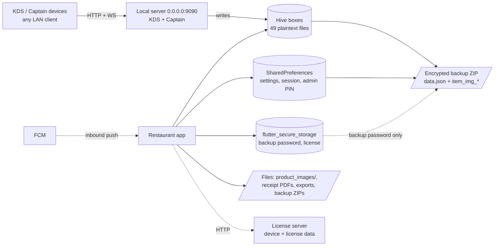
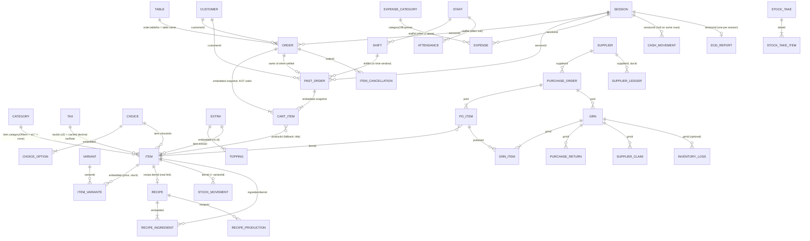

# Restaurant Database — 01 Overview

> **Scope:** the **restaurant** mode of Bill Berry Lite (Flutter package `billberrylite`, repo `D:\flutter\UniPOSs`, branch `refactor/shared-code-consolidation`).
> **Method:** static reading of the source on 2026-10-19. Nothing here was run on a device.
> **Citations:** `path:line`, relative to the repo root (`lib/` is written out). Line numbers drift, so search for the symbol if a line looks wrong.
> **Shared parts:** many boxes and models are shared with retail. Where the retail docs already describe a shared box or model, this file describes only its **restaurant usage** and links to the retail doc.

**How claims are marked**

| Mark | Meaning |
|---|---|
| *(no mark)* | **Confirmed** from the code. A `path:line` is given. |
| **(inferred)** | A conclusion drawn from reading the code. It was not executed. |
| **(unverified)** | Not checked. Treat it as a lead, not a fact. |

---

## 0. How to read these five documents

| # | Document | Read it when you want to… |
|---|---|---|
| 01 | **This file**: overview | Understand the technology, startup, every box, every model, storage boundaries, the local server, backup, and the main risks. |
| 02 | [02_RESTAURANT_DATABASE_MODELS.md](02_RESTAURANT_DATABASE_MODELS.md) | See every field of every restaurant model (HiveField index, type, nullability, default, meaning). |
| 03 | [03_RESTAURANT_DATABASE_FLOWS.md](03_RESTAURANT_DATABASE_FLOWS.md) | Follow a business action (add item, place order, KOT, settle, refund, GRN, EOD, captain order, backup/restore) box by box. |
| 04 | [04_RESTAURANT_DATABASE_RELATIONSHIPS.md](04_RESTAURANT_DATABASE_RELATIONSHIPS.md) | See how records point at each other (ids, names used as keys, snapshots, dangling references). |
| 05 | [05_RESTAURANT_DATABASE_LEARNING_GUIDE.md](05_RESTAURANT_DATABASE_LEARNING_GUIDE.md) | Learn step by step as a new developer, with exercises and rules of thumb. |

Suggested order for a new developer: **01 → 05 → 02 → 04 → 03**.

**Retail equivalents** (shared boxes and models are documented there in full):
[01 Overview](../retail/01_RETAIL_DATABASE_OVERVIEW.md) · [02 Models](../retail/02_RETAIL_DATABASE_MODELS.md) · [03 Flows](../retail/03_RETAIL_DATABASE_FLOWS.md) · [04 Relationships](../retail/04_RETAIL_DATABASE_RELATIONSHIPS.md) · [05 Learning guide](../retail/05_RETAIL_DATABASE_LEARNING_GUIDE.md).

---

## 1. What kind of database is this?

Restaurant data is stored in **Hive**, a key-value database written in pure Dart. The general rules (box = file, typed vs raw boxes, TypeAdapters, no SQL/joins/foreign keys/transactions) are the same as retail: see [retail §1](../retail/01_RETAIL_DATABASE_OVERVIEW.md#1-what-kind-of-database-is-this).

Restaurant-specific facts:

- **49 boxes are open** in restaurant mode: 1 `appConfigBox` + 11 common + 37 restaurant-phase (§3). `lib/core/init/hive_init.dart:164-203` opens 11, `:764-848` opens 37 (grep count of `openBox` in those ranges: 11 and 37).
- **5 boxes are raw (untyped)**: `appConfigBox`, `storebox`, `app_state`, `appCounters`, `dayManagementBox`. The other 44 are typed.
- **No lazy boxes.** There is no `openLazyBox` in `lib/`; every box is loaded into memory when opened.
- **No encryption at rest.** No `HiveAesCipher` / `encryptionCipher` / `hive_key` anywhere in `lib/` (grep: 0 hits). The legacy encrypted-import path (`import.dart` + a `hive_key` in secure storage) described in `docs/modules/database.md` **no longer exists**: the folder `lib/presentation/widget/componets/restaurant/componets/import/` holds only `saveimage.dart`, `test_data_generator.dart`, `test_data_screen.dart` and `web_file_saver*.dart`; only a commented import remains (`lib/domain/services/common/auto_backup_service.dart:14`).
- **A second writer exists besides the UI:** the **local server on port 9090** (KDS + Captain) writes orders, stock, tables and counters straight into Hive (§6.5).
- **There is no KOT model and no payment box.** KOTs are fields on the order (`kotNumbers`, `kotBoundaries`, `kotStatuses`, `kotTimestamps`, `lib/data/models/restaurant/db/ordermodel_309.dart:75-123`); payment legs are a JSON string (`paymentListJson`) on the order.

### 1.1 Packages (`pubspec.yaml`)

| Package | Version | `pubspec.yaml` line | What restaurant uses it for |
|---|---|---|---|
| `hive` / `hive_flutter` | ^2.2.3 / ^1.1.0 | 42-43 | All domain data; `Hive.initFlutter()` |
| `hive_generator` / `build_runner` (dev) | ^2.0.1 / ^2.4.7 | 140-141 | Generates the `*.g.dart` adapters |
| `shared_preferences` | ^2.2.2 | 64 | Settings toggles, print/order settings, login session, admin PIN (§6.2) |
| `flutter_secure_storage` | ^10.0.0 | 96 | Backup password, license token and manifest (§6.3) |
| `encrypt` / `crypto` / `cryptography` | ^5.0.3 / ^3.0.3 / ^2.7.0 | 97 / 65 / 66 | Backup AES; PIN and backup SHA-256; Ed25519 manifest |
| `archive` | ^3.6.1 | 131 | WinZip-AES backup ZIP |
| `path_provider` / `path` | ^2.1.1 / ^1.9.0 | 63 / 99 | Documents, Downloads, `product_images/` |
| `file_picker` / `file_selector` / `share_plus` | ^10.3.2 / ^1.0.3 / ^12.0.1 | 38 / 68 / 67 | Picking and sharing backups |
| `shelf`, `shelf_router`, `shelf_web_socket`, `web_socket_channel` | ^1.4.1, ^1.1.4, ^2.0.1, ^3.0.3 | 105-108 | **Local KDS / Captain server on :9090** |
| `http` | ^1.2.0 | 39 | License API; bulk-import image download |
| `firebase_core` / `firebase_messaging` | ^4.12.1 / ^16.4.3 | 118-119 | FCM inbound push |
| `flutter_local_notifications` | ^17.2.3 | 114 | OS notifications |
| `image_picker` | ^1.1.2 | 81 | Item photo → `Items.imageBytes` |
| `uuid` | ^4.3.3 | 44 | Record ids, default payment methods |

---

## 2. Database technology rules that matter here

| Rule | Why it matters in restaurant |
|---|---|
| **No migrations, no schema version.** | `appConfigBox['appVersion']` exists but nothing writes it (shared fact, [retail §2.5](../retail/01_RETAIL_DATABASE_OVERVIEW.md#25-business-mode)). New fields must be nullable or carry `@HiveField(n, defaultValue: …)`. |
| **Few restaurant fields have a Hive default.** | Confirmed defaults: `Items` f23 `lowStockAlertEnabled=false`, f24 `isFavorite=false` (`itemmodel_302.dart:86,89`); `EndOfDayReport` f28 `0.0` (`eodmodel_317.dart:115`); `RecipeIngredientModel` f3 `0.0`, f5 `1.0`; `RecipeModel` f9 `0`; `RestaurantSupplierModel` f8 `0.0`; `RestaurantSupplierLedgerEntryModel` f13 `0`. |
| **A non-nullable field added late throws on old records.** | Examples with no default: `Items.isSoldByWeight` f16, `Items.editCount` f20 (`itemmodel_302.g.dart:28,40`), `Category.editCount` f6, `OrderModel.itemCountAtLastKot` f22, `CartItem.productId` f15 (hard cast, `cartmodel_308.g.dart:23`). Pre-release, so breaking local data is accepted (project memory). |
| **Never reuse a typeId or a HiveField index.** | Retired indices: `CartItem` **2**, `Category` **2** ("was imagePath — removed", `categorymodel_300.dart:13`). Retired typeId 101 (§5.3). |
| **int ↔ double is always breaking.** | `CartItem.quantity` is `int` (`cartmodel_308.g.dart:25`) while stock (`Items.stockQuantity`) is `double`. Weighed items are sold as `quantity 1` with the whole line amount in `price`. |
| **No cross-box transactions.** | Place order, settle, void, refund, GRN, production, stock take and EOD are all sequences of separate writes (§10). |
| **Box key ≠ record id in some boxes.** | `cart_box` and `paymentMethodsBox` use auto-int keys by design; `itemBoxs` may hold int-keyed rows from dev generators; `extra` and `restaurant_eodBox` get int keys **after a restore** (§7.3). |

---

## 3. Startup: how the database is opened

### 3.1 The sequence

`lib/main.dart` → `_initializeApp()` (`lib/main.dart:111-260`):

| Step | Call | Line | What it does |
|---|---|---|---|
| 1 | `HiveInit.init()` | `main.dart:128` | `Hive.initFlutter()` (no subfolder) + `_registerCommonAdapters()` (`hive_init.dart:104-111`, common adapters `:114-161`). |
| 2 | `AppConfig.init()` | `main.dart:132` | Opens raw `appConfigBox` (`lib/core/config/app_config.dart:54`), reads `businessMode`. |
| 3 | `HiveInit.openCommonBoxes()` | `main.dart:138` | Opens 11 common boxes (`hive_init.dart:164-203`); seeds 6 default payment methods if empty (`:197-198, 206-264`). |
| 4 | `HiveInit.initializeBusinessBoxes()` | `main.dart:142` | Restaurant → `registerRestaurantAdapters()` (`hive_init.dart:569-761`) + `openRestaurantBoxes()` (`:764-848`) (`:856-858`). |
| 5 | `setupServiceLocator()` | `main.dart:148` | Common DI, then `registerBusinessDependencies(restaurant)` (`lib/core/di/service_locator.dart:230-234`; restaurant block `:382-499`). |
| 5b | `LicenseStore.loadCachedLicense()` / `checkStatusInBackground()` | `main.dart:152,157` | Secure-storage reads, background HTTP. |
| 6 | `Future.wait([AppSettings.load, PrintSettings.load, DecimalSettings.load, OrderSettings.load, CurrencyHelper.load, RestaurantSession.load])` | `main.dart:184-191` | All SharedPreferences. |
| 6a | `RestaurantSession.initLifecycle()` | `main.dart:192` | Auto-logout on pause/resume. |
| 6b | `AutoBackupService.initialize()` | `main.dart:196` | Hourly timer (§7.4). Imported through the deprecated 3-line re-export `lib/domain/services/restaurant/auto_backup_service.dart` (`main.dart:24`). |
| 6c | `startServer()` (fire-and-forget) | `main.dart:202-206` | Binds `0.0.0.0:9090` (`lib/server/server.dart:64-96`). |
| 7 | `LocalNotificationService.init`, `notificationStore.load`, `NotificationSync.runStartupChecks`, FCM init | `main.dart:232-251` | Both modes; failures are non-fatal. |
| Later | `StartOfDayBackupPrompt.show(context)` | `lib/presentation/screens/restaurant/welcome_Admin.dart:59` | Once per app session on the admin dashboard; may run a full backup (§7.4). |

```mermaid
sequenceDiagram
    autonumber
    participant Main as main.dart _initializeApp
    participant HI as HiveInit
    participant AC as AppConfig
    participant DI as setupServiceLocator
    participant Prefs as Settings (SharedPreferences)
    participant AB as AutoBackupService
    participant Srv as Local server :9090
    participant UI as welcome_Admin

    Main->>HI: init()  [Hive.initFlutter + 9 common adapters]
    Main->>AC: init()  [open appConfigBox, read businessMode]
    Main->>HI: openCommonBoxes()  [11 boxes, seed payment methods]
    Main->>HI: initializeBusinessBoxes()
    alt AppConfig.isRestaurant
        HI->>HI: registerRestaurantAdapters()  [45 adapters; 123 NOT registered]
        HI->>HI: openRestaurantBoxes()  [37 boxes, no fixups]
    end
    Main->>DI: setupServiceLocator() → registerBusinessDependencies(restaurant)
    Main->>Main: LicenseStore.loadCachedLicense / checkStatusInBackground
    Main->>Prefs: AppSettings, PrintSettings, DecimalSettings, OrderSettings, CurrencyHelper, RestaurantSession .load()
    Main->>AB: initialize()  [Timer.periodic 1h + check after 10 s]
    Main-)Srv: startServer()  [fire-and-forget, binds 0.0.0.0:9090]
    Main->>Main: notifications + FCM (non-fatal)
    Note over UI: Later, on the admin dashboard
    UI->>UI: StartOfDayBackupPrompt.show()  [once per session; may export a backup]
```

### 3.2 Adapter registration (`registerRestaurantAdapters`, `hive_init.dart:569-761`)

- Calls `_registerCommonAdapters()` first (`:574`), then registers **45** restaurant adapters (grep count in `:569-761`): typeIds 100, 102-117, 118-121 and 124 (EOD parts), 122 (TestBill), 125, 126, 128, 129, 131, 134, 135, 136, 137, 138-149 and 185. Each is guarded by `isAdapterRegistered`.
- Common adapters (`hive_init.dart:114-161`): 2, 3, 4, 5 (read-only legacy), 6, 127, 130, 132, 133.
- **Not registered anywhere:** typeId **123** `TestBillItem` (embedded in 122). Writing a `TestBillModel` with items would throw `HiveError: unknown type` **(inferred)**; nothing writes one today.
- **Stale in-code comments:** the doc comment says "typeIds: 100-149" (`:568`) but 185 is also registered; "OrderTypeSummary - 18 … CashReconciliation - 22" (`:643-662`) are really 118-121/124; "TestBill - 118" (`:663`) is really 122 (`lib/core/constants/hive_type_ids.dart:82`).

### 3.3 Startup fixups

The restaurant phase has **no** data-changing fixups (no box deletes or recoveries, unlike retail's attribute cleanup and `billingTabs` recovery). The only startup mutation is the common payment-method seeding (`hive_init.dart:197-198, 206-264`).

### 3.4 Other ways the boxes get opened

| Entry point | Where | Notes |
|---|---|---|
| Setup wizard | `HiveInit.initializeForMode(BusinessMode)` `hive_init.dart:865-879` | Skips if the `areRestaurantBoxesOpen` getter is true; that getter checks only 10 boxes (`:898-913`). Boxes are never closed on a mode switch **(inferred)**. |
| Backup restore | `_ensureBoxesOpened('restaurant')` `lib/domain/services/common/unified_backup_service.dart:682-695` | Opens restaurant boxes if `categories` **or** `itemBoxs` is closed. |
| Settings restore end | `lib/presentation/screens/restaurant/Settings/settingsScreen.dart:1748-1770` | Shows "Please close and restart", then `exit(0)`. No in-process DI rebuild. `exit` is not supported on web **(inferred)**. |
| Dev data generator | `ComprehensiveDataGenerator` `lib/domain/services/restaurant/comprehensive_data_generator.dart:795-890` | Reads and clears 11 boxes directly; used by `data_generator_screen.dart:134` and `performance_statistics_report.dart:31-32`. |

### 3.5 Business mode and file location

Same as retail: `appConfigBox['businessMode']` is `'none' | 'restaurant' | 'retail'`, set by the wizard via `forceSetBusinessMode` and overwritten by a restore. Box files sit at the root of the application documents folder (`<lowercased name>.hive` + `.lock`); on Windows this is the user's (possibly OneDrive-redirected) Documents folder. See [retail §2.5-2.6](../retail/01_RETAIL_DATABASE_OVERVIEW.md#25-business-mode).

---

## 4. Complete box inventory (49 boxes open in restaurant)

**49 = 1 `appConfigBox` + 11 common boxes + 37 restaurant-phase boxes.** Raw boxes: 5. Typed: 44. Lazy: 0. Encrypted: 0.

Legend: **T** = typed `Box<Model>`, **U** = untyped/raw `Box`. "Shared" = the same physical box (same string name) is used by retail mode. "Backup" = included in the restaurant backup (§7). "Restore write": `putAll(id)` keeps string keys; `addAll`/`add()` creates auto-increment int keys.

### 4.1 Master table

| # | Constant (`HiveBoxNames.*`) | String name | Model (typeId) | T/U | Hive key used by the app | Shared? | Purpose | Main accessor | Backup? (restore write) |
|---|---|---|---|---|---|---|---|---|---|
| 0 | — (`AppConfig`) | `appConfigBox` | raw | U | fixed keys | Yes | Business mode, setup flag | `AppConfig` (`app_config.dart:45-59`) | Yes (put each key) |
| **Common phase** (`hive_init.dart:164-203`) |||||||||
| 1 | `storeBox` | `storebox` | raw (legacy) | U | none found | Yes | Legacy; no writer found | backup only | Yes (put each key) |
| 2 | `appState` | `app_state` | raw | U | `auto_backup_enabled`, `last_backup_date` | Yes | Auto-backup flags | `AutoBackupService` (`auto_backup_service.dart:20-21`) | Yes (put each key) |
| 3 | `taxBox` | `taxBox` | `TaxDetails` (2) | T | `'taxDetails'` | Yes | Shop-wide tax switches | `TaxDetailsRepository` (`tax_details_repository.dart:8`) | Yes (**`add()`**, RR-03) |
| 4 | `businessTypeBox` | `businessTypeBox` | `BusinessType` (3) | T | `'selectedBusinessType'` | Yes | Chosen business type | `BusinessTypeRepository` | Yes (**`add()`**, RR-03) |
| 5 | `businessDetailsBox` | `businessDetailsBox` | `BusinessDetails` (4) | T | `'businessDetails'` | Yes | Store profile, logo bytes, FSSAI no., tax flags | `BusinessDetailsRepository` | Yes (**`add()`**, RR-03) |
| 6 | `appCounters` | `appCounters` | raw counters | U | named keys (§4.4) | Yes | KOT, bill, order and document numbers | `OrderRepository`, `HiveOrders`, `DocumentNumberService` | Yes (clear + put each key) |
| 7 | `restaurantPrinters` | `restaurantPrintersBox` | `SavedPrinterModel` (130) | T | `printer.id` | Yes | Paired printers | `PrinterRepository` (`printer_repository.dart:22,27,102`) | Yes (`putAll(id)`) |
| 8 | `appNotifications` | `restaurantNotificationsBox` | `AppNotificationModel` (133) | T | `record.id` | Yes | In-app notifications | `NotificationRepository` | **No** |
| 9 | `shift` | `shiftBox` | `ShiftModel` (127) | T | `shift.id` | Yes | Staff shifts | `ShiftRepository` | Yes (`putAll(id)`) |
| 10 | `attendance` | `restaurantAttendanceBox` | `AttendanceModel` (132) | T | `record.id` | Yes | Clock in/out | `AttendanceRepository`; direct in `shift_store.dart:249,287`, `endday.dart:749` | Yes (`putAll(id)`) |
| 11 | `paymentMethods` | `paymentMethodsBox` | `PaymentMethod` (6) | T | **auto-int** (`box.add`, `hive_init.dart:262`) | Yes | Payment methods | `PaymentMethodRepository` | Yes (`add()`, consistent) |
| **Restaurant phase** (`openRestaurantBoxes`, `hive_init.dart:764-848`, in open order) |||||||||
| 12 | `category` | `categories` | `Category` (100) | T | `category.id` | **Yes** | Menu categories | `CategoryRepository` (`category_repository.dart:29,44,49,98`) | Yes (`putAll(id)`) |
| 13 | `restaurantItems` | `itemBoxs` | `Items` (102) + embedded `ItemVariante` (112) | T | `item.id`; update writes under the **existing** key (`item_repository.dart:55-66`) | No | Menu items, raw materials, prep items; **holds all stock** and item photo bytes | `ItemRepository`, `ItemStore` | Yes (`putAll(id)`; images patched from ZIP) |
| 14 | `restaurantExtras` | `extra` | `Extramodel` (103) + embedded `Topping` (104) | T | `extra.Id` (`extra_repository.dart:11,16,31,36`) | No | Paid add-on groups | `ExtraRepository`, `HiveExtra` | Yes (**`addAll`**, RR-02) |
| 15 | `restaurantVariants` | `variante` | `VariantModel` (105) | T | `variant.id` (`variant_repository.dart:10,15,30,35`) | No | Global variant names (Half/Full) | `VariantRepositoryRes` | Yes (`putAll(id)`) |
| 16 | `restaurantChoices` | `choice` | `ChoicesModel` (106) + embedded `ChoiceOption` (107) | T | `choice.id` (`choice_repository.dart:11,16`) | No | Free modifier groups | `ChoiceRepository` | Yes (`putAll(id)`) |
| 17 | `restaurantCart` | `cart_box` | `CartItem` (108) | T | **auto-int**; `add` / `putAt(index)` / `deleteAt(index)` (`cart_repository.dart:17,126-155`) | No | Working cart lines | `CartRepository`, `CartStoreRes` | Yes (`addAll`, consistent) |
| 18 | `restaurantOrders` | `orderBox` | `OrderModel` (109) + embedded `CartItem` | T | `order.id`; update scans keys (`order_repository.dart:17,25,35,49-66`) | No | **Active (open) orders** with KOT history | `OrderRepository`, `HiveOrders`, server handlers | Yes (`putAll(id)`, but 5 fields lost, RR-04) |
| 19 | `staff` | `staffBox` | `StaffModel` (110) | T | `staff.id` | **Yes** | Staff, role, hashed PIN | `StaffRepository` | Yes (`putAll(id)`) |
| 20 | `restaurantTables` | `tablesBox` | `TableModel` (111) | T | `table.id` = **the table's display name** (`table_repository.dart:11,21,59`) | No | Tables and their live status | `TableRepository`, `TableStore` | Yes (`putAll(id)`) |
| 21 | `restaurantPastOrders` | `pastorderBox` | `PastOrderModel` (113) + embedded `CartItem` | T | `pastOrder.id` (`past_order_repository.dart:11,21,31,36`) | No | **Settled bills and voids** (the restaurant "sale") | `PastOrderRepository`, `PastOrderStore` | Yes (`putAll(id)`) |
| 22 | `tax` | `taxes` | `Tax` (114) | T | `tax.id` | **Yes** | Tax rates | `TaxRepository` | Yes (`putAll(id)`) |
| 23 | `restaurantExpenseCategory` | `restaurant_expenseCategory` | `ExpenseCategory` (115) | T | `id` | No (retail: `expenseCategory`) | Expense categories | `ExpenseCategoryRepository`, `HiveExpenseCat` | Yes (`putAll(id)` into **current-mode** box, RR-17) |
| 24 | `restaurantExpense` | `restaurant_expenseBox` | `Expense` (116) | T | `id` (`expense_repository.dart:13,18,33,38`) | No (retail: `expenseBox`) | Expenses | `ExpenseRepository`, `HiveExpenceL` | Yes (same, RR-17) |
| 25 | `restaurantEOD` | `restaurant_eodBox` | `EndOfDayReport` (117) + embedded 118-121, 124 | T | `reportId` (`eod_repository.dart:11-13,18,57,62`) | No (retail: `eodBox`) | End-of-day snapshots | `EodRepository`, `HiveEod` | Yes (**`addAll`**, RR-02) |
| 26 | `dayManagementBox` | `dayManagementBox` | raw | U | 6 fixed keys (§4.4) | Yes | Current day/session pointer | `DayManagementService` (static) | **No** |
| 27 | `testBillBox` | `testBillBox` | `TestBillModel` (122) + unregistered 123 | T | auto-int (`hive_testbill.dart:17,23`) | No | **Dead** | none | Yes (`addAll`) |
| 28 | `customer` | `customers` | `Customer` (125) | T | `customerId` | **Yes** | Customers, loyalty | `CustomerRepository` | Yes (`putAll(customerId)`) |
| 29 | `restaurantCashMovements` | `cashMovementsBox` | `CashMovementModel` (128) | T | `movement.id` | Yes | Cash drawer ledger | `CashMovementRepository`; direct in `day_management_service.dart`, `eod_service.dart:204,557` | Yes (`putAll(id)`) |
| 30 | `restaurantStockMovements` | `stockMovementsBox` | `StockMovementModel` (126) | T | `movement.id` | Yes | Stock ledger | `StockMovementRepository` (new'd ad hoc) | **No** (RR-01) |
| 31 | `restaurantCashHandovers` | `cashHandoversBox` | `CashHandoverModel` (129) | T | `handover.id` | No | Drawer handovers (UI unreachable) | `CashHandoverRepository` | Yes (`putAll(id)`) |
| 32 | `restaurantSessions` | `restaurantSessionsBox` | `RestaurantSessionModel` (131) | T | `sessionId` | Yes | Day sessions | `DayManagementService` | Yes (`putAll(sessionId)`) |
| 33 | `restaurantItemCancellations` | `restaurantItemCancellationsBox` | `ItemCancellationModel` (134) | T | `record.id` | No | Audit of items removed from a KOT'd order | `ItemCancellationRepository` | **No** (RR-01) |
| 34 | `restaurantRecipes` | `restaurantRecipesBox` | `RecipeModel` (135) + embedded 136 | T | `recipe.id` | No | Bills of materials | `RecipeRepository` (no store) | Yes (`putAll(id)`) |
| 35 | `restaurantRecipeProductions` | `restaurantRecipeProductionsBox` | `RecipeProductionModel` (137) | T | `production.id` | No | Production batch log | `RecipeProductionRepository` | Yes (`putAll(id)`) |
| 36 | `restaurantSuppliers` | `restaurantSuppliersBox` | `RestaurantSupplierModel` (138) | T | `supplierId` | No | Suppliers + balance | `RestaurantSupplierRepository` | Yes (`putAll`) |
| 37 | `restaurantPurchaseOrders` | `restaurantPurchaseOrdersBox` | (139) | T | `poId` | No | PO headers | `RestaurantPurchaseOrderRepository` | Yes (`putAll`) |
| 38 | `restaurantPurchaseOrderItems` | `restaurantPurchaseOrderItemsBox` | (140) | T | `poItemId` | No | PO lines | same | Yes (`putAll`) |
| 39 | `restaurantGrns` | `restaurantGrnsBox` | (141) | T | `grnId` | No | GRN headers | `RestaurantGRNRepository` | Yes (`putAll`) |
| 40 | `restaurantGrnItems` | `restaurantGrnItemsBox` | (142) | T | `grnItemId` | No | GRN lines | same | Yes (`putAll`) |
| 41 | `restaurantPurchaseReturns` | `restaurantPurchaseReturnsBox` | (143) | T | `returnId` | No | Damaged goods sent back | `RestaurantPurchaseReturnRepository` | Yes (`putAll`) |
| 42 | `restaurantPurchaseReturnItems` | `restaurantPurchaseReturnItemsBox` | (144) | T | `returnItemId` | No | Lines | same | Yes (`putAll`) |
| 43 | `restaurantSupplierClaims` | `restaurantSupplierClaimsBox` | (145) | T | `claimId` | No | Damage claims | `RestaurantSupplierClaimRepository` | Yes (`putAll`) |
| 44 | `restaurantSupplierClaimItems` | `restaurantSupplierClaimItemsBox` | (146) | T | `claimItemId` | No | Lines | same | Yes (`putAll`) |
| 45 | `restaurantInventoryLosses` | `restaurantInventoryLossesBox` | (147) | T | `lossId` | No | Written-off value (never moves stock) | `RestaurantInventoryLossRepository` | Yes (`putAll`) |
| 46 | `restaurantStockTakes` | `restaurantStockTakesBox` | (148) | T | `takeId` | No | Stock count sessions | `RestaurantStockTakeRepository` | Yes (`putAll`) |
| 47 | `restaurantStockTakeItems` | `restaurantStockTakeItemsBox` | (149) | T | `takeItemId` | No | Counted lines | same | Yes (`putAll`) |
| 48 | `restaurantSupplierLedger` | `restaurantSupplierLedgerBox` | `RestaurantSupplierLedgerEntryModel` (185) | T | `entryId` | No | Supplier payable journal | `RestaurantSupplierLedgerRepository` | Yes (`putAll(entryId)`) |

Sources: open lines `hive_init.dart:168-194` (common) and `:770-845` (restaurant); keys from each repository as cited; backup map `unified_backup_service.dart:712-1056` (restaurant export), `:1474-1594` (common export), `:2169-2553` (restaurant restore), `:1910-2028` (common restore).

**Good to know**
- Three repositories hard-code the box string instead of the constant: `variant_repository.dart:10` (`'variante'`), `choice_repository.dart:11` (`'choice'`), `extra_repository.dart:11` (`'extra'`); `cart_repository.dart:17` uses `'cart_box'`. Renaming a constant will not rename those boxes.
- `HiveBoxNames.allRestaurantBoxes` (`lib/core/constants/hive_box_names.dart:353-394`) lists 40 names; it omits `dayManagementBox` and `restaurantNotificationsBox` and includes 4 common ones. **No code uses it.** Do not trust it as an inventory.
- `EodRepository`, `ExpenseRepository`, `ExpenseCategoryRepository`, `hive_eod.dart` and `hive_expensecategory.dart` choose the box name at run time with `AppConfig.isRetail ? … : …` (`eod_repository.dart:11-13`, `expense_repository.dart:11-13`). The helper getters in `hive_box_names.dart:288-306` have no callers.

### 4.2 Per-box property cards

Columns: **Purpose · Model · Primary id · Relationships · Created by · Read by · Updated by · Deleted by · Persistence · Restaurant usage.**
Persistence: *master* (edited, can be deleted), *document* (business history), *append-only*, *working* (temporary), *singleton*, *raw* (key-value).

#### Menu

| Box | Purpose | Model | Primary id | Relationships | Created by | Read by | Updated by | Deleted by | Persistence | Restaurant usage |
|---|---|---|---|---|---|---|---|---|---|---|
| `itemBoxs` | One model for menu items, raw materials, semi-finished prep and recipe dishes (`productType` f28). Photo as bytes (f2). Stock on the item (f14) or on embedded variants | Items + embedded ItemVariante | `id` (UUID v4, `add_item_form_state.dart:181`) | `categoryOfItem` → Category.id (`''` = none); `taxIds` → Tax.id (≤2) with cached decimal `taxRate`; `choiceIds`, `extraId`, `defaultChoiceOptionIds`; `variant[].variantId` → VariantModel.id; RecipeModel.itemId points here | `ItemStore.addItem` (Add Item sheet, setup wizard, `AddProductFormStore`, bulk import); dev generators write int keys directly | `ItemStore` (POS menu, Manage Menu, Inventory), `CartRepository`, `InventoryService`, `/captain/menu`, reports | `ItemStore.updateItem` (Edit Item, favourite, tax apply, manual stock); `ItemStore.applyStockDelta` (sale, recipe cascade, void/refund, GRN, production); `CategoryRepository.deleteCategory` (re-parent to `''`) | `ItemStore.deleteItem` → `ItemRepository.deleteItem` (hard delete by id key only; no reference guard) | Master; soft hide via `isEnabled=false` | Every screen |
| `variante` | Global variant-name list ("Half", "Full") | VariantModel | `id` (UUID) | Referenced by `ItemVariante.variantId`, `Topping.variantPrices` keys | `VariantStore.addVariant` (`variant_tab.dart:304`, selection screen), bulk import | POS options dialog, stock deduction (**by name**) | Rename (drops audit fields, `variant_tab.dart:298-302`) | `VariantStore.deleteVariant` (no in-use check) | Master | Variants tab |
| `choice` | Free modifier groups ("Spice level") with embedded options | ChoicesModel + ChoiceOption | `id` (UUID) | `Items.choiceIds`, `defaultChoiceOptionIds` → option id | `ChoiceStore.addChoice` | POS options dialog | `updateChoice` (rebuilt model) | `deleteChoice` (no in-use check) | Master | Choices tab |
| `extra` | Paid add-on groups with embedded toppings | Extramodel + Topping | `Id` (UUID; capital I) | `Items.extraId`, `Items.extraConstraints` keys | `ExtraStore` | POS options dialog via `getExtraById` | Rebuilt model (resets `isEnabled`, drops audit) | `deleteExtra` (no in-use check) | Master | Extras tab |
| `categories` | Categories (shared box) | Category | `id` (restaurant: UUID) | `Items.categoryOfItem` | Add category dialog, setup screen, bulk import (restaurant never seeds defaults) | `CategoryStore`, POS sections | Rename with duplicate guard and audit (`edit_category.dart:43-66`) | `CategoryStore.deleteCategory` — items re-parented to `''`, **never deleted** (`category_repository.dart:72-99`) | Master | Category tab. Retail usage: [retail §3.2](../retail/01_RETAIL_DATABASE_OVERVIEW.md#catalog) |
| `taxes` | Tax rates (shared) | Tax | `id` (UUID) | `Items.taxIds`; rate stored on items as a **decimal sum** | Tax settings, selection screen, bulk import | Tax settings, Edit Item | Edit does **not** propagate to items | Unguarded delete; items keep billing the old rate (RR-13) | Master | Tax settings |
| `restaurantRecipesBox` | Recipe (BOM) for semi-finished and recipe-based items | RecipeModel + RecipeIngredientModel | `id` (UUID) | `itemId` → Items.id (**the real link**; `Items.recipeId` is write-only); ingredients → Items.id | Edit Item only (`edit_item.dart:583-589`) | `InventoryService` (sale cascade, availability, production), menu, recipe reports | Same save | `deleteRecipeForItem` when the type changes; **not** on item delete (orphan) | Master | Recipes, food cost |

#### Tables & orders

| Box | Purpose | Model | Primary id | Relationships | Created by | Read by | Updated by | Deleted by | Persistence | Restaurant usage |
|---|---|---|---|---|---|---|---|---|---|---|
| `cart_box` | Working cart lines | CartItem | auto-int key; `id` field = UUID (weighed items reuse item id) | `productId` → Items.id | `CartRepository.addToCart` (merge by `CartItem.==` or `add`) | `CartStoreRes.loadCartItems`, cart screen | `updateQuantity` (`putAt`) | `removeFromCart` (`deleteAt`), `clearCart` after every place/settle | Working | POS cart |
| `orderBox` | Active orders; items embedded in KOT order; KOT data as fields | OrderModel | `id` (UUID on POS; **epoch-ms** on server paths, `captain_handler.dart:248`, `order_handler.dart:24`) | `tableNo` → TableModel.id (= name); `customerId`; `sessionId` | `TA._placeOrder` (`takeaway.dart:1370`), `POST /orders`, `POST /captain/send-order` | `OrderStore`, Active Orders, tables, KDS, EOD resolution | `OrderStore.updateOrder` (add-on KOT, cancel, KOT status, pay-before-serve); `HiveOrders.updateOrder` (captain, direct Hive) | After moving to `pastorderBox`; immediate cancel of the last item; table merge (source); captain full cancel; crash reconcile in `OrderStore.loadOrders` (`order_store.dart:240-252`) | Working document | Active Orders, KDS |
| `pastorderBox` | Settled bills, voids and refunds | PastOrderModel | `id` (= active order id, or new UUID for direct / quick settle) | `customerId`, `sessionId`, `shiftId`, `tableNo` | 7 writers: `CD.completeOrder`, `CD._placeOrder` (settle), Quick Settle, `_moveOrderToPast`, EOD complete-service, Active-Orders void, EOD void | EOD, reports, cash drawer, `ShiftRepository._restaurantTxns`, reprints | `RefundService.processRefund` (in place) | **Never** by the UI | Document | Past Orders, all sales reports |
| `tablesBox` | Tables and live status | TableModel | `id` = display name | `currentOrderId` → OrderModel.id (set only by server paths); orders point back by `tableNo` | `TableStore.addTable` (plan-gated) | Table screen, captain | `updateTableStatus` (repo nulls `currentOrderId` if omitted, RR-15) | Delete (blocked when occupied); **rename = delete + add** (allowed when occupied, RR-12) | Master | Tables tab |

#### KOT & cancellations

| Box | Purpose | Model | Primary id | Relationships | Created by | Read by | Updated by | Deleted by | Persistence | Restaurant usage |
|---|---|---|---|---|---|---|---|---|---|---|
| (none — KOT) | KOTs are **not** a model. `kotNumbers`, `kotBoundaries` (cumulative end index), `kotStatuses`, `kotTimestamps`, `itemCountAtLastKot` live on OrderModel / PastOrderModel | — | KOT number from `appCounters` | — | Place order, add-on, settle-with-new-items | KDS `/kds/orders`, KOT print | KOT status updates | — | — | Kitchen tickets |
| `restaurantItemCancellationsBox` | Audit row per item removed or reduced on a KOT'd order | ItemCancellationModel | `id` (UUID) | `orderId` → order; `sessionId` | `takeaway.dart:1136-1160` (immediate cancel), `:1761-1793` (correction on update) | Item Cancellation report (`itemCancellationReport.dart:67`, repo directly) | Never | Never | Append-only | Cancel audit. **Not** written by Active-Orders `_cancelKotItem` or captain modify (RR-10); **not backed up** |

#### Customers

| Box | Purpose | Model | Primary id | Relationships | Created by | Read by | Updated by | Deleted by | Persistence | Restaurant usage |
|---|---|---|---|---|---|---|---|---|---|---|
| `customers` | Customers and loyalty (shared box) | Customer | `customerId` (restaurant: **UUID v4**) | `OrderModel.customerId`, `PastOrderModel.customerId` | `TA._getOrCreateCustomer`, `CD._autoSaveNewCustomer`, customer screens (gated by `EntKeys.customers`) | Checkout picker, customer reports | `updateCustomerVisit` (visits, points; twice per settle when points are redeemed), refund `addLoyaltyPoints` | Hard delete from 3 screens, unguarded (`customer_store.dart:191-203`) | Master | Restaurant has **no credit**: f18/f19 stay 0. Field detail: [retail 02](../retail/02_RETAIL_DATABASE_MODELS.md) |

#### Day, cash, EOD & expenses

| Box | Purpose | Model | Primary id | Relationships | Created by | Read by | Updated by | Deleted by | Persistence | Restaurant usage |
|---|---|---|---|---|---|---|---|---|---|---|
| `dayManagementBox` | Day flags + `currentSessionId` | raw | 6 fixed keys | → session | `DayManagementService.startSession` | Billing gates, EOD | `startSession`, `endSession`, `markDayEnded` | `currentSessionId` key deleted on `endSession` | Raw | Start Day / EOD |
| `restaurantSessionsBox` | Day sessions (shared) | RestaurantSessionModel | `sessionId` (UUID) | Stamped on orders, past orders, expenses, cash movements, cancellations, EOD | `startSession` | `getCurrentSession`, EOD | `endSession` (`closingCash` = **counted** cash, `endday.dart:848`) | None found | Document | Every day |
| `cashMovementsBox` | Drawer ledger (shared) | CashMovementModel | `id` (UUID) | `sessionId` (null on opening, opening-modified and safe-drop rows) | `CashMovementStore.addMovement/addAdjustment`, `startSession` (opening row), EOD safe drop | Cash drawer, `EODService` (direct Hive), history screen (direct Hive) | Never | Never | Append-only | Cash in/out, EOD. `adjustment` rows store a **signed** amount |
| `cashHandoversBox` | Two-step handover | CashHandoverModel | `id` (UUID) | staff **names** | `CashHandoverStore.createHandover` — **its dialogs are never constructed** | Drawer "Handover History", history screen | `receiveHandover` (unreachable) | — | Document | Effectively empty |
| `restaurant_eodBox` | EOD snapshot per session | EndOfDayReport + embedded summaries | `reportId` (UUID) | `sessionId` | `EODService.saveEODReport` (replaces any report of the same session, `eod_service.dart:402-417`) | Daily Closing, POS End Day reports | — | Same save (delete + add) | Snapshot | EOD. `taxSummaries` always empty, `cashWithdrawn` never set (RR-16) |
| `restaurant_expenseCategory` | Expense categories | ExpenseCategory | `id` (UUID) | `Expense.categoryOfExpense` | `Expense/managecategory.dart:55` | Expense screens, report | — | `_delete` (no confirm, no guard) | Master | Expenses |
| `restaurant_expenseBox` | Expenses | Expense | `id` (UUID) | `sessionId`, category id | `Expense/addexpence.dart:117` (session = current, even if back-dated) | EOD (cash expenses), drawer, report | `viewexpense.dart` edit (no closed-session lock) | `viewexpense.dart` delete | Document | Expense entry (restaurant is the only vertical with a UI) |

#### Staff, shifts & attendance

| Box | Purpose | Model | Primary id | Relationships | Created by | Read by | Updated by | Deleted by | Persistence | Restaurant usage |
|---|---|---|---|---|---|---|---|---|---|---|
| `staffBox` | Staff, role in `isCashier`, hashed PIN (shared) | StaffModel | `id` (UUID) | Shift/Attendance `staffId` | Manage Staff, onboarding | PIN login, `/captain/auth`, `RestaurantSession.canAccess` | Manage Staff edit | Hard delete, unguarded | Master | Roles Manager / Cashier / Waiter (`staff_roles.dart:19`) |
| `shiftBox` | Shifts (shared) | ShiftModel | `id` (UUID) | `staffId` (= **staff name** for non-admins, `welcome_Admin.dart:153-155`); `PastOrderModel.shiftId` | `ShiftStore.startShift` from the dashboard | Shift report, Staff Performance (`ShiftTxn` over past orders) | `closeShift`, freeze at forced EOD | `reconcileShiftOnAttendanceDelete` (if no sales) | Document | Shifts |
| `restaurantAttendanceBox` | Clock in/out (shared) | AttendanceModel | `id` (UUID) | `staffId`, `sessionId` (both **null** on PIN auto clock-in, `restaurant_login.dart:133-137`) | `AttendanceStore.clockIn` | Attendance report, EOD (direct Hive) | Clock-out, EOD auto clock-out | Attendance screen delete | Document | Attendance |

#### Purchasing

All restaurant purchasing boxes are **restaurant-only** (separate models 138-149 and 185; retail has its own 155-181). Behaviour mirrors retail's PO/GRN design but with differences called out here; full flow in [03 §E](03_RESTAURANT_DATABASE_FLOWS.md#e-purchasing-stock-take-adjustments-and-production).

| Box | Purpose | Primary id | Relationships | Created by | Updated by | Deleted by | Persistence | Notes |
|---|---|---|---|---|---|---|---|---|
| `restaurantSuppliersBox` | Suppliers + `currentBalance` (+ = we owe) | `supplierId` | owns ledger rows | `RestaurantSupplierStore.addSupplier` | `updateSupplier` (snapshot may carry stale balance); balance only via `recordBalanceMovement` | `deleteSupplier` — UI guard (docs + balance), store has none; wipes the supplier's ledger | Master | |
| `restaurantSupplierLedgerBox` | Signed payable journal | `entryId` | `supplierId`, `docId` | `recordBalanceMovement` (GRN, credit note, claim settle, payment dialog), opening row | Never | `deleteBySupplier` | Append-only | Not serialised (race) |
| `restaurantPurchaseOrdersBox` / `…ItemsBox` | PO header / lines | `poId` (UUID) / `poItemId` | `supplierId`; lines → `Items.id` | `createPurchaseOrder` | Draft edit re-creates lines (new `poItemId`s); `markPOSent`; GRN roll-up | `deletePurchaseOrder` (draft, no GRN) | Document | `cancelled` status unreachable |
| `restaurantGrnsBox` / `…ItemsBox` | GRN header / lines | `grnId` / `grnItemId` | `poId`, `poItemId`, `itemId` | `confirmGRN` (lines first, then header; `restaurant_purchase_order_store.dart:289-435`) | Never | No delete in repo | Document | Not resumable, not idempotent (RR-11) |
| `restaurantPurchaseReturnsBox` / `…ItemsBox` | Damaged units returned | `returnId` / `returnItemId` | `grnId`, `grnItemId` | `RestaurantDamagedGoodsStore.recordFromGRN` | `recordCreditNote`, `cancelPurchaseReturn` | — | Document | |
| `restaurantSupplierClaimsBox` / `…ItemsBox` | Damage claims | `claimId` / `claimItemId` | `grnId` | `recordFromGRN` | `updateClaimStatus`, `writeOffRejectedClaim` | — | Document | |

#### Inventory & recipes

| Box | Purpose | Model | Primary id | Created by | Read by | Updated / deleted | Persistence | Notes |
|---|---|---|---|---|---|---|---|---|
| `stockMovementsBox` | Stock ledger (shared box with retail) | StockMovementModel | `id` (UUID; `st_<takeItemId>` for stock-take lines) | `InventoryService` (sale, recipe cascade, production, void/refund), `confirmGRN`, `StockAdjustService` (opening, correction, addStock, adjustTo), `manage_Inventory.dart` | Stock History, Stock Adjustments report, Food Cost tabs 2-3 | Never | Append-only | **Not in the restaurant backup** (RR-01). Most non-sale writers leave `unitCost` null |
| `restaurantRecipeProductionsBox` | Production batch log | RecipeProductionModel | `id` | `InventoryService.produceBatch` (`inventory_service.dart:380-527`) | Production history | Never | Append-only | |
| `restaurantInventoryLossesBox` | Value of written-off units; never moves stock | RestaurantInventoryLossModel | `lossId` | Damaged goods (`grn_damage`, `claim_rejected`), `StockAdjustService.recordLoss` (`stock_adjustment`) | Damaged goods, purchase reports | Never (repo `delete` uncalled) | Append-only | Not used by Food Cost |
| `restaurantStockTakesBox` / `…ItemsBox` | Count sessions / lines | `takeId` / `takeItemId` | `RestaurantStockTakeStore.startTake`, `countItem` | Stock take screen | `commit` (via `adjustTo`); `cancelTake` hard-deletes a draft | Document | Lines have **no variantId** |

Stock lives on **`Items.stockQuantity`** or on embedded **`ItemVariante.stockQuantity`**, never in a separate box. Recipe-Based items have no physical stock; availability is derived from ingredients.

#### Printers & notifications

| Box | Purpose | Model | Primary id | Created / updated / deleted by | Persistence | Notes |
|---|---|---|---|---|---|---|
| `restaurantPrintersBox` | Paired printers (shared; opened in common phase) | SavedPrinterModel | `id` (UUID) | `PrinterStore` → `PrinterRepository.savePrinter` / `deletePrinter` (also clears the default-slot prefs) | Master | Default KOT/receipt printer ids live in SharedPreferences; `isDefault` field is written but not read. Restored from backup, but the default-slot prefs are denylisted |
| `restaurantNotificationsBox` | In-app notifications (shared) | AppNotificationModel | `id` | `NotificationStore.raiseEvent`, `LowStockSyncService` | Document | Not backed up |

#### Settings & counters

| Box | Purpose | Keys / model | Notes |
|---|---|---|---|
| `appConfigBox` | Mode, setup flag | `businessMode`, `isSetupComplete`, `appVersion` (never written), `firstLaunchDate` | Shared, see [retail §2.5](../retail/01_RETAIL_DATABASE_OVERVIEW.md#25-business-mode) |
| `app_state` | Auto-backup flags | `auto_backup_enabled` (default false), `last_backup_date` | `AppSettings` does **not** use this box (no Hive refs in `staticswitch.dart`) |
| `businessDetailsBox` | Store profile singleton | key `'businessDetails'`; `foodLicenseNo` is **f20** (`business_details.dart:85-86`) | FSSAI written only by the setup wizard; no restaurant post-setup editor |
| `businessTypeBox`, `taxBox` | Singletons | `'selectedBusinessType'`, `'taxDetails'` | |
| `paymentMethodsBox` | Payment methods; `value` = reporting bucket key | auto-int key | Restaurant edit dialog rewrites `value` from the new name, even for built-ins (`paymentsMethods.dart:167-171`, RR-14) |
| `appCounters` | All sequences | §4.4 | |

#### Dead / legacy

| Box | Status | Evidence |
|---|---|---|
| `testBillBox` | Opened, exported and restored, but `HiveTestBill` has **no callers**; embedded `TestBillItem` (123) adapter is unregistered | `hive_init.dart:802`; `testbillmodel_318.dart:21,76`; restore `unified_backup_service.dart:2288` |
| `storebox` | Legacy raw box; no writer found | `hive_init.dart:168` |
| `cashHandoversBox` | Live box, but no UI creates records | `cash_drawer_screen.dart:1902-1916, 2392-2410` (dialogs never constructed) |

### 4.3 Shared physical boxes

Shared with retail (one file used by both modes): `categories`, `customers`, `staffBox`, `taxes`, `shiftBox`, `restaurantAttendanceBox`, `restaurantNotificationsBox`, `restaurantPrintersBox`, `paymentMethodsBox`, `dayManagementBox`, `restaurantSessionsBox`, `cashMovementsBox`, `stockMovementsBox`, `appCounters`, plus the singletons and raw config boxes. List with line numbers: [retail §3.4](../retail/01_RETAIL_DATABASE_OVERVIEW.md#34-shared-physical-boxes-one-file-used-by-both-modes).

**Separate per mode:** EOD (`restaurant_eodBox` vs `eodBox`), expense categories (`restaurant_expenseCategory` vs `expenseCategory`), expenses (`restaurant_expenseBox` vs `expenseBox`), and the whole purchasing/inventory set (restaurant 138-149 + 185 vs retail 155-181).

### 4.4 Raw (untyped) box keys

#### `appCounters` (restaurant keys)

| Counter | Keys | Reset rule | Writer | Notes |
|---|---|---|---|---|
| KOT number | `lastKotNumber`, `lastKotDate` (`yyyy-MM-dd`) | **Calendar day** (device date), not session | `OrderRepository.getNextKotNumber` (`order_repository.dart:71-86`) | Used by POS, `POST /orders`, captain new order |
| KOT number (2nd writer) | `lastKotNumber` (same key, no date check) | **Never resets** | `HiveOrders.getNextKotNumber` (`hive_order.dart:46-55`) via `updateOrderWithNewItems` (`:215`) | Captain "add items" path (`captain_handler.dart:201`). Can produce duplicate KOT numbers in a day (RR-08) |
| Bill number | `lastBillNumber`, `lastBillResetYear` | **Financial year** (`FiscalYearRule.startOfCurrent.year`) | `order_repository.dart:93-110` | Plain int, no prefix. Comments saying "Daily bill number" (`customerdetails.dart:1475,1544`) are stale. `resetDailyBillNumber` (`:114`) is a no-op |
| Bill number (dead) | `lastBillNumber`, `lastBillDate` | daily | `HiveOrders.getNextBillNumber` (`hive_order.dart:59-90`) | No callers; would clobber the FY counter if used |
| Order number | `lastOrderNumber`, `lastOrderDate` | Calendar day | `order_repository.dart:119-144` | Not set on customer-details or `POST /orders` orders |
| Documents | `<CODE>_lastFy`, `<CODE>_lastSeq`, `<CODE>_prefix` for `PO`, `GRN`, `PR`, `CLM`, `LOSS`, `ST` | Financial year | `DocumentNumberService` (`lib/domain/services/common/document_number_service.dart:32,49-53`) | Format `PREFIX-00001`. **Mode-agnostic: the `PO` and `GRN` series are shared with retail** |

Numbers are reserved **before** the guarded write, so abandoned flows, cancel-KOT prints, `printBillForActiveOrder` (`restaurant_print_helper.dart:692`) and retries leave gaps. The whole box is backed up and restored (`unified_backup_service.dart:801-807, 2271-2281`).

#### Other raw boxes

| Box | Keys | Writer |
|---|---|---|
| `dayManagementBox` | `openingBalance`, `dayStarted`, `lastDayDate`, `dayStartTimestamp`, `closingBalance` (cash kept after safe drop; next opening pre-fill), `currentSessionId` | `lib/domain/services/restaurant/day_management_service.dart:18-23, 60-67, 119-121` |
| `app_state` | `auto_backup_enabled`, `last_backup_date` | `lib/domain/services/common/auto_backup_service.dart:20-21, 57-166` |
| `appConfigBox` | `businessMode`, `isSetupComplete`, `appVersion`, `firstLaunchDate` | `app_config.dart:45-48` |
| `storebox` | none found | — |

### 4.5 Who touches boxes outside the store → repository path

- **Static helpers** in `lib/data/models/restaurant/db/database/`: `HiveOrders` (orderBox + appCounters; used by server handlers), `HiveCart`, `HiveDb`, `HiveChoice`, `HiveExtra`, `HiveTable`, `HiveVariante`, `HivePastOrder`, `HiveEod`, `HiveExpenseCat`, `HiveExpenceL` (backup uses the last two), `HiveTestBill` (dead).
- `DayManagementService` (static) writes `dayManagementBox`, `restaurantSessionsBox`, `cashMovementsBox` and reads past orders, orders and expenses (`day_management_service.dart:28-341`).
- `EODService` reads `cashMovementsBox` directly (`eod_service.dart:203-217`); `endday.dart:749` reads attendance directly; `cash_drawer_history_screen.dart:179,345` opens boxes in the UI.
- `StockMovementRepository` is `new`'d in `inventory_service.dart:30,419,746`, `stock_adjust_service.dart:41`, `restaurant_purchase_order_store.dart:52` and report services (not in DI).
- `RestaurantDamagedGoodsStore` and `RestaurantStockTakeStore` construct their own repositories (`restaurant_damaged_goods_store.dart:79-81`, `restaurant_stock_take_store.dart:76-78`).
- `RecipeRepository` has no store; it is used directly.
- The **local server handlers** (§6.5) write through `orderStore`, `HiveOrders`, `InventoryService` and `tableStore` in the same isolate.

---

## 5. Model inventory

**55 Hive model classes** exist for restaurant mode: **54 registered** adapters (45 restaurant-phase + 9 common, including the read-only `LegacyTaxRateItem`) plus **1 unregistered** class (`TestBillItem`, 123). Field-level detail is in [02](02_RESTAURANT_DATABASE_MODELS.md).

> **Filename suffix ≠ typeId.** Restaurant files `*_302.dart` … `*_318.dart` use typeIds **offset by −200**: `itemmodel_302.dart` = 102, `ordermodel_309.dart` = 109, `pastordermodel_313.dart` = 113, `eodmodel_317.dart` = 117, but `testbillmodel_318.dart` = **122**. Common files do the same (`categorymodel_300.dart` = 100, `staffModel_310.dart` = 110, `taxmodel_314.dart` = 114). `item_cancellation_model_134.dart` and `customer_model_125.dart` do match. Always read the `@HiveType` line or `lib/core/constants/hive_type_ids.dart`.

### 5.1 Restaurant models (`lib/data/models/restaurant/db/` unless noted)

| Class | File | typeId | Box / embedded | Meaning |
|---|---|---|---|---|
| Items | `itemmodel_302.dart` | 102 | `itemBoxs` | Menu item / raw material / semi-finished / recipe dish; stock, cost (`lastPurchaseCost`), photo bytes |
| Extramodel | `extramodel_303.dart` | 103 | `extra` | Paid add-on group |
| Topping | `toppingmodel_304.dart` | 104 | embedded in Extramodel | Add-on; **no id** (identified by name) |
| VariantModel | `variantmodel_305.dart` | 105 | `variante` (+ embedded in Topping) | Global variant name; plain class, not HiveObject |
| ChoicesModel | `choicemodel_306.dart` | 106 | `choice` | Modifier group |
| ChoiceOption | `choiceoptionmodel_307.dart` | 107 | embedded in ChoicesModel | Modifier option (free) |
| CartItem | `cartmodel_308.dart` | 108 | `cart_box` + embedded in OrderModel/PastOrderModel | Cart line and order-line snapshot |
| OrderModel | `ordermodel_309.dart` | 109 | `orderBox` | Active order with KOT fields |
| TableModel | `table_Model_311.dart` | 111 | `tablesBox` | Table (id = name) |
| ItemVariante | `itemvariantemodel_312.dart` | 112 | embedded in Items | Per-item variant price and stock |
| PastOrderModel | `pastordermodel_313.dart` | 113 | `pastorderBox` | Settled bill / void / refunded bill |
| ExpenseCategory | `expensemodel_315.dart` | 115 | `restaurant_expenseCategory` | Expense category (constant misnamed `restaurantExpense`) |
| Expense | `expensel_316.dart` | 116 | `restaurant_expenseBox` | Expense |
| EndOfDayReport | `eodmodel_317.dart` | 117 | `restaurant_eodBox` | EOD snapshot |
| OrderTypeSummary / CategorySales / PaymentSummary / CashReconciliation / TaxSummary | `eodmodel_317.dart` | 118 / 119 / 120 / 121 / 124 | embedded in EndOfDayReport | EOD parts |
| TestBillModel | `testbillmodel_318.dart` | 122 | `testBillBox` | **Dead** |
| TestBillItem | `testbillmodel_318.dart:76` | 123 | embedded in TestBillModel | **Dead; adapter NOT registered** |
| StockMovementModel | `stock_movement_model.dart` | 126 | `stockMovementsBox` | Stock ledger row (shared) |
| CashMovementModel | `cash_movement_model.dart` | 128 | `cashMovementsBox` | Cash ledger row (shared) |
| CashHandoverModel | `cash_handover_model.dart` | 129 | `cashHandoversBox` | Drawer handover |
| RestaurantSessionModel | `session_model.dart` | 131 | `restaurantSessionsBox` | Day session (shared) |
| ItemCancellationModel | `item_cancellation_model_134.dart` | 134 | `restaurantItemCancellationsBox` | Item-cancel audit row |
| RecipeModel | `recipe_model.dart` | 135 | `restaurantRecipesBox` | Recipe / BOM |
| RecipeIngredientModel | `recipe_ingredient_model.dart` | 136 | embedded in RecipeModel | Ingredient line |
| RecipeProductionModel | `recipe_production_model.dart` | 137 | `restaurantRecipeProductionsBox` | Production log |
| RestaurantSupplierModel | `restaurant_supplier_model.dart` | 138 | `restaurantSuppliersBox` | Supplier |
| RestaurantPurchaseOrderModel / ItemModel | `restaurant_purchase_order_model.dart`, `restaurant_purchase_order_item_model.dart` | 139 / 140 | PO boxes | PO header / line |
| RestaurantGRNModel / ItemModel | `restaurant_grn_model.dart`, `restaurant_grn_item_model.dart` | 141 / 142 | GRN boxes | GRN header / line |
| RestaurantPurchaseReturnModel / ItemModel | `restaurant_purchase_return_model.dart`, `…_item_model.dart` | 143 / 144 | return boxes | Purchase return |
| RestaurantSupplierClaimModel / ItemModel | `restaurant_supplier_claim_model.dart`, `…_item_model.dart` | 145 / 146 | claim boxes | Supplier claim |
| RestaurantInventoryLossModel | `restaurant_inventory_loss_model.dart` | 147 | `restaurantInventoryLossesBox` | Loss record |
| RestaurantStockTakeModel / ItemModel | `restaurant_stock_take_model.dart`, `…_item_model.dart` | 148 / 149 | stock-take boxes | Count session / line |
| RestaurantSupplierLedgerEntryModel | `restaurant_supplier_ledger_entry_model.dart` | 185 | `restaurantSupplierLedgerBox` | Supplier journal row |

### 5.2 Common / shared models registered in restaurant

| Class | File | typeId | Box | Restaurant note |
|---|---|---|---|---|
| TaxDetails | `lib/models/tax_details.dart` | 2 | `taxBox` | Live via `TaxDetailsRepository` |
| BusinessType | `lib/data/models/common/business_type.dart` | 3 | `businessTypeBox` | |
| BusinessDetails | `lib/data/models/common/business_details.dart` | 4 | `businessDetailsBox` | Logo, FSSAI (f20), tax flags |
| LegacyTaxRateItem | `lib/data/models/legacy/legacy_tax_rate_item.dart` | 5 | read-only inside old `taxBox` rows | Retired; adapter kept |
| PaymentMethod | `lib/models/payment_method.dart` | 6 (**hardcoded literal**, `:5`) | `paymentMethodsBox` | The only `@HiveType` not using `HiveTypeIds.*` |
| Category | `lib/data/models/common/categorymodel_300.dart` | 100 | `categories` | |
| StaffModel | `lib/data/models/common/staffModel_310.dart` | 110 | `staffBox` | |
| Tax | `lib/data/models/common/taxmodel_314.dart` | 114 | `taxes` | `taxperecentage` is a **percent**; `Items.taxRate` is a **decimal sum** |
| Customer | `lib/data/models/common/customer_model_125.dart` | 125 | `customers` | Restaurant-only fields f5-f7 |
| ShiftModel | `lib/data/models/common/shift_model.dart` | 127 | `shiftBox` | |
| SavedPrinterModel | `lib/data/models/restaurant/db/saved_printer_model.dart` | 130 | `restaurantPrintersBox` | Registered in the common phase |
| AttendanceModel | `lib/data/models/common/attendance_model.dart` | 132 | `restaurantAttendanceBox` | |
| AppNotificationModel | `lib/data/models/common/app_notification_model.dart` | 133 | `restaurantNotificationsBox` | |

Shared field tables: [retail 02](../retail/02_RETAIL_DATABASE_MODELS.md).

### 5.3 typeId ranges and retired ids

Ranges (`hive_type_ids.dart:3-32, 199-206`): Common 1-19 · **Restaurant 100-149 (full)** · Retail 150-184 · **Restaurant overflow 185-199 (next free: 186)** · Retail future 200-223. All ids are unique; no collisions. Retail ids 150-184 are not registered in restaurant mode.

| typeId | Was | Status | Evidence |
|---|---|---|---|
| 101 | Company (`companyBox`) | Retired; never reuse | `hive_type_ids.dart:55-58` |
| 122 / 123 | TestBill / TestBillItem | Dead but still declared (123 unregistered); keep reserved | `hive_type_ids.dart:82-83` |

### 5.4 Non-Hive models and things that look like models but are not

| You might expect… | Reality |
|---|---|
| A **KOT** model or box | No. KOT data is fields on OrderModel / PastOrderModel (`kotNumbers`, `kotBoundaries`, `kotStatuses`, `kotTimestamps`); `getItemsByKot()` slices `items` (`ordermodel_309.dart:277-293`). |
| A **payments** box | No. Legs are JSON in `paymentListJson` plus `totalPaid`, `changeReturn`, `isSplitPayment`. |
| A persisted **RefundInfo** | No. Refund state is `orderStatus`, `refundAmount` (cumulative, positive), `refundReason` (append-only log), `refundedAt`, `refundedBy` on PastOrderModel and `refundedQuantity` on each CartItem. `RefundInfo` (`lib/util/restaurant/refund_state.dart:9`) is a plain helper class that **derives** a `RefundState` from those fields at read time; it has no `@HiveType` and is never stored. |
| **AppSettings** in Hive | No. `AppSettings` (`lib/util/restaurant/staticswitch.dart`) is SharedPreferences only (§6.2). `PrintSettings`, `OrderSettings`, `DecimalSettings`, `CurrencyHelper`, `RestaurantSession` are SharedPreferences too. |
| A **ProductType** model | No. A constants class (`lib/data/models/restaurant/db/product_type.dart`) stored as a String in `Items.productType` (f28). |
| A **credit / receivable** model | No. Restaurant has no credit. A partly-paid order finalised at EOD keeps `amountDue > 0` with no ledger. |
| A separate **variant stock** box | No. Stock lives on `Items.stockQuantity` or the embedded `ItemVariante.stockQuantity`. |
| A unique **"one recipe per item"** constraint | No. `RecipeRepository.getRecipeForItem` takes the first match (`recipe_repository.dart:15-21`); uniqueness is by convention. |

---

## 6. Storage boundaries (where each kind of data lives)



### 6.1 Hive

Everything in §4. Item photos are **bytes inside `Items.imageBytes`** (f2, `itemmodel_302.dart:20-21`); there is no path field on `Items`. The store logo is bytes inside `BusinessDetails.logo`. **If the Hive files disappear, all business data is lost** unless a backup exists.

### 6.2 SharedPreferences keys used in restaurant

| Key(s) | Owner | Backed up? | If lost |
|---|---|---|---|
| Bool toggles keyed by **display name**: `Item Image`, `Item Price`, `Round Off`, `Menu Grid View`, `Keep Categories Open`, `Visual Keyboard`, `Generate KOT`, `Tax Is Inclusive`, `Discount On Items`, `Decimal Precision`, `Auto Serve Dine In On Payment`, `Shift Handover`, `Auto Close Stale Shift`, `Low Stock Alerts`, `Allow Refunds` | `AppSettings` (`staticswitch.dart:12-63, 182-206`) | Yes | Toggles reset to defaults (e.g. KOT printing off, refunds per default) |
| `selectedRoundOffValue`, `refundWindowMinutes`, `lowStockThreshold`, `maxSessionDurationHours` | `staticswitch.dart:9,111,116,121,184-187` | Yes | Defaults; the EOD-pending lock depends on the last two settings |
| `print_<Field>` bools, `print_bill_format`, `print_footer_message`, `print_bill_template`, `print_kot_template` | `PrintSettings` (`print_settings.dart:40-86,145,154`) | Yes | Receipt layout defaults |
| `order_enable_takeaway/dinein/delivery`, `order_takeaway_dialog`, `order_dinein_dialog` | `order_settings.dart:11-15` | Yes | Order-type defaults (Take Away is always shown anyway) |
| `restaurant_login_type`, `restaurant_staff_role`, `restaurant_staff_name`, `restaurant_is_logged_in`, `restaurant_current_shift_id` | `restaurant_session.dart:12-16` | No (denylist `unified_backup_service.dart:164-165`) | Log in again; current shift id forgotten |
| `restaurant_inactivity_timeout_minutes` | `restaurant_session.dart:19` | Yes | Default timeout |
| `restaurant_admin_password` (hashed PIN), `restaurant_admin_username` | `restaurant_auth_helper.dart:13`; `restaurant_login.dart:31-32` | Yes | Admin PIN falls back to the default seed **(inferred)** |
| `restaurant_decimal_precision`, `selected_currency` | `decimal_settings.dart:12`, `currency_helper.dart:21` | Yes | Defaults |
| `default_kot_printer_id`, `default_receipt_printer_id` | `printer_repository.dart:17-18` | No (denylist `:161`) | Printers are restored but **no default slot** is set **(inferred)** |
| `snooze_day_start_until`, `snooze_eod_until`, `snooze_license_until` | `welcome_Admin.dart:72-74,103` | Yes | Banners reappear |
| `last_eod_date`, `pendingEod_snoozed_date` | `endday.dart:1690,1696`; `day_management_service.dart:73,157-175` | No | Snooze reset |
| `IS_LOGGED_IN` (legacy) | `appStore.dart:62` | Yes | — |
| `list_sort_<list>` | `list_sort_service.dart:52,77,84` | Yes | Sort order reset |
| `skip_walkthrough`, `setup_wizard_last_step`, `payment_country_defaults_applied` | onboarding | Yes | Onboarding hints |
| `unipos_device_id`, `unipos_device_id_source`, `dev_rsa_keypair_v1` | `device_id_service.dart:59-60`, `dev_token_helper.dart:19` | No | New device id (license impact **unverified**) |

Denylist entries `captain_pos_ip`, `captain_logged_in`, `captain_staff_id`, `is_captain_mode`, `first_time_pos` (`unified_backup_service.dart:162,169`) have no writer in this app (the Captain app is a separate project).

### 6.3 flutter_secure_storage

Same keys as retail ([retail §6.3](../retail/01_RETAIL_DATABASE_OVERVIEW.md#63-flutter_secure_storage-keys)): `BackupEncryptionService` (`backup_encryption_service.dart:11-16`; the 6-digit backup password is stored in plaintext and is also put inside the backup as `secureCreds`) and `LicenseStore` (`license_store.dart:35-51`). Restaurant-specific: `StartOfDayBackupPrompt` **shows the plaintext backup password** in its dialog behind an eye toggle (`start_of_day_backup_prompt.dart:41-45, 148-180`). `hive_expensecategory.dart:3` imports `flutter_secure_storage` but never uses it. There is **no** Hive key in secure storage.

### 6.4 Files

| Artifact | Where | How it is referenced | Backed up? | If lost |
|---|---|---|---|---|
| **Item photo** | Bytes in `Items.imageBytes` (Hive) | Inline — the source of truth | **Yes**, as separate `item_img_<id>` ZIP entries (stripped from `data.json`), in every native backup including auto-backups (`unified_backup_service.dart:718-724, 1639-1655`). **Web export drops them** (RR-06) | Lost only with Hive |
| `<AppDocs>/product_images/img_<ts>.jpg` | Copy saved by `setup_add_item_screen.dart:219-237` | **Orphan** — the model stores bytes | Zipped as `prod_img_*` when `includeImages` | Nothing |
| `<AppDocs>/product_images/img_<ts>_<id>.<ext>` | Bulk-import download from **user-supplied HTTP(S) URLs** (`restaurant_bulk_import_service.dart:545-580`), then read into `imageBytes` (`:999-1008`) | Orphan copy | Same | Nothing |
| `<AppDocs>/product_images/item_img_<id>` | Written by restore (`unified_backup_service.dart:1799-1807`) and left on disk | Orphan after restore | Re-zipped by the next manual backup → photo stored twice **(inferred)** | Nothing |
| Store logo | Bytes in `BusinessDetails.logo` | Inline | Yes (but see RR-03) | — |
| Receipt / KOT / EOD PDFs | Temp / OS print dialog (paths **unverified**) | — | No | Regenerable |
| Report Excel/PDF | `report_export_service.dart:416,531` | — | No | Regenerable |
| Backup ZIPs | Downloads, a custom folder, `<AppDocs>/backup_share_cache`; `<AppDocs>/temp_backup` is created unused (`:1616-1618`) | — | — | The backup itself |

### 6.5 Network

| Channel | Direction / data | Writes Hive? | Evidence |
|---|---|---|---|
| License API `http://192.168.120.47:8005` (**plain HTTP**) | Device payload, license key, business info | Secure storage only | `api_constants.dart:7` (shared, [retail §6.6](../retail/01_RETAIL_DATABASE_OVERVIEW.md#66-network)) |
| **Local server `0.0.0.0:9090`** (shelf) | KDS and Captain clients on the LAN | **Yes** | `lib/server/server.dart:64-95`; `lib/server/router.dart:9-31` |
| `GET /health` | status | No | `router.dart:12-15` |
| `POST /orders` (**not licensing-gated**) | In: items, customer, type, table, `totalPrice` (from client) → creates OrderModel (no `orderNumber`), deducts stock, sets table | `orderBox`, `appCounters`, `itemBoxs`, `stockMovementsBox`, `tablesBox` | `lib/server/handlers/order_handler.dart:12-85` |
| `GET /kds/orders`; `PUT /kds/orders/<id>/status`; `PUT /kds/orders/<id>/kot/<n>/status` | Out: one DTO per KOT; in: status | `orderBox` (status / `kotStatuses`) | `kds_handler.dart:9-293` |
| `POST /captain/auth` | PIN → staff id, name, role. **No token** | No | `captain_handler.dart:43-88` |
| `GET /captain/menu`, `/captain/tables`, `/captain/active-orders` | Out: menu incl. `imageBytes` as a JSON int list; tables; orders < 24 h | No | `:94-144, 451-488` |
| `POST /captain/send-order` | New order or appended KOT; in-memory 30-min `requestId` cache | `orderBox` (direct via `HiveOrders` on append), `appCounters`, stock, `tablesBox` | `:152-320` |
| `PUT /captain/orders/<id>/modify` | Rewrite or delete order, restock; **no ItemCancellation row, no VOID past record** | same | `:329-445` |
| `PUT /captain/orders/<id>/status` | Raw status | `orderBox`, `tablesBox` | `:494-548` |
| `/ws` WebSocket (**ungated**) | Server → clients broadcast only; incoming ignored | No | `lib/server/websocket.dart:6-35` |
| POS self-client `ws://127.0.0.1:9090/ws` | POS listens to its own server while Active Orders is open | No | `websocket_client_service.dart:46-48`; `activeorder.dart:42,58-61` |
| FCM | Inbound push; token kept in memory **(inferred)** | No | `firebase_messaging_service.dart:76-89` |

Gating: `/kds/*` needs `EntKeys.kds`, `/captain/*` needs `EntKeys.captain` (`server.dart:15-35`). **`POST /orders` and `/ws` are ungated.** No authentication, no TLS, CORS `*` including Private-Network (`server.dart:38-61`). Server orders skip every POS billing gate (EOD pending, day started, bill-per-day cap, item cap). Detail: [03 §G](03_RESTAURANT_DATABASE_FLOWS.md#g-captain-app-and-kds-local-server-9090).

**(inferred)** No sales, menu, customer or stock data is sent to any internet server. The only data leaving the device is license traffic and whatever LAN clients pull from :9090.

---

## 7. Backup and restore (summary)

Primary file: `lib/domain/services/common/unified_backup_service.dart` (restaurant export `_collectAllData` branch `:712-1056`, common `:1474-1594`; restaurant restore `_restoreRestaurantData` `:2169-2553`). UI: Settings → Download / Share / Import (`settingsScreen.dart:1573, 1686, 1748`). Format, triple encryption, 6-digit password and KDF are shared with retail: see [retail §7.1](../retail/01_RETAIL_DATABASE_OVERVIEW.md#71-format-and-encryption). Step-by-step: [03 §J](03_RESTAURANT_DATABASE_FLOWS.md#j-backup-and-restore-as-a-data-flow).

### 7.1 Included / excluded

**Included: 45 of 49 boxes** (38 restaurant datasets + 7 common), SharedPreferences minus the denylist (`localPrefs`), and the backup password (`secureCreds`). Item photos travel as `item_img_<id>` ZIP entries.

**Excluded:**

| Excluded | Consequence |
|---|---|
| `dayManagementBox` | The device keeps its own `dayStarted` / `currentSessionId` / `openingBalance` while `restaurantSessionsBox` is replaced → `currentSessionId` may point to a session that no longer exists; on a fresh device the day is simply not started **(inferred)**. (Retail **does** export this box.) |
| `stockMovementsBox` | `Items.stockQuantity` is restored but the movement log is lost: Stock History, Stock Adjustments report and Food Cost tabs 2-3 are empty after a restaurant restore. Stock movements are restored only in `_restoreRetailData` (`:2783-2793`). |
| `restaurantItemCancellationsBox` | Item Cancellation report history lost. |
| `restaurantNotificationsBox` | Notification history lost (same in retail). |
| Default-printer prefs, session prefs | Denylisted (`:156-172`). |
| License data | Not backed up. |

### 7.2 Restore order and error handling

- Order: `_restoreRestaurantData` (`:2169-2553`) → common boxes (`:1910-2028`) → `_updateAppConfigFromBackup` only if there is no `appConfig` key (`:2032-2037`) → `_restoreLocalSettings` (`:2040`).
- Helpers: `restoreBox` = `clear()` + `addAll` (`:2175-2187`); `restoreBoxWithId` = `clear()` + `putAll` keyed by id (`:2189-2207`). **Both return without clearing when the key is absent** (`:2180, :2195`), so an older backup that lacks e.g. `restaurantSupplierLedger` leaves device rows mixed with restored data.
- The first block (categories → orders, `:2209-2261`) is **not wrapped in try/catch**: a `fromMap` throw aborts the restore with earlier boxes replaced and later ones untouched (RR-05). From the cart onward each call is try/caught.
- `restaurant_expenseCategory` / `restaurant_expenseBox` are restored via `HiveExpenseCat` / `HiveExpenceL`, which pick the box from the **current** `AppConfig.isRetail` (`:2253-2254`) (RR-17).
- After a Settings restore the app calls `exit(0)` and relies on a cold start.

### 7.3 Restore write modes

| Box | Restore write | Repo key | Effect |
|---|---|---|---|
| Most restaurant boxes (items, variants, choices, tables, orders, past orders, staff, taxes, customers, sessions, purchasing, recipes…) | `putAll(id)` | id | Correct. Items are normalised to id keys. |
| `extra` | **`addAll` (int keys)** (`:2250`) | `extra.Id` | `getExtraById` misses → **every extra disappears from the POS item dialog**; edit creates a duplicate; delete misses (RR-02) |
| `restaurant_eodBox` | **`addAll`** (`:2258`) | `reportId` | `deleteEODReport(reportId)` cannot delete restored reports |
| `cart_box`, `paymentMethodsBox` | `addAll` / `add()` | index / auto-int | Consistent with the repository |
| `testBillBox` | `addAll` (`:2288`) | — | Throws if any row has items (123 unregistered); caught |
| `businessDetailsBox`, `businessTypeBox`, `taxBox` | clear + **`add()`** (`:1960-2012`) | fixed keys | `get('businessDetails')` etc. return **null** after restore (both modes, RR-03) |
| `orderBox` | `putAll(id)` via `OrderModel.fromMap` | id | `toMap`/`fromMap` omit `billNumber`, `sessionId`, `lastModifiedBy`, `lastModifiedAt`, `kotTimestamps` (`ordermodel_309.dart:306-396`) (RR-04) |

**Images on restore:** `_restoreEntries` writes `item_img_*` / `prod_img_*` into `<AppDocs>/product_images/` (skipped on web, `:1800`), then `_restoreRestaurantData` patches `imageBytes` from `item_img_<id>` (`:2212-2247`). A failure there is swallowed → items restored without photos.

### 7.4 Auto-backup (restaurant only)

- `AutoBackupService.initialize()` (`auto_backup_service.dart:29-45`): `Timer.periodic(1 hour)` plus a check after 10 s → `_checkAndBackup` (`:106-136`). Gated by `PlanEnforce.allows(EntKeys.dataBackup)`, `auto_backup_enabled` (default **false**, `:58`), and **once per calendar day** (`last_backup_date` in `app_state`).
- `_performBackup` (`:139-178`) skips silently when no password is set; calls `exportToDownloads(includeImages: false)` — which still embeds every item photo; only the `product_images/` folder is skipped.
- `StartOfDayBackupPrompt.show` (`start_of_day_backup_prompt.dart:22-53`): once per app session, same gates, calls `exportToDownloads()` with images (`:274`), then `markTodayAsBackedUp` (`:284`).

---

## 8. Conceptual relationship diagram

> **CONCEPTUAL ONLY.** Hive has **no foreign keys**. Each line means "this record stores that record's id (or name) as a string". Nothing stops an id from pointing at a deleted record, and every POS reader silently skips a dangling id. Full detail: [04 — Relationships](04_RESTAURANT_DATABASE_RELATIONSHIPS.md).



Key ideas for a newcomer:
- **Two order boxes.** An order lives in `orderBox` while open and moves to `pastorderBox` (same id) when settled or voided; the active copy is then deleted. Past orders are never deleted; refunds edit them in place.
- **Grand total = stored `totalPrice`.** Reports and EOD use `totalPrice − refundAmount`; never recompute from lines (project memory `inclusive_tax_grand_total`).
- **Order lines are snapshots** (`CartItem` embedded in the order). Choices are stored by **name**, extras as raw maps; only `productId` links back to the menu.
- **Tables are keyed by name.** `OrderModel.tableNo` stores the table name; the active order for a table is found by matching `tableNo` + an active status (`order_store.dart:570-584`), not by `TableModel.currentOrderId`.
- **Stock is deducted at order placement (KOT), not at payment.** Recipe-Based items cascade one level into ingredients (`inventory_service.dart:54-65, 124-162`).
- **Staff on orders are names, not ids** (`discountAppliedBy`, `voidedBy`, `refundedBy`, `lastModifiedBy`).

---

## 9. Important source files

| Area | Path |
|---|---|
| Entry point / init order | `lib/main.dart` (`_initializeApp`, `:111-260`; restaurant branch `:162-206`) |
| Hive init | `lib/core/init/hive_init.dart` (common `:104-264`; `registerRestaurantAdapters` `:569-761`; `openRestaurantBoxes` `:764-848`) |
| Mode & config box | `lib/core/config/app_config.dart` |
| Box names / typeIds | `lib/core/constants/hive_box_names.dart`, `lib/core/constants/hive_type_ids.dart` |
| DI | `lib/core/di/service_locator.dart` (restaurant `_registerRestaurantDependencies`, `:382-499`) |
| Restaurant models | `lib/data/models/restaurant/db/` |
| Legacy static Hive helpers | `lib/data/models/restaurant/db/database/` (`hive_order.dart`, `hive_eod.dart`, `hive_expensecategory.dart`, `hive_testbill.dart`, …) |
| Shared models | `lib/data/models/common/`, `lib/models/` (PaymentMethod, TaxDetails) |
| Local server | `lib/server/server.dart`, `lib/server/router.dart`, `lib/server/websocket.dart`, `lib/server/handlers/{order,kds,captain}_handler.dart` |

**Repositories** — `lib/data/repositories/restaurant/`: `item_repository.dart`, `variant_repository.dart` (`VariantRepositoryRes`), `choice_repository.dart`, `extra_repository.dart`, `cart_repository.dart`, `order_repository.dart`, `past_order_repository.dart`, `table_repository.dart`, `eod_repository.dart`, `expense_repository.dart`, `expense_category_repository.dart`, `cash_movement_repository.dart`, `cash_handover_repository.dart`, `stock_movement_repository.dart`, `item_cancellation_repository.dart`, `recipe_repository.dart`, `recipe_production_repository.dart`, `printer_repository.dart`, `restaurant_supplier_repository.dart`, `restaurant_supplier_ledger_repository.dart`, `restaurant_purchase_order_repository.dart`, `restaurant_grn_repository.dart`, `restaurant_purchase_return_repository.dart`, `restaurant_supplier_claim_repository.dart`, `restaurant_inventory_loss_repository.dart`, `restaurant_stock_take_repository.dart`. Shared: `lib/data/repositories/common/` (category, tax, customer, staff, shift, attendance, notification).

**Stores (MobX)** — `lib/domain/store/restaurant/`: `item_store.dart`, `variant_store.dart`, `choice_store.dart`, `extra_store.dart`, `cart_store.dart` (`CartStoreRes`), `order_store.dart`, `past_order_store.dart`, `table_store.dart`, `eod_store.dart`, `expense_store.dart`, `cash_movement_store.dart`, `cash_handover_store.dart`, `printer_store.dart`, `restaurant_purchase_order_store.dart`, `restaurant_damaged_goods_store.dart`, `restaurant_supplier_store.dart`, `restaurant_stock_take_store.dart`. Shared: `lib/domain/store/common/` (category, tax, customer, staff, shift, attendance, notification).

**Key services** — `lib/domain/services/restaurant/`: `inventory_service.dart` (deduction, restore, recipe cascade, production), `stock_adjust_service.dart`, `refund_service.dart`, `day_management_service.dart`, `eod_service.dart`, `cart_calculation_service.dart`, `recipe_report_service.dart`, `restaurant_purchase_report_service.dart`, `low_stock_sync_service.dart`, `comprehensive_data_generator.dart` (dev), `data_clear_service.dart` (dead). Common: `unified_backup_service.dart`, `backup_encryption_service.dart`, `auto_backup_service.dart`, `start_of_day_backup_prompt.dart`, `document_number_service.dart` (all in `lib/domain/services/common/`).

**Key screens** — `lib/presentation/screens/restaurant/`: `start order/cart/takeaway.dart` (place order, add-on, cancel, Quick Settle), `start order/cart/customerdetails.dart` (settle), `start order/cart/cart.dart` (table transfer/merge), `tabbar/activeorder.dart` (KOT status, void, move to past), `tabbar/table.dart`, `tabbar/orderDetails.dart` (refund), `end day/endday.dart`, `manage menu/tab/edit_item.dart`, `inventory/`, `Reports/`, `Settings/settingsScreen.dart`.

---

## 10. Known data risks at a glance

> Static findings from reading the code. None has been reproduced on a device, and **none has been fixed** as part of this documentation. Evidence lines are from 2026-10-19. Full context in [03 §Z](03_RESTAURANT_DATABASE_FLOWS.md#z-unclear-or-risky-data-flows).

| ID | Area | Risk | Evidence |
|---|---|---|---|
| RR-01 | Backup | Restaurant backup excludes `stockMovementsBox`, `restaurantItemCancellationsBox`, `dayManagementBox`, `restaurantNotificationsBox` → stock ledger, food-cost history and cancel audit lost on restore; `currentSessionId` may dangle | `unified_backup_service.dart:712-1056` (no such keys); retail restores movements only at `:2783-2793` |
| RR-02 | Restore | `extra` and `restaurant_eodBox` restored with `addAll` (int keys) while repos use string ids → extras vanish from the POS dialog; edits duplicate, deletes miss | `unified_backup_service.dart:2175-2187, 2250, 2258`; `extra_repository.dart:16,24-26`; `eod_repository.dart:18,57` |
| RR-03 | Restore | `BusinessDetails` / `BusinessType` / `TaxDetails` restored with `add()` → fixed-key reads return null (logo, FSSAI, tax flags) | `unified_backup_service.dart:1960-2012`; `business_details_repository.dart:8` |
| RR-04 | Restore | `OrderModel.toMap/fromMap` drop `billNumber`, `sessionId`, `lastModifiedBy/At`, `kotTimestamps` → restored open orders lose session and pre-assigned bill number | `ordermodel_309.dart:306-396`; `unified_backup_service.dart:785, 2261` |
| RR-05 | Restore | First restore block has no try/catch; a throw after `clear()` leaves boxes half-restored. Absent keys leave old rows in place | `unified_backup_service.dart:2180, 2195, 2209-2261` |
| RR-06 | Backup | Web export drops item photos entirely; web restore skips image entries | `unified_backup_service.dart:240-290, 1800` |
| RR-07 | Network | Local server :9090 is unauthenticated; `POST /orders` and `/ws` not even license-gated; client-supplied prices/totals trusted; server orders bypass EOD-pending, day-start and bill caps | `server.dart:15-61`; `order_handler.dart:12-85`; `captain_handler.dart:43-88, 152-320` |
| RR-08 | Counters | Two KOT counters share `lastKotNumber`: POS resets daily, captain add-items never resets → duplicate KOT numbers per day | `order_repository.dart:71-86`; `hive_order.dart:46-55, 215` |
| RR-09 | Settlement | Stores swallow write errors and return `false`; no caller checks → `completeOrder`/void/served paths can delete the active order after a failed past-order write (sale lost) | `past_order_store.dart:127-136`; `customerdetails.dart:1498-1501`; `activeorder.dart:190-224` |
| RR-10 | Audit | Captain modify and Active-Orders `_cancelKotItem` write no `ItemCancellationModel`; captain full-cancel deletes the order with no VOID past record | `captain_handler.dart:329-445`; `activeorder.dart:1540-1614` |
| RR-11 | Purchasing | GRN confirm is not resumable or idempotent: lines + stock written before the header, orphan lines count as received | `restaurant_purchase_order_store.dart:339-386`; `restaurant_grn_repository.dart:67-71` |
| RR-12 | Tables | Renaming an occupied table (delete + add) orphans the running order; table key = name | `table.dart:192-199, 276-284` |
| RR-13 | Menu/tax | Tax edit/delete not re-cached onto `Items.taxRate`; deleted taxes keep billing | `addMultipleTax.dart:91-97, 126-128`; `itemmodel_302.dart:242-266` |
| RR-14 | Payments | Editing a payment method rewrites its `value` (the reporting bucket key), even for built-ins; Quick Settle stores `name` not `value` | `paymentsMethods.dart:167-171`; `takeaway.dart:2950, 3075` |
| RR-15 | Orders | Immediate cancel saves fewer items but keeps `kotBoundaries` → `getItemsByKot` (no bounds guard) can throw `RangeError` | `takeaway.dart:1120-1129`; `ordermodel_309.dart:277-293` |
| RR-16 | Money/EOD | Takeaway-screen paths store `subTotal` with GST subtracted twice (inclusive mode); `gstRate` always 0 → EOD `taxSummaries` empty; EOD `roundOff` includes discounts; `cashWithdrawn` never set | `takeaway.dart:1481, 1724, 3303`; `eod_service.dart:259-263, 367` |
| RR-17 | Restore | Expense boxes resolve their name from the **current** mode at restore → a restaurant backup restored on a retail-mode install writes into retail boxes **(inferred)** | `unified_backup_service.dart:2253-2254`; `hive_expensecategory.dart:13,53` |
| RR-18 | Stock | Manual adjust, low-stock add, stock-take commit and Edit Item write stock via the plan-gated `updateItem` and ignore its `false`; they bypass `applyStockDelta` serialisation (lost updates) and null the variant `trackInventory` | `stock_adjust_service.dart:233-243, 307-316`; `manage_Inventory.dart:566-591`; `item_store.dart:224-228` |
| RR-19 | Cost | Edit Item re-seeds a Raw Material's `lastPurchaseCost` from the selling-price field on every save → GRN cost and recipe costing corrupted | `edit_item.dart:147-149, 474-482` |
| RR-20 | Atomicity | No multi-box transactions; no "stock deducted" marker on orders; crash after order save loses or doubles the deduction; refund/void side effects not reconciled | `inventory_service.dart:21-115`; `customerdetails.dart:1268-1299, 1524-1570` |
| RR-21 | Security | No encryption at rest; backup password plaintext in secure storage, inside the backup, and shown in `StartOfDayBackupPrompt` | grep `HiveAesCipher` = 0; `start_of_day_backup_prompt.dart:41-45, 148-180` |
| RR-22 | Refund | Paid void restocks unserved KOTs, then a later refund defaults to restock ON → double restock; partially paid orders voided as `VOID`/`N/A` lose collected money | `activeorder.dart:156, 196-221`; `partial_refund_dialog.dart:53` |

---

## 11. Stale documentation (do not trust these parts)

Older docs disagree with the current code in these places. `docs/modules/*.md` are gitignored.

### 11.1 `docs/modules/database.md` (about 25 discrepancies)

| Doc says | Code reality |
|---|---|
| Header "branch `temp-push`", "restaurant-only, retail feature-hidden" (`:3-4, :249, :288, :522`) | Branch `refactor/shared-code-consolidation`; retail enabled (`app_config.dart:29`) |
| Secure storage holds a Hive AES key used by `import.dart` (`:153, :471, :477-480, :497`) | No `hive_key`, no `HiveAesCipher`, no `import.dart` |
| `_initializeApp()` at `main.dart:103` (`:158`) | `main.dart:111` |
| `HiveInit.init :83`, guards `:77-80`, `initializeForMode :665`, adapters `:652` (`:178-188`) | `:104`, `:98-101`, `:865`; `registerRestaurantAdapters :569`, `openRestaurantBoxes :764` |
| Startup fixups `:131, :351, :403` (`:190-192`) | `:197`, `:462-485`, `:525-543` (the latter two are retail-only) |
| Ranges "Restaurant 100-149, Retail 150-223" (`:196`) | Retail 150-184, restaurant overflow 185-199, retail future 200-223; 185 exists |
| Registry table "Restaurant (100-134)" (`:210-247`) | 100-149 + 185 (recipes 135-137, procurement 138-142, damaged goods 143-149, ledger 185) |
| 101 `Company` / `companyBox` (`:214, :278`) | Retired; no box |
| 2 `TaxDetails` "no live use", 5 `TaxRateItem` (`:204, :207`) | 2 is live; 5 is `LegacyTaxRateItem` read-only |
| 114 box `restaurant_taxes`; 125 `RestaurantCustomer` / `restaurantCustomers` (`:227, :238, :279, :281`) | Shared `taxes` and `customers` (`Customer`) |
| 127/130/132/133 listed as restaurant | Registered as **common** (`hive_init.dart:142-160`) |
| "Restaurant (27 boxes)" (`:276-285`) | 37 restaurant-phase boxes (49 open in total) |
| `getEODBox()` etc. at `hive_box_names.dart:217-235` (`:287`) | `:288-306`, zero callers |
| `app_state` holds AppSettings toggles (`:268, :452`) | Only `AutoBackupService` uses it; AppSettings is SharedPreferences |
| `dayManagementBox` is common (`:274`) | Opened in the business phase (`hive_init.dart:549, 800`) |
| Category delete cascade-deletes items (`:381, :485`) | Re-parents items to `''` (`category_repository.dart:72-99`) |
| `restaurant/auto_backup_service.dart` is legacy/unused (`:392-393`) | It is the re-export `main.dart:24` imports |
| "~27 restaurant datasets" (`:395`); restore "batch-written with `putAll` using each model's own id" (`:418-420`) | 38 restaurant datasets + 7 common; `extras`, `eodReports`, `restaurantCart`, `testBillBox` use `addAll`; common singletons use `add()` |
| Backup line refs `_collectAllData:676`, `_createZipBackup:1291`, `_looksLikePlainBackup:1454`, `importData:310`, `_handleLegacyRestore:1815`, `_prefsDenylist:137` | `:709`, `:1609`, `:1772`, `:343`, `:2133`, `:156` |
| "Auto-backups omit images for size" (`:424`) | Item photos are always embedded; only `product_images/` is skipped |
| Backup coverage (excluded boxes) not stated | 4 boxes excluded (§7.1) |
| §13 place-order write path `customerdetails._placeOrder (:1498)`; settlement `_saveToPastOrders:1440` "guarded by an idempotency check" | Live place-order path is `takeaway.dart:1370`; the non-settle branch of `CD._placeOrder` is unreachable; settlement is `CD.completeOrder :1443`, and four other finalisers are unguarded |
| §13 "each store hydrates in its constructor" | False for `PastOrderStore` (screens call `loadPastOrders`) |
| §16 counters "order/bill/KOT" daily | Bill number resets per **financial year**; KOT/order per calendar day |
| `taxRate = 5.0` example (`:71, :76`) | Stored as a decimal sum (`0.05`) |
| Login key `isLoggedIn` (`:462-463`) | Only `restaurant_is_logged_in` and legacy `IS_LOGGED_IN` |
| Silent on: server :9090 writing Hive, the `HiveOrders` second counter, dead `testBillBox`, mode-dependent expense restore | See §6.5, §4.4, RR-08, RR-17 |

Still correct in that doc: no typeId collisions, 123 unregistered, filename ≠ typeId, `PaymentMethod` hardcoded 6, CartItem/Category index-2 gaps, deprecated `kotNumber`.

### 11.2 `docs/modules/restaurant_inventory.md` (v1) and `restaurant_inventory_v2.md`

| Doc says | Code reality |
|---|---|
| v1 D-A1 (production cost write-back), D-A2 (GRN bills accepted), D19 (PO/GRN bypass `DocumentNumberService`) open | **Fixed** (`inventory_service.dart:474-490`; `restaurant_purchase_order_store.dart:308-316`; repos `:38-43`, `:36-41`) |
| v1 "No PO cancel/edit/delete" | Edit and delete exist (`:180-276`); cancel is still missing |
| v1 "Finished Goods excluded from stock take" | Allowed now (`stock_take_screen.dart:79-95`) |
| v1 "Restaurant purchase reports: 0" | 9 purchasing + 2 inventory report tiles exist (`reports.dart:391-513`) |
| v1 GRN number `GRN-YYYYMMDD-<ms>`; supplier delete "blocked by non-zero balance" | `GRN-00001` FY series; balance guard is UI-only |
| v1 `:226` `unit` only written when sold by weight; `:589` `sellDirectlyAtPos` only for Raw Material | Raw/semi get `'piece'`; the toggle applies to raw **and** semi |
| v2 §2 / `:297` "GRN remains the only thing that *updates*" `lastPurchaseCost` | Edit Item re-seeds it from the price field (RR-19) |
| v2 §8 stock-take commit fully resumable | Double-apply window remains between item write and `st_` movement (`stock_adjust_service.dart:307-335`) |
| v2 line numbers (`confirmGRN :201-339`) | `confirmGRN :290-435`, `produceBatch :380-527` |
| Both: D-A0 (stock movements not restored for restaurant) | **Still open** (RR-01) |

### 11.3 `docs/modules/inventory_recipe_system_plan.md` (design plan)

- §6 typeIds Supplier 137, PO 138, PO item 139, GRN 140, GRN item 141 → actual **138-142** (137 = `RecipeProductionModel`).
- "Load RecipeModel via `item.recipeId`" → code uses `getRecipeForItem(itemId)`; `recipeId` is write-only.
- Items "28 fields (0-27)" → now 32 (0-31).
- `PO-YYYYMMDD-XXX` and production reason `'Production'` → `PO-00001`; `'Production (X)'` / `'Production batch'`.

### 11.4 `docs/cash_drawer_flow_2026-07-07.md`

- §7.1 "EOD only blocks on unpaid orders — a paid-unserved order passes through silently" → **stale**: EOD now blocks on every active order until the manager resolves it (`endday.dart:711-724`).
- §2 "the drawer mirrors EOD" → false for refunds of earlier-session orders: EOD subtracts them, the drawer screen does not (`eod_service.dart:83-152` vs `cash_drawer_screen.dart:163-167`).
- §9 lists handover in `cash_drawer_screen.dart` → the code exists but its dialogs are never shown.
- Still correct: expected cash = finalized past orders only; voided excluded; a refund on a `VOIDED` order keeps the status.

### 11.5 Other stale notes

- `docs/modules/printing.md`: call-site line numbers drifted (e.g. place-order KOT `takeaway.dart:1508`, `printBillForActiveOrder` `restaurant_print_helper.dart:662`, `_printSummary` `endday.dart:1708`); the Cancel KOT "Reference:" line never prints (`cancelReference` is not passed into `ReceiptData`).
- In-code stale comments: `hive_init.dart:568` "typeIds 100-149"; `:643-663` EOD "18-22" and "TestBill - 118"; `category_repository.dart:17-19` (item-delete step); `item_store.dart:55` veg filter values; "Daily bill number" at `customerdetails.dart:1475,1544`; model doc comments with old `PO-20260824-001` / `PR-20260813-001` formats; `pastordermodel_313.dart:80` "Daily".
