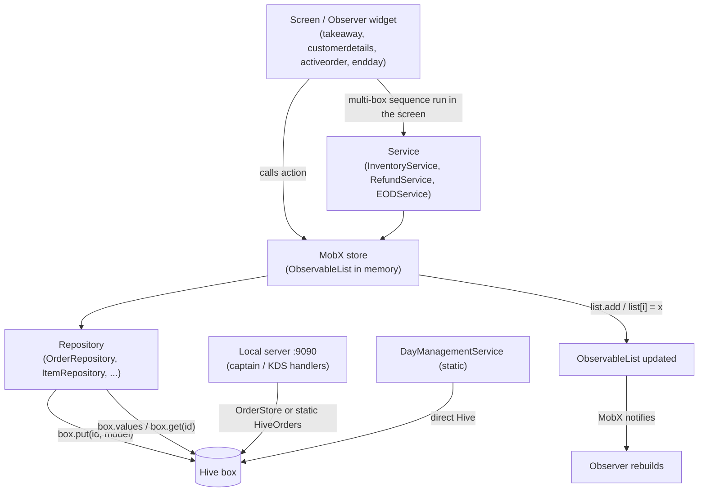
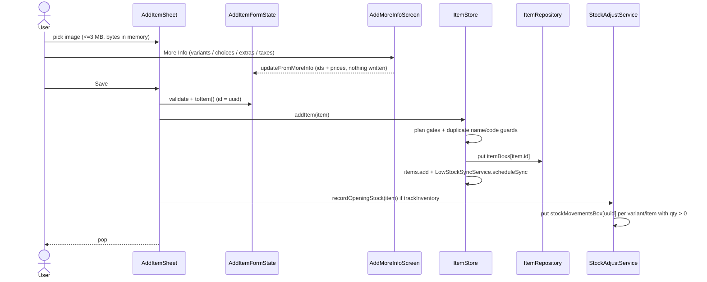
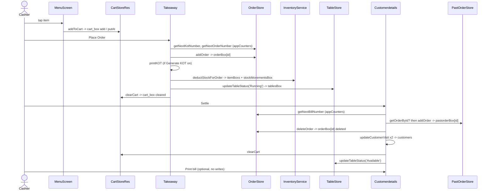
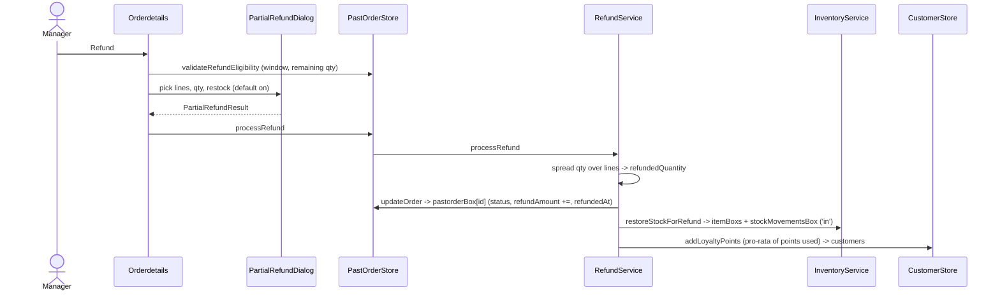
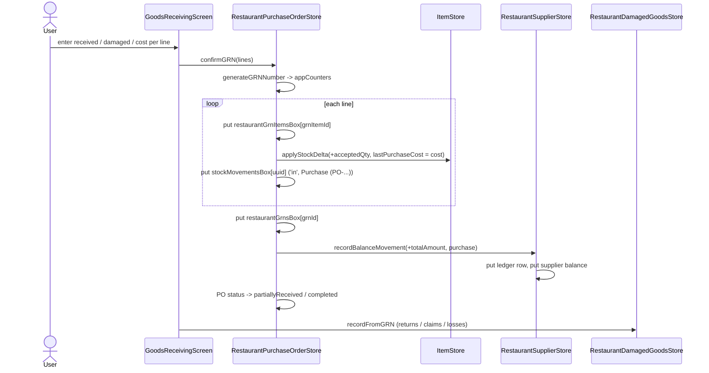
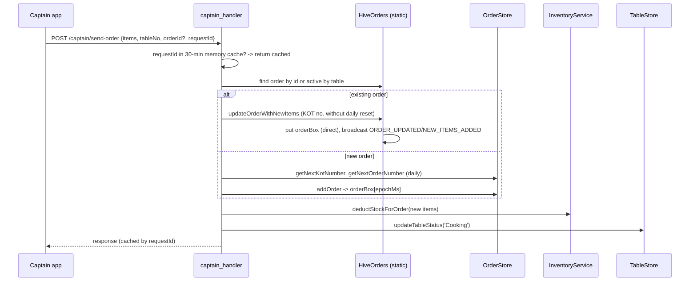
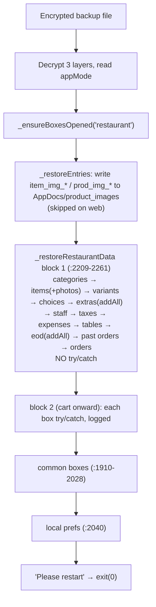

# 03 — Restaurant Database Flows

**App:** Bill Berry Lite (restaurant mode) · **Storage:** Hive · **State:** MobX
**Branch read:** `refactor/shared-code-consolidation` · **Date:** 2026-10-19 · **Method:** static code reading only (nothing was run)

This document follows each restaurant business operation from the screen down to the Hive box, and lists every record that gets created, changed or deleted.

## How to read this document

- All paths are relative to `lib/` unless they start with `docs/`.
- `file.dart:120` means line 120 of that file. A statement with a citation was checked in the code.
- **(inferred)** = a conclusion drawn from reading the code, not from running it.
- **(unverified)** = not checked.
- **Not implemented** = there is no code for it.
- The **Records** line in each step uses **CREATED**, **MODIFIED** and **DELETED**. The box name always comes first, for example `orderBox[orderId]`.
- Short names for the big screens:
  - `TA` = `presentation/screens/restaurant/start order/cart/takeaway.dart` (the cart and checkout hub)
  - `CD` = `presentation/screens/restaurant/start order/cart/customerdetails.dart` (payment and settle screen)
  - `CART` = `presentation/screens/restaurant/start order/cart/cart.dart` (`CartScreen`, hosts `Takeaway`)
  - `AO` = `presentation/screens/restaurant/tabbar/activeorder.dart` (Active Orders tab)
  - `PH` = `presentation/screens/restaurant/util/restaurant_print_helper.dart`
- Related docs: `01_*` (infrastructure) and `02_*` (models), in this folder. Older module docs in `docs/modules/` are partly out of date. The stale points are listed at the end.

---

## Contents

0. [General data access path](#0-general-data-access-path)
A. [Menu item creation and edit](#a-menu-item-creation-and-edit)
B. [Menu retrieval](#b-menu-retrieval)
C. [Order taking and billing](#c-order-taking-and-billing)
D. [Refunds and voids](#d-refunds-and-voids)
E. [Purchasing, stock take, adjustments and production](#e-purchasing-stock-take-adjustments-and-production)
F. [Day management](#f-day-management)
G. [Captain app and KDS (local server :9090)](#g-captain-app-and-kds-local-server-9090)
H. [Reports](#h-reports)
I. [Deletion flows](#i-deletion-flows)
J. [Backup and restore as a data flow](#j-backup-and-restore-as-a-data-flow)
Z. [Unclear or risky data flows](#z-unclear-or-risky-data-flows)

---

## 0. General data access path

### 0.1 The layers

| Layer | What it does | Example |
|---|---|---|
| Screen (`presentation/screens/restaurant/…`) | Reads observables inside an `Observer` and calls store actions. Several big screens also run the business sequence themselves (settle, void, EOD). | `takeaway.dart`, `customerdetails.dart`, `activeorder.dart`, `endday.dart` |
| MobX store (`domain/store/restaurant/…`, `domain/store/common/…`) | Holds `ObservableList`s and runs actions | `ItemStore`, `CartStoreRes`, `OrderStore`, `PastOrderStore`, `TableStore` |
| Service (`domain/services/restaurant/…`, `common/…`) | Rules that touch more than one store or box | `InventoryService`, `RefundService`, `EODService`, `DayManagementService`, `StockAdjustService` |
| Repository (`data/repositories/restaurant/…`, `common/…`) | Hive reads and writes for one box (or a header + lines pair) | `OrderRepository`, `PastOrderRepository`, `ItemRepository` |
| Hive box | The file on disk | `orderBox`, `pastorderBox`, `itemBoxs`, `stockMovementsBox` |



**Exceptions to the layering** (direct box access, no store in between):
- `DayManagementService` is static. It writes `restaurantSessionsBox`, `dayManagementBox` and `cashMovementsBox` itself (`domain/services/restaurant/day_management_service.dart:26-35, 60-88`).
- `EODService` reads `cashMovementsBox` with `Hive.box(...)` (`eod_service.dart:203-217`). `endday.dart:749` reads `restaurantAttendanceBox` directly. `cash_drawer_history_screen.dart:179, 345` opens `cashMovementsBox` and `cashHandoversBox` from the UI.
- Captain handlers write `orderBox` and `appCounters` through the static `HiveOrders` helper (`data/models/restaurant/db/database/hive_order.dart`), bypassing `OrderStore`.
- `StockMovementRepository` is not in DI; it is created with `new` in `inventory_service.dart:30`, `stock_adjust_service.dart:41`, `restaurant_purchase_order_store.dart:52` and report services.
- The Item Cancellation report calls `locator<ItemCancellationRepository>()` from the UI (`itemCancellationReport.dart:67`).
- `RecipeRepository` has no store; `edit_item.dart:583-589` writes recipes directly.

### 0.2 How writes work

- **One `put` per record.** Most repositories write `box.put(id, model)` (upsert by string id).
- **No transactions.** Hive has no multi-box transaction. Every multi-record operation (order + stock + table + cart) is a chain of separate `await`s in the screen.
- **Stores swallow errors.** `OrderStore.addOrder/updateOrder/deleteOrder` (`order_store.dart:263-327`) and `PastOrderStore.addOrder/updateOrder` (`past_order_store.dart:127-161`) catch exceptions and return `false`. **No settlement caller checks the bool.**
- **Key exceptions:**

| Box | Key scheme | Where |
|---|---|---|
| `cart_box` | auto-int; lines addressed by **index** (`putAt` / `deleteAt`) | `cart_repository.dart:17, 126-155` |
| `itemBoxs` | `item.id`, **or an auto-int** for items written with `addAll` by the dev generators | `item_repository.dart:39-79`; `test_data_generator.dart:504, 514` |
| `paymentMethodsBox` | auto-int (`add`), delete by list index (`deleteAt`) | `payment_method_repository.dart:75, 125-131` |
| `tablesBox` | `table.id` = display name (e.g. `T1`) | `table_repository.dart:11, 21` |
| `orderBox` (captain/server orders) | `id = epoch ms` string | `order_handler.dart`, `captain_handler.dart:245-313` |
| `stockMovementsBox` (stock-take lines) | `st_<takeItemId>` | `restaurant_stock_take_store.dart:366-374` |
| everything else | `Uuid().v4()` | |

**Counters in `appCounters`:**

| Number | Keys | Reset | Writer |
|---|---|---|---|
| KOT number | `lastKotNumber` + `lastKotDate` | daily (calendar date) | `OrderRepository.getNextKotNumber` `order_repository.dart:71-86` |
| KOT number (captain add-items) | `lastKotNumber` (same key, no date) | **never** | `HiveOrders.getNextKotNumber` `hive_order.dart:46-56` |
| Order number | `lastOrderNumber` + `lastOrderDate` | daily | `order_repository.dart:119-144` |
| Bill number | `lastBillNumber` + `lastBillResetYear` | **financial year** (not daily, despite comments in `CD:1475`, `TA:2931`, `TA:3312`) | `order_repository.dart:93-110` |
| PO / GRN / PR / CLM / LOSS / ST | `<P>_lastSeq`, `<P>_lastFy`, `<P>_prefix` | financial year; shared with retail | `domain/services/common/document_number_service.dart:31-91` |

A number is consumed **before** the record it belongs to is written, so retries and failures leave gaps. `getNextBillNumber/KotNumber` return **0** on error (`order_store.dart:409-426`).

### 0.3 How memory caching works

- Restaurant stores are lazy singletons registered through `_regBusiness` (`core/di/service_locator.dart:132`, restaurant block `:382-499`).
- `ItemStore`'s constructor starts `loadItems()` without awaiting it (`item_store.dart:17-20`); screens call `ensureLoaded()` (`:32-35`). `OrderStore`'s constructor calls `loadOrders()` (`order_store.dart:15-18`), which also runs crash reconciliation (C step 8). `PastOrderStore` does **not** self-hydrate; screens call `loadPastOrders()` (`past_order_store.dart:85-100`).
- `ItemStore.updateItem` replaces the entry in place in the `ObservableList` so list order is kept (`item_store.dart:246-251`).
- `CartStoreRes.loadCartItems` replaces the whole list after every cart write (`cart_store.dart:124-135`). Menu tiles read a per-product memoised `Computed` (`cartStateFor`, `cart_store.dart:94-121`).
- Writers that bypass MobX (captain `HiveOrders.updateOrder`) leave `orderStore.orders` stale until something calls `loadOrders()` (`startorder.dart:130-138`; WS listener in `AO:63-125`).
- Reports keep a per-screen `_isDataLoaded` flag; the first open scans the whole `pastorderBox` (H).

### 0.4 Duplicate-prevention mechanisms that exist

| Mechanism | What it prevents | Where |
|---|---|---|
| `CD._isProcessing` re-entry flag | Double tap on Settle | `CD:100, 2088-2096` |
| `existingModel.isFullyPaid` block | Re-settling an already paid order | `CD:2167-2173` |
| Past-order existence check before `addOrder` | Duplicate past record after a crash between "add past" and "delete active" | `CD.completeOrder` `CD:1494-1499` (only there) |
| `OrderStore.loadOrders` reconcile | Same order in both `orderBox` and `pastorderBox` | `order_store.dart:233-260` |
| Place Order disabled on paid orders | Adding KOTs to a fully paid order through the cart button | `TA:2252-2258` |
| Item add duplicate guards | Same name in the same category; duplicate `itemCode` | `item_store.dart:185-201` |
| `ItemRepository.updateItem` multi-key collapse | Editing an auto-keyed item creating a second copy | `item_repository.dart:56-74`; read-side collapse `:26-36` |
| Per-item stock queue `_stockMutationTails` | Lost updates between concurrent stock deltas on one item | `item_store.dart:364-458` |
| Stock-take movement id `st_<takeItemId>` | Applying the same counted variance twice | `stock_adjust_service.dart:287` |
| `creditApplied` / `lossRecorded` flags | Crediting a return or claim twice; writing off a rejected claim twice (at most once, see E) | `restaurant_damaged_goods_store.dart:259-297, 393-444` |
| Captain `requestId` cache (30 min TTL, in memory) | Captain retry creating a second order/KOT | `captain_handler.dart:18-36, 157-171` |
| EOD dedupe by session | Two EOD reports for one session | `eod_service.dart:402-417` |
| `_isCompletingEOD` | Double tap on Complete EOD | `endday.dart:701-702` |
| Bill-per-day cap (`todaysBillLoad`) | Exceeding the plan's daily bill count at POS entrances | `past_order_store.dart:206-214` |

### 0.5 What happens if the app closes mid-operation

| Flow | Crash-safe? | Summary (details in each section) |
|---|---|---|
| Item create | No | Item row, then opening-stock movements. A crash between leaves stock with no opening movement. |
| Place order | No | Counters → order → (KOT print) → stock → table → cart clear. The cart survives a crash, so re-placing creates a duplicate order (inferred). |
| Settle existing order | Partly | Past order → delete active is healed on next `loadOrders`; table, loyalty and visit updates are never reconciled. |
| Direct / Quick Settle | No | Past order written before stock deduction; cart cleared last → possible duplicate sale and missed deduction. |
| Immediate item cancel | No | Order rewrite, restock, cancellation row, cancel KOT and table are separate writes. |
| Void active order | No | Past VOID record → restock → delete active. A crash after the first write: reconcile deletes the active order but restock never happens. |
| Refund | No | Past order update → restock → loyalty. No resume. |
| GRN confirm | No | No draft, no idempotency. Lines + stock are written before the GRN header (E). |
| Stock take commit | Mostly | `st_` id protects a crash after the movement; a crash between the stock write and the movement double-applies on re-commit. |
| Production | No | Ingredient deductions with no production record on failure. |
| Start day / EOD close | No | Multi-box writes across `restaurantSessionsBox`, `dayManagementBox`, `appCounters`, `cashMovementsBox`. |
| Merge tables | No | Target updated, then source deleted → both hold the source items after a crash. |
| Backup restore | No | The first block of boxes has no try/catch; a throw leaves boxes half replaced (J). |

### 0.6 Safeguards: implemented vs missing

| Implemented safeguards | Missing or unverified safeguards |
|---|---|
| Settle re-entry flag and fully-paid block | No in-flight flag on Place Order or Quick Settle (double tap = two records, inferred) |
| `CD.completeOrder` checks for an existing past record | `_moveOrderToPast`, EOD finalise, void, quick and direct settle have no such check |
| Startup reconcile removes active orders already in past orders | Reconcile does not free tables, redo stock or apply customer updates |
| Per-item serialised stock deltas (`applyStockDelta`) | Manual adjust, stock take, low-stock add and Edit Item bypass it and ignore the plan-gated `updateItem` result |
| Stock-take `st_` movement id | No order id on stock movements → no way to detect a partial or missing sale deduction |
| Category delete re-parents items (never deletes them) | Item, tax, variant, choice, extra, staff, customer deletes have no in-use guard |
| Supplier delete blocked by documents and non-zero balance (UI) | The store's `deleteSupplier` re-checks nothing |
| EOD dedupe per session; EOD forces resolution of every active order | EOD-pending gate only when `autoCloseStaleShift` is on; refunds, voids and captain orders are never gated |
| Captain `requestId` cache | Cache is in memory and filled after the write; `POST /orders` has no dedupe and no licence gate |
| Encrypted backups | Restaurant backup excludes `stockMovementsBox`, `dayManagementBox`, `restaurantItemCancellationsBox`, notifications |

---

## A. Menu item creation and edit

There are four create entry points and one edit entry point. All of them reach `ItemStore.addItem` / `ItemStore.updateItem` → `ItemRepository` → `itemBoxs`, except the dev data generator.

| Entry | File | Store call | Opening-stock movement? |
|---|---|---|---|
| Manage Menu "Add Item" (sheet / tablet dialog) | `presentation/widget/componets/restaurant/bottom_sheets/add_item_sheet.dart:173` (opened from `componets/bottomsheet.dart:40-46`) | `itemStore.addItem` `:187` | Yes, `:194` |
| Onboarding wizard | `presentation/screens/restaurant/auth/setup_add_item_screen.dart:494` | `itemStore.addItem` | Yes, `:497` |
| Onboarding shared form store | `domain/store/common/add_product_form_store.dart:706-765` | `itemStore.addItem` `:765` | **No** |
| Bulk import (Excel) | `presentation/screens/restaurant/import/restaurant_bulk_import_service.dart:1107-1108` | `addItem` / `updateItem` | **No** (inferred: no `recordOpeningStock` call in the file) |
| Dev test-data generator | `presentation/widget/componets/restaurant/componets/import/test_data_generator.dart:366, 504, 514` | **bypasses the store**: `Hive.box<Items>('itemBoxs').addAll(items)` (int keys) | No |



### A1. Create via the Add Item sheet (`add_item_sheet.dart`)

1. **Form state.** `AddItemFormState` (`bottom_sheets/add_item_form_state.dart`) pre-fills the item code from `itemStore.generateNextItemCode()` (`:105`; `item_store.dart:574-587` = highest existing 4–5 digit code + 1, starting at 1001).
   - Records: none.
2. **Image.** `_pickImage` (`add_item_sheet.dart:123-142`) → `ImagePickerService.pickProductImage()` (capped at 1200×1200), refuses files over 3 MB (`:130`). The bytes stay in memory and are saved **inline** in `Items.imageBytes` (HiveField 2, `data/models/restaurant/db/itemmodel_302.dart:20-21`). There is no image file or path on the item.
   - Records: none yet.
3. **More Info (optional).** `_handleAddMoreInfo` (`:216-233`) pushes `presentation/screens/restaurant/item/add_more_info_screen.dart`. The result is merged by `updateFromMoreInfo` (`add_item_form_state.dart:254-270`): `variants` (maps `{variantId, price, stockQuantity}`), `choiceIds`, `extraIds`, `taxIds` / `taxRate`. Picked from the masters through `variant_selection_screen.dart`, `choice_selection_screen.dart`, `extra_selection_screen.dart`, `default_choice_picker.dart`, `tax_selection_screen.dart`.
   - Records: none.
4. **Validate** (`add_item_form_state.dart:110-160`): name required; price > 0 for menu types (Finished Good, Recipe-Based); category required for menu types; item code `^\d{4,5}$` and unique against `itemStore.items` (`:153`).
5. **Build the model** `toItem()` (`:163-232`):
   - `id = Uuid().v4()` (`:181`) — this becomes the Hive key.
   - **Variants are embedded**: each map → `ItemVariante(variantId, price, stockQuantity)` (`:171-176`) inside `Items.variant` (HiveField 8). Raw Material / Semi-Finished get no variants (`:167-168`). The variant's `trackInventory` is left **null**.
   - `stockQuantity` = typed stock only when tracking and no variants; otherwise 0 (`:207-209`). Variant items keep stock per variant.
   - **Tax is cached on the item**: `taxRate` = summed decimal of the selected `taxIds` (`:210-211`); both stored (f11 `taxRate`, f27 `taxIds`).
   - **Choices and extras are id lists**, not copies: `choiceIds` (f9), `extraId` (f10), `defaultChoiceOptionIds` (f26).
   - **Inventory fields:** `lastPurchaseCost` seeded from the cost field for Raw Material (`:186-189`), `unit` `'piece'` for Raw/Semi by unit (`:200-205`), `sellDirectlyAtPos` only for Raw/Semi (`:218-222`), `createdTime = now`, `editCount = 0`.
6. **Store** `ItemStore.addItem` (`item_store.dart:167-217`):
   - Plan gates `EntKeys.manageMenuItemsAdd` (`:174`) and the item cap `manageMenuItemsMax` vs `items.length` (`:178-182`). Failure returns `false` with `errorMessage`.
   - Duplicate guards: same trimmed, case-insensitive name **in the same category** (`:185-192`); duplicate `itemCode` across all items (`:195-201`).
   - `_repository.addItem(item)` (`:203`) then `items.add(item)` (`:204`), then `LowStockSyncService.scheduleSync()` (`:207`).
   - UI: `add_item_sheet.dart` · Store: `ItemStore` · Repo: `ItemRepository.addItem` (`item_repository.dart:39-46`, `flush()` on web only) · Box: `itemBoxs`
   - Records: **CREATED** `itemBoxs[item.id]`.
7. **The sheet respects failure** (`add_item_sheet.dart:188-193`): on `false` it shows `itemStore.errorMessage` and stays open.
8. **Opening stock** `StockAdjustService.recordOpeningStock(item)` (`domain/services/restaurant/stock_adjust_service.dart:133-177`): only if `trackInventory`. Variant item → one movement per variant with qty > 0 (`type 'in'`, `reason 'Opening stock'`, `balanceAfter = qty`, `sessionId` from `DayManagementService.getCurrentSessionId()`, no `unitCost`) (`:139-160`). Simple item → one movement if `stockQuantity > 0`. It only logs; the stock is already on the item.
   - Records: **CREATED** `stockMovementsBox[uuid]` × N.
9. Recipe-Based items get only a warning (`add_item_sheet.dart:198-202`): the recipe is built later in Edit. No `RecipeModel` is created here.
10. `onItemAdded` + pop (`:203-209`). Menu screens observe `itemStore.items`; no reload needed.

### A2. Edit via Manage Menu → Edit Item (`presentation/screens/restaurant/manage menu/tab/edit_item.dart`, `_saveChanges` `:332-614`)

1. **Validate** (`:333-373`): name, code (4–5 digits, unique excluding self, `:348-356`), menu types need price > 0 and a category. **No duplicate-name check on edit.**
   - Records: none.
2. **Image** (`:380-385`): keeps the existing `imageBytes` unless a new image is picked. No "remove image" path through `copyWith` (inferred: `copyWith` uses `?? this.x`).
3. **Variants** rebuilt from the master checkboxes (`:394-442`). Existing variant stock is kept; edited stock is taken when tracking and an adjustment is queued if it changed (`:420-430`). Variant `trackInventory` is carried over from the existing embedded variant (`:436`).
4. **Choices / extras** id lists rebuilt (`:444-456`); `extraConstraints` `{extraId: {min, max}}` (HiveField 21) built (`:458-473`).
5. `widget.items.copyWith(...)` (`:475-508`), then fields `copyWith` cannot null are set directly: `taxRate`/`taxIds` (`:512-513`), `recipeId` (`:517-519`), `sellDirectlyAtPos` (`:524-528`), low-stock fields (`:535-538`), `trackInventory` + `stockQuantity` via `ProductType.resolvePhysicalStock` (`:551-572`; Recipe-Based forced to no physical stock).
   - **Raw Material cost re-seed:** `lastPurchaseCost` is re-seeded from the price field (initialised from `items.price`, `:147-149`) on every save (`:474-482`). This overwrites the GRN cost.
6. `AuditTrailHelper.trackEdit(updateItem, editedBy: staff)` (`:574-578`).
7. `itemStore.updateItem(updateItem)` (`:580`) → `ItemStore.updateItem` (`item_store.dart:219-264`): plan gate `manageMenuItemsEdit` (`:226`), duplicate-code guard (`:232-238`), repo write (`:240`), in-place list replacement (`:246-251`), `LowStockSyncService.scheduleSync()`. **The screen ignores the returned bool.**
8. **Repository — duplicate-key handling** (`item_repository.dart:56-74`): it finds **every** key whose value has `id == item.id`. None → `put(item.id)`. Otherwise it writes over the first key in place (keeps box order, so favourites do not jump to the end) and deletes every other key with the same id. Cause: generator/imported items stored with `addAll` (int keys); a plain `put(item.id)` would have created a second copy. `getAllItems` (`:26-36`) also collapses duplicates on read, preferring the record whose key equals the id.
   - Records: **MODIFIED** `itemBoxs[existingKey]` · **DELETED** `itemBoxs[otherKeys]` (only when duplicates exist).
9. **Recipe** (`edit_item.dart:583-589`): `recipeRepository.saveRecipe(recipe.copyWith(itemId))` for types with a recipe, otherwise `deleteRecipeForItem`.
   - Records: **CREATED / MODIFIED** or **DELETED** `restaurantRecipesBox[recipeId]`.
10. **Stock adjustments** logged after the save (`:592-608`) → `StockAdjustService.logAdjustment`.
    - Records: **CREATED** `stockMovementsBox[uuid]` (`reason 'Stock correction'`, no `unitCost`).
11. Pop with `true` (`:610`).

### A3. Other item writers (all through `ItemStore`)

- Favourite star: `tabbar/menu.dart:134`, `menu_grid_screen.dart:123` → `updateItem(copyWith(isFavorite))`. Subject to the edit plan gate, so starring silently fails on a plan without `manageMenuItemsEdit` (inferred).
- Tax bulk apply: `TaxSetting/apply_tax_screen.dart:147, 180`, `addMultipleTax.dart:136`.
- Inventory screens: `inventory/manage_Inventory.dart:580-712`, `stock_adjust_service.dart:233-312` (through `updateItem`). Sales, refunds, GRN and production use `ItemStore.applyStockDelta` (`item_store.dart:364-458`), which is serialised per item and deliberately not plan-gated.
- Enable/disable: `toggleItemStatus` (`item_store.dart:294-314` → `item_repository.dart:185-194`).

### A4. Masters (variant, choice, extra)

- `VariantStore.addVariant/updateVariant/deleteVariant` (`domain/store/restaurant/variant_store.dart:62, 84, 99`) → `variant_repository.dart:14-35` → `variante`. The master holds the **name only**; price and stock live on the item's embedded `ItemVariante`.
- `ChoiceStore` (`choice_store.dart:63-144`) → `choice_repository.dart:15-80` → `choice`. Options are embedded and edited **by index** (`addOption/removeOption/updateOption`, `:40-80`).
- `ExtraStore` (`extra_store.dart:63-144`) → `extra_repository.dart:15-85` → `extra`. Toppings embedded, edited by index.
- Items reference masters by id, so a rename propagates. A delete leaves dangling ids on items (I).

### Crash/consistency notes (A)

- Item row and opening-stock movements are separate writes. A crash between them leaves stock with no opening movement.
- Edit: item write, recipe write and adjustment movements are three separate writes.

### Risks found (A)

| ID | Risk | Evidence |
|---|---|---|
| A-R1 | Deleting an item stored under an int key does nothing on disk; it reappears on the next `loadItems`. `updateItem` handles multiple keys, `deleteItem` does not. | `item_repository.dart:77-79` vs `:56-74` |
| A-R2 | `AddProductFormStore` and bulk import create items with stock but no opening movement → stock ledger starts mid-air. | `add_product_form_store.dart:765`; `restaurant_bulk_import_service.dart:1107` |
| A-R3 | Edit Item ignores the `updateItem` result: if the plan gate or code guard rejects, it still saves the recipe, logs stock adjustments and pops as if successful. | `edit_item.dart:580-608` |
| A-R4 | Edit Item writes an absolute `stockQuantity` loaded when the screen opened, outside `applyStockDelta` → a sale settled meanwhile is overwritten (lost deduction); the logged adjustment uses a stale old value (inferred). | `edit_item.dart:540-570, 592-608` |
| A-R5 | Edit Item re-seeds a Raw Material's `lastPurchaseCost` from the price field on every save → GRN cost and recipe costing are lost. | `edit_item.dart:147-149, 474-482` |
| A-R6 | Add-sheet variants are saved with `trackInventory: null`; per-variant tracking then depends on the item flag (inferred). | `add_item_form_state.dart:171-176` |
| A-R7 | No duplicate-name guard on edit; the add guard is per category only. | `item_store.dart:185-192` |
| A-R8 | Choice options are edited by index; `Items.defaultChoiceOptionIds` can point at a removed option (inferred). | `choice_repository.dart:40-80` |
| A-R9 | Photos are stored as raw bytes in every `Items` row and loaded with the whole box. | `itemmodel_302.dart:20-21`; `item_repository.dart:26-36` |

---

## B. Menu retrieval

### B1. Hydration

1. `ItemStore` is built on first `locator<ItemStore>()` (`service_locator.dart:428-429`); its constructor starts `loadItems()` (`item_store.dart:17-20`).
2. `loadItems` (`:150-165`) → `ItemRepository.getAllItems` (`item_repository.dart:26-36`): reads **all keys** of `itemBoxs`, de-duplicates by `id` (keeps the key == id copy), `items.clear(); items.addAll(...)`.
3. `CategoryStore.ensureLoaded` (`domain/store/common/category_store.dart:31-34`) → `loadCategories` (`:100`) from the shared `categories` box.
4. `MenuScreen._loadData` (`presentation/screens/restaurant/tabbar/menu.dart:582-612`) awaits `categoryStore.ensureLoaded()`, `itemStore.ensureLoaded()` and `restaurantCartStore.loadCartItems()` in parallel with a 10 s timeout. `MenuGridScreen` does the same (`menu_grid_screen.dart:103-105`).
5. `CartStoreRes.loadCartItems` (`cart_store.dart:124-135`) reads `cart_box` and **replaces** the observable list.
6. Re-entering the tab (`tabRevisitTick`) re-reads the cart, clears the search and scrolls to top (`menu.dart:623-631`). Items and categories are not re-read.
- Records: none (read only).

### B2. List view (`MenuScreen`, `tabbar/menu.dart`)

1. Visible items: `itemStore.items.where(isEnabled && sellsAtPos)` (`:1070-1076` mobile, `:1441-1447` tablet). `sellsAtPos = sellDirectlyAtPos ?? !isRawMaterial` (`itemmodel_302.dart:177`). Sorted once (`menu.dart:178-183`).
2. Categories: `categoryStore.categoriesWithItems(visibleItems)` (`menu.dart:1087-1089`) hides empty ones. Items whose category was deleted appear under "Uncategorised" (`:185-193`).
3. Favourites: sentinel `__favorites__` (`:130`), shown only when some item is a favourite.
4. **Search is local UI state** (`_searchController` → `setState`, `:389-393`), matching name or item code. `ItemStore.searchQuery` / `filteredItems` are not used by any restaurant screen (dead store surface).
5. Category filter: mobile scroll-to-section with staged expansion (`:396-458`); tablet `activeCategory` filter (`:1449-1460`).
6. Stock badge per tile (`:776-880`). Recipe-Based availability is computed live from ingredients through `InventoryService.effectiveAvailableStock(item)` (`:789, 874`) and `recipeRepository.getRecipeForItem`. No stored figure.
7. **Reactive cart boundary.** The section `Observer` does not read the cart (`:1078-1083`). Each tile (`_GridItemCard` `:2292`, `_ItemListTile` `:2543`) reads `restaurantCartStore.cartStateFor(item.id).value` (`:2314, 2574`). `cartStateFor` is a memoised `Computed<ProductCartState>` per product with value equality (`cart_store.dart:37-45, 94-121`), so a cart write rebuilds only tiles whose quantity changed.

### B3. Grid view (`MenuGridScreen`)

Opt-in through the "Menu Grid View" setting (`util/restaurant/staticswitch.dart:230`; selected at `menu.dart:237, 314, 1231`).
1. Same hydration and filter (`menu_grid_screen.dart:103-105, 348, 439`), favourites and search (`:441-457`).
2. **Does not use `cartStateFor`.** The grid `Observer` snapshots `restaurantCartStore.cartItems.toList()` (`:435-437`) and passes it to every card (`:588, 596-601`) → every cart write rebuilds the whole grid.
3. Out-of-stock tiles are not tappable (`:597-610`).

### B4. Tap → cart (hand-off to C)

`_handleItemTap` (`menu.dart:643-742`; grid `:126-199`) → EOD gate → weight dialog / `ItemOptionsDialog` / plain `CartItem` → `_addItemToCart`. Details in C step 2.

### Crash/consistency notes (B)

- Read-only flow. The only write is the cart (C).

### Risks found (B)

| ID | Risk | Evidence |
|---|---|---|
| B-R1 | `MenuGridScreen` reads the whole cart above the tiles → full-grid rebuild on every cart change. | `menu_grid_screen.dart:435-437` |
| B-R2 | `_productCartStates` map is never pruned (one `Computed` per product ever shown). | `cart_store.dart:84` |
| B-R3 | Store-side search/filter/low-stock computeds are unused; low-stock computeds hard-code `< 10` while the model has per-item thresholds. | `item_store.dart:104, 136`; `itemmodel_302.dart:198-211` |

---

## C. Order taking and billing

**Boxes touched:** `cart_box`, `orderBox`, `pastorderBox`, `appCounters`, `tablesBox`, `itemBoxs`, `stockMovementsBox`, `restaurantItemCancellationsBox`, `customers`, `dayManagementBox` / `restaurantSessionsBox` (read; `promptStartDay` may create a session, F1).

There is **no KOT model and no payment box**. KOTs live on the order as `kotNumbers` / `kotBoundaries` / `kotStatuses` / `kotTimestamps` (`ordermodel_309.dart:75-123`, sliced by `getItemsByKot()` `:277`). Payments are `paymentListJson` (JSON string of legs), `totalPaid`, `changeReturn`, `isSplitPayment`, `paymentMethod` / `paymentmode` on the order or past order. `amountDue`, `isFullyPaid` (< 0.01) and `hasPartialPayment` are getters (`ordermodel_309.dart:174-180`).

### C0. Gates on every new-bill entrance

| Entrance | Plan `billingInvoiceCreate` | Bill-per-day cap | EOD strictly pending | Session open (else `promptStartDay`) | Stock check |
|---|---|---|---|---|---|
| Menu tap `menu.dart:643` | — | — | `:644` | soft prompt `:748` | cart-add checks |
| Place Order (new) `TA._placeOrder:1370` | `:1375` | `:1382-1391` | `:1392` | `:1401` | `checkStockAvailability` `:1429` |
| Quick Settle `TA._qucikSettleNewOrder:3214` | `:3221` | `:3228-3237` | `:3239` | `:3248` | `:3264` |
| Settle & Print / Delivery (new) `CD._doSubmitOrder:2098` | `:2101` | `:2107-2113` | `:2118-2122` | `:2126` | none (relies on cart-add checks) |
| Settle an existing order `CD._doSubmitOrder` | `:2101` | skipped (`:2104-2106`) | **allowed** (`:2119`) | `:2126` | none |
| Update existing order `TA._updateExistingOrder:1585` | none | none | none | none | typed-qty check only |
| Captain / `POST /orders` (G) | none | none | none | none | none |

- **Bill-per-day cap:** `todaysBillLoad` (`past_order_store.dart:206`) = today's past orders (by `orderAt`) + today's active orders (by `timeStamp`). Active orders count at placement so settling cannot dodge the cap.
- **EOD-pending gate:** `isEodStrictlyPending` (`day_management_service.dart:201-215`) is true only when `AppSettings.autoCloseStaleShift` is on **and** the session is older than `maxSessionDurationHours`. With auto-close off it never blocks (inferred). `hasPendingEOD()` (previous calendar day) only shows a banner.

### C overview diagram (place order, then settle)



### C step 1 — Choose order type and table

1. `Startorder` (`start order/startorder.dart:58`) has tabs Menu / Orders / Tables. Tables only if `OrderSettings.enableDineIn && PlanEnforce.allows(EntKeys.billingTables)` (`:79, 456, 490, 535`). Switching to Orders/Tables calls `orderStore.loadOrders()` (`:132, 138`) to pick up captain writes.
2. The order type is chosen **in the cart**. `CartScreen._setDefaultOrderType` (`CART:79`) sets `"Take Away"`. **Take Away is always available** (no `enableTakeaway` check in the chip row, `CART:654-660`). Dine In only if `enableDineIn && billingTables` (`CART:661`); it pushes `TableScreen(isfromcart: true)` which returns the table id (`CART:668-679`). Delivery only if `OrderSettings.enableDelivery` (`CART:682`), with no plan gate. Opening the cart with a table switches to Dine In (`CART:247`).
3. **Tables tab** (`tabbar/table.dart`): the active order of a tile is found with `orderStore.getActiveOrderByTableId(table.id)` (`table.dart:619` → `order_store.dart:570`), by `order.tableNo` and an active status. `TableModel.currentOrderId` is only a hint.
   - Occupied tile → `CartScreen(existingOrder)` (`:645`). Occupied but no order → orphaned-table dialog: **Reset to Available** (`:736`) or **Delete Table** (`:686`).
   - Available/Reserved → from the cart: pop with the table id (`:752`); else `Startorder(newOrderForTableId)` (`:758`).
   - Long-press Reserve/Unreserve → `tableStore.updateTableStatus` (`:185`).
4. Table write mechanics: `TableStore.updateTableStatus` (`table_store.dart:118`) → `TableRepository.updateTableStatus` (`table_repository.dart:30`). `Available` nulls total, order id and timestamp. Any other status writes `currentOrderTotal`, and `currentOrderId` = the passed id **or null if omitted**, then `table.save()`. The store keeps the old id when omitted (`table_store.dart:142-145`), so Hive and memory can differ.
- UI: `startorder.dart`, `cart.dart`, `table.dart` · Store: `TableStore`, `OrderStore` · Repo: `TableRepository` · Box: `tablesBox`, `orderBox` (read)
- Records: none for type selection · **MODIFIED** `tablesBox[tableId]` (reserve / reset) · **DELETED** `tablesBox[tableId]` (orphan delete).

### C step 2 — Add items to the cart (`cart_box`)

1. **EOD gate:** `DayManagementService.isEodStrictlyPending()` → "Day has ended. Complete End of Day to unlock." (`menu.dart:644-650`; grid `menu_grid_screen.dart:135-211`).
2. **Build a snapshot line** (no live link except `productId`):
   - Sold by weight → `showWeightItemDialog` (`tabbar/weight_item_dialog_restaurant.dart:17-36`) returns a `CartItem` with `weightDisplay`.
   - Variants / extras / choices → `ItemOptionsDialog` (`tabbar/item_options_dialog.dart:357-…`). `price` = variant price (or item price) + Σ extra price × qty (`_recalculateTotal` `:222-252`). Stores `variantName`, `variantPrice`, `choiceNames` (names only, no price), `extras` (list of maps with name, price, category, quantity, `:369-399`), `taxRate`, `categoryName`, `isStockManaged = item.trackInventory`, `id = uuid`.
   - Plain item → `CartItem(productId, id: uuid, title, price, taxRate, categoryName)` (`menu.dart:728-738`).
3. `_addItemToCart` (`menu.dart:744-774`): if the cart is empty and no session is open → `promptStartDay(context)` (cancelable; the item is still added). Then `restaurantCartStore.addToCart` (`cart_store.dart:144`).
4. `CartStoreRes.addToCart` stock pre-check (only when `isStockManaged`): variant stock by **name** match through `variantStore`, else `InventoryService.effectiveAvailableStock` (recipe-aware), including what is already in the cart (`cart_store.dart:147-211`).
5. `CartRepository.addToCart` (`cart_repository.dart:23`): looks for an **equal** line using `CartItem.==` (`cartmodel_308.dart:95-108`: title + variant + weight + price + sorted choices + normalised extras; not productId, not instruction). Re-checks stock from Hive (item by `productId`, fallback by **name**) and refuses a Recipe-Based item with no recipe (`:64-72`). Merge → `quantity += …; putAt(index)`; new → `add(item)`. The store then reloads the cart.
- UI: `menu.dart` / `menu_grid_screen.dart` · Store: `CartStoreRes` · Repo: `CartRepository` · Box: `cart_box` (+ `itemBoxs`, `variante` read)
- Records: **CREATED** `cart_box[autoInt]` or **MODIFIED** `cart_box[index]` · possibly **CREATED** `restaurantSessionsBox` etc. through `promptStartDay` (F1).

### C step 3 — Change quantity, variants, choices and extras

1. `CartScreen._initializeCart` (`CART:198`):
   - **Existing order:** base = the latest `orderStore.orders` copy (`CART:204`); the first load fires `restaurantCartStore.clearCart()` **un-awaited** (`CART:210`); the active items are deep-copied into a diff baseline (`_originalActiveList`, `_originalQuantities`, local KOT boundaries/numbers, `:213-218`). ACTIVE section = order items; NEW section = `cart_box` contents.
   - **New order:** NEW section = `cart_box` contents (`:241-248`).
2. **NEW lines (cart_box):** `+` → name-based stock check against `itemStore.items` (`CART:349-391`) → `updateQuantity` (`cart_store.dart:238` → `cart_repository.dart:150`, `putAt`). `−` at qty 1 → `removeFromCart` (`deleteAt`, `cart_repository.dart:138`). Typed quantity (`TA._onQtyChanged/_commitQty`, `TA:123-162`) flags over-stock and disables all order buttons (`TA:2306`).
3. **ACTIVE lines (already on a KOT):** `+`/`−` only change the in-memory copy (`_updateActiveItemQty` `CART:516`, `_removeActiveItem` `CART:522`). Nothing is written until Place Order (step 6) or an immediate cancel (step 6b).
4. **Changing a variant, choice or extra** of a line is not an edit in place: the line is a snapshot. A different variant/choice/extra combination is a different line (step 2, `CartItem.==`).
5. Back with unplaced NEW items on an existing order → "Unplaced Items" dialog; Discard → `clearCart()` (`CART:185-187`). A new order's cart survives back navigation (`CART:98-100`).
6. **Table transfer:** plan gate `billingTablesTransfer` (`CART:773`); `orderStore.updateOrder(tableNo: new)` then new table `Cooking` and old table `Available` (`CART:792-814`).
7. **Table merge** (`_mergeTables`, `CART:1286`): concatenates items and KOT numbers, shifts boundaries, `totalPrice = a + b`; updates the target, deletes the source, target table `Cooking`, source table `Available` (`CART:1311-1338`).
- Records: **MODIFIED** / **DELETED** `cart_box[index]` · **DELETED** all `cart_box` (discard, existing-order open) · transfer: **MODIFIED** `orderBox[id]`, `tablesBox` × 2 · merge: **MODIFIED** `orderBox[target]`, **DELETED** `orderBox[source]`, **MODIFIED** `tablesBox` × 2.

### C step 4 — Taxes, discounts, remarks, charges, loyalty

| Input | Where it lives | Written when | Where |
|---|---|---|---|
| Tax rate per line | `CartItem.taxRate` (copied from `Items.taxRate`) | at cart add | `menu.dart:728-738` |
| Tax mode | `existingModel?.isTaxInclusive ?? AppSettings.isTaxInclusive`, snapshotted on the order and past order | at placement / settle | `CD:189-235` |
| Bill discount (amount or %) | Calculation input; saved as `Discount` on the past order, actor as `discountAppliedBy` | at settle | `CD:194-198, 853-865, 1484-1486, 1559-1561` |
| Service charge % / delivery charge | `serviceCharge` amount | at settle | `CD:200-211` |
| Loyalty redemption | `pointsDiscount = clamp(points, 0, floor(grandTotal))`; scales taxable + GST before tax; 1 point = 1 unit | at settle | `CD:223-229`; `cart_calculation_service.dart:348-384` |
| Kitchen note | `OrderModel.remark` from the Place Order dialog | at placement | `TA:1466-1498` |
| Discount reason | `SelectedRemark`, default `'Old Customer'` → past order `remark` | at settle | `CD:102, 1465-1466` |

- There is **no role gate** on the discount section (`CD:741-…`).
- `remark` has two meanings: kitchen note on the active order, discount reason on the past order. `CD.completeOrder` overwrites the kitchen note with `SelectedRemark` even when no discount was given; `CD._placeOrder` uses `'no Remark'` instead.
- Records: none until placement/settle.

### C step 5 — Place order + KOT (`TA._placeOrder`, `TA:1370-1543`)

Triggered from `_showPlaceOrderDialog` (`TA:2892`). Dine In and Take Away only; a new Delivery order goes straight to settle (`TA:2352-2369`).

1. Gates (C0). Mobile must be 10 digits if given (`:1417-1426`).
2. `InventoryService.checkStockAvailability(plainItems)` (`inventory_service.dart:567`) groups by **title** and variant, finds items by **name**.
3. `_getOrCreateCustomer` (`TA:1305`): if `EntKeys.customers` is allowed, reuse the selected one, else match by phone, else create.
   - Records: **CREATED** `customers[customerId]` (maybe).
4. `getNextKotNumber()` (`order_repository.dart:71`) and `getNextOrderNumber()` (`:119`).
   - Records: **MODIFIED** `appCounters` (`lastKotNumber`/`lastKotDate`, `lastOrderNumber`/`lastOrderDate`).
5. `sessionId = DayManagementService.getCurrentSessionId()` (reads `dayManagementBox`).
6. Build `OrderModel` (`TA:1466-1498`): `status 'Processing'`, `orderType`, `tableNo = selectedTableNo ?? ''`, `remark` (kitchen note), `subTotal` / `gstAmount` / `totalPrice` from `CartCalculationService`, `kotNumbers [k]`, `kotBoundaries [n]`, `itemCountAtLastKot n`, `kotStatuses {k: 'Processing'}`, `orderNumber`, `customerId`, `isTaxInclusive`, `sessionId`. No payment fields.
7. `orderStore.addOrder` (`order_store.dart:263`) → `OrderRepository.addOrder` (`order_repository.dart:24`, `put(id)`).
   - Records: **CREATED** `orderBox[orderId]`.
8. **KOT print** if `AppSettings.generateKOT` (default **off**, `staticswitch.dart:227`): `RestaurantPrintHelper.printKOT(autoPrint: true)` (`TA:1508`). `printKOT` is plan-gated by `EntKeys.billingKot` (`PH:40`), takes the KOT slice with `getItemsByKot()[k]`, and routes to the default KOT printer (raster, fallback ESC/POS text) or a thermal PDF. No writes.
9. **Stock / recipe deduction at placement**: `InventoryService.deductStockForOrder(plainItems)` (`TA:1520`), see C7.
   - Records: **MODIFIED** `itemBoxs[...]` · **CREATED** `stockMovementsBox[uuid]` per line or ingredient.
10. Dine in: `tableStore.updateTableStatus(table, 'Running', total, orderId, time)` (`TA:1525`).
    - Records: **MODIFIED** `tablesBox[tableId]`.
11. `clearCart()` (`TA:1534`), pop, back to Start Order.
    - Records: **DELETED** all `cart_box` rows.

`CD._placeOrder`'s non-settle branch (`CD:1631-1697`) is **unreachable**: `_placeOrder` is only called with `isSettle == true` and that branch returns at `CD:1628`.

### C step 6 — Add more items (new KOT boundary) (`TA._updateExistingOrder`, `TA:1585-1925`)

Trigger: Place Order on an existing order (`TA:2252-2258`, disabled when fully paid). "Add Items" opens `Startorder(isForAddingItem: true)`; menu adds go to `cart_box`.

1. **Diff** (`TA:1630-1675`): removed lines, qty up (`stockToDeduct`), qty down (`stockToRestore`).
2. **New KOT boundary** if there are new items: `getNextKotNumber()`, append to `kotNumbers`, append boundary = `active.length + new.length`, `kotStatuses[new] = 'Processing'`, `kotTimestamps[new] = now` (`TA:1701-1710`). Items are appended (the boundary model needs append-only).
3. **Payment re-derive:** `alreadyPaid = existing.totalPaid`; status Paid / Partially Paid / Unpaid (`TA:1718-1745`). This is how a paid order reopens with a balance.
4. `orderStore.updateOrder` (stamps `lastModifiedBy/At`, `order_store.dart:281`) → `OrderRepository.updateOrder` (key scan then `put`, `order_repository.dart:49`).
5. Stock: restore removed + reduced, deduct increased + new (`TA:1750-1757`).
6. If corrected: one `ItemCancellationModel` per removed/reduced line (`TA:1761-1795`); failures swallowed.
7. WS broadcasts `NEW_ITEMS_ADDED` / `ORDER_MODIFIED` (`TA:1798-1848`).
8. Prints the add-on KOT (`TA:1851-1863`) and a **Cancel KOT** for corrections with a fresh KOT number that is **not** stored on the order (`TA:1866-1896`).
9. Table status/total update (`TA:1899-1907`); `clearCart()`.
- Records: **MODIFIED** `appCounters` (1–2 KOT numbers) · **MODIFIED** `orderBox[orderId]` · **MODIFIED** `itemBoxs` · **CREATED** `stockMovementsBox` · **CREATED** `restaurantItemCancellationsBox[uuid]` (corrections) · **MODIFIED** `tablesBox` · **DELETED** `cart_box`.

### C step 6b — Immediate item cancel (`TA._cancelItemImmediately`, `TA:1060-1233`)

Commits at once from the cancel dialog on an ACTIVE line (`TA:699`).

1. Rebuild the item list with the line reduced/removed and recalculate totals with stored discount/service charge (`TA:1086-1109`).
2. Nothing left → `orderStore.deleteOrder` (`TA:1117-1118`); else `updateOrder(items, totalPrice, subTotal, gstAmount)` (`TA:1120-1129`). **`kotBoundaries` / `kotNumbers` / `kotStatuses` are not adjusted.**
3. `restoreStockForOrder([cancelledPortion])` (`TA:1134`).
4. `ItemCancellationModel` (item, variant, qty, `amount = price × qty`, reason, orderId, kotNumber, staff, time, session, order type, table) (`TA:1137-1162`).
5. Cancel KOT: new KOT number + `printKOT(kotStatuses {k: 'CANCEL'}, cancelReference)` (`TA:1165-1184`). `printKOT` never puts `cancelReference` into `ReceiptData` (`PH:35, 153-171`), so the reference line never prints.
6. WS `ORDER_MODIFIED`; table `Available` if the order is gone, else new total (`TA:1187-1214`).
7. `CART._commitActiveCancel` (`CART:468`) patches the in-memory baseline so a later Place Order does not cancel again.
- Records: **MODIFIED** or **DELETED** `orderBox[orderId]` · **MODIFIED** `itemBoxs` · **CREATED** `stockMovementsBox` · **CREATED** `restaurantItemCancellationsBox[uuid]` · **MODIFIED** `appCounters` · **MODIFIED** `tablesBox`.

Separate path: Active Orders → status dialog → `_cancelKotItem` (`AO:1540-1614`) removes the whole line, adjusts boundaries correctly, `totalPrice -= price × qty` (subTotal and GST not recomputed), restores stock and broadcasts `CANCEL_KOT_ITEM`. It writes **no** `ItemCancellationModel` and prints **no** Cancel KOT.

### C step 7 — Settle and payment

**Payment legs.** `SplitPaymentWidget(billTotal: balanceToCollect)` (`CD:1027-1032`) with `balanceToCollect = netPayable − existingModel.totalPaid`. `allowPartial` defaults to **false** (`split_payment_widget.dart:113`), so each settle must tender the whole balance. A leg stores `PaymentMethod.value` as `method` (`:253, 613`) and the money moved. Legs are saved as `paymentListJson`.

**Common prelude** (`CD._submitOrder` → `_doSubmitOrder`, `CD:2088-2180`): `_isProcessing` guard, gates (C0), 10-digit phone, `_isPaymentValid` unless points cover all (`CD:2151`), `_autoSaveNewCustomer` (`CD:2041`; may create a customer), fully-paid block (`CD:2168-2173`).

**7a. Direct settle of a new cart** ("Settle & Print Bill" `TA:2398-2416`, new Delivery `TA:2352-2369`) → `CD._placeOrder` (`CD:1506-1629`):
1. `getNextKotNumber()`, `getNextBillNumber()`.
2. Build `PastOrderModel` directly (`CD:1529-1564`): uuid id, `paymentmode` (method or `'Split Payment'`), `paymentListJson`, `totalPaid`, `changeReturn`, `Discount`, `remark` (reason if discount > 0 else `'no Remark'`), `loyaltyPointsUsed`, `subTotal`, `gstAmount`, KOTs, `billNumber`, tax/GSTIN/round-off snapshots, `tableNo`, `shiftId`, `sessionId`, `discountAppliedBy`, `customerId`, `serviceCharge`. **No `orderBox` record ever exists.**
3. `pastOrderStore.addOrder` (`past_order_store.dart:127` → `past_order_repository.dart:20`).
4. `deductStockForOrder` (`CD:1570`) — deduction happens at settle on this path.
5. Customer: points used → `updateCustomerVisit(pointsToAdd: −used)`; then `_updateCustomerStats(LoyaltyPoints.earnedFor(grandTotal))` (`CD:1573-1581`).
6. `clearCart()`; KOT print with a throw-away `OrderModel` (`CD:1588-1615`); success dialog → optional bill print.
- Records: **MODIFIED** `appCounters` · **CREATED** `pastorderBox[uuid]` · **MODIFIED** `itemBoxs` · **CREATED** `stockMovementsBox` · **MODIFIED** `customers[id]` (×2 when points are used) · **DELETED** `cart_box`.

**7b. Settle an existing active order** ("Settle" / "Settle Balance" `TA:2229-2248`) → `CD.proceed` (`CD:1245-1441`):
1. Needs `existingModel` and `tableid` (`''` for Take Away) (`CD:1246`).
2. **Settle without update:** `hasNewItems = itemsToSettle.length > itemCountAtLastKot` (`CD:1258-1261`). If true: new KOT number, append KOT/boundary, `kotStatuses[new] = 'Cooking'`, `deductStockForOrder(new items)`, add-on KOT print (`CD:1268-1299`).
3. **Balance due accumulation:** prior legs (`jsonDecode(existing.paymentListJson)`) + this settle's legs → merged list; `newTotalPaid = existing.totalPaid + _totalPaid`; `settledInFull = newTotalPaid >= grandTotal − 0.01` (`CD:1306-1323`).
4. `completedOrder = existing.copyWith(...)` with items, KOTs, customer, discount, service charge, `totalPrice = grandTotal` (net of points), merged legs, `isPaid`, `paymentStatus` `Paid` / `Partially Paid`, `totalPaid`, `changeReturn`, `sessionId` (`CD:1325-1351`).
5. Branch (`CD:1356-1435`):
   - **Dine In, not Served, `autoServeDineInOnPayment` on (default off, `staticswitch.dart:228`) and fully paid** → `completeOrder` → customer updates → `clearCart` → table `Available`.
   - **Dine In, not Served (flag off or partial)** → `getNextBillNumber()`, `orderStore.updateOrder(completedOrder.copyWith(billNumber))`; the order **stays active**, table untouched → `clearCart` → customer updates. Finalised later on "Served" (step 8b).
   - **Take Away / Delivery / already Served** → `completeOrder` → customer updates → `clearCart` → table `Available`.
- Records (partial or unserved): **MODIFIED** `appCounters` · **MODIFIED** `orderBox[orderId]` · **MODIFIED** `customers` · **DELETED** `cart_box`.

**7c. Quick Settle of a new cart** (`TA._qucikSettleNewOrder`, `TA:3214-3395`). The sheet selects a method by **`PaymentMethod.name`** (`TA:2950, 3075`), not `.value`.
1. Gates + stock check. KOT and bill numbers.
2. `PastOrderModel` with `customerName 'Quick Settle'`, `paymentmode = method name`, **no** `paymentListJson`, `totalPaid`, `changeReturn`, `customerId`, discount, service charge or loyalty (`TA:3292-3327`).
3. **Await KOT print** (`TA:3331-3370`), then `deductStockForOrder` (`TA:3373`), table `Available` (dine in), `clearCart`, success dialog.
- Records: **MODIFIED** `appCounters` · **CREATED** `pastorderBox[uuid]` · **MODIFIED** `itemBoxs` · **CREATED** `stockMovementsBox` · **MODIFIED** `tablesBox` · **DELETED** `cart_box`.

**C7 detail — stock and recipe deduction** (`InventoryService.deductStockForOrder`, `domain/services/restaurant/inventory_service.dart:21-115`):
1. Resolve `Items` by `productId`, fallback by **name** (`:36-49`); unknown → skipped silently.
2. **Recipe-Based** → `_deductRecipeIngredients` (`:124-162`): `getRecipeForItem`, scale by yield, deduct each tracked ingredient with `applyStockDelta(−q)`, reason `'Sale (recipe: X)'`. A missing recipe deducts nothing. One level deep; variants and weight ignored.
3. `!trackInventory` → skip. Variant line → `_deductVariantStock` (variant matched by **name** through the global `VariantStore`, `:540-556`). Weight line → qty × parsed weight (`:81-88`). Else quantity.
4. `ItemStore.applyStockDelta` (`item_store.dart:365-394`): per-item serialised, re-reads the item, writes, then `LowStockSyncService.scheduleSync()`.
5. `_logMovementAndAlert` (`:168-211`): `StockMovementModel` (`type 'out'`, `reason 'Sale'`, `balanceAfter`, variant, unit, staff, session, `unitCost = lastPurchaseCost`). No order id.
- **Timing:** new order → at placement (`TA:1520`); added items → at update (`TA:1757`) or at settle-without-update (`CD:1278`); direct and quick settle → at settle (`CD:1570`, `TA:3373`); captain → at send (G).

### C step 8 — Save to past orders, delete active, free table, customer, bill print

**8a. `CD.completeOrder`** (`CD:1443-1504`):
1. `getNextBillNumber()` — always a new number; it ignores a bill number already stored on the active order (`CD:1450`).
2. Build `PastOrderModel` from the active order: `paymentmode` from **this** settle's legs, merged `paymentListJson` / `totalPaid` / `changeReturn`, `remark = SelectedRemark`, `Discount`, `loyaltyPointsUsed`, `subTotal`, `gstAmount`, KOTs, bill number, tax snapshots, `tableNo`, `shiftId`, `sessionId`, `discountAppliedBy`, `customerId`, `serviceCharge`.
3. **Idempotency check:** `pastOrderStore.getOrderById(id)`; `addOrder` only if absent (`CD:1496-1499`).
4. `orderStore.deleteOrder(id)` always (`CD:1501`).
5. Then (in `proceed`): customer updates → `clearCart` → table `Available`.
6. **Bill print:** success dialog → `printOrderReceipt(order, calculations, billNumber, loyaltyPointsDiscount)` (`CD:1931-1938`; `PH:266-659`). Route: A4 PDF if `isBillFormatA4`; Windows PDF queue; default receipt printer (thermal raster, fallback ESC/POS); else thermal PDF preview. Manual only; no writes.
- Records: **MODIFIED** `appCounters` · **CREATED** `pastorderBox[orderId]` · **DELETED** `orderBox[orderId]` · **MODIFIED** `customers[id]` · **DELETED** `cart_box` · **MODIFIED** `tablesBox[tableId]`.

**Customer updates** (`CustomerStore.updateCustomerVisit`, `domain/store/common/customer_store.dart:206` → `customer_repository.dart:98-115`): `totalVisites + 1`, `lastVisitAt`, `lastorderType`, `loyaltyPoints += pointsToAdd`, `totalPointEarned += max(0, pointsToAdd)`. Called once with `−pointsUsed` and once with `+earned` per settle → **two visits** when points are redeemed. A balance re-settle awards points again on the full `grandTotal` (`CD:1401-1403, 1420-1422`). `totalPurchaseAmount` is never updated on the restaurant side (inferred).

**8b. Finalise a paid dine-in on "Served"** (`AO`):
1. Status dialog (`AO:493`): per-KOT `_updateKotStatus` (`AO:1383`) or all `_updateAllKotStatuses` (`AO:1304`). `kotStatuses[k] = new`; overall status from `_calculateOverallStatus` (`AO:1458`); `orderStore.updateOrder`; table mirrors the status; WS `KOT_STATUS_UPDATE`.
2. Last KOT Served **and** `isFullyPaid` → `_moveOrderToPast` (`AO:508-519, 530-538`). Unpaid served orders stay active.
3. `_moveOrderToPast` (`AO:1491-1538`): reuses the stored bill number or takes a new one; `PastOrderModel` with `id = order.id` (a repeat run overwrites rather than duplicates), payment fields carried, `orderStatus` left to the model default `'COMPLETED'` (`pastordermodel_313.dart:159`). It does **not** set `customerId`, `shiftId`, `loyaltyPointsUsed` or `discountAppliedBy`. No existence check, no customer update. Then delete the active order and free the table.
- Records: **MODIFIED** `orderBox` and `tablesBox` (status changes) · **CREATED** `pastorderBox[orderId]` · **DELETED** `orderBox[orderId]` · **MODIFIED** `tablesBox[tableId]` (`Available`).

**8c. Active-order bill print** `printBillForActiveOrder` (`PH:662-…`) calls `orderStore.getNextKotNumber()` for a "temporary" KOT number when new items exist (`PH:692`) → **MODIFIED** `appCounters` permanently.

**8d. Crash reconciliation** (`OrderStore.loadOrders`, `order_store.dart:233-260`): for every active order, if `pastOrderStore.getOrderById(id) != null` → `_repository.deleteOrder(id)`. It does **not** free the table, redo stock or apply customer updates. A leftover occupied table shows the orphaned-table dialog (`table.dart:641-668`).
- Records: **DELETED** `orderBox[orderId]` (only for duplicates).

### Crash/consistency notes (C)

| Path | Write order | Crash after… → state |
|---|---|---|
| Place order | `appCounters` → `orderBox` → (KOT print) → `itemBoxs` + `stockMovementsBox` → `tablesBox` → `cart_box` clear | `orderBox` write → cart still full; placing again creates a duplicate order (inferred). Before stock → deduction lost, no marker. |
| Settle existing (S1) | (new-item KOT + stock) → `appCounters` → `pastorderBox` → `orderBox` delete → `customers` → `cart_box` → `tablesBox` | New-item stock step → re-settle deducts again and prints a second KOT (`itemCountAtLastKot` not yet saved, inferred). Bill number → gap. Past write → reconcile removes the active order, but table and customer are never fixed. |
| Pay before serve (S2) | `orderBox` (paid, bill no.) → `cart_box` → `customers` | Finalised later by `_moveOrderToPast` / EOD with no existence check. |
| Direct settle (S3) | `appCounters` → `pastorderBox` → stock → `customers` → `cart_box` | Past write → sale recorded, stock never deducted; cart survives → a second settle makes a second sale with a new uuid (inferred). |
| Quick Settle (S4) | `pastorderBox` → **KOT print (awaited)** → stock → `tablesBox` → `cart_box` | The printer round-trip widens the window; no in-flight flag (the sheet pops before the async work, `TA:3159-3161`). |
| Merge tables | target `orderBox` → source delete → tables | Both orders hold the source items → double billing (reconcile only compares with past orders). |

Silent-failure amplification: store `addOrder` returns `false` on exception and `completeOrder` (`CD:1498 → 1501`), `_moveOrderToPast` (`AO:1533 → 1534`), void (`AO:190 → 224`) and EOD (`endday.dart:635 → 636, 672 → 682`) delete the active order anyway → the sale is lost (inferred). `TA._placeOrder` continues to print, deduct stock and occupy the table after a failed `addOrder`.

### Risks found (C)

| ID | Risk | Evidence |
|---|---|---|
| C-R1 | Immediate cancel keeps old `kotBoundaries` when a line is removed → `getItemsByKot` `sublist` past the end (RangeError) on KOT print/reprint and shifted KDS grouping (inferred, high confidence). | `TA:1120-1129`; `ordermodel_309.dart:286` |
| C-R2 | GST subtracted twice in inclusive mode: `subTotal = calc.subtotal − calc.totalGST`, but `subtotal` is already ex-tax. Flows into past orders via `_moveOrderToPast` and EOD finalise. | `TA:1124, 1481, 1724, 3303`; `cart_calculation_service.dart:111-119` |
| C-R3 | Store write failures are swallowed and unchecked → active order deleted after a failed past write → sale lost. | `order_store.dart:263-327`; `past_order_store.dart:127-136`; `CD:1498-1501` |
| C-R4 | Customer visits counted twice when points are redeemed; points re-earned on the full total at each balance re-settle. | `CD:1401-1403, 1420-1422, 1573-1581` |
| C-R5 | Settle-without-update detects new items only by count → staged removals are neither restocked nor audited; remove-one + add-one gives the new item no KOT and no deduction. | `CD:1258-1261` |
| C-R6 | Quick Settle stores `PaymentMethod.name`, split payments store `.value` → two buckets for methods where name ≠ value (inferred). | `TA:2950, 3075`; `eod_service.dart:146-152` |
| C-R7 | `remark` overwritten with `'Old Customer'` by default at settle; `'no Remark'` on the direct path. | `CD:102, 1465-1466` |
| C-R8 | No in-flight guard on Place Order or Quick Settle; `_moveOrderToPast` and EOD finalise have no existence check and drop `customerId`, `shiftId`, `loyaltyPointsUsed`, `discountAppliedBy`. | `TA:2892, 3159-3161`; `AO:1504-1531` |
| C-R9 | KOT/bill counter burn: `printBillForActiveOrder`, Cancel KOTs and retries consume numbers; a dine-in balance re-settle assigns a second bill number. | `PH:692`; `TA:1866-1896`; `CD:1390` |
| C-R10 | Cancel KOT reference line never prints. | `PH:35, 153-171` |
| C-R11 | Active Orders `_cancelKotItem` writes no cancellation record, no Cancel KOT, leaves `subTotal`/`gstAmount` stale. | `AO:1580-1592` |
| C-R12 | Table merge keeps only `totalPrice`; source payments, KOT statuses, customer and discount are dropped. | `CART:1311-1319` |
| C-R13 | Items resolved by title in cart checks, `checkStockAvailability` and the deduction fallback → same-name or renamed items are checked or deducted wrongly (inferred). | `CART:349, 433`; `inventory_service.dart:36-49, 576-597` |
| C-R14 | `TableRepository.updateTableStatus` nulls `currentOrderId` when omitted while the store keeps it. | `table_repository.dart:45-49`; `table_store.dart:142-145` |
| C-R15 | EOD-pending gate depends on `autoCloseStaleShift`; captain/server entrances skip every gate. | `day_management_service.dart:201-215`; G |

---

## D. Refunds and voids

Four writers produce VOID / VOIDED / refund state. Only one goes through `RefundService`.

| # | Entry | Status written | Restock? | Via |
|---|---|---|---|---|
| D1 | Past order → Refund (`tabbar/orderDetails.dart`) | `PARTIALLY_REFUNDED` / `FULLY_REFUNDED` (keeps `VOIDED`) | per line, default **on** | `pastOrderStore.processRefund` → `RefundService.processRefund` |
| D2 | Past order → Void (`orderDetails._deleteOrder`) | `VOIDED` | no | `RefundService.voidOrder` — **dead UI, no caller** |
| D3 | Active order → Void (`AO._deleteOrder`) | `VOID` (unpaid) / `VOIDED` (paid) | KOTs not `Served` | direct `pastOrderStore.addOrder` + `orderStore.deleteOrder` |
| D4 | EOD resolution (`endday._voidOrderAtEod`) | `VOID` | only if order `status == 'Processing'` | same pattern as D3 |
| — | Captain modify, all items cancelled | no past record at all | cancelled qty | G3 |

**VOID vs VOIDED.** `VOID` = removed before payment (`paymentmode 'N/A'`). `VOIDED` = paid then voided, still refundable (`orderDetails.dart:65`). `OrderStatusFilter.isVoided` uses `contains('VOID')` and catches both (`util/restaurant/order_status_filter.dart:12-21`). `cash_drawer_history_screen.dart:265` only skips `'VOID'` and `'CANCELLED'`, so `VOIDED` cash still shows there. `voidOrderReport.dart:228` and `shift_repository.dart:96` list explicit strings.



### D1. Partial / full refund of a past order

1. Refund button (`orderDetails.dart:103-117`) shows if not fully refunded, (not void OR paid void), `AppSettings.refundsEnabled`, and `PlanEnforce.allows(EntKeys.billingReturns)`. Window = `AppSettings.refundWindowMinutes` from `orderAt`, 0 = no limit (`:68-80`).
2. `validateRefundEligibility` (`past_order_store.dart:344` → `refund_service.dart:120-152`).
3. `getRefundableItems` (`refund_service.dart:157-183`) groups lines across KOTs by `productId_variantName_extras_choices` (`:186-190`).
4. `PartialRefundDialog` (`tabbar/partial_refund_dialog.dart`): per-unit price = item discount or pro-rata bill discount, plus `taxRate` unless inclusive (`:62-100`). **Service charge, round-off and loyalty redemption are not apportioned.** A full selection snaps to the exact remaining total (`:113-119`). Restock checkbox defaults to **true** (`:53`).
5. `RefundService.processRefund` (`refund_service.dart:30-116`):
   1. Plan gate `billingReturns` (`:35`).
   2. Refund qty spread over matching lines → `CartItem.refundedQuantity` (`:45-64`). Leftover qty silently dropped (`:62-63`).
   3. Status: keep `VOIDED`; else `FULLY_REFUNDED` / `PARTIALLY_REFUNDED` (`:67-75`).
   4. `refundAmount += total` (cumulative), `refundReason` appended, `refundedAt = now` (only the last refund time kept), `refundedBy` (`:82-90`).
   5. `pastOrderStore.updateOrder` (`past_order_repository.dart:30-32`).
   6. `InventoryService.restoreStockForRefund` (`inventory_service.dart:740-842`) for selected lines: item by `productId`, then by **name**; recipe items restore ingredients (`:848-891`); untracked skipped; variant → `applyStockDelta` on the embedded variant; **weight items restore one parsed weight and ignore the restock qty** (`:813-824`). Movement `type 'in'`, `reason 'Void / Refund return'`, current `sessionId`.
   7. Loyalty: `round(pointsUsed × refund / totalPrice)` back through `customerStore.addLoyaltyPoints` (`:100-110`). Points **earned** on the sale are never taken back.
- UI: `orderDetails.dart`, `partial_refund_dialog.dart` · Store: `PastOrderStore`, `ItemStore`, `CustomerStore` · Service: `RefundService`, `InventoryService` · Box: `pastorderBox`, `itemBoxs`, `stockMovementsBox`, `customers`
- Records: **MODIFIED** `pastorderBox[orderId]` (lines `refundedQuantity`, status, `refundAmount`, `refundReason`, `refundedAt`, `refundedBy`) · **MODIFIED** `itemBoxs` · **CREATED** `stockMovementsBox[uuid]` per restocked line/ingredient · **MODIFIED** `customers[id]`.

**Cash effect.** No `CashMovementModel` is written. Refunds affect cash only by derivation:
- Same session: `PaymentModeSummary.summarize` nets `totalPrice − refundAmount` pro-rata over legs (`util/restaurant/payment_mode_summary.dart:29-44`); the drawer does the same (`cash_drawer_screen.dart:251-275`).
- Order from an earlier session: EOD subtracts its `refundAmount` from summaries pro-rata (`eod_service.dart:83-152`). The live drawer does **not** (it filters by `sessionId == current`, `cash_drawer_screen.dart:163-167`).
- The refund is spread over the original legs; there is no "refund in cash" choice.

### D2. Void a past order — unreachable

`orderDetails.dart:1296 _deleteOrder` → `pastOrderStore.voidOrder` (`past_order_store.dart:360`) → `RefundService.voidOrder` (`refund_service.dart:200-229`) would gate `billingInvoiceVoid`, set `VOIDED`, `refundReason 'VOIDED: …'`, `refundedAt`, `voidedBy`, with no restock. `_deleteOrder` has no call site (grep).
- Records: none in practice.

### D3. Void an active order (`AO:135-229`)

1. Plan gate `PlanGuard.allowedOr(EntKeys.billingInvoiceVoid)` (`:138`), reason dialog (`:146`).
2. `wasPaid = isPaid || paymentStatus == 'paid'` (`:156-158`). It ignores `totalPaid > 0`, so a **partially paid** order becomes `VOID` / `N/A` and its money disappears from every total.
3. `PastOrderModel` with `id = order.id` (`:160-192`): `VOIDED` if paid else `VOID`; payment fields only when paid; `voidedBy`, `voidReason`, `sessionId`, tax snapshots. **No bill number if none, no `shiftId`, `customerId`, `serviceCharge`, `changeReturn`.**
4. Restock (`:196-221`): every KOT whose `kotStatuses[k] ?? order.status` is not `'Served'`, through `restoreStockForRefund`.
5. `orderStore.deleteOrder` (`order_store.dart:310`); table `Available` (`table_store.dart:118-156`).
6. No `ItemCancellationModel`, no Cancel KOT print, no loyalty or visit reversal (unverified for visit counters).
- Records: **CREATED** `pastorderBox[orderId]` · **MODIFIED** `itemBoxs` · **CREATED** `stockMovementsBox` · **DELETED** `orderBox[orderId]` · **MODIFIED** `tablesBox[tableId]`.

### D4. Void at EOD (zero-payment orders) (`end day/endday.dart:645-688`)

1. `PastOrderModel` `VOID`, `paymentmode 'N/A'`, `voidedBy 'EOD by <staff>'`, `sessionId = current ?? order.sessionId`.
2. Restock **only if `o.status == 'Processing'`** (`:673`) — order-level, unlike D3's per-KOT rule.
3. Delete active order, table `Available`.
- Records: **CREATED** `pastorderBox` · **MODIFIED** `itemBoxs` / **CREATED** `stockMovementsBox` (conditional) · **DELETED** `orderBox` · **MODIFIED** `tablesBox`.

`_refundOrderAtEod` (`:690-698`) first finalises the paid order (`_completeServiceForOrder`, `:602-641`: **CREATED** `pastorderBox` `COMPLETED`, **DELETED** `orderBox`, **MODIFIED** `tablesBox`) then opens `Orderdetails` for a normal D1 refund.

### Crash/consistency notes (D)

- Refund: past-order update → restock → loyalty are separate awaits. A crash leaves the refund recorded without restock or points. `RefundService` ignores `updateOrder`'s `false` and still restocks and returns points (`refund_service.dart:92-109`).
- Void (D3): past record → restock → delete. A crash after the past write lets reconcile delete the active order, but restock never happens.

### Risks found (D)

| ID | Risk | Evidence |
|---|---|---|
| D-R1 | Double restock: a paid void restocks unserved KOTs; a later refund of the `VOIDED` order has restock on by default. | `AO:196-221`; `partial_refund_dialog.dart:53` |
| D-R2 | Partially paid order voided as `VOID` / `N/A` → collected money vanishes from EOD, drawer and reports. | `AO:156-158` |
| D-R3 | Two restock rules for voids (per-KOT `!= Served` vs order-level `== Processing`). | `AO:196-221`; `endday.dart:673` |
| D-R4 | Cumulative `refundAmount` + last-only `refundedAt` → EOD over-subtracts when an older order is refunded across two sessions. | `refund_service.dart:82-90`; `eod_service.dart:83-145` |
| D-R5 | Drawer and EOD disagree on earlier-session refunds. | `cash_drawer_screen.dart:163-167` vs `eod_service.dart:95-152` |
| D-R6 | Refund amount ignores service charge, round-off and loyalty; no cap check for partial selections (unverified beyond the dialog). | `partial_refund_dialog.dart:62-100` |
| D-R7 | Earned loyalty points never reversed. | no code path |
| D-R8 | Restock resolves items by name when `productId` misses; weight items restore a single weight. | `inventory_service.dart:758-776, 813-824` |
| D-R9 | Refunds and voids are not gated by EOD-pending. | `refund_service.dart` (no check) |
| D-R10 | `RefundService.voidOrder` / `_deleteOrder` is dead code. | grep |

---

## E. Purchasing, stock take, adjustments and production

Boxes: `restaurantSuppliersBox`, `restaurantSupplierLedgerBox`, `restaurantPurchaseOrdersBox`, `restaurantPurchaseOrderItemsBox`, `restaurantGrnsBox`, `restaurantGrnItemsBox`, `restaurantPurchaseReturnsBox` (+Items), `restaurantSupplierClaimsBox` (+Items), `restaurantInventoryLossesBox`, `restaurantStockTakesBox` (+Items), `restaurantRecipesBox`, `restaurantRecipeProductionsBox`, `itemBoxs`, `stockMovementsBox` (shared with retail), `appCounters`.

**Stock choke points.** `ItemStore.applyStockDelta` (`item_store.dart:364-458`) serialises per item, re-reads the live item and is not plan-gated. Sale, recipe cascade, void/refund, production and GRN use it. Manual adjustments, `StockAdjustService.addStock/adjustTo`, stock-take commit and Edit Item **do not**: they write a full snapshot through `itemStore.updateItem`, which is plan-gated on `manageMenuItemsEdit` and returns `false` without throwing (`item_store.dart:224-228`). No caller checks it.

### E1. Purchase order (`restaurant_purchase_order_store.dart`)

1. **Create** (`inventory/purchase_order/add_purchase_order_screen.dart:211` → `createPurchaseOrder` `:104-153`): `poId = uuid`; `poNumber = generatePONumber()` (writes `appCounters` even if the save later fails); `totalItems = Σ qty`, `estimatedTotal = Σ qty × price`; header (status `draft`) then each line; insert at the front of the list. Lines may only be Raw Material or Finished Good (`add_purchase_order_screen.dart:944-946`).
   - Records: **MODIFIED** `appCounters` (`PO_…`) · **CREATED** `restaurantPurchaseOrdersBox[poId]` · **CREATED** `restaurantPurchaseOrderItemsBox[poItemId]` × N.
2. **Edit** (`updatePurchaseOrder` `:180-248`): only drafts with no GRN; deletes all lines, writes new lines with **new `poItemId`s**, then the header.
   - Records: **DELETED** + **CREATED** PO lines · **MODIFIED** PO header.
3. **Mark sent** (`purchase_order_list_screen.dart:138` → `markPOSent` `:155-164`): status `sent`. No status guard in the store.
   - Records: **MODIFIED** `restaurantPurchaseOrdersBox[poId]`.
4. **Delete** (`purchase_order_list_screen.dart:94-114` → `canDeletePurchaseOrder` draft + no GRN `:272-276` → `deletePurchaseOrder` `:253-264`): lines first, then header.
   - Records: **DELETED** PO lines and header.
5. **Cancel / close short:** not implemented (`cancelled` is never written). A short PO stays `partiallyReceived`.

### E2. GRN receive (`goods_receiving_screen.dart` → `confirmGRN`, `restaurant_purchase_order_store.dart:289-435`)



1. **Screen** `_loadLines` (`:73-100`): `remaining = orderedQty − Σ received of every GRN item for that PO line` (damaged included, header not checked); `costPrice = estimatedPrice ?? 0`. The line dialog checks only `damaged ≤ received` and a damage handling (`:268-279`). **Over-receipt is allowed.** `_confirm` (`:370-449`) sends lines with `receivedQty > 0`, mapping cost 0 → null and damaged 0 → null (`:405-420`). The received date can be up to 30 days back (`:105-110`).
2. **Store** (no `canReceive` or item-type check):
   1. Totals; billed total = Σ received × cost, damaged included (`:304-316`).
   2. GRN header built in memory; `generateGRNNumber()` (`:318-331`).
   3. Per line: save the GRN item (`:340-353`). If `acceptedQty ≤ 0` or the item was deleted, skip the stock step — the line is **still billed** (`:355-358`).
   4. `itemStore.applyStockDelta(itemId, +acceptedQty, lastPurchaseCost: costPrice)` (`:364-368`). Item level only (`variantId` null), no `trackInventory` check. **Last cost overwrites the old cost**; no weighted average; a null cost keeps the old one.
   5. Movement `in`, `Purchase (PO-…)`, **no `unitCost`** (`:370-383`).
   6. Save the GRN header (`:386`), status `confirmed`.
   7. If `totalAmount > 0`: `RestaurantSupplierStore.recordBalanceMovement(+totalAmount, purchase, docNumber, date = receivedDate)` (`:397-407`): backfill opening row if needed, `balanceAfter = currentBalance + amount` (read from the repo), `seq = max + 1`, save the ledger row, save the supplier, reload (`restaurant_supplier_store.dart:178-230`). No lock.
   8. PO roll-up: `Σ confirmed GRN totalReceivedQty ≥ po.totalItems` → `completed`; > 0 → `partiallyReceived` (`:410-426`). Header totals, not per line; damaged counts as received.
3. Screen then calls `RestaurantDamagedGoodsStore.recordFromGRN` (`:429-437`, E3).
- UI: `goods_receiving_screen.dart` · Store: `RestaurantPurchaseOrderStore`, `ItemStore`, `RestaurantSupplierStore` · Repo: GRN, GRN-item, PO, ledger, supplier repos, `StockMovementRepository` · Box: listed
- Records: **MODIFIED** `appCounters` (`GRN_…`) · **CREATED** `restaurantGrnItemsBox[grnItemId]` × N · **MODIFIED** `itemBoxs[itemId]` (`stockQuantity`, `lastPurchaseCost`) · **CREATED** `stockMovementsBox[uuid]` × N · **CREATED** `restaurantGrnsBox[grnId]` · **CREATED** `restaurantSupplierLedgerBox[entryId]` (+ opening row if backfilled) · **MODIFIED** `restaurantSuppliersBox[supplierId]` · **MODIFIED** `restaurantPurchaseOrdersBox[poId]`.

**Not crash-safe.** No draft GRN, no idempotency key, no resume:
- Mid-loop: GRN items, stock and movements exist **with no header**; `getTotalReceivedQtyForPOItem` counts them anyway (`restaurant_grn_repository.dart:67-71`), so the screen hides that qty while the PO status (header-based) does not move. Stock up, nothing billed.
- After the header, before the ledger: GRN exists, supplier never billed.
- After the ledger row, before the balance: row exists, balance short.
- Before the PO status: stays `sent` until a later GRN.
- Before `recordFromGRN`: damaged documents never raised; no retry path.
- A retry creates a second GRN.

### E3. Purchase returns, supplier claims, inventory losses (no stock)

1. **Raise from GRN** `recordFromGRN` (`restaurant_damaged_goods_store.dart:110-145`): lines with `damagedQty > 0` and a handling go to `_createReturn` (`PR`, header then items, `:147-183`), `_createClaim` (`CLM`, `:185-221`) or `_createLosses` (`LOSS` per line, source `grn_damage`, `:223-252`). Errors swallowed (`:141-144`).
   - Records: **MODIFIED** `appCounters` · **CREATED** return / claim headers + items · **CREATED** `restaurantInventoryLossesBox[lossId]`. **No stock change** (damaged qty never entered stock). **No balance change.**
2. **Credit note** (`restaurant_purchase_return_detail_screen.dart:152` → `recordCreditNote` `:259-297`): saves the return as `creditReceived` with `creditApplied = true`, **then** `recordBalanceMovement(−amount, returnCredit)`. No status guard, no amount validation (a negative amount raises the balance).
   - Records: **MODIFIED** return · **CREATED** ledger row · **MODIFIED** supplier.
3. **Cancel return** (`:301-314`): status `cancelled`, nothing else.
4. **Claim lifecycle** `updateClaimStatus` (`:334-389`): approve/reject from pending (status only); settle from approved → claim saved, then `−totalAmount` `claimCredit` ledger row.
5. **Write off a rejected claim** (`:393-444`): `LOSS` per line (source `claim_rejected`), **then** `lossRecorded = true`. A crash between lets a retry duplicate the losses.
6. **Loss from a manual adjustment** `StockAdjustService.recordLoss` (`stock_adjust_service.dart:62-85`) after the caller moved stock; `LOSS` number has no `isTaken` check. A loss row never moves stock.

### E4. Stock take (`inventory/stock_take_screen.dart` → `restaurant_stock_take_store.dart`)

1. `startTake` (`:164-188`): `ST` number, draft take. **CREATED** `restaurantStockTakesBox[takeId]`.
2. `countItem` (`:191-251`): picker requires `trackInventory`, excludes Recipe-Based (`stock_take_screen.dart:79-95`); line keyed by `(takeId, itemId)` (**no variant field**); `systemQty` and `costPrice = lastPurchaseCost` snapshotted. **CREATED / MODIFIED** `restaurantStockTakeItemsBox[takeItemId]`, **MODIFIED** take.
3. `removeLine` / `cancelTake` (`:253-304`): hard delete unless a line is applied.
4. `commit` (`:322-426`) per variance line: re-read item; `target = item.stockQuantity + variance`; `StockAdjustService.adjustTo(item, target, reason, movementId: 'st_<takeItemId>')`:
   - skip if that movement exists (`stock_adjust_service.dart:287`);
   - `itemStore.updateItem(item.copyWith(trackInventory: true, stockQuantity: target))` (plan-gated, bool ignored) (`:307-316`);
   - movement `st_…` (no `unitCost`) (`:319-335`);
   - loss row if stock went out with a loss reason (`:337-345`).
   Then `appliedQty = variance`; take `completed` when no variance is outstanding.
- Records per line: **MODIFIED** `itemBoxs` · **CREATED** `stockMovementsBox['st_<takeItemId>']` · **CREATED** `restaurantInventoryLossesBox` (conditional) · **MODIFIED** `restaurantStockTakeItemsBox`; then **MODIFIED** `restaurantStockTakesBox`.
- Crash between the item write and the movement → re-commit recomputes from the adjusted stock and applies the variance again.

### E5. Manual stock adjustments

| Path | Steps | Records |
|---|---|---|
| Manage Inventory add (`manage_Inventory.dart:~520-622`) | snapshot balance → reason → `updateItem(copyWith(trackInventory: true, stockQuantity + qty))` or rebuilt variant list (drops variant `trackInventory`) → movement | **MODIFIED** `itemBoxs` · **CREATED** `stockMovementsBox` |
| Manage Inventory remove (`:626-760`) | as above with a remove reason; loss reason → `recordLoss` | + **CREATED** `restaurantInventoryLossesBox` |
| Low Stock "Add" (`low_stock_screen.dart:162` → `StockAdjustService.addStock` `:212-265`) | same as add; **no Recipe-Based guard** | as add |
| Edit Item stock field (A2) | absolute stock from the opening snapshot → `logAdjustment` | as add |
| Opening stock (A1 step 8) | log only | **CREATED** `stockMovementsBox` |

All of them bypass `applyStockDelta` (lost updates against concurrent sales), ignore the plan-gated bool (a movement or loss is logged with no stock change) and write no `unitCost`.

### E6. Recipe production (`inventory/production_screen.dart:88-120` → `InventoryService.produceBatch`, `inventory_service.dart:380-527`)

1. Picker lists Semi-Finished items only; the service does not check the type. `batchQty ≤ 0`, no recipe or no ingredients → throws.
2. `requirements = batchQty / yield × effectiveQuantity` per ingredient line (`:221-234`).
3. Validate each tracked ingredient has enough stock (per line, not summed per ingredient; TOCTOU with sales) (`:397-417`).
4. Per ingredient: `applyStockDelta(−qty)` and movement `out` / `Production (X)` with `unitCost` (`:425-464`).
5. `producedUnitCost = recipe.estimatedCostPerUnit(lastPurchaseCost)`; `applyStockDelta(+batchQty, lastPurchaseCost: producedUnitCost)`; movement `in` / `Production batch` (`:474-506`).
6. `RecipeProductionModel` with all movement ids (`:508-518`).
- Records: **MODIFIED** `itemBoxs` (ingredients and produced item) · **CREATED** `stockMovementsBox` × (N + 1) · **CREATED** `restaurantRecipeProductionsBox[uuid]`.
- No rollback: a failure after step 4 leaves a partial deduction and no production record.

**Recipe save** has no store: `edit_item.dart:583-589` → `recipeRepository.saveRecipe` / `deleteRecipeForItem`. Recipes are found with `getRecipeForItem(itemId)`; `Items.recipeId` is written but never read.

### Crash/consistency notes (E)

| Flow | Write order | Crash window |
|---|---|---|
| PO create | counter → header → lines | header with partial lines |
| PO edit | delete lines → new lines → header | draft with no or partial lines (still editable) |
| GRN confirm | per line: item → stock → movement; header → ledger → balance → PO status; damaged docs | see E2 |
| Credit note / claim settle | flag → ledger → balance | credit lost (never doubled) |
| Rejected-claim write-off | losses → flag | duplicate losses on retry |
| Stock take | item → `st_` movement → loss → `appliedQty` | double apply; lost loss row |
| Production | ingredient stock + movement … produced stock + movement → production row | partial deduction, orphan movements |
| Supplier delete | ledger rows → supplier | supplier with no ledger |

### Risks found (E)

| ID | Risk | Evidence |
|---|---|---|
| E-R1 | GRN not resumable or idempotent; GRN items without a header count as received. | `restaurant_purchase_order_store.dart:339-386`; `restaurant_grn_repository.dart:67-71` |
| E-R2 | Manual / low-stock / stock-take / Edit Item stock writes use plan-gated `updateItem`, ignore its result and bypass serialisation. | `item_store.dart:224-228`; `stock_adjust_service.dart:233-243, 307-316`; `manage_Inventory.dart:580-590, 709-714` |
| E-R3 | Variant rebuilds in manual add/remove, `addStock` and `adjustTo` drop `ItemVariante.trackInventory`. | `manage_Inventory.dart:568-577, 697-706`; `stock_adjust_service.dart:222-231, 297-306` |
| E-R4 | GRN adds stock at item level for variant items and for `trackInventory = false` items → stock that sales never read or deduct. | `item_store.dart:400-418` |
| E-R5 | PO status from header totals; damaged counts as received; over-receipt allowed. | `:410-426`; `goods_receiving_screen.dart:268-279` |
| E-R6 | Credit-note amount not validated; no status guard on credit. | `restaurant_damaged_goods_store.dart:259-297` |
| E-R7 | `recordBalanceMovement` not serialised → concurrent movements race. | `restaurant_supplier_store.dart:191-228` |
| E-R8 | Stock-take lines have no variant id; variant items counted against `Items.stockQuantity`. | `restaurant_stock_take_item_model.dart:17`; `stock_take_screen.dart:79-95` |
| E-R9 | Production validation per line, not per ingredient; no rollback. | `inventory_service.dart:397-464` |
| E-R10 | GRN movements and manual movements carry no `unitCost` → food-cost wastage priced at today's cost. | `restaurant_purchase_order_store.dart:370-383`; `recipe_report_service.dart:238-294` |

---

## F. Day management

Boxes: `dayManagementBox` (raw keys `currentSessionId`, `dayStarted`, `openingBalance`, `closingBalance`, `lastDayDate`, `dayStartTimestamp`), `restaurantSessionsBox`, `cashMovementsBox`, `cashHandoversBox`, `restaurant_expenseBox`, `restaurant_eodBox`, `shiftBox`, `restaurantAttendanceBox`, `appCounters`. SharedPreferences: `last_eod_date`, `pendingEod_snoozed_date`, `restaurant_is_logged_in`, `restaurant_current_shift_id`.

### F1. Start day / session

Entrances: `promptStartDay(context)` (`presentation/widget/restaurant/opening_balance_dialog.dart:21`) from the first cart add (`menu.dart:751`, cancelable), checkout (`CD:2126-2134`, mandatory), `TA:1403, 3249`, `menu_grid_screen.dart:208`, the welcome banner (`welcome_Admin.dart:622`) and `endday.dart:1972`. The welcome screen does not force it (`welcome_Admin.dart:139-144`).

1. Self-guard: returns if `DayManagementService.isDayStarted()` (`opening_balance_dialog.dart:22`).
2. `OpeningBalanceDialog` pre-fills `dayManagementBox['closingBalance']` (`day_management_service.dart:178-182`).
3. If the last closing > 0 and the entry differs by > 0.01 → `cashMovementStore.addAdjustment('Opening balance modified')` (`cash_movement_store.dart:133-157`). This runs **before** the session exists → `sessionId = null`, so the drawer's session filter never shows it.
4. `DayManagementService.startSession(openingCash)` (`day_management_service.dart:47-92`):
   - `RestaurantSessionModel{uuid, startTime, openingCash, isClosed: false}`;
   - `dayManagementBox` keys `currentSessionId`, `openingBalance`, `dayStarted = true`, `lastDayDate`, `dayStartTimestamp`;
   - `orderStore.resetDailyBillNumber()` if registered;
   - removes the `last_eod_date` pref;
   - `CashMovementModel` `type 'opening'`, `note 'Session ID: <id>'` (no `sessionId` field set).
- Records: **CREATED** `cashMovementsBox` (adjustment, maybe) · **CREATED** `restaurantSessionsBox[sessionId]` · **MODIFIED** `dayManagementBox` (5 keys) · **MODIFIED** `appCounters` · **CREATED** `cashMovementsBox` (opening).
- Not atomic: a crash can leave a session row without `currentSessionId` or the reverse.

### F2. Shifts and attendance (common stores)

1. **Clock-in at PIN login** (`restaurant_login.dart:133-137 _autoClockIn` → `attendance_store.dart:65-83`): **CREATED** `restaurantAttendanceBox[id]` with no `staffId` and no `sessionId`.
2. **Shift auto-start** (`welcome_Admin.dart:146-176`): skipped when strictly pending or without `EntKeys.shifts`; `staffId = 'admin'` or the **staff name**; `shiftStore.startShift` (`shift_store.dart:145-170`) reuses an open shift or **CREATED** `shiftBox[id]`; pref `restaurant_current_shift_id`. Shifts have no `sessionId`.
3. **Shift close** `closeShift` (`shift_store.dart:174-206`): totals from `ShiftRepository.getTxnsForShift` (by `shiftId`, else time window); **MODIFIED** `shiftBox[id]` (`endTime`, `status 'closed'`, counts, sales).
4. Manual attendance (`screens/common/attendance/staff_attendance_screen.dart:138-144`). Edit/delete re-aligns the shift (`shift_store.dart:323-370`): **MODIFIED** or **DELETED** `shiftBox` (delete only with no sales).

### F3. Cash In / Cash Out

`cash_drawer_screen.dart:441 _showMovementDialog` (fixed reasons `:449-464`; confirm when Cash Out exceeds the balance `:606-622`) → `cashMovementStore.addMovement` (`cash_movement_store.dart:84-123`): refused when `isEodStrictlyPending()` unless `systemClose: true`; stamps `sessionId` and staff; `CashMovementRepository.saveMovement` (`cash_movement_repository.dart:17-19`). No `isDayStarted` check.
- Records: **CREATED** `cashMovementsBox[id]`.

**Live drawer balance** (`cash_drawer_screen.dart:432-437`, not stored) = opening + cash sales + cash in − cash out − cash expenses. Cash sales come from **past orders only** with `sessionId == current`, voids excluded, cash leg net of refunds pro-rata (`:157-275`). Paid dine-in orders still in `orderBox` are not counted. Adjustments are audit-only (`:410-420`).

### F4. Cash handover — unreachable

`CashHandoverStore.createHandover` (`cash_handover_store.dart:95-117`, `PENDING`), `receiveHandover` (`:124-159`, `MATCHED` / `DISCREPANCY` within ±1) and `recordShiftEnd` (`:60-89`) are called only from `CashHandoverCloseDialog._save` (`cash_drawer_screen.dart:1902-1916`) and `HandoverReceiveDialog._confirm` (`:2392-2410`). **Neither dialog is ever constructed** (grep). No handover records are created by the current UI. Readers: Handover History (`cash_drawer_screen.dart:209`), `cash_drawer_history_screen.dart:346`, backup.
- Records: none in practice.

### F5. Safe drop

Only at EOD (F7 step 9). Withdrawal → `addMovement(type 'out', reason 'Safe drop - End of Day')`; kept cash → `markDayEnded(closingBalance: actual − withdrawal)` → next opening pre-fill.

### F6. Expenses

`Expense/addexpence.dart:75-140 _addExpense`: refused when strictly pending (`:78`), **allowed before a day starts**; date = picked date + current time (`:103-111`); `sessionId` = **current** session even for a back-dated expense; `expenseStore.addExpense` (`expense_store.dart:100`) → `expense_repository.dart:17-19`. Edit/delete (`Expense/viewexpense.dart:349, 414, 700, 747`) have **no closed-session lock**. Only `paymentType == 'cash'` reduces expected cash (`eod_service.dart:192-195`).
- Records: **CREATED / MODIFIED / DELETED** `restaurant_expenseBox[id]`.

### F7. End of Day per session (`presentation/screens/restaurant/end day/endday.dart`)

```mermaid
sequenceDiagram
    actor M as Manager
    participant E as EndDayScreen
    participant OS as OrderStore
    participant SH as ShiftStore
    participant EOD as EODService
    participant DM as DayManagementService
    participant CM as CashMovementStore
    M->>E: Complete EOD (actual cash)
    E->>OS: loadOrders; resolve every active order (complete / void / refund / open)
    E->>SH: freezeStaleShiftsAndAttendance (if pending)
    E->>E: clock out others (direct Hive read)
    E->>EOD: generateEODReport(sessionId)
    EOD->>EOD: saveEODReport (delete same-session report, add new)
    E->>SH: close open shifts
    E->>DM: endSession (session closed, dayStarted=false, closingBalance, counters reset)
    M->>E: Safe-drop dialog
    E->>CM: EOD Shortage/Overage adjustment + Safe drop 'out' (sessionId null)
    E->>DM: markDayEnded(closing - withdrawal)
```

1. **Load** `_loadEODData` (`:98-185`): checks boxes by literal names; previews with `EODService.generateEODReport(date: session.startTime, openingBalance, actualCash: 0, sessionId)`. Preview cash in/out come from `cashMovementStore.loadTodayMovements(dayStart)` — **time-based**, unlike the session-based report (`:166-177`).
2. **Complete** `_completeEndOfDay` (`:700-871`), guarded by `_isCompletingEOD`:
   1. Actual cash required; `orderStore.loadOrders()`.
   2. **Every** active order not void/voided/cancelled/completed (`_activeUnresolvedOrders` `:219-226`) must be resolved in a blocking dialog: complete service (**CREATED** `pastorderBox` `COMPLETED`, **DELETED** `orderBox`, **MODIFIED** `tablesBox`; `:602-641`, no existence check), void (D4), refund, or open the table. EOD aborts if any remain (`:716-723`).
   3. Force-EOD freeze if `isEodStrictlyPending() || hasPendingEOD()`: `freezeStaleShiftsAndAttendance()` (`shift_store.dart:278-299`) → **MODIFIED** open shifts (end time = latest business activity, `day_management_service.dart:217-309`; status `closed:auto_closed:previous_day_detected:system`) and **MODIFIED** matching/orphan attendance.
   4. Auto clock-out of others (`:747-795`, direct Hive read; "Cancel EOD" aborts) → **MODIFIED** `restaurantAttendanceBox`.
   5. `EODService.generateEODReport` (`eod_service.dart:35-290`):
      - past orders of the session (legacy null session → calendar day) (`:51-70`); excludes VOID/VOIDED/CANCELLED/FULLY_REFUNDED;
      - order-type, category, payment (net of refunds pro-rata) and tax summaries;
      - external refunds (other sessions' orders refunded now) subtracted (`:95-152`);
      - expenses by session, else time window (`:158-195`);
      - cash movements read **directly** from Hive; in = `'in'`, out = `'out'`; opening and adjustment ignored (`:203-217`);
      - `expectedCash` = cash payment summary (**finalised past orders only**); `closingBalance = opening + expectedCash + in − out − cashExpenses`; `difference = actual − closing`;
      - status by **exact `== 0`** compare (`:226-233`; the tolerance constant is used only by retail).
   6. `saveEODReport` (`:402-417`): find by session (fallback by date) → delete → add.
      - Records: **DELETED** + **CREATED** `restaurant_eodBox[reportId]` (box name chosen by a literal in `eod_repository.dart:10-19`).
   7. Cleanup (`:823-848`): close open shifts (**MODIFIED** `shiftBox`); clear shift pref and EOD snooze; in `finally` `DayManagementService.endSession(closingCash: actual)` (`day_management_service.dart:109-125`) → **MODIFIED** session (`endTime`, `closingCash`, `isClosed`), **MODIFIED** `dayManagementBox` (`dayStarted = false`, `closingBalance`), **DELETED** key `currentSessionId`, **MODIFIED** `appCounters` (`resetDailyBillNumber`).
   8. **Safe-drop dialog** (`:874-1000+`): discrepancy from the screen's values; `runConfirm` (`:886-934`): shortage/overage adjustment and safe-drop `out` movement — both written **after `endSession`**, so `sessionId = null`; `markDayEnded(actual − withdrawal)` → **MODIFIED** `dayManagementBox.closingBalance`; logout prefs; go to login.
      - Records: **CREATED** `cashMovementsBox` × 0–2.
3. **Pending states:** `hasPendingEOD()` (`day_management_service.dart:144-162`) = session from an earlier day and not snoozed → banner only. `isEodStrictlyPending()` (`:201-215`) locks the welcome screen and blocks menu adds, new-order checkout, cash in/out and new expenses. It does **not** block refunds, voids, settling existing orders or captain/server orders.

### F8. EOD print

`endday.dart:1708 _printSummary`, triggered **only** by the print icon in the safe-drop dialog (`:1059-1075`). Thermal (`EscPosReceiptBuilder.buildEodSettlementTicket`, `:1752-1789`) via `printerStore.sendBytes`, fallback PDF (`:1825`). Uses the stored report: `totalSale` and `netSale` both = `netSale` (`:1763, 1765`); `drawerBalance = closingBalance` (expected, not counted); `reprintBill` and `cancelledProducts` hard-coded 0. No writes. No reprint path after logout (other report screens unverified).

### Crash/consistency notes (F)

- `startSession` / `endSession` write several boxes plus prefs with no transaction → `currentSessionId` can point to a closed session, or an open session can have no pointer.
- EOD saves the report before closing shifts and the session; safe-drop rows come after `endSession`.

### Risks found (F)

| ID | Risk | Evidence |
|---|---|---|
| F-R1 | Exact float compare for Balanced/Overage/Shortage. | `eod_service.dart:226-233` |
| F-R2 | Safe-drop and EOD adjustment rows have `sessionId = null`. | `endday.dart:847` vs `:905-924` |
| F-R3 | Opening-balance adjustment written before the session → invisible in that session's log. | `opening_balance_dialog.dart`; `cash_movement_store.dart:133-157` |
| F-R4 | EOD preview cash in/out time-based vs report session-based. | `endday.dart:166-177` vs `eod_service.dart:203-217` |
| F-R5 | Cash handover feature unreachable. | `cash_drawer_screen.dart:1902-1916, 2392-2410` |
| F-R6 | Shift `staffId` = staff name; attendance has no `staffId`/`sessionId` → same-name collisions. | `welcome_Admin.dart:153-155`; `restaurant_login.dart:133-137` |
| F-R7 | Expenses: allowed before day start, back-dated ones land in today's session, editable after EOD. | `addexpence.dart:75-140`; `viewexpense.dart` |
| F-R8 | Two different "last closing balance" helpers (counted − withdrawal vs expected). | `EODService.getLastClosingBalance` vs `day_management_service.dart:178-182` |
| F-R9 | `systemExpectedCash` = cash sales only while `difference` uses the full closing balance (label risk). | `eod_service.dart` |
| F-R10 | EOD print is one-shot and has duplicated / hard-coded fields. | `endday.dart:1708-1789` |

---

## G. Captain app and KDS (local server :9090)

`main.dart:199` → `startServer()` (`server/server.dart:64-96`): shelf on `0.0.0.0:9090`, CORS `*`, `entitlementGate`, logging. `/kds/*` needs `EntKeys.kds`, `/captain/*` needs `EntKeys.captain` (`server.dart:15-35`). **`POST /orders`, `/health` and `/ws` are not gated.** `/captain/auth` checks a PIN and returns staff info but issues no token; no route checks identity. `/ws` is broadcast-only; incoming messages are ignored (`server/websocket.dart:9-35`). The POS listens to its own socket only while Active Orders is mounted (`services/websocket_client_service.dart:46`; `AO:58-61`).

### G1. Routes and the records they write (`server/router.dart:9-31`)

| Route | Handler | Records | Broadcast |
|---|---|---|---|
| `GET /health` | inline | none | — |
| `POST /orders` (ungated) | `order_handler.dart:10-84` | **MODIFIED** `appCounters` (`orderStore.getNextKotNumber`) · **CREATED** `orderBox[epochMs]` (`status 'Processing'`, `totalPrice` from the client, `sessionId` current) via `orderStore.addOrder` · **MODIFIED** `itemBoxs`, **CREATED** `stockMovementsBox` (`deductStockForOrder`) · **MODIFIED** `tablesBox` (`Cooking`) | `NEW_ORDER` |
| `GET /kds/orders` | `kds_handler.dart:9-110` | read; one DTO per KOT | — |
| `PUT /kds/orders/<id>/status` (legacy) | `kds_handler.dart:113-185` | **MODIFIED** `orderBox` `status` only (via `orderStore.updateOrder`, which stamps `lastModifiedBy` = the POS user); `kotStatuses` untouched | `STATUS_UPDATE` |
| `PUT /kds/orders/<id>/kot/<n>/status` | `kds_handler.dart:188-293` | **MODIFIED** `orderBox` `kotStatuses[n]` + overall status | `KOT_STATUS_UPDATE` |
| `POST /captain/auth` | `captain_handler.dart:43-88` | read `staffBox` | — |
| `GET /captain/menu` | `:94-122` | read 5 stores; items include `imageBytes` as JSON int lists | — |
| `GET /captain/tables` | `:128-144` | read `tablesBox` | — |
| `POST /captain/send-order` | `:152-320` | G2 | `NEW_ORDER` or `NEW_ITEMS_ADDED` (+ `ORDER_UPDATED`) |
| `GET /captain/active-orders` | `:451-488` | read `HiveOrders.getAllActiveOrders()` (last 24 h) | — |
| `PUT /captain/orders/<id>/status` | `:494-547` | **MODIFIED** `orderBox` `status` = raw client value via `HiveOrders.updateOrder` (**bypasses OrderStore**) · **MODIFIED** `tablesBox` (`Served` → `Running`) | `ORDER_STATUS_UPDATED` |
| `PUT /captain/orders/<id>/modify` | `:329-445` | G3 | `ORDER_MODIFIED` + `ORDER_UPDATED` |

### G2. Captain send-order



1. Idempotency: in-memory `_orderRequestCache[requestId]` with a 30 min TTL (`captain_handler.dart:24-36, 157-171`); lost on restart, filled after the write, missing `requestId` not deduplicated.
2. `items` parsed with `CartItem.fromMap` — client prices trusted, no repricing (`:177-179`).
3. Target: explicit `orderId` → `HiveOrders.getOrderById`, else `getActiveOrderByTableId(tableNo)` (`hive_order.dart:136-167`).
4. **Append** (`:199-243`): `HiveOrders.updateOrderWithNewItems` (`hive_order.dart:206-285`) — KOT number from `HiveOrders.getNextKotNumber` (**no daily reset**, same `lastKotNumber` key), items/KOTs/timestamps appended, status back to `Processing` if `Ready`/`Served`, `HiveOrders.updateOrder` direct to Hive. **`totalPrice` is not recomputed.** Then stock deduction, table `Cooking`, `NEW_ITEMS_ADDED` broadcast **again**, local notification.
   - Records: **MODIFIED** `appCounters.lastKotNumber` · **MODIFIED** `orderBox[orderId]` · **MODIFIED** `itemBoxs` · **CREATED** `stockMovementsBox` · **MODIFIED** `tablesBox`.
5. **Create** (`:245-313`): `orderId = epoch ms`; KOT and order numbers through `orderStore` (daily reset); `customerName 'Captain Order'`, `totalPrice` from the client, `sessionId` current (**may be null** if no day started); `orderStore.addOrder`; stock; table `Cooking`; `NEW_ORDER`; notification. `staffId` is read but not stored (`:158`).
   - Records: **MODIFIED** `appCounters` · **CREATED** `orderBox[epochMs]` · **MODIFIED** `itemBoxs` · **CREATED** `stockMovementsBox` · **MODIFIED** `tablesBox`.
6. **Gates bypassed:** day start, EOD pending, bill-per-day cap, item cap, `billing.tables` / `billing.kot` (only the `captain` path gate). No KOT print on the POS.

### G3. Captain modify (qty edit / cancel)

1. Client sends `updatedItems` and `cancelledItems` (`:334-340`); `newTotal = Σ updatedItems.totalPrice` (no tax/discount/charge recompute, `:351`).
2. `cancelKotNumber = orderStore.getNextKotNumber()` — consumed but never stored on the order.
3. All cancelled → `orderStore.deleteOrder` with **no VOID past record**; else `HiveOrders.updateOrder(copyWith(items, totalPrice))`.
4. `restoreStockForRefund` for cancelled qty; table `Available` or new total.
5. **No `ItemCancellationModel`**, no check whether the order is paid.
- Records: **MODIFIED** `appCounters` · **MODIFIED** or **DELETED** `orderBox[orderId]` · **MODIFIED** `itemBoxs` · **CREATED** `stockMovementsBox` (`'Void / Refund return'`) · **MODIFIED** `tablesBox`.

### G4. POS reaction to WS events (`AO:63-125`)

| Event | POS action |
|---|---|
| `ORDER_UPDATED`, `NEW_ITEMS_ADDED` | `orderStore.loadOrders()` + toast (needed because `HiveOrders` bypasses MobX) |
| `NEW_ORDER`, `STATUS_UPDATE` | toast only (the store was already updated in-process) |
| `CANCEL_KOT` | reload + toast (no server route emits it) |
| `KOT_STATUS_UPDATE`, `ORDER_STATUS_UPDATED`, `ORDER_MODIFIED` | **not handled**; after `ORDER_STATUS_UPDATED` the POS list is stale until the next reload (inferred) |

Marking every KOT `Served` on the KDS only sets `status 'Served'`. Nothing moves the order to past orders, frees the table or applies auto-serve server-side; that still happens on the POS.

### Risks found (G)

| ID | Risk | Evidence |
|---|---|---|
| G-R1 | Unauthenticated LAN write API; `POST /orders` not even licence-gated. | `server.dart:15-35`; `router.dart:9-31` |
| G-R2 | **KOT number collision:** captain add-items uses a counter without the daily reset on the same key → an add-on KOT before the first POS KOT of the day continues yesterday's count; the next POS call resets to 1 → duplicate KOT numbers per day. | `hive_order.dart:46-56` vs `order_repository.dart:71-86` |
| G-R3 | Captain add-items leaves `totalPrice` and the table total stale; `NEW_ITEMS_ADDED` sent twice. | `hive_order.dart:206-285`; `captain_handler.dart:199-243` |
| G-R4 | Client prices and totals trusted on create and modify. | `captain_handler.dart:177-179, 351` |
| G-R5 | Server orders bypass EOD, day-start, bill cap and plan caps; `sessionId` may be null. | `captain_handler.dart:245-313`; `order_handler.dart:21-57` |
| G-R6 | Captain full cancel leaves no VOID record; captain cancels leave no cancellation record. | `captain_handler.dart:358-375` |
| G-R7 | Mixed write paths (OrderStore vs `HiveOrders`) and unhandled WS events → stale MobX state. | `AO:63-125` |
| G-R8 | KDS writes stamp `lastModifiedBy` with the POS user. | `order_store.dart:286-291` |
| G-R9 | Legacy KDS status route ignores `kotStatuses`. | `kds_handler.dart:113-185` |
| G-R10 | Idempotency cache lost on restart and filled after the write → duplicate order and double stock deduction on retry. | `captain_handler.dart:18-36` |

---

## H. Reports

Hub: `presentation/screens/restaurant/Reports/reports.dart:12` (Sales & Operations `:158-380`, Purchasing `:391-486`, Inventory `:495-513`). Each tile checks `PlanGuard.allowedOr` / `allowedAnyOf` (`:30-44`) and each route is wrapped in `_guard(..., 'reports', EntKeys.*)` (`core/routes/restaurant_routes.dart:424-443, 520-524`). The plan history limit (`ReportHistoryWindow.cutoff`) is applied in 13 sales screens and in `RestaurantPurchaseReportService._historyCutoff`. **No report writes any box.**

| # | Report | Screen (under `presentation/screens/restaurant/Reports/` unless noted) | Source boxes / stores | Live or stored |
|---|---|---|---|---|
| 1 | Total Sale | `totalsales/totalsales.dart` | `pastOrderStore.loadPastOrders()` → `pastorderBox`; excludes `isExcludedFromRevenue`, nets `refundAmount` | live |
| 2 | Sales by Items | `salesbyItem/salesbyitem.dart` | `pastorderBox`; per-line `refundedQuantity` netting | live |
| 3 | Sale by Category | `salesbyCategory/salesbycategory.dart` | `pastorderBox` + `itemBoxs` + `categories`; category via the **live** item map (`:146-150`) | live (history follows current catalogue) |
| 4 | Daily Closing | `dailyClosingReports/dailyclosing.dart` | `eodStore.loadEODReports()` → `restaurant_eodBox` | **stored** |
| 5 | Customer List | `customerList/customerlist.dart` | `customers` + `pastorderBox` | live, in-screen cache |
| 6 | Sales Comparison | `comparison/comparison.dart` | `pastorderBox` | live |
| 7 | Comparison by Product | `comparisonbyproduct/comparisonproduct.dart` | `pastorderBox` | live |
| 8 | Refund Details | `refundDetails/refunddetails.dart` | `pastorderBox` (`refundAmount`, `refundedAt`) | live |
| 9 | Void Order Report | `void Order Report/voidOrderReport.dart` | `pastorderBox` (`VOID` / `VOIDED`) | live |
| 10 | Item Cancellation | `item Cancellation Report/itemCancellationReport.dart` | `restaurantItemCancellationsBox` (repo called from the UI) | live |
| 11 | Discount Orders | `Discount Order Report/dicountOrderReport.dart` | `pastorderBox` | live |
| 12 | POS End Day | `pos End Day Report/posenddayreport.dart` | `restaurant_eodBox` | **stored** |
| 13 | Customer by Revenue | `customer list by revenue/customerlistbyrevenue.dart` | `pastorderBox` | live |
| 14 | Expense Report | `expenseReport/expensereport.dart` | `restaurant_expenseCategory`, `restaurant_expenseBox` | live |
| 15 | Sales by Payment Mode | `paymentMode/payment_mode_report.dart` | `pastorderBox`, refund netted | live |
| 16 | Performance Statistics | `performance_statistics_report.dart` | `ComprehensiveDataGenerator` box counts and file sizes | live (diagnostic) |
| 17 | Shift Report | `screens/common/shift/shift_report_screen.dart` | `shiftBox` + expenses | live |
| 18 | Staff Performance | `screens/common/shift/staff_performance_screen.dart` | `shiftBox`, `ShiftRepository.getAllTxns()` (over `pastorderBox`), `staffBox`, expenses | live |
| 19 | Cash Drawer History | `restaurant/cash_drawer/cash_drawer_history_screen.dart` | **`Hive.box` direct**: `cashMovementsBox`, `cashHandoversBox`; plus `pastorderBox`, `shiftBox`, expenses | live |
| 20 | Attendance Report | `screens/common/attendance/attendance_report_screen.dart` | `restaurantAttendanceBox` (unverified detail) | live |
| 21–29 | Purchase Summary, GRN, Supplier-wise, PO Pending / Partial / Completed, Damaged Items, Purchase Returns, Supplier Statement | `Reports/purchase/*` | `RestaurantPurchaseReportService` reads **repositories** (PO, GRN, returns, claims, losses); Supplier Statement → `restaurantSupplierLedgerBox` | live; stored document totals |
| 30 | Stock Adjustments | `purchase/restaurant_stock_adjustment_report_screen.dart` | `stockMovementsBox` (`isManualAdjustment`) | live |
| 31 | Low Stock Report | `purchase/restaurant_low_stock_report_screen.dart` | `itemBoxs` | live snapshot |
| — | Food Cost (Inventory hub) | `inventory/food_cost_report_screen.dart` | tab 1: items × recipes × **current** `lastPurchaseCost` (memoised); tabs 2–3: `stockMovementsBox` | live |
| — | Stock History | `inventory/stock_history_screen.dart` | `stockMovementsBox` per item | live |
| — | Low Stock (Inventory hub) | `inventory/low_stock_screen.dart` | `StockAdjustService.lowStockEntries()`; its **Add** button writes stock (E5) | live |

**Caching.** `PastOrderStore.loadPastOrders()` does a full `pastorderBox.values.toList()` and refills the shared list in place (`past_order_store.dart:85-100`). Each sales report keeps `_isDataLoaded`: the first open scans everything, later period changes filter in memory. `loadOrdersByDateRange` (`:106`) has no callers; if adopted as is it would replace the shared list that the Past Orders tab and drawer also read. The repository date filter excludes both ends (`past_order_repository.dart:47-48`) and `getTodaysPastOrders` ends at 23:59:59 (`:56`), which feeds the bill cap count.

**Stored vs computed.** Only Daily Closing and POS End Day read stored EOD snapshots. A refund or void after EOD changes Total Sale and Payment Mode but not that day's Daily Closing (inferred).

### Risks found (H)

| ID | Risk | Evidence |
|---|---|---|
| H-R1 | No history clamp on Daily Closing, POS End Day, Shift, Staff Performance, Attendance, Cash Drawer History. | no `ReportHistoryWindow` in those files |
| H-R2 | Cash Drawer History opens boxes from the UI; Item Cancellation calls a repository from the UI. | `cash_drawer_history_screen.dart:179, 345`; `itemCancellationReport.dart:67` |
| H-R3 | Full `pastorderBox` scan on first open of every report. | `past_order_repository.dart:15-17` |
| H-R4 | Sale by Category uses the live category map → history moves when items are re-categorised or deleted. | `salesbycategory.dart:146-150` |
| H-R5 | Restaurant restore never restores `stockMovementsBox` → Stock History, Stock Adjustments and Food Cost tabs 2–3 are empty after a restore. | J |

---

## I. Deletion flows

**Guard** = a check that refuses the delete. **Cascade** = other records deleted with it. **Dangle** = records that keep the deleted id.

| Entity | Entry point | Store → Repo → Box | Guard | Cascade | Dangling references / effects |
|---|---|---|---|---|---|
| Menu item | `manage menu/tab/items_tab.dart:70-89`; `onboarding/add_product_screen.dart:4282` | `ItemStore.deleteItem` `item_store.dart:267-292` → `item_repository.dart:77-79` → `itemBoxs` (`delete(itemId)` only) | Plan `manageMenuItemsDelete` + confirm. **No** check for active orders, cart, recipes, ingredient use, open POs | None | `CartItem.productId` in cart/orders/past orders (snapshots keep receipts readable); its recipe row (never removed); recipes using it as an ingredient → "0 can make" forever and sale deduction skips it (`inventory_service.dart:139-142, 257-259`); movements and PO/GRN lines; name fallback lets a later same-name item absorb deductions. **Auto-keyed items are not deleted on disk and come back on the next load.** |
| Category (shared) | `auth/category_management_screen.dart:112`, `manage menu/tab/categories_tab.dart:58`, `bottom_sheets/category_selector_sheet.dart:135` | `CategoryStore.deleteCategory` `common/category_store.dart:204-240` → `category_repository.dart:72-98` | Plan `ModeKeys.categoriesDelete` | Items **re-parented** to `categoryOfItem: ''` (MODIFIED `itemBoxs`, iterating by key), retail products too; then DELETED `categories` | "Uncategorised" bucket in menu and reports. Not atomic but re-runnable |
| Choice group / option | `manage menu/tab/choice_tab.dart:712-732` | `choice_store.dart:100-109` → `choice_repository.dart:35-37` → `choice`; option removal by index `:56` | Plan `manageMenuChoicesDelete` + confirm | None | `Items.choiceIds`, `defaultChoiceOptionIds`; POS dialog skips missing groups (`item_options_dialog.dart:157-168`); past orders keep choice names |
| Extra group / topping | `manage menu/tab/extra_tab.dart:1125, 1132-1154` | `extra_store.dart:100-109` → `extra_repository.dart:35` → `extra` | Plan + confirm | None | `Items.extraId[]`, `Items.extraConstraints`; dialog skips nulls (`item_options_dialog.dart:172-187`). After a restore, `extra` rows have int keys → delete is a no-op (J) |
| Variant master | `manage menu/tab/variant_tab.dart:313-333`; `item/variant_selection_screen.dart:82-97` (**no PlanGuard**) | `variant_store.dart:99-108` → `variant_repository.dart:34` → `variante` | Plan (first screen only) | None | `Items.variant[].variantId` keeps price and stock; POS dialog drops that size (`item_options_dialog.dart:124-139`); name-based deduction no longer matches → **no stock deducted, but an `out` movement with `balanceAfter 0` is written** (`inventory_service.dart:540-556`) |
| Table | `tabbar/table.dart` long-press (`:205-230, 298-309`); orphan dialog `:686` | `table_store.dart:159-168` → `table_repository.dart:58-60` → `tablesBox` | Disabled while occupied | None | **Rename** (`:261-285`) = delete + add, **not** blocked while occupied → the order's `tableNo` points at a missing table; crash between delete and add loses the table |
| Staff (shared) | `screens/common/staff/manage_staff_screen.dart:240, 1126-1141`; onboarding `staffSetupStep.dart:267` | `staff_store.dart:147-156` → `staff_repository.dart:40` → `staffBox` | Confirm only (no open-shift, clocked-in or self check) | None | `ShiftModel.staffId`, `AttendanceModel.staffId`; orders hold names only |
| Customer (shared) | `customer/customer_list_screen.dart:96-115`, `customer_detail_screen.dart:140-160`, `manage_customers_screen.dart:776` | `customer_store.dart:191-205` → `customer_repository.dart:60` → `customers` | Confirm only (no active-order or points check) | None | `OrderModel.customerId`, `PastOrderModel.customerId`; later visit/points updates hit a missing id (expected no-op, unverified); history vanishes from Customer List reports (inferred) |
| Tax (shared) | `TaxSetting/addMultipleTax.dart:126-128, 485-497`, `item/tax_selection_screen.dart:361-382`, `bottom_sheets/tax_selector_sheet.dart:440`, onboarding `taxSetupStep.dart:142` | `tax_store.dart:97-106` → `tax_repository.dart:35` → `taxes` | None | None | Items keep `taxIds` and the summed `taxRate` → keep charging the deleted tax; the per-tax un-apply needs the deleted record (inferred) |
| Payment method (shared) | `Settings/paymentsMethods.dart:335-350, 677-682` (overflow menu on every method) | `PaymentMethodStore.deletePaymentMethod` `stores/payment_method_store.dart:101-112` → `payment_method_repository.dart:125-131` (`deleteAt(index)`) → `paymentMethodsBox` | Confirm only; **built-in methods are not protected on the restaurant screen** | None | Past orders keep the method value string; summaries bucket by that string (inferred: still reported) |
| Supplier | `inventory/supplier/restaurant_supplier_detail_screen.dart:91-130` | `RestaurantSupplierStore.deleteSupplier` `restaurant_supplier_store.dart:162-167` → ledger `deleteBySupplier` + supplier repo | **UI only:** POs, GRNs, returns or claims (`referencesFor` `:300-309`), or non-zero balance block it. The store re-checks nothing | DELETED all its `restaurantSupplierLedgerBox` rows, then the supplier | Zero-balance supplier with payment/adjustment history loses that history |
| Active order | no plain delete; see rows below | | | | |
| — Void | `AO:135-230` | past record + `orderStore.deleteOrder` | Plan `billingInvoiceVoid` | CREATED `pastorderBox` VOID/VOIDED, restock, DELETED `orderBox`, table `Available` | D3 |
| — Merge tables | `CART:1286-1340` | | Plan (transfer) | MODIFIED target, DELETED source, tables × 2 | Source payments, KOT statuses, customer, discount dropped |
| — Cancel last item | `TA:1113-1135` | | — | DELETED `orderBox`, restock, CREATED cancellation row | KOT boundaries (C-R1) |
| — EOD resolution | `endday.dart:602-688` | | — | complete or void (D4) | — |
| — Crash reconcile | `order_store.dart:240-251` | | id already in past orders | DELETED `orderBox` | table/customer not fixed |
| — Captain full cancel | `captain_handler.dart:358-375` | | none | DELETED `orderBox`, restock | **no VOID record** |
| Past order | **Not implemented in UI** | `PastOrderStore.deleteOrder` `:164`, `deleteAllOrders` `:257` (no UI callers) | — | — | Corrections only through refund / void |
| Expense category | `Expense/managecategory.dart:73-75` | `expense_category_store.dart:101-110` → `restaurant_expenseCategory` | **No confirm, no guard** | None | Expenses keep the category id; report groups by the live list (inferred: unnamed) |
| All transactional data | `DataClearService.clearAllTransactionalData` (`domain/services/restaurant/data_clear_service.dart:12`) | — | — | — | **No callers** (dead) |

### Risks found (I)

| ID | Risk | Evidence |
|---|---|---|
| I-R1 | Item delete misses auto-keyed items → resurrection on next load. | `item_repository.dart:77-79` |
| I-R2 | Variant delete or rename breaks name-based deduction and writes a false `balanceAfter: 0` movement. | `inventory_service.dart:540-556` |
| I-R3 | Table rename allowed while occupied; orphans the order; not atomic. | `table.dart:191-199, 261-285` |
| I-R4 | Tax delete leaves `taxIds` / `taxRate` on items. | `itemmodel_302.dart:48, 99, 242-259` |
| I-R5 | Merge drops the source order's payments, KOT statuses and customer. | `CART:1312-1319` |
| I-R6 | No guard on ingredient delete or recipe cleanup. | `item_store.dart:267-292` |
| I-R7 | `variant_selection_screen.dart` deletes variants without a plan check. | `:82-97` |
| I-R8 | Restaurant payment-method delete has no built-in protection and no in-use check. | `paymentsMethods.dart:335-350, 677-682` |
| I-R9 | Supplier store delete re-checks nothing; ledger history destroyed at zero balance. | `restaurant_supplier_store.dart:162-167` |
| I-R10 | Captain full cancel deletes an order with no VOID audit. | `captain_handler.dart:358-375` |

---

## J. Backup and restore as a data flow

Primary file: `domain/services/common/unified_backup_service.dart`. Restaurant UI: Settings → Download (`settingsScreen.dart:1573`, images on) / Share (`:1686`) / Import (`:1748`). Encryption and file format are shared with retail (see the retail doc, K1).

### J1. Export (`_collectAllData`, restaurant branch `:712-1056`, common `:1474-1594`)

1. Gate `PlanEnforce.allows(EntKeys.dataBackup)`; a 6-digit backup password is required.
2. Each box is converted row by row with `toMap()` into one `data` map.
3. **Item photos:** `imageBytes` is removed from the `items` JSON (`:718-724`) and each photo is added as a ZIP entry `item_img_<id>` (`:1639-1655`), **including auto-backups** (the "skip images" switch only skips the `product_images/` folder). **Web export drops photos entirely** (JSON strips them and there are no binary entries).
4. Three encryption layers, then written to Downloads / custom folder / share cache.
- Records: none changed in Hive.

**Auto-backup** (`AutoBackupService`, `auto_backup_service.dart:29-178`): hourly timer + 10 s check; needs `dataBackup`, `auto_backup_enabled` (default off) and once per day (`app_state.last_backup_date`); skips silently without a password. `StartOfDayBackupPrompt` (`start_of_day_backup_prompt.dart:22-53, 274-284`) does the same once per app session.
- Records: **MODIFIED** `app_state` (`last_backup_date`).

### J2. Export map and restore write mode

| Box | Export key | Restore write mode | Repo key match? |
|---|---|---|---|
| `categories`, `variante`, `choice`, `staffBox`, `taxes`, `tablesBox`, `pastorderBox`, `orderBox`, `shiftBox`, `cashMovementsBox`, `cashHandoversBox`, `customers`, `restaurantPrintersBox`, `restaurantSessionsBox`, `restaurantAttendanceBox`, `restaurantRecipesBox`, `restaurantRecipeProductionsBox`, all supplier / PO / GRN / ledger / return / claim / loss / stock-take boxes | same or similar names | `clear()` + `putAll` keyed by id | ✓ |
| `itemBoxs` | `items` (no `imageBytes`) | `putAll(id)`, then photos patched from `item_img_<id>` files (`:2212-2247`; failure swallowed) | ✓ (normalises int keys to ids) |
| `restaurant_expenseCategory`, `restaurant_expenseBox` | `expenseCategories`, `expenses` | `putAll(id)` into the box of the **current** mode (`:2253-2254`) | ✓, but a restaurant backup on a retail-mode install writes into retail boxes (inferred) |
| `extra` | `extras` | `clear()` + **`addAll` (int keys)** (`:2250`) | ✗ — repo uses `extra.Id` → later edits duplicate, deletes do nothing |
| `restaurant_eodBox` | `eodReports` | **`addAll`** (`:2258`, hard-coded name) | ✗ — repo uses `reportId` |
| `cart_box` | `restaurantCart` | `addAll` (`:2265`) | ✓ (index based) |
| `testBillBox` (dead) | `testBillBox` | `addAll`; would throw for any non-empty bill (adapter 123 not registered), caught | n/a |
| `appCounters`, `appConfigBox`, `app_state`, `storebox` | one map each | `clear()` + put each key | ✓ |
| `businessDetailsBox`, `businessTypeBox`, `taxBox` | `businessDetails`, `businessTypes`, `taxDetails` | `clear()` + **`add()`** | ✗ — repos read fixed keys (shared defect, see retail K-R3) |
| `paymentMethodsBox` | `paymentMethods` | `clear()` + `add()` | ✓ |
| SharedPreferences (minus denylist) / backup password | `localPrefs` / `secureCreds` | per type / `setPassword` | — |

**Excluded from the restaurant backup (4 of 49 open boxes):**

| Box | Consequence |
|---|---|
| `dayManagementBox` | The device keeps its own `currentSessionId` while `restaurantSessionsBox` is replaced → the pointer can reference a session that no longer exists (inferred). |
| `stockMovementsBox` | Item stock is restored but the movement log is lost → Stock History, Stock Adjustments report and Food Cost tabs 2–3 empty. (Retail restore does restore it, `:2783-2793`; `_restoreRestaurantData` has no entry.) |
| `restaurantItemCancellationsBox` | Item Cancellation report history lost. |
| `restaurantNotificationsBox` | Notification history lost. |

### J3. Restore steps



1. Pick and decrypt the file; read `appMode`.
2. `_ensureBoxesOpened('restaurant')` (`:682-695`).
3. `_restoreEntries` writes `item_img_*` and `prod_img_*` files into `<AppDocs>/product_images/` (web: skipped, `:1800`). The files stay there; a later manual backup zips them again as `prod_img_item_img_<id>` (photos stored twice, inferred).
4. `_restoreRestaurantData` (`:2169-2553`): `restoreBox` = clear + `addAll`, `restoreBoxWithId` = clear + `putAll` (`:2175-2207`). Both **return without clearing when the key is absent**, so an older backup without e.g. the supplier ledger leaves the device's rows mixed with restored data. **Block 1 (`:2209-2261`) has no try/catch:** a `fromMap` throw after some boxes were cleared aborts the restore with those boxes replaced and the rest untouched (**partial-restore abort**). From the cart onward each box is try/caught.
5. Common boxes, `appConfig` (if the backup has none, `_updateAppConfigFromBackup`), local settings.
6. Settings shows "Please close and restart" then `exit(0)` (`settingsScreen.dart:1748-1770`). No in-process store reload; `exit` is not supported on web (inferred).
- Records: **DELETED** every row of every restored box (when its key is present), then **CREATED** the backup's rows.

### Risks found (J)

| ID | Risk | Evidence |
|---|---|---|
| J-R1 | `stockMovementsBox`, `dayManagementBox`, `restaurantItemCancellationsBox` not backed up. | `unified_backup_service.dart:712-1056` |
| J-R2 | `extra` and `restaurant_eodBox` restored with int keys → duplicate on edit, no-op delete. | `:2250, 2258` vs `extra_repository.dart:16, 31, 36`; `eod_repository.dart:18, 57, 62` |
| J-R3 | Block 1 of the restore has no try/catch → half-restored boxes on a bad row. | `:2209-2261` |
| J-R4 | Missing keys leave old device rows in place (no clear). | `:2180, 2195` |
| J-R5 | Photos always embedded (large auto-backups); dropped on web; re-zipped twice after a restore. | `:718-724, 1639-1670, 1799-1807` |
| J-R6 | Expense restore target depends on the current mode. | `:2253-2254` |
| J-R7 | BusinessDetails / BusinessType / TaxDetails restored with `add()` while repos read fixed keys. | `:1960-2012` |
| J-R8 | Printer defaults are denylisted while printer rows are restored → pairings without defaults (inferred). | `:161`; `printer_repository.dart:17-18` |

---

## Z. Unclear or risky data flows

Severity: **H** = can corrupt money, stock or customer data; **M** = wrong figures or lost audit data; **L** = cosmetic, performance or latent.

| ID | Flow | Risk | Severity | Evidence |
|---|---|---|---|---|
| Z-01 | Settle / served / void / EOD | Store `addOrder` swallows errors; callers then delete the active order → sale silently lost. | H | `past_order_store.dart:127-136`; `CD:1498-1501`; `AO:1533-1534, 190-224`; `endday.dart:635-636` |
| Z-02 | Place order / direct & quick settle | No order link on stock movements and no "deducted" marker → crash between record and deduction loses or doubles stock; cart survives → duplicate order or sale. | H | `TA:1500-1534, 3327-3394`; `CD:1567-1570`; `stock_movement_model.dart:15-71` |
| Z-03 | Immediate cancel | KOT boundaries not adjusted → RangeError on KOT print, wrong KDS grouping. | H | `TA:1120-1129`; `ordermodel_309.dart:286` |
| Z-04 | Inclusive tax | `subTotal` has GST subtracted twice on cart paths; flows to past orders. | M | `TA:1124, 1481, 1724, 3303` |
| Z-05 | Void | Partially paid order voided as `VOID`/`N/A` → collected money vanishes. | H | `AO:156-158` |
| Z-06 | Void + refund | Paid void restocks, then refund restocks again by default. | M | `AO:196-221`; `partial_refund_dialog.dart:53` |
| Z-07 | Refund | Side effects run even if the refund write failed; not atomic; cumulative `refundAmount` over-subtracted across sessions. | M | `refund_service.dart:82-110`; `eod_service.dart:83-145` |
| Z-08 | Customer | Two visits per settle with points; points re-earned on re-settle; earned points never reversed. | M | `CD:1401-1422, 1573-1581` |
| Z-09 | Settle without update | New items detected by count only; staged removals and swaps missed. | M | `CD:1258-1261` |
| Z-10 | Finalisers | `_moveOrderToPast` and EOD finalise have no existence check and drop `customerId` / `shiftId` / loyalty / discount actor. | M | `AO:1491-1538`; `endday.dart:600-641` |
| Z-11 | Quick Settle | Method stored by name, not value → split buckets; no in-flight guard; KOT print before stock. | M | `TA:2950, 3075, 3159-3161, 3331-3373` |
| Z-12 | Captain | KOT counter without daily reset on the shared key → duplicate KOT numbers in a day. | M | `hive_order.dart:46-56`; `order_repository.dart:71-86` |
| Z-13 | Captain | Unauthenticated LAN writes; client prices trusted; all billing gates bypassed; `sessionId` may be null. | H | `server.dart:15-35`; `captain_handler.dart:152-320` |
| Z-14 | Captain | Add-items leaves `totalPrice` stale; full cancel leaves no VOID record; no cancellation audit; in-memory idempotency. | M | `hive_order.dart:206-285`; `captain_handler.dart:18-36, 329-445` |
| Z-15 | EOD gate | Gate only active with `autoCloseStaleShift`; refunds, voids, existing settles and captain not gated. | M | `day_management_service.dart:201-215` |
| Z-16 | Merge tables | Not atomic (double billing after crash); drops source payments and KOT statuses. | M | `CART:1286-1338` |
| Z-17 | Item delete | Auto-keyed items resurrect; recipes and ingredient references left behind. | M | `item_repository.dart:77-79`; `item_store.dart:267-292` |
| Z-18 | Edit Item | Ignores save result; overwrites concurrent sale stock; re-seeds Raw Material cost from price. | H | `edit_item.dart:147-149, 474-482, 540-608` |
| Z-19 | Manual stock writes | Plan-gated `updateItem` result ignored → movement/loss without stock change; not serialised; variant flag dropped. | M | `item_store.dart:224-228`; `stock_adjust_service.dart:222-316`; `manage_Inventory.dart:566-715` |
| Z-20 | GRN | Not resumable/idempotent; orphan GRN items count as received; variant / untracked items get item-level stock. | H | `restaurant_purchase_order_store.dart:289-435`; `restaurant_grn_repository.dart:67-71` |
| Z-21 | Stock take | Crash between stock write and `st_` movement double-applies; variant items counted at item level. | M | `stock_adjust_service.dart:287, 307-335` |
| Z-22 | Damaged goods | Credit amount unvalidated; flag-before-ledger loses credit; write-off duplicates losses on retry. | L | `restaurant_damaged_goods_store.dart:259-297, 393-444` |
| Z-23 | Variant master | Delete/rename stops deduction and writes a false `balanceAfter: 0` movement. | M | `inventory_service.dart:540-556` |
| Z-24 | Name resolution | Cart checks, availability check, deduction and restock fall back to item title. | M | `inventory_service.dart:36-49, 576-597, 758-776` |
| Z-25 | Weight items | Void/refund restores a single weight, ignoring quantity. | M | `inventory_service.dart:813-824` vs `:81-86` |
| Z-26 | Day / EOD | Safe-drop and EOD adjustments have `sessionId = null`; opening adjustment before the session; exact float status; preview vs report mismatch. | M | `endday.dart:166-177, 847, 905-924`; `eod_service.dart:226-233` |
| Z-27 | Day | `startSession` / `endSession` multi-box, non-atomic. | M | `day_management_service.dart:47-125` |
| Z-28 | Cash handover | Feature unreachable (dialogs never built). | L | `cash_drawer_screen.dart:1902-1916, 2392-2410` |
| Z-29 | Expenses | Allowed before day start; back-dated into current session; editable after EOD. | M | `addexpence.dart:75-140`; `viewexpense.dart` |
| Z-30 | Drawer vs EOD | Earlier-session refunds subtracted by EOD only. | M | `cash_drawer_screen.dart:163-167`; `eod_service.dart:95-152` |
| Z-31 | Table rename | Allowed while occupied; delete + add not atomic. | M | `table.dart:191-199, 261-285` |
| Z-32 | Tax delete | Items keep charging the deleted tax. | M | `tax_repository.dart:35`; `itemmodel_302.dart:242-259` |
| Z-33 | Backup | Stock movements, item cancellations and day state not backed up; `extra` / EOD restored with int keys; block 1 aborts half-way. | H | `unified_backup_service.dart:712-1056, 2209-2261` |
| Z-34 | Counters | Numbers consumed before writes; printing an active bill burns a KOT number; bill number re-assigned on re-settle; 0 on error. | L | `PH:692`; `CD:1390`; `order_store.dart:409-426` |
| Z-35 | Reports | Full scans; category history follows current catalogue; history clamp missing on six screens. | L | H |
| Z-36 | Grid menu | Whole grid rebuilds on every cart change. | L | `menu_grid_screen.dart:435-437` |
| Z-37 | Payment methods | Restaurant screen can delete built-in methods; no in-use check. | L | `paymentsMethods.dart:335-350` |

### Stale notes found while tracing

| Source | Stale claim | Reality |
|---|---|---|
| `docs/modules/database.md` §13 | Place-order write path is `customerdetails._placeOrder:1498` → `orderStore.addOrder` | Live path is `TA._placeOrder` (`takeaway.dart:1370`, `addOrder` `:1500`); `CD._placeOrder`'s order branch is unreachable |
| `docs/modules/database.md` §13, §19 | Settlement `_saveToPastOrders:1440` is crash-safe / idempotent | No such function; only `CD.completeOrder:1443` is guarded; four other finalisers are not |
| `docs/modules/database.md` §13, §19 | Deleting a category cascade-deletes items | Items are re-parented (`category_repository.dart:72-98`) |
| `docs/modules/database.md` §13 | Each store hydrates in its constructor | `PastOrderStore` does not |
| `docs/modules/database.md` §16 | Bill counter "daily" | Bill number resets per financial year; KOT and order numbers daily |
| `docs/modules/database.md` (backup) | Restore uses `putAll` everywhere; auto-backups omit images | `extras`, `eodReports`, `restaurantCart`, `testBillBox` use `addAll`; item photos always embedded |
| `docs/cash_drawer_flow_2026-07-07.md` §7.1 | EOD only blocks on unpaid orders | EOD blocks on every active order and forces resolution |
| `docs/cash_drawer_flow_2026-07-07.md` §2, §5–6 | Drawer mirrors EOD; voided refunds never subtracted | Holds within one session only; EOD subtracts earlier-session refunds, the drawer does not |
| `docs/modules/printing.md:180` | Cancel KOT prints a Reference line | `cancelReference` never reaches `ReceiptData` |
| `docs/modules/printing.md` | `_printSummary` at `endday.dart:1388`, call-site lines | Now `:1708`; many line numbers drifted |
| `docs/modules/restaurant_inventory.md` | No PO edit/delete; FG excluded from stock take; no purchase reports; D-A1, D-A2, D19 open | PO edit/delete exist; FG allowed; 9 purchase + 2 inventory report tiles; those defects fixed |
| `restaurant_inventory_v2.md:297` | GRN is the only writer of `lastPurchaseCost` after creation | Edit Item re-seeds it from price for Raw Material |
| Code comments `CD:1475`, `TA:2931`, `TA:3312` | "Daily bill number" | Financial-year reset |
