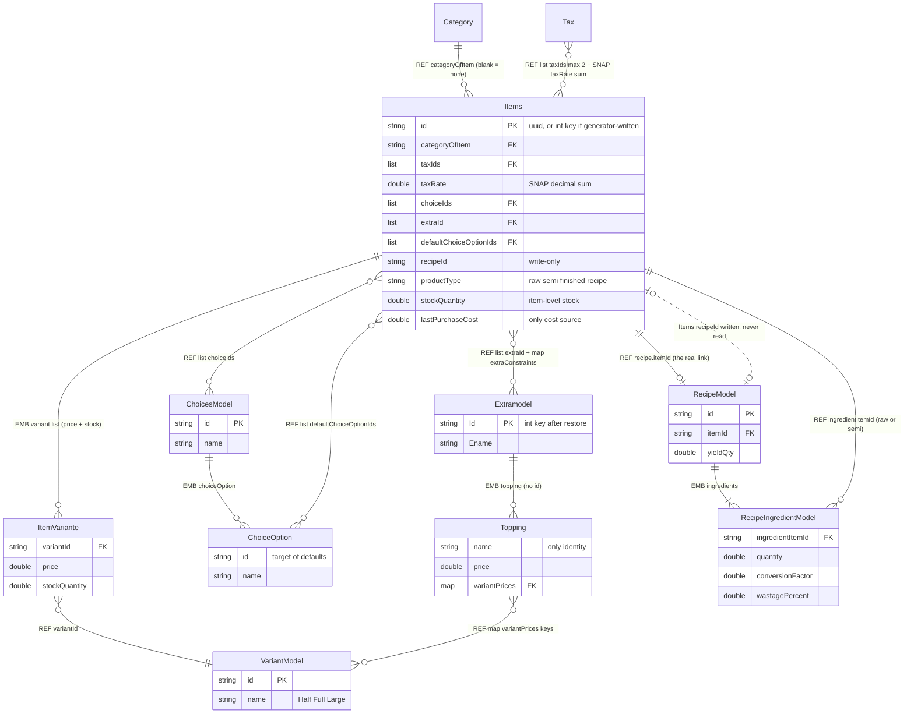
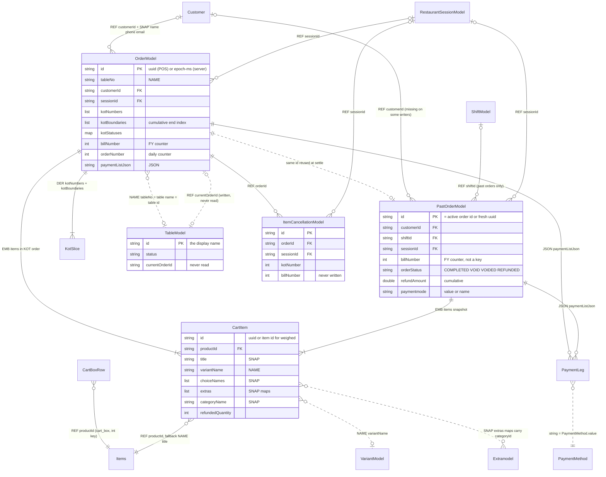
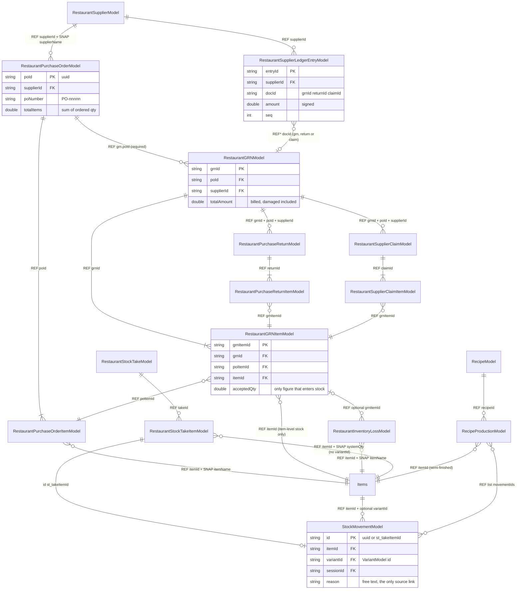
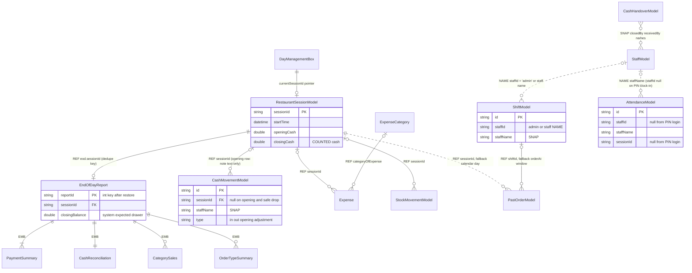

# 04 — Restaurant Database Relationships

> **Scope:** the RESTAURANT vertical of Bill Berry Lite (`D:\flutter\UniPOSs`), branch `refactor/shared-code-consolidation`. Verified by static reading of the source on 2026-10-19. Nothing was executed.
> **Audience:** a junior Flutter developer who needs to know how restaurant records point at each other, and what happens to those pointers when something is edited or deleted.
> **Companion docs:** model field lists live in the model docs of this series. This file covers only the **links between** models. Retail has its own version: `docs/database/retail/04_RETAIL_DATABASE_RELATIONSHIPS.md`.

**Evidence markers used throughout**

| Marker | Meaning |
|---|---|
| `file.dart:123` | Confirmed by reading that line of the source. |
| **(inferred)** | A conclusion drawn from the code that was not proven end to end. |
| **(unverified)** | Not checked in this pass. Treat it as a lead, not a fact. |

Short screen names used in citations:

| Short | Full path under `lib/presentation/screens/restaurant/` |
|---|---|
| `TA` | `start order/cart/takeaway.dart` (cart hub: place order, add-on, cancel, Quick Settle) |
| `CD` | `start order/cart/customerdetails.dart` (payment / settle) |
| `CART` | `start order/cart/cart.dart` (CartScreen: table transfer, merge) |
| `AO` | `tabbar/activeorder.dart` (KOT status, void, move to past) |

---

## 1. Read this first: Hive has no relationships

Hive is a **key-value store**. Every box is a map of `key → object`. That has consequences that are easy to forget:

- There are **no foreign keys**. `CartItem.productId` is only a string. Hive does not know it refers to the `itemBoxs` box.
- There are **no cascades**. Deleting a menu item does not touch its recipe, its order lines or its stock movements unless Dart code does it explicitly (it does not, see §5).
- There are **no joins**. "All past orders of customer X" means scanning the whole `pastorderBox` and filtering by `customerId`.
- There are **no transactions across boxes**. A settlement is a sequence of awaited `put`/`delete` calls over `appCounters`, `pastorderBox`, `orderBox`, `customers`, `cart_box` and `tablesBox`, and a crash can stop it halfway.
- The **only** thing Hive enforces is that a key is unique **within one box**, and that the stored bytes match a registered type adapter.

Every "relationship" in this document is therefore a **convention that application code follows**. The diagrams in §2 are **conceptual**. They show what the code intends, not anything the database checks.

### 1.1 The six link kinds

| Kind | Code | What it looks like | Restaurant example | Survives deletion of the target? |
|---|---|---|---|---|
| **ID reference** | `REF` | A `String` (or list/map of strings) holding another box's key | `Items.categoryOfItem → categories[id]`; `Items.choiceIds`; `RecipeModel.itemId` | The string stays and **dangles** |
| **Name reference** | `NAME` | A string holding the target's **display name**, matched by name at runtime | `OrderModel.tableNo` holds the table **name** (which is also `TableModel.id`); `CartItem.variantName` matched against `VariantModel.name` for stock deduction; `CartItem.title` as a fallback item lookup; `ShiftModel.staffId` = staff **name** for non-admins | Breaks on **rename** as well as on delete |
| **Embedded object** | `EMB` | A child object stored *inside* the parent record, with no box of its own | `Items.variant: List<ItemVariante>`; `ChoicesModel.choiceOption`; `Extramodel.topping`; `RecipeModel.ingredients`; `OrderModel.items: List<CartItem>`; the 5 summary types inside `EndOfDayReport` | It lives and dies with the parent |
| **Snapshot / denormalised copy** | `SNAP` | A copy of a value taken at write time | `CartItem.title`, `.price`, `.taxRate`, `.categoryName`, `.choiceNames`, `.extras`; `PastOrderModel.customerName`; `Items.taxRate` (cached sum of tax rates); `RestaurantGRNModel.supplierName` | Yes. History stays readable |
| **JSON in a field** | `JSON` | A JSON string holding a nested structure | `OrderModel.paymentListJson`, `PastOrderModel.paymentListJson` (payment legs) | Lives with the parent. Opaque to Hive and to any query |
| **Derived** | `DER` | Not stored. Computed on demand from other records | KOT slices from `kotBoundaries`; Recipe-Based "can make" stock; PO remaining qty; recipe cost; EOD figures (then frozen) | Recomputed, so it always reflects **current** data |

**Polymorphic reference (`REF*`)** is a special case of `REF` where one field points at different boxes depending on context: `RestaurantSupplierLedgerEntryModel.docId` (a GRN, purchase return or claim), the deterministic `StockMovementModel.id = st_<takeItemId>`, and `AppNotificationModel.subjectId` (`itemId`, `itemId:variantId` or a `sessionId`).

**Restaurant has more `NAME` links than retail.** Retail resolves almost everything by id. Restaurant resolves tables, variants on order lines, and (as a fallback) items by display text. A rename is therefore a **data-changing** action in restaurant mode.

### 1.2 Shared physical boxes

Restaurant and retail **share** some boxes. A device runs one mode at a time (`appConfigBox['businessMode']`), so in practice a shared box holds only one mode's rows (`hive_box_names.dart`; notes 01 §3).

| Data | Box string | Shared with retail? |
|---|---|---|
| Categories | `categories` | Yes |
| Customers | `customers` | Yes |
| Staff | `staffBox` | Yes |
| Taxes | `taxes` | Yes |
| Shifts | `shiftBox` | Yes |
| Attendance | `restaurantAttendanceBox` | Yes |
| Notifications | `restaurantNotificationsBox` | Yes |
| Payment methods | `paymentMethodsBox` | Yes |
| Printers | `restaurantPrintersBox` | Yes (opened in the common phase) |
| Sessions (the "day") | `restaurantSessionsBox` | Yes |
| Day pointer | `dayManagementBox` (untyped) | Yes |
| Cash movements | `cashMovementsBox` | Yes |
| Stock movements | `stockMovementsBox` | Yes |
| Counters | `appCounters` (untyped) | Yes |
| EOD reports | `restaurant_eodBox` vs retail `eodBox` | **No**, one per mode |
| Expense categories | `restaurant_expenseCategory` vs `expenseCategory` | **No** |
| Expenses | `restaurant_expenseBox` vs `expenseBox` | **No** |
| Menu, orders, tables, recipes, procurement | `itemBoxs`, `variante`, `choice`, `extra`, `cart_box`, `orderBox`, `pastorderBox`, `tablesBox`, `restaurantRecipesBox`, … | **No**, restaurant only |

The counter keys in `appCounters` used by `DocumentNumberService` (`PO_…`, `GRN_…`) are mode-agnostic, so restaurant and retail share a sequence for the same prefix (`document_number_service.dart:9-11`).

### 1.3 Where the cited files live

| Short name pattern | Folder |
|---|---|
| `itemmodel_302.dart`, `variantmodel_305.dart`, `choicemodel_306.dart`, `extramodel_303.dart`, `toppingmodel_304.dart`, `table_Model_311.dart`, `cartmodel_308.dart`, `ordermodel_309.dart`, `pastordermodel_313.dart`, `recipe_*.dart`, `restaurant_*_model.dart`, `eodmodel_317.dart`, `session_model.dart`, `cash_*_model.dart`, `stock_movement_model.dart`, `item_cancellation_model_134.dart` | `lib/data/models/restaurant/db/` |
| `hive_order.dart` (static `HiveOrders`, used by the server) | `lib/data/models/restaurant/db/database/` |
| `categorymodel_300.dart`, `taxmodel_314.dart`, `customer_model_125.dart`, `staffModel_310.dart`, `shift_model.dart`, `attendance_model.dart` | `lib/data/models/common/` |
| `payment_method.dart` | `lib/models/` |
| `item_repository.dart`, `order_repository.dart`, `cart_repository.dart`, `table_repository.dart`, `recipe_repository.dart`, `restaurant_grn_repository.dart`, `eod_repository.dart`, … | `lib/data/repositories/restaurant/` |
| `category_repository.dart`, `customer_repository.dart`, `shift_repository.dart` | `lib/data/repositories/common/` |
| `item_store.dart`, `order_store.dart`, `past_order_store.dart`, `table_store.dart`, `cart_store.dart`, `restaurant_purchase_order_store.dart`, `restaurant_damaged_goods_store.dart`, `restaurant_supplier_store.dart`, `restaurant_stock_take_store.dart` | `lib/domain/store/restaurant/` |
| `category_store.dart`, `customer_store.dart`, `shift_store.dart`, `attendance_store.dart` | `lib/domain/store/common/` |
| `inventory_service.dart`, `stock_adjust_service.dart`, `refund_service.dart`, `eod_service.dart`, `day_management_service.dart`, `low_stock_sync_service.dart`, `recipe_report_service.dart` | `lib/domain/services/restaurant/` |
| `document_number_service.dart`, `unified_backup_service.dart` | `lib/domain/services/common/` |
| `order_handler.dart`, `captain_handler.dart`, `kds_handler.dart` | `lib/server/handlers/` |

---

## 2. Conceptual relationship diagrams

> **CONCEPTUAL ONLY.** These are Mermaid `erDiagram`s for orientation. The lines show **intended** links that application code maintains by convention. Hive enforces none of them. "PK" marks the field used as the Hive key. "FK" marks a string that *should* match another box's key. Dotted lines (`..`) mark name references or links that are written but never read. Relationship labels give the link kind from §1.1.

### 2.1 Menu

### 2.2 Orders and billing

`KotSlice` and `PaymentLeg` are not stored types. A KOT is a slice `items[kotBoundaries[i-1] .. kotBoundaries[i])` of the order (`ordermodel_309.dart:277-293`). A payment leg is one element of the JSON array in `paymentListJson`. There is **no KOT box and no payment box** (notes 05 §C.0).

### 2.3 Purchasing and inventory

### 2.4 Day, cash and staff

`ShiftModel` has **no** `sessionId`. Shifts and sessions are independent. A shift reaches orders only through `PastOrderModel.shiftId` or the time window.

---

## 3. Relationship inventory

Column guide:
- **Kind**: see §1.1.
- **On delete of target**: what happens to *this* record when the record it points at is deleted.
- **On change of target**: what happens when the target is renamed, repriced or re-taxed.
- **Enforced by**: `DB` never applies (Hive enforces no link). The column names the **app code** that keeps the link valid, or `Nobody`.

### 3.1 Menu

| # | From (model.field) | To (model.key) | Kind | Card. | On delete of target | On change of target | Enforced by | Evidence |
|---|---|---|---|---|---|---|---|---|
| M1 | `Items.categoryOfItem` | `Category.id` | REF | N:1 (0..1; `''` = none) | **Re-parented** to `''`. The repo iterates the item box **by key**, so int-keyed items are handled too. Items are never deleted | Rename is free. POS shows the live name. `CartItem.categoryName` on orders keeps the old name. Sales by Category uses the **live** item→category map | App: `category_repository.dart:72-99`; mirror `category_store.dart:213-260` | `itemmodel_302.dart` f5; POS "Uncategorised" bucket `menu.dart:192-215` |
| M2 | `Items.taxIds` (≤2) + `Items.taxRate` | `Tax.id` | REF (list) + SNAP | N:M | `taxIds` **dangle** and the item **keeps billing** the cached `taxRate`. Per-tax removal needs the tax record (`apply_tax_screen.dart:179`) | A rate edit is **not** re-cached. A later `removeTax(id, newRate)` subtracts the new rate from a sum built with the old one | App on apply only (`applyTax` max 2, `itemmodel_302.dart:242-266`). Nobody on delete/edit | `addMultipleTax.dart:91-97, 126-128`; `tax_selection_screen.dart:361-381` |
| M3 | `Items.taxRate` units | `Tax.taxperecentage` | SNAP (converted) | — | — | `Tax` stores a **percent** (5). `Items.taxRate` stores a **decimal sum** (0.05 + 0.12 = 0.17) | App (÷100 at every writer) | `addMultipleTax.dart:131`; `apply_tax_screen.dart:137,175`; `restaurant_bulk_import_service.dart:1040-1045` |
| M4 | `Items.variant` | `ItemVariante` | EMB | 1:N | Dies with the item | Rebuilt on edit and on every stock delta | App: `item_store.dart:429-434`; `edit_item.dart:432-439` | `itemmodel_302.dart` f8 |
| M5 | `ItemVariante.variantId` | `VariantModel.id` | REF | N:1 | **Dangles**. The POS dialog silently drops the size (`item_options_dialog.dart:121-148`). If all sizes go, `hasVariants` stays true but nothing is pickable | Rename shows live in the dialog, but **in-flight cart lines carry the old name**, so stock deduction finds no match (see O5) | Nobody. No in-use check (`variant_tab.dart:313-333`); `variant_selection_screen.dart:82-97` deletes with no plan gate either | `itemvariantemodel_312.dart` f0 |
| M6 | `ItemVariante.trackInventory` | — | (ignored flag) | — | — | The **item's** `trackInventory` governs; the variant flag is ignored | — | `itemmodel_302.dart:186-191` |
| M7 | `Items.choiceIds` | `ChoicesModel.id` | REF (list) | N:M | **Dangles**; POS skips it (`item_options_dialog.dart:157-167`) | Rename/new options propagate (id link) | Nobody (`choice_tab.dart:711-732`) | `itemmodel_302.dart` f9 |
| M8 | `ChoicesModel.choiceOption` | `ChoiceOption` | EMB | 1:N | Dies with the group | Edit keeps existing option ids (`choice_tab.dart:87`); new options get new UUIDs (`:143`) | App | `choicemodel_306.dart` f2 |
| M9 | `Items.defaultChoiceOptionIds` | `ChoiceOption.id` (embedded inside a `ChoicesModel`) | REF (list into embedded) | N:M | Removing the option or the group **dangles**; silently ignored | — | Nobody | `item_options_dialog.dart:154-166` |
| M10 | `Items.extraId` | `Extramodel.Id` | REF (list) | N:M | **Dangles**; POS skips (`item_options_dialog.dart:171-188`). **After any restore every extra is unresolvable** because `extra` is restored with int keys (§4.3) | Rename propagates | Nobody (`extra_tab.dart:1132-1155`) | `itemmodel_302.dart` f10; `unified_backup_service.dart:2250` |
| M11 | `Items.extraConstraints` (`{extraId: {min,max}}`) | `Extramodel.Id` | REF (map keys) | N:M | Key dangles | Overrides `Extramodel.minimum/maximum` per item | Nobody | f21; `edit_item.dart:458-473` |
| M12 | `Extramodel.topping` | `Topping` | EMB | 1:N | Dies with the group | Topping edit rebuilds the object with no audit fields | App | `extramodel_303.dart` f3 |
| M13 | `Topping` identity | — | **none** (identified by `name`) | — | — | The POS dialog keys quantities by `topping.name`. Two same-named toppings in two extras on one item share one counter | Nobody | `item_options_dialog.dart:183,199` |
| M14 | `Topping.variantPrices` (`{VariantModel.id: price}`) | `VariantModel.id` | REF (map keys) | N:M | Key dangles; `getPriceForVariant` falls back to `price` | — | Nobody | `toppingmodel_304.dart:122-127`; `extra_tab.dart:394,629` |
| M15 | `Topping.variantion` | `VariantModel` copies | EMB / SNAP | 1:N | Unaffected | Not refreshed. **Only bulk import writes it** | — | `restaurant_bulk_import_service.dart:772` |
| M16 | `RecipeModel.itemId` | `Items.id` | REF | 1:1 by convention (first match wins) | **Recipe is orphaned**: item delete does not cascade | Switching the item's type away from semi/recipe deletes the recipe (`edit_item.dart:587-588`) | App, partial: lookup `recipe_repository.dart:15-21` (`firstWhere`); only writer `edit_item.dart:583-589` | `recipe_model.dart` f1 |
| M17 | `Items.recipeId` | `RecipeModel.id` | REF, **write-only** | — | — | Written by Edit Item; **no code reads it** (grep: only `edit_item.dart:517`, `copyWith`, ctor) | — | All lookups use `getRecipeForItem(item.id)` |
| M18 | `RecipeModel.ingredients` | `RecipeIngredientModel` | EMB | 1:N | Dies with the recipe | — | App (builder drops qty ≤ 0) | `recipe_model.dart` f4 |
| M19 | `RecipeIngredientModel.ingredientItemId` | `Items.id` | REF | N:1 | **Dangles**. Sale cascade **skips** the ingredient silently (`inventory_service.dart:136-142`); `availableToMakeFrom` returns 0, so the dish shows "0 can make" forever (`:257-259`) | Ingredient cost changes flow live into food cost | App, **picker only**: raw or semi and ≠ self (`recipe_builder_widget.dart:236-240`). Nobody on delete | `recipe_ingredient_model.dart` f0 |
| M20 | Recipe-Based available stock | Σ ingredient stock ÷ effective qty | DER | — | — | Always current | App: `InventoryService.effectiveAvailableStock` (`menu.dart:789,874`) | Own `stockQuantity` forced to 0 (`product_type.dart:73-85`) |
| M21 | Recipe cost / food cost | `RecipeModel.estimatedCostPerUnit` × ingredient `lastPurchaseCost` | DER | — | — | Live snapshot, no history | App: `recipe_report_service.dart:109-164` | `recipe_model.dart:58-76` |

### 3.2 Orders and billing

| # | From (model.field) | To (model.key) | Kind | Card. | On delete of target | On change of target | Enforced by | Evidence |
|---|---|---|---|---|---|---|---|---|
| O1 | `cart_box` rows | `CartItem` | working rows, **auto-int keys, addressed by index** | — | Whole box cleared after every place/settle | — | App: `cart_repository.dart:126-155` (`add`/`putAt`/`deleteAt`) | `customerdetails.dart:1395,1426,1583,1688` |
| O2 | `OrderModel.items` / `PastOrderModel.items` | `CartItem` | EMB (snapshot lines) | 1:N | Die with the order | Item price/name/tax edits do **not** reach existing orders | App | `ordermodel_309.dart` f4; `pastordermodel_313.dart` f3 |
| O3 | `CartItem.productId` | `Items.id` | REF, with **NAME fallback** on `title` | N:1 | Dangles. Receipts render from snapshots. Stock deduct/restore by id fails, then matches **by name**, so a later item with the same name absorbs deductions | Name, price, tax are frozen on the line | Nobody | `cartmodel_308.dart` f15; `inventory_service.dart:36-49, 758-776`; `cart_repository.dart:44-55` |
| O4 | `CartItem.title`, `.price`, `.taxRate`, `.categoryName`, `.isStockManaged` | Items / Category | SNAP | — | Unaffected | Frozen | App (written at add time) | `item_options_dialog.dart:357-399`; `menu.dart:728-738` |
| O5 | `CartItem.variantName` | `VariantModel.name` → `ItemVariante` | **NAME** | N:1 | Variant delete or **rename**: `_deductVariantStock` finds no match, deducts nothing, and **still writes an `out` movement** with `balanceAfter: 0` | Breaks on rename | Nobody | `inventory_service.dart:72-79, 540-564`; `cart_repository.dart:83-89` |
| O6 | `CartItem.choiceNames` | `ChoiceOption.name` | SNAP (names only, no id, no price) | — | Unaffected | Frozen | — | `item_options_dialog.dart:369-399` |
| O7 | `CartItem.extras` (list of raw maps) | `Extramodel.Id` via map key `categoryId`, topping by `name` | SNAP (maps that carry an id) | — | Unaffected | Frozen. Extra price is already folded into `CartItem.price` | — (readers of `categoryId` **(unverified)**) | `item_options_dialog.dart:372-399` |
| O8 | `OrderModel.kotNumbers` / `kotBoundaries` / `kotStatuses` / `kotTimestamps` | positions in `OrderModel.items` | DER (positional encoding) | 1:N KOTs | — | Invariant `kotBoundaries.last == items.length`. **Immediate cancel (`TA:1120-1129`) removes items without adjusting boundaries**; `getItemsByKot` has no bounds guard (`ordermodel_309.dart:277-293`) | App, per writer: `order_repository.dart:148-183`; `AO:1540-1567` | `PastOrderModel.getItemsByKot` clamps (`pastordermodel_313.dart:288-322`) |
| O9 | `OrderModel.tableNo` | `TableModel.id` (= the table's display name) | **NAME** | N:1 (0..1; `''` for take-away) | Delete is refused for an occupied table (`table.dart:203-231`) | **Rename** = delete old + add new (`table.dart:276-284`), offered **even for occupied tables** (`:192-199`). The order keeps the old name → orphaned | App (delete only). Nobody (rename) | `ordermodel_309.dart` f8; `table.dart:76` |
| O10 | `TableModel.currentOrderId` | `OrderModel.id` | REF, **written but never read** | 1:0..1 | Nulled when the table goes `Available` | — | — | **Correction to older notes:** POS **does** write it (`TA:1529`, `TA:1210`, `TA:1904`, `CART:805`, `CART:1333`, `AO:1343`), as do server handlers. No code reads it (grep `.currentOrderId`: only `table_store.dart:143`, `table_repository.dart:43,47`). The live lookup is `OrderStore.getActiveOrderByTableId` matching `tableNo` + active status (`order_store.dart:570-584`) |
| O11 | `TableModel.currentOrderTotal` / `timeStamp` | Order | SNAP (cached) | — | — | Repo writes `total` as passed (null if omitted) while the store keeps the old value → disk and memory diverge | Nobody | `table_repository.dart:30-55` vs `table_store.dart:137-150` |
| O12 | `PastOrderModel.id` | `OrderModel.id` | **same key reused across boxes** | 1:1 | Active order is **deleted** once moved to past | — | App: crash reconcile deletes an active order whose id already exists in past (`order_store.dart:240-252`); `CD.completeOrder` checks before writing (`CD:1496-1499`) | Direct Settle & Print (`CD:1512`) and Quick Settle (`TA:3293`) mint a **fresh UUID** and never had an active order |
| O13 | `OrderModel.customerId` / `PastOrderModel.customerId` (+ `customerName`, `customerNumber`, `customerEmail`) | `Customer.customerId` | REF + SNAP | N:1 (optional) | Customer delete is **unguarded** (`customer_store.dart:191-203`) → id dangles; loyalty restore on refund targets a missing id | Name/phone snapshots not refreshed | Nobody | **Missing** on `_moveOrderToPast` (`AO:1504-1528`), Active-Orders void, Quick Settle (`TA:3292-3322`) |
| O14 | `PastOrderModel.shiftId` | `ShiftModel.id` | REF | N:1 (optional) | Shift deleted only when it has no sales (`shift_store.dart:323-370`) | — | Nobody. Fallback: `orderAt` inside the shift window (`shift_repository.dart:91-113, 152-165`) | `OrderModel` has **no** `shiftId`. Not written by `_moveOrderToPast` or Active-Orders void; EOD complete-service writes the **closer's** shift |
| O15 | `OrderModel.sessionId` / `PastOrderModel.sessionId` | `RestaurantSessionModel.sessionId` | REF | N:1 (optional) | Sessions are never deleted | Settle refreshes it to the current session (`CD:1350`) | Nobody. EOD filters by sessionId, falling back to the **calendar day of `orderAt`** when null (`eod_service.dart:51-70`) | `OrderModel.toMap/fromMap` **drop `sessionId`** (and `billNumber`, `lastModifiedBy/At`, `kotTimestamps`) → lost on backup restore (`ordermodel_309.dart:306-396`) |
| O16 | `OrderModel.paymentListJson` / `PastOrderModel.paymentListJson` | payment legs | JSON | 1:N | — | Re-settle **appends** legs and accumulates `totalPaid` (`CD:1306-1348`) | App: `split_payment_widget.dart:63-75` | Null on Quick Settle and VOID; getter falls back to `{paymentmode, totalPrice}` (`pastordermodel_313.dart:417-432`) |
| O17 | leg `method` / `PastOrderModel.paymentmode` | `PaymentMethod.value` | **string value, not id** | N:1 (soft) | Past orders keep the string; reports bucket by it (`payment_mode_summary.dart:72-90`) | **Restaurant edit rewrites `value` from the edited name, built-ins included** (`paymentsMethods.dart:167-171`) → reporting bucket splits. **Quick Settle stores `PaymentMethod.name`**, not `.value` (`TA:2950, 3075`) | Nobody | `payment_method.dart` f2 |
| O18 | `CartItem.refundedQuantity` + `PastOrderModel.refundAmount` | refunds | stored (cumulative) | — | — | Refund qty is spread over lines grouped by `productId_variant_extras_choices` (DER key, `refund_service.dart:186-190`) | App: `RefundService.processRefund` (`refund_service.dart:30-116`) | `refundedAt` keeps only the **last** refund time |
| O19 | `PastOrderModel.loyaltyPointsUsed` | `Customer.loyaltyPoints` | stored count; restore DER | — | — | Refund restores `round(pointsUsed × refund/totalPrice)` only when `customerId` is present. Earned points are never reversed | App: `refund_service.dart:99-110` | Writers that drop `customerId` make points unrecoverable (O13) |
| O20 | `ItemCancellationModel.orderId` (+ `itemName`, `kotNumber`, `tableNo`, `orderType` SNAP) | `OrderModel.id`, later `PastOrderModel.id` | REF + SNAP | N:1 | Order later voided/settled: the id still matches the past record (O12) | — | App: written only by POS cancel paths (`TA:1136-1160, 1761-1793`) | **Not written** by captain modify (`captain_handler.dart:329-445`) or `AO._cancelKotItem` (`AO:1540-1614`). `billNumber` f7 never written. Box **not backed up** |
| O21 | `ItemCancellationModel.sessionId` | Session | REF | N:1 | — | — | Nobody | `item_cancellation_model_134.dart` f11 |
| O22 | `PastOrderModel.discountAppliedBy`, `voidedBy`, `refundedBy`; `OrderModel.lastModifiedBy` | Staff | SNAP (label strings) | — | — | — | — | No staff id on any order model. KDS writes stamp the **POS's** logged-in user (`order_store.dart:282-291`) |
| O23 | `PastOrderModel.taxEnabled`, `storeGstNumber`, `roundOffStep`, `discountOnItems`, `isTaxInclusive` | Business settings | SNAP | — | — | Frozen at settlement | App | `pastordermodel_313.dart` f25, f36-f39 |
| O24 | Order totals | `CartItem` lines | stored, not derived | — | — | `totalPrice` is the canonical grand total; never recompute from items. Captain add-items does **not** recompute it (`hive_order.dart:206-285`) | App | notes 03 §0.3 |
| O25 | Customer visit / points counters | settlements | stored counters | — | — | Each settle that redeems points calls `updateCustomerVisit` twice (+2 visits) | App: `customer_repository.dart:98-115` | `CD:1401-1403, 1420-1422` |
| O26 | Server-created order | `OrderModel` | REF via static `HiveOrders` (bypasses `OrderStore`) | — | — | Captain/KDS writes go straight to `orderBox`; POS reloads on WS events | App (partial) | `captain_handler.dart:152-320`; `order_handler.dart:12-85` |

### 3.3 Purchasing and inventory

| # | From (model.field) | To (model.key) | Kind | Card. | On delete of target | On change of target | Enforced by | Evidence |
|---|---|---|---|---|---|---|---|---|
| P1 | `RestaurantPurchaseOrderModel.supplierId` (+`supplierName`) | `RestaurantSupplierModel.supplierId` | REF + SNAP | N:1 | Supplier delete is **blocked by the UI** while any PO/GRN/return/claim exists or balance ≠ 0. The store's `deleteSupplier` does **not** re-check | Name snapshot not refreshed | App (UI only): `referencesFor` (`restaurant_supplier_store.dart:300-309`), `restaurant_supplier_detail_screen.dart:91-130` | `restaurant_purchase_order_model.dart` f2-f3 |
| P2 | `RestaurantPurchaseOrderItemModel.poId` | `RestaurantPurchaseOrderModel.poId` | REF | N:1 | **Cascade** on PO delete (lines first, then header) | Edit deletes all lines and creates new ones with **new `poItemId`s** | App: `restaurant_purchase_order_store.dart:180-264` | f1 |
| P3 | `RestaurantPurchaseOrderItemModel.itemId` (+`itemName`) | `Items.id` | REF + SNAP | N:1 | Dangles | Snapshot kept | Nobody (picker allows raw or finished, `add_purchase_order_screen.dart:944-946`) | f2-f3 |
| P4 | `RestaurantGRNModel.poId` (+`poNumber`) | PO | REF + SNAP | N:1 (required) | PO delete is **blocked** once a GRN exists; PO edit likewise | — | App: `canDeletePurchaseOrder` (`:272-276`); `updatePurchaseOrder` (`:194`) | `restaurant_grn_model.dart` f2-f3 |
| P5 | `RestaurantGRNModel.supplierId` (+`supplierName`) | Supplier | REF + SNAP | N:1 | Blocked as P1 | — | App (UI) | f4-f5 |
| P6 | `RestaurantGRNItemModel.grnId` | `RestaurantGRNModel.grnId` | REF | N:1 | **No GRN delete exists** (repo has none) | Lines are written **before** the header; a crash leaves header-less lines | App | `restaurant_purchase_order_store.dart:339-386` |
| P7 | `RestaurantGRNItemModel.poItemId` | `RestaurantPurchaseOrderItemModel.poItemId` | REF | N:1 | — | Breaks if the PO were edited; prevented by the draft-and-no-GRN rule | App (P4) | f2 |
| P8 | `RestaurantGRNItemModel.itemId` (+`itemName`) | `Items.id` | REF + SNAP | N:1 | Receiving **skips** a missing item but the GRN still **bills full value** | Stock lands on `Items.stockQuantity` only (never on a variant) and `lastPurchaseCost` is **overwritten** (last cost, not average) | App: `:355-368` → `item_store.dart:400-458` | Also increments `trackInventory=false` items |
| P9 | PO status / remaining qty | Σ GRN quantities | DER (+ stored status) | — | — | **Two different sums:** status compares Σ **confirmed GRN header** `totalReceivedQty` with `po.totalItems` (`:410-426`); the receiving screen's remaining qty sums **every GRN-item row regardless of header** (`restaurant_grn_repository.dart:67-71`) | App | Surplus on one line can close shortfall on another |
| P10 | GRN stock movement | GRN line | **text only** (`reason: 'Purchase (PO-…)'`) | — | — | — | Nobody | Movement id is a random UUID (`restaurant_purchase_order_store.dart:370-383`), unlike retail's `grn_<grnItemId>`. No idempotency |
| P11 | `RestaurantPurchaseReturnModel.grnId/grnNumber/poId/poNumber/supplierId` (+`supplierName`) | GRN / PO / Supplier | REF + SNAP | N:1 | Supplier delete blocked (UI) | — | App (UI) | `restaurant_purchase_return_model.dart` f2-f7 |
| P12 | `RestaurantPurchaseReturnItemModel.returnId` / `.grnItemId` / `.itemId` | Return / GRN line / Item | REF + SNAP (`itemName`, `costPrice`) | N:1 | No return delete (cancel = status only, `:301-314`) | Snapshot | App (header then items, not atomic) | `restaurant_damaged_goods_store.dart:147-183` |
| P13 | `RestaurantSupplierClaimModel.grnId/poId/supplierId` (+numbers, name) | GRN / PO / Supplier | REF + SNAP | N:1 | Supplier delete blocked (UI) | — | App (UI) | `restaurant_supplier_claim_model.dart` f2-f7 |
| P14 | `RestaurantSupplierClaimItemModel.claimId` / `.grnItemId` / `.itemId` | Claim / GRN line / Item | REF + SNAP | N:1 | — | Snapshot | App | `:185-221` |
| P15 | `RestaurantInventoryLossModel.grnId/grnItemId/poId/supplierId` (all optional) | GRN / GRN line / PO / Supplier | REF + SNAP | N:1 | Not counted by `referencesFor` (covered transitively by its GRN) | — | Nobody | `restaurant_inventory_loss_model.dart` f3-f8 |
| P16 | `RestaurantInventoryLossModel.itemId` (+`itemName`, `costPrice`, `lossValue`) | `Items.id` | REF + SNAP | N:1 | Dangles | `lossValue` frozen | Nobody | f9-f13. A loss never moves stock |
| P17 | `RestaurantSupplierLedgerEntryModel.supplierId` | Supplier | REF | N:1 | **Cascade**: supplier delete wipes all its ledger rows, **including payment/adjustment history** when the balance is 0 | — | App: `restaurant_supplier_store.dart:162-167`; `restaurant_supplier_ledger_repository.dart:39-45` | f1 |
| P18 | `RestaurantSupplierLedgerEntryModel.docId` (+`docNumber`) | `grnId` / `returnId` / `claimId` | REF* (polymorphic) + SNAP | N:1 | — | — | App writes it (`restaurant_purchase_order_store.dart:404`; `restaurant_damaged_goods_store.dart:290, 381`). A per-doc idempotency check like retail's `hasEntryForDoc` **(unverified)** for restaurant; none is used in GRN confirm | f7-f8 |
| P19 | `RestaurantSupplierModel.currentBalance` vs Σ ledger `amount` | — | stored + DER | — | — | Ledger row written **before** the balance; a crash makes them drift. Two concurrent calls race (no lock) | App: `recordBalanceMovement` only (`restaurant_supplier_store.dart:178-230`) | notes 04 §2.2 |
| P20 | Return / claim credit applied once | Ledger | flag (`creditApplied`, `lossRecorded`) | — | — | Flag saved **before** the ledger write (at-most-once). `writeOffRejectedClaim` saves losses **before** its flag (retry duplicates) | App | `restaurant_damaged_goods_store.dart:259-297, 393-444` |
| P21 | `RestaurantStockTakeItemModel.takeId` | `RestaurantStockTakeModel.takeId` | REF | N:1 | **Cascade** on cancel (hard delete, draft with no applied line) | — | App: `restaurant_stock_take_store.dart:279-304` | f1 |
| P22 | `RestaurantStockTakeItemModel.itemId` (+`itemName`, `systemQty`, `costPrice`) | `Items.id` | REF + SNAP | N:1 (one line per item per take) | Dangles | `systemQty` re-snapshotted on recount. **No `variantId` field**: variant items are counted against `Items.stockQuantity` | App | f2-f6; `findLine` keyed `(takeId, itemId)` |
| P23 | `StockMovementModel.id = st_<takeItemId>` | stock-take line | REF* (key) | 1:1 | — | — | App: idempotency in `adjustTo` (`stock_adjust_service.dart:287`). The item is written **before** this movement, so a crash between them double-applies on re-commit | `restaurant_stock_take_store.dart:366-374` |
| P24 | `StockMovementModel.itemId` (+`itemName`) | `Items.id` | REF + SNAP | N:1 | Dangles; `itemName` keeps history readable | Snapshot | Nobody | `stock_movement_model.dart` f2, f4 |
| P25 | `StockMovementModel.variantId` | `VariantModel.id` (the same value as `ItemVariante.variantId`) | REF | N:1 (optional) | Dangles | — | Nobody | `inventory_service.dart:76-78, 550, 927` |
| P26 | `StockMovementModel.sessionId` | Session | REF | N:1 (optional) | Sessions never deleted | — | Nobody | f12 |
| P27 | Source document of a sale / void / GRN / adjustment movement | order, GRN, adjustment | **text only** (`reason`, `note`) | — | — | — | Nobody | No order id on the movement, so partial deductions cannot be detected or replayed |
| P28 | `RecipeProductionModel.recipeId` / `.itemId` (+`itemName`) | Recipe / Items | REF + SNAP | N:1 | Dangles (append-only log) | — | Nobody | `recipe_production_model.dart` f1-f3 |
| P29 | `RecipeProductionModel.movementIds` | `StockMovementModel.id` | REF (list) | 1:N | Movements never deleted | Written **last**; a crash leaves unlinked movements | App: `inventory_service.dart:508-518` | f7 |
| P30 | `Items.lastPurchaseCost` | GRN line cost / production cost | SNAP (overwritten) | — | — | Written by GRN (last cost), production, `applyStockDelta`, **and re-seeded from the selling-price field on every Raw-Material edit** | Nobody | `edit_item.dart:147-149, 474-482` |
| P31 | `StockMovementModel.unitCost` | item cost at write time | SNAP | — | — | Missing on GRN, opening, manual, stock-take and adjustment movements | — | notes 04 §6.1 |

### 3.4 Day, cash, staff, notifications

| # | From (model.field) | To (model.key) | Kind | Card. | On delete of target | On change of target | Enforced by | Evidence |
|---|---|---|---|---|---|---|---|---|
| D1 | `dayManagementBox['currentSessionId']` | `RestaurantSessionModel.sessionId` | REF (pointer) | 1:0..1 | Pointer deleted at `endSession` (`day_management_service.dart:121`) | — | App: `startSession`/`endSession` (`:47-125`), non-atomic | `dayManagementBox` is **not in the restaurant backup**: after restore it can point at a session that is not there |
| D2 | `EndOfDayReport.sessionId` | Session | REF | 1:1 (dedupe) | — | Re-saving for the same session **deletes and replaces** the report | App: `eod_service.dart:402-417` | `eodmodel_317.dart` f20 |
| D3 | EOD ↔ past orders, cash movements, expenses, refunds | rows with matching `sessionId` (fallbacks: calendar day / time window) | DER, then frozen | — | — | Later refunds/voids change live reports but **not** the stored EOD | App: `eod_service.dart:35-291` | No id list on the report |
| D4 | `EndOfDayReport.orderSummaries/categorySales/paymentSummaries/cashReconciliation/taxSummaries` | types 118-121, 124 | EMB | 1:N / 1:1 | Die with the report | `taxSummaries` always empty because every writer stores `gstRate: 0` (`eod_service.dart:367`) | — | `eodmodel_317.dart` |
| D5 | `CashMovementModel.sessionId` | Session | REF | N:1 | — | — | Nobody | **Null** for: the `opening` row (matched by note text `Session ID: <id>`, `eod_service.dart:209`); the opening-balance adjustment (written before the session exists); EOD shortage/overage and safe-drop rows (written after `endSession`, `endday.dart:848` then `:903-920`) |
| D6 | `CashMovementModel.staffName` | Staff | SNAP only | — | — | — | — | No staff id |
| D7 | Refund / void ↔ cash | — | DER only | — | — | No cash movement is written for a refund; payment summaries net `refundAmount` pro-rata over legs | App: `payment_mode_summary.dart:29-44` | Drawer screen and EOD disagree on refunds of earlier-session orders (`cash_drawer_screen.dart:163-167` vs `eod_service.dart:83-152`) |
| D8 | `Expense.categoryOfExpense` | `ExpenseCategory.id` | REF | N:1 | Category delete is **unguarded and unconfirmed**; the expense keeps the id and the report groups by the live category list | — | Nobody: `expense_category_store.dart:101-110`; `managecategory.dart:73-75` | `expensereport.dart:121` |
| D9 | `Expense.sessionId` | Session | REF | N:1 (optional) | — | Set to the **current** session even for a back-dated expense; edit/delete has no closed-session lock | Nobody | `addexpence.dart:114,125` |
| D10 | `ShiftModel.staffId` (+`staffName`) | `StaffModel.id` | **NAME** in practice | N:1 | Staff delete is unguarded; shift keeps the snapshot | — | Nobody | Restaurant auto-start writes `staffId = 'admin'` or the staff **name** (`welcome_Admin.dart:153-155`) |
| D11 | `AttendanceModel.staffId` / `.sessionId` | Staff / Session | REF (declared), **null in practice** | N:1 | — | — | Nobody | PIN-login clock-in passes neither (`restaurant_login.dart:136`; `attendance_store.dart:65-80` accepts both as optional). Matching falls back to `staffName` |
| D12 | `CashHandoverModel.closedBy` / `receivedBy` | Staff | SNAP names | — | — | — | — | **No handover record is ever created by the current UI** (dialogs never constructed, notes 05 §E4) |
| D13 | `AppNotificationModel.subjectId` | `Items.id` or `Items.id:VariantModel.id` (low stock); `sessionId` (session notice); `'license'` | REF* (composite string) | N:1 | Resolved by the reconciling sync when the item is no longer low **(inferred** for a deleted item**)** | — | App: `low_stock_sync_service.dart:73-74, 79-126`; `notification_sync_service.dart:34-35` | Box not backed up |
| D14 | `RestaurantSessionModel.closingCash` vs `dayManagementBox['closingBalance']` | — | two stored figures | — | — | Session holds **counted** cash (`endday.dart:848`); the box holds counted − safe-drop withdrawal (next opening pre-fill) | App | `day_management_service.dart:109-125, 178-195` |
| D15 | `EndOfDayReport.cashWithdrawn` | safe drop | stored, **never set** for restaurant | — | — | `cashKept` therefore equals counted cash | — | notes 03 §6 f28 |
| D16 | `SavedPrinterModel.id` ← prefs `default_kot_printer_id` / `default_receipt_printer_id` | Printer | REF (from SharedPreferences) | 1:0..1 | `deletePrinter` clears both pref references first | Stale/role-incompatible reference cleared on read | App: `printer_repository.dart:47-69, 91-103` | Prefs denylisted from backup; printers box restored |

### 3.5 Expected relationships that do NOT exist

New developers often assume these links exist. They don't:

| Missing link | What exists instead | Evidence |
|---|---|---|
| Order → staff id (cashier, waiter, captain) | Only label strings: `discountAppliedBy`, `voidedBy`, `refundedBy`, `lastModifiedBy`. Captain's `staffId` is read from the request and discarded | notes 03 §12; `captain_handler.dart:158` |
| `OrderModel.shiftId` | Only `PastOrderModel.shiftId`, and only on some writers | `ordermodel_309.dart` field list |
| `ShiftModel.sessionId` | None. Shift and session are independent | `shift_model.dart` |
| Session opened-by / staff | None | `session_model.dart` f0-f5 |
| KOT entity or box | KOTs are positional slices encoded on the order | `ordermodel_309.dart:75-123, 277-293` |
| Payment rows in a box | JSON legs inside the order | `paymentListJson` |
| Order/past order ↔ `PaymentMethod.id` | The method **value** string (or **name** on Quick Settle) | `split_payment_widget.dart:253,613`; `TA:2950` |
| `Items.recipeId` used for lookup | Recipe is found by `RecipeModel.itemId` (`getRecipeForItem(item.id)`) | `recipe_repository.dart:15-21` |
| Item delete → recipe / ingredient cascade | Nothing. The item's own recipe is orphaned, dishes using it break silently | `item_store.dart:267-292` |
| `CartItem` → `ChoicesModel` / `ChoiceOption` / `Extramodel` / `VariantModel` ids | Names and raw maps (the extras map does carry `categoryId`) | `item_options_dialog.dart:369-399` |
| Order ↔ table by id | `tableNo` holds the table **name**; `currentOrderId` is never read | O9, O10 |
| Stock movement → order / GRN / adjustment | Free text in `reason`/`note`; only stock-take (`st_`) and production (`movementIds`) are linkable | `stock_movement_model.dart`; `restaurant_purchase_order_store.dart:370-383` |
| Refund / void → cash movement | Derived from `refundAmount` | D7 |
| Customer credit / dues | Restaurant has **no credit**. A part-paid order finalised at EOD keeps `amountDue > 0` with no receivable | `endday.dart:602-640` |
| `ItemCancellationModel.billNumber` | Field exists, never written | both writers in `takeaway.dart` |
| Cancel-KOT number on the order | Consumed from the counter and printed only | `TA:1165-1184`; `captain_handler.dart` modify |
| Captain full cancel → VOID past record | The active order is simply deleted | `captain_handler.dart:358-375` |
| Item → preferred supplier | None | model field lists |
| GRN / stock take → `ItemVariante` | Item-level stock only (`variantId` null) | `restaurant_purchase_order_store.dart:374`; P22 |
| Topping id | Identified by name | M13 |
| Expense ↔ order | None | — |
| Customer → list of orders | Scan `pastorderBox` by `customerId` | — |
| EOD → list of order ids | Aggregates only | `eodmodel_317.dart` |
| Category parent / sub-category | None | `categorymodel_300.dart` |

---

## 4. How IDs connect records

### 4.1 ID schemes

| Record | Id field | Hive key | Format / generator | Evidence |
|---|---|---|---|---|
| Menu item (`Items`) | `id` | `id`; **auto-int** for items written by the dev data generators (`addAll`) | UUID v4. Bulk import upserts `existingItem?.id ?? uuid` | `add_item_form_state.dart:181`; `restaurant_bulk_import_service.dart:1061`; `test_data_generator.dart:504,514`; `comprehensive_data_generator.dart:657,664` |
| Variant master | `id` | same | UUID v4 | `variant_tab.dart:304` |
| Choice group / option | `id` / `id` | same / embedded | UUID v4 | `choice_tab.dart:143, 702` |
| Extra group | `Id` | same; **auto-int after restore** | UUID v4 | `extra_tab.dart:1049`; `unified_backup_service.dart:2250` |
| Topping | — | embedded | **no id** | `toppingmodel_304.dart` |
| Table | `id` | same | **The user-typed display name** | `table.dart:76` |
| Recipe | `id` | same | `initialRecipe?.id ?? uuid` (reused per item) | `recipe_builder_widget.dart:86` |
| Category (shared) | `id` | same | UUID v4 in restaurant (retail uses ms epoch) | `add_category_dialog.dart:137` |
| Tax / Staff (shared) | `id` | same | UUID v4 | `addMultipleTax.dart:100` |
| Customer (shared) | `customerId` | same | **UUID v4** in restaurant (retail `CUST-000042`) | `customerdetails.dart:2075`; `takeaway.dart:1339` |
| Payment method (shared) | `id` (UUID) | **auto-int** (`box.add`) | Orders reference `value`/`name`, not `id` | `hive_init.dart:262` |
| Cart line | `CartItem.id` | **auto-int**, addressed by index | UUID v4, or **the item id** for weighed lines (drives merging) | `item_options_dialog.dart:360`; `weight_item_dialog_restaurant.dart:37` |
| Active order | `id` | same | UUID v4 on POS; **epoch-ms string** from `/orders` and Captain | `TA:1467`; `order_handler.dart:24`; `captain_handler.dart:248` |
| Past order | `id` | same | = the active order id; fresh UUID for direct Settle & Print and Quick Settle | `CD:1512`; `TA:3293` |
| Item cancellation | `id` | same | UUID v4 | `TA:1145, 1773` |
| Session / EOD / cash movement / handover / shift / attendance / expense / expense category | `sessionId` / `reportId` / `id` | same (EOD: **auto-int after restore**) | UUID v4 | notes 03 §0.1; `eod_service.dart:267` |
| Supplier / ledger entry | `supplierId` / `entryId` | same | UUID v4 | `restaurant_supplier_model.dart:67` |
| Purchase order | `poId` | same | **UUID v4** (retail uses ms epoch) | `restaurant_purchase_order_store.dart:116` |
| PO line | `poItemId` | same | UUID v4, **new on every edit** | `:229-239` |
| GRN / GRN line / return / claim / loss / stock take / take line / production | `grnId` / … | same | UUID v4 | notes 04 §1 |
| Stock movement | `id` | same | UUID v4, or deterministic `st_<takeItemId>` (stock take only) | `restaurant_stock_take_store.dart:366-374` |

### 4.2 Numbers that act like identifiers but are not keys

| Number | Format | Counter (`appCounters` keys) | Reset | Unique? | Evidence |
|---|---|---|---|---|---|
| Bill number | plain int | `lastBillNumber` + `lastBillResetYear` | **Financial year** (`FiscalYearRule.startOfCurrent`) | Within one FY only. Comments saying "daily" are stale | `order_repository.dart:93-110` |
| Bill number (dead variant) | int | `lastBillNumber` + `lastBillDate` | daily | No callers, but would clobber the FY counter | `hive_order.dart:59-90` |
| KOT number (POS) | int | `lastKotNumber` + `lastKotDate` | **Calendar day** (device date, not session) | Within a day | `order_repository.dart:71-86` |
| KOT number (Captain append) | int | **same `lastKotNumber`**, no date check | **never** | Collides with the daily series: an add-on KOT before the day's first POS KOT continues yesterday's count, then the POS resets to 1 | `hive_order.dart:46-55` via `updateOrderWithNewItems` (`:215`); `captain_handler.dart:201` |
| Order number | int | `lastOrderNumber` + `lastOrderDate` | Calendar day | Not set by the `CD` place path or `/orders` | `order_repository.dart:119-144` |
| Item code | 4-5 digits, suggested max+1 from 1001 | none | — | **Yes, app-enforced** on add and edit | `item_store.dart:194-201, 231-238, 574-587` |
| Document numbers | `<PREFIX>-00001` | `
_lastFy`, `
_lastSeq`, optional `
_prefix` | Financial year | Within a box via `isTaken` (box scan for PO/GRN; observable list for PR/CLM/LOSS/ST). **`LOSS` from a manual stock adjustment has no `isTaken` guard** | `document_number_service.dart:31-91`; `stock_adjust_service.dart:70` |

Prefixes used by restaurant: `PO`, `GRN`, `PR`, `CLM`, `LOSS`, `ST`. Some model doc comments still show the old daily format (`PR-20260813-001`); those are stale.

**Numbers are consumed before use.** A cancel-KOT print, `printBillForActiveOrder` (`restaurant_print_helper.dart:692`), every retry and every failed save burn KOT or bill numbers. A dine-in order paid before being served gets a bill number, and `CD.completeOrder` then takes **another** one (`CD:1390, 1450`).

**Rule for juniors:** join on the **id** fields, never on a bill or KOT number. Bill 42 exists once per financial year; KOT 3 exists once per day (twice if the Captain path was used).

### 4.3 "Key ≠ id" after a backup restore

Most restaurant boxes are restored with `putAll` keyed by the model id, so key = id. These are not (`unified_backup_service.dart:2175-2187, 2250, 2258, 2265, 2288`; common `:1960-2028`):

| Box | Restore write | Repository uses | Effect after restore |
|---|---|---|---|
| `extra` | `addAll` (int keys) | `get/put/delete(extra.Id)` | `getExtraById` misses → **every extra disappears from the POS dialog**; edit writes a second copy; delete is a no-op |
| `restaurant_eodBox` | `addAll` | `reportId` | Delete/replace by id misses (only matters if a restored session is re-closed) |
| `cart_box` | `addAll` | index-based | Works as designed |
| `testBillBox` | `addAll` | — | Dead box |
| `businessDetailsBox`, `businessTypeBox`, `taxBox` | `add()` | fixed keys (`'businessDetails'`, …) | Lookups by fixed key return null **(inferred)** |
| `paymentMethodsBox` | `add()` | position-based | Works as designed |

**Not in the restaurant backup at all:** `dayManagementBox`, `stockMovementsBox`, `restaurantItemCancellationsBox`, `restaurantNotificationsBox` (notes 01 R2). Stock-movement export/restore exists only in the retail branch (`unified_backup_service.dart:1174-1187, 2783-2793`). After a restaurant restore, `Items.stockQuantity` comes back but its ledger does not.

**Items have their own key trap.** Generator-written items sit under int keys. `ItemRepository.updateItem` finds every key holding the id and rewrites in place (`item_repository.dart:56-74`), and `getAllItems` de-duplicates by id (`:26-36`). But `deleteItem`, `getItemById`, `updateStock` and `toggleItemStatus` use `box.get/delete(itemId)` and miss int-keyed rows, so a deleted item **reappears on the next `loadItems()`** (`:77-248`).

---

## 5. Deletion and consistency behaviour

| Entity | Delete path | Guard | Behaviour | What dangles | What keeps history readable |
|---|---|---|---|---|---|
| Menu item | `items_tab.dart:70-88` → `item_store.dart:267-292` → `item_repository.dart:77-79` | Plan key + confirm only | **Hard delete**, no cascade. Int-keyed items are not actually deleted | Own recipe; ingredient lines of other recipes; `CartItem.productId` in cart/active/past orders; PO/GRN/return/claim/loss/stock-take lines; movements; low-stock notification | Name/price/tax snapshots on order lines; `itemName` on documents and movements |
| Menu item (soft) | `isEnabled = false` | — | Hidden from POS, kept in Manage Menu | Nothing | Everything |
| Variant master | `variant_tab.dart:313-333` (plan gated); `variant_selection_screen.dart:82-97` (**not** gated) | None for usage | Hard delete | `ItemVariante.variantId` on items; `Topping.variantPrices` keys; name-matched cart lines stop deducting stock | `CartItem.variantName` snapshot |
| Choice group | `choice_tab.dart:711-732` | Plan key | Hard delete | `Items.choiceIds`, `defaultChoiceOptionIds` | `CartItem.choiceNames` |
| Choice option | edit of the group (`choice_tab.dart:686-699`) | None | Removed from the embedded list | `Items.defaultChoiceOptionIds` | `CartItem.choiceNames` |
| Extra group / topping | `extra_tab.dart:1125, 1132-1155` | Plan key | Hard delete | `Items.extraId`, `extraConstraints` keys | `CartItem.extras` maps |
| Category (shared) | `category_store.dart:213-260` → `category_repository.dart:72-99` | Plan key (`ModeKeys.categoriesDelete`) | **Re-parents** items to `''` (by key), then deletes. Not atomic but re-runnable | Nothing | `CartItem.categoryName` on orders; but Sales by Category re-buckets history live |
| Tax (shared) | `addMultipleTax.dart:126-128`; `tax_selection_screen.dart:361-381` | None | Hard delete | `Items.taxIds`; items keep billing the cached `taxRate` | `CartItem.taxRate` snapshot |
| Recipe | Edit Item when type leaves semi/recipe, or all rows cleared (`edit_item.dart:583-589`) | — | Hard delete | `Items.recipeId` (unread); `RecipeProductionModel.recipeId` | Production log `itemName` |
| Table | `table.dart:298-311` → `table_repository.dart:58-60` | Refused when occupied (`table.dart:203-231`); allowed when Reserved; no plan gate | Hard delete | Nothing for occupied tables | `PastOrderModel.tableNo` |
| Table **rename** | `table.dart:242-295` (delete old + add new) | **None for occupancy**; the add is plan-gated, so on a capped plan the delete succeeds and the add is refused | Copies only `status` and `tableCapacity` | Active `OrderModel.tableNo` keeps the old name; `currentOrderId/Total/timeStamp` lost | — |
| Customer (shared) | `customer_list_screen.dart:96-114`; `customer_detail_screen.dart:139-160`; `manage_customers_screen.dart:775-776` | Confirm only | Hard delete | `OrderModel.customerId`, `PastOrderModel.customerId`; loyalty restore on refund | `customerName/Number/Email` snapshots on orders. Customer reports drop the history **(inferred)** |
| Staff (shared) | `manage_staff_screen.dart:240-241, 1126-1141` → `staff_store.dart:147-156` | Confirm only; soft `isActive` exists | Hard delete | `ShiftModel.staffId` (often a name anyway), `AttendanceModel.staffId` | Name snapshots on shifts, attendance, orders, cash and stock movements |
| Payment method | `Settings/paymentsMethods.dart` | **None**: any method, built-ins included, can be deleted after a confirm dialog, with no in-use check (`Settings/paymentsMethods.dart:335-350`) | Hard delete | Nothing (orders hold the string) | The value/name string on orders |
| Active order (void) | `AO:135-230` | Plan key `billingInvoiceVoid` + reason | C past `VOID`/`VOIDED` (same id), restock non-Served KOTs, **D** active, table `Available` | — | The VOID past record |
| Active order (cancel last item) | `TA:1113-1135` | — | **D** active order, restock, C ItemCancellation | — | ItemCancellation row (no VOID past record) |
| Active order (merge source) | `CART:1286-1340` | Plan key for tables | M target, **D** source | Source `totalPaid`/`paymentListJson`, `kotStatuses`, `customerId`, discount are dropped | Merged items on the target |
| Active order (EOD resolution) | `endday.dart:602-688` | Manager must resolve every active order | Complete → C past `COMPLETED`; void → C past `VOID` (restock only if `Processing`) | — | Past record |
| Active order (captain full cancel) | `captain_handler.dart:358-375` | Captain entitlement only | **D** active, restock, **no past record, no cancellation row** | — | Nothing |
| Active order (crash reconcile) | `order_store.dart:240-252` | — | D active if the id exists in past | Table may stay occupied; customer stats not applied | The past record |
| Past order | `PastOrderStore.deleteOrder` / `deleteAllOrders` exist with **no UI caller** | — | Never deleted; refund/void mutate in place | — | — |
| Supplier | `restaurant_supplier_detail_screen.dart:91-130` → `restaurant_supplier_store.dart:162-167` | **UI only**: `referencesFor` (PO/GRN/return/claim) and balance ≠ 0. Store does not re-check | Hard delete + **all** its ledger rows | Nothing via documents (guard) | Supplier name snapshots on documents |
| Purchase order | `purchase_order_list_screen.dart:94-114` | Draft and no GRN | Lines then header | Header with no lines on crash | Number gap only |
| GRN | **No delete** in repo | — | Permanent | — | — |
| Purchase return / claim | No delete; cancel = status (`:301-314`) | Open only | Status change | — | Everything |
| Inventory loss | Repo `delete` (`restaurant_inventory_loss_repository.dart:48`) has **no caller** | — | Append-only in practice | — | — |
| Stock take | `cancelTake` (`restaurant_stock_take_store.dart:279-304`) | Refused if any line applied | Hard delete of take + items | Nothing applied, so nothing | — |
| Expense | `viewexpense.dart:349,414,700,747` | Strict-pending block only; **no closed-session lock** | Hard delete | Stored EOD keeps the old figure | Stored EOD |
| Expense category | `managecategory.dart:73-75` → `expense_category_store.dart:101-110` | **None, no confirm** | Hard delete | `Expense.categoryOfExpense` | None (report groups by the live list) |
| Shift | `reconcileShiftOnAttendanceDelete` (`shift_store.dart:323-370`) | Only if the shift has no sales | Hard delete | `PastOrderModel.shiftId` (none, by the guard) | — |
| Printer | `printer_repository.dart:91-103` | — | Clears both default-printer prefs, then deletes | Nothing | — |
| Session, cash movement, stock movement, production, item cancellation, EOD | — | — | **Append-only** in practice. EOD is replaced only for the same `sessionId` | — | — |

---

## 6. Database-enforced vs application-enforced

### 6.1 What Hive enforces (the complete list)

1. **Key uniqueness within one box.** `put(k, v)` with an existing key overwrites; it never errors. `add(v)` always creates a new int key, which is how duplicates appear (§4.3).
2. **Type adapters.** A box opened as `Box<PastOrderModel>` reads and writes only what the typeId 113 adapter understands. An unregistered embedded type throws on write (for example `TestBillItem` 123 is never registered, so any non-empty `TestBillModel` write would throw).
3. **Hive `defaultValue`** on a field, used when an old record lacks it (for example `Items.lowStockAlertEnabled = false`, `RecipeIngredientModel.conversionFactor = 1.0`).

Nothing else. No referential integrity, no uniqueness of non-key fields, no required references, no cascades, no transactions.

### 6.2 What application code enforces

| Rule | Where |
|---|---|
| Item code unique (4-5 digits) on add and edit | `item_store.dart:194-201, 231-238`; `add_item_form_state.dart:146-157`; `edit_item.dart:340-356` |
| Item name unique within its category, **on add only** | `item_store.dart:184-192` |
| Variant / choice / extra / category / tax names unique (UI) | `variant_tab.dart:290-295`; `choice_tab.dart:663-673`; `edit_category.dart:43-66`; `addMultipleTax.dart:66-86` |
| At most 2 taxes per item | `Items.applyTax` (`itemmodel_302.dart:242-251`) |
| Recipe ingredient must be raw or semi and not the item itself | Picker filter only (`recipe_builder_widget.dart:236-240`) |
| Category delete re-parents items | `category_repository.dart:72-99` |
| Occupied table cannot be deleted | `table.dart:203-231` |
| Active order ↔ past order not both present | `order_store.dart:240-252`; `CD.completeOrder` pre-check (`CD:1496-1499`) |
| No double settle of a paid order | `isFullyPaid` guard (`CD:2167-2173`); `_isProcessing` (`CD:2088-2096`) |
| EOD resolves every active order first | `endday.dart:711-724` |
| One EOD per session | `EODService.saveEODReport` (`eod_service.dart:402-417`) |
| Stock writes serialised per item | `ItemStore.applyStockDelta` (`item_store.dart:364-458`) |
| Stock-take line applied once | `st_<takeItemId>` movement id + `appliedQty` (`stock_adjust_service.dart:287`) |
| Supplier balance moves only with a ledger row | `RestaurantSupplierStore.recordBalanceMovement` (`restaurant_supplier_store.dart:178-230`) |
| Return / claim credit applied once | `creditApplied` / `lossRecorded` flags |
| Supplier cannot be deleted while referenced or owing | UI only (`restaurant_supplier_detail_screen.dart:91-130`) |
| PO editable/deletable only as draft with no GRN | `restaurant_purchase_order_store.dart:189-194, 272-276` |
| GRN requires a PO | GRN only created by `confirmGRN` from a PO |
| Document numbers unique within a box | `DocumentNumberService.isTaken` (except stock-adjustment `LOSS`) |
| Refund ≤ remaining refundable quantity | `RefundService.validateRefundEligibility` (`refund_service.dart:120-152`) |
| Captain request idempotency | In-memory `requestId` cache, 30 min, lost on restart (`captain_handler.dart:24-36, 157-171`) |
| Default printer references stay valid | `printer_repository.dart:47-69, 91-103` |

### 6.3 What nobody enforces

- `CartItem.productId` and every document line `itemId` → item existence.
- `CartItem.variantName` → a variant with that name (and that it is still the same variant after a rename).
- `ItemVariante.variantId`, `Items.choiceIds`, `defaultChoiceOptionIds`, `extraId`, `extraConstraints`, `Topping.variantPrices` → master existence.
- `RecipeModel.itemId` → item existence; one recipe per item (convention only); `RecipeIngredientModel.ingredientItemId` → item existence after the picker.
- `Items.taxIds` → tax existence; cached `Items.taxRate` ↔ current tax rates.
- `OrderModel.tableNo` → a table with that name; table rename while occupied.
- `kotBoundaries` ↔ `items.length` after an immediate cancel.
- `OrderModel.customerId`, `PastOrderModel.customerId` → customer existence.
- `PastOrderModel.shiftId`, every `sessionId` → shift/session existence.
- `ShiftModel.staffId`, `AttendanceModel.staffId` → staff existence (and they are often names or null).
- `Expense.categoryOfExpense` → category existence.
- `PaymentMethod.value` stability across renames; value vs name on Quick Settle.
- `RestaurantSupplierModel.currentBalance` = Σ ledger after a crash or race.
- Supplier delete guard at the store level.
- KOT number uniqueness per day (two counters share one key).
- `LOSS` numbers from manual stock adjustments.
- Any cross-box atomicity: settlement, void, merge, GRN confirm, production, sale deduction, refund, start/end session.
- Success of a store write: `OrderStore`/`PastOrderStore` actions return `false` on error and **no caller checks it** (`order_store.dart:263-327`; `past_order_store.dart:127-136`); `ItemStore.updateItem` is plan-gated and its `false` is ignored by Edit Item and manual stock paths.

---

## 7. Consistency risks (relationship level)

Ranked by impact. "Links" refers to the § 3 row ids.

| # | Risk | Links affected | Evidence | Severity |
|---|---|---|---|---|
| K1 | Settlement deletes the active order even when the past-order write failed (store swallows the error, caller ignores `false`) → sale lost | O12 | `past_order_store.dart:127-136`; `CD:1498-1501`; same pattern `AO:190→224, 1533→1534`, `endday.dart:635→636` | High |
| K2 | After any restore, extras are stored under int keys: every extra vanishes from the POS dialog, edits duplicate, deletes do not stick | M10, M11 | `unified_backup_service.dart:2250`; `extra_repository.dart:16,31,36` | High |
| K3 | Renaming an occupied table orphans its running order (name link) and drops the table's order fields | O9, O10 | `table.dart:192-199, 276-284` | High |
| K4 | Restaurant payment-method edit rewrites `value` (the reporting key) for built-ins; Quick Settle stores `name` instead of `value` → payment buckets split | O17 | `paymentsMethods.dart:167-171`; `TA:2950, 3075` | High |
| K5 | Stock movements, item cancellations, notifications and the day pointer are not in the restaurant backup; restored stock has no ledger and `currentSessionId` can point at nothing | D1, D13, O20, P24-P27 | notes 01 R2; `unified_backup_service.dart:712-1056` | High |
| K6 | `OrderModel.toMap/fromMap` drop `sessionId` and `billNumber`: restored open orders lose session attribution and pre-assigned bill numbers | O15 | `ordermodel_309.dart:306-396`; `unified_backup_service.dart:785, 2261` | High |
| K7 | Item hard delete has no guard: own recipe orphaned, dishes using it show "0 can make" and skip deduction, later same-named item absorbs name-matched deductions | M16, M19, O3 | `item_store.dart:267-292`; `inventory_service.dart:36-49, 136-142, 257-259` | Medium |
| K8 | Variant delete or rename breaks name-matched stock deduction and writes a false `out` movement with `balanceAfter: 0` | M5, O5 | `inventory_service.dart:540-564` | Medium |
| K9 | Immediate item cancel shortens `items` without adjusting `kotBoundaries`; `OrderModel.getItemsByKot` has no bounds guard → `RangeError` on KOT print and shifted KDS grouping | O8 | `TA:1120-1129`; `ordermodel_309.dart:277-293` | Medium |
| K10 | Tax edit is not re-cached and tax delete leaves `taxIds` + `taxRate`: deleted taxes keep billing, per-tax removal becomes impossible | M2 | `addMultipleTax.dart:91-97, 126-128`; `itemmodel_302.dart:242-266` | Medium |
| K11 | Several past-order writers drop `customerId`, `shiftId`, `loyaltyPointsUsed`: refunds cannot restore points, shift attribution falls back to order-creation time | O13, O14, O19 | `AO:1504-1528`; `TA:3292-3322`; `AO:160-192` | Medium |
| K12 | Two KOT counters share `lastKotNumber`; the Captain append path never resets → duplicate KOT numbers per day | §4.2 | `order_repository.dart:71-86`; `hive_order.dart:46-55` | Medium |
| K13 | GRN confirm is not atomic or idempotent; GRN lines are written before the header and counted as received without one; the stock movement has no link to the line | P6, P9, P10 | `restaurant_purchase_order_store.dart:339-386`; `restaurant_grn_repository.dart:67-71` | Medium |
| K14 | GRN against a deleted item bills the supplier but adds no stock; variant items are stocked at item level | P8 | `restaurant_purchase_order_store.dart:355-368` | Medium |
| K15 | Edit Item re-seeds `lastPurchaseCost` from the selling-price field for Raw Material, corrupting GRN cost and all recipe costing | P30, M21 | `edit_item.dart:147-149, 474-482` | Medium |
| K16 | Stock-take commit writes the item before the `st_` movement: a crash between double-applies the variance on re-commit; variant items are counted at item level | P22, P23 | `stock_adjust_service.dart:287, 307-335` | Medium |
| K17 | Sale stock deduction has no order link or "deducted" marker; crashes between order write and deduction lose or duplicate deductions with no way to reconcile | P27 | `inventory_service.dart:21-115`; notes 05 §I | Medium |
| K18 | Table merge drops the source order's payments, KOT statuses and customer; merge is non-atomic (crash = items in both orders) | O16, O13 | `CART:1286-1340` | Medium |
| K19 | Captain full cancel deletes the order with no VOID record; captain and `AO._cancelKotItem` cancels write no `ItemCancellationModel` | O20 | `captain_handler.dart:329-445`; `AO:1540-1614` | Medium |
| K20 | Cash movements for the opening adjustment, EOD shortage/overage and safe drop carry `sessionId = null` and belong to no session | D5 | `endday.dart:848, 903-920`; `cash_movement_store.dart:133-157` | Medium |
| K21 | Shift and attendance link to staff by name ('admin' or staff name; staffId/sessionId null on PIN clock-in); same-named staff collide, staff delete leaves names only | D10, D11 | `welcome_Admin.dart:153-155`; `restaurant_login.dart:136` | Low |
| K22 | Supplier delete wipes payment/adjustment ledger history when the balance is 0; the store does not re-check the UI guard; balance updates are not serialised | P17, P19 | `restaurant_supplier_store.dart:162-167, 178-230` | Low |
| K23 | `TableRepository.updateTableStatus` writes `currentOrderTotal`/`currentOrderId` as passed (null when omitted) while the store keeps the old values; harmless only because nothing reads `currentOrderId` | O10, O11 | `table_repository.dart:30-55`; `table_store.dart:137-150` | Low |
| K24 | Expense category delete is unguarded and unconfirmed; back-dated expenses attach to the current session; closed-session expenses stay editable | D8, D9 | `expense_category_store.dart:101-110`; `addexpence.dart:114,125` | Low |
| K25 | Choice, extra, topping identity: toppings have no id (name-keyed counters), option removal dangles defaults, `ChoicesModel.copyWith(option:)` ignores its argument (latent) | M9, M13 | `item_options_dialog.dart:183,199`; `choicemodel_306.dart:48-58` | Low |
| K26 | Generator-written items under int keys are not deleted by `deleteItem` and reappear on reload | §4.3 | `item_repository.dart:77-79` | Low (dev data only) |

---

## 8. Quick answers

- **"Which table is this order on?"** Read `OrderModel.tableNo`. It is the table's **name**, which is also its key. Do not use `TableModel.currentOrderId`; nothing reads it.
- **"Which order is on this table?"** `OrderStore.getActiveOrderByTableId(table.id)`, which matches `tableNo` and an active status.
- **"Can I rename a table, variant or item safely?"** Not while it is in use. Tables and variants are linked by name, and items fall back to name matching for stock.
- **"Where is an item's recipe?"** `recipeRepository.getRecipeForItem(item.id)`. Ignore `Items.recipeId`.
- **"Where are the KOTs?"** Inside the order: `kotNumbers` plus `kotBoundaries` slice `items`. Use `getItemsByKot()`.
- **"Where is the money for a bill split by method?"** `paymentListJson` on the order. Quick Settle bills have none; they fall back to `paymentmode` + `totalPrice`.
- **"Which bills belong to today's EOD?"** Past orders whose `sessionId` is the session; null-session orders by calendar day of `orderAt`.
- **"Which staff member took this order?"** Only name strings exist (`discountAppliedBy`, `voidedBy`, `lastModifiedBy`). There is no staff id on an order.
- **"Is bill 42 unique?"** Only within one financial year. Join on `PastOrderModel.id`.
