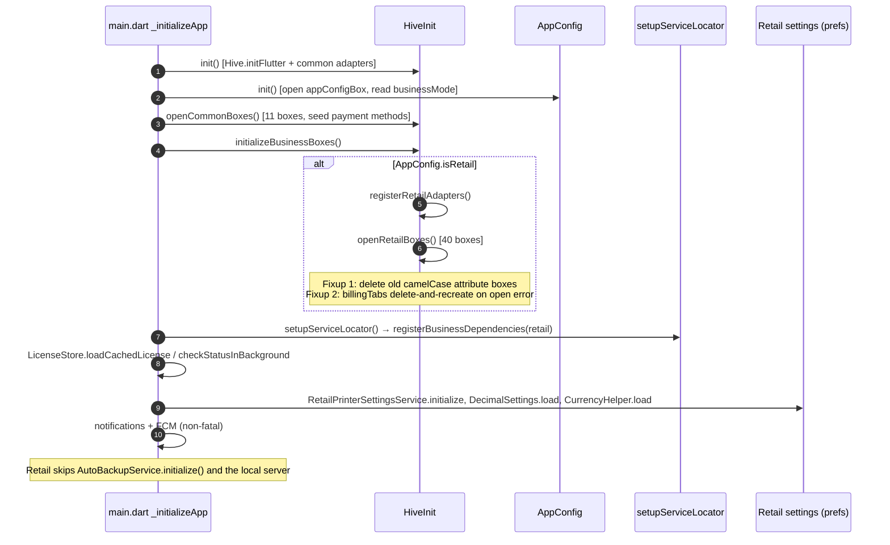
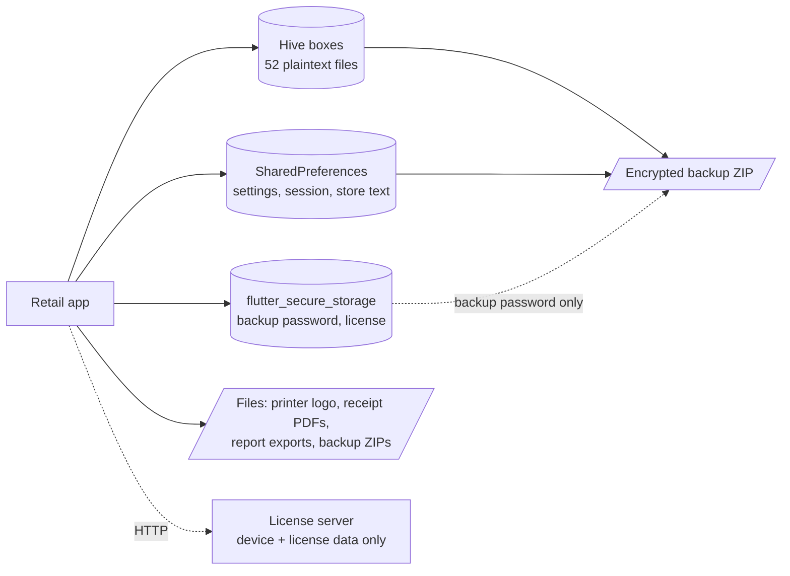
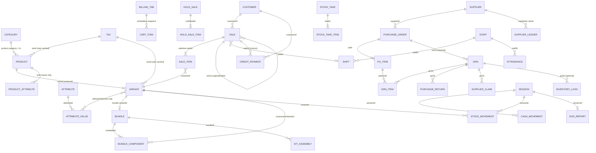

# Retail Database — 01 Overview

> **Scope:** the **retail** mode of Bill Berry Lite (Flutter package `billberrylite`, repo `D:\flutter\UniPOSs`, branch `refactor/shared-code-consolidation`).
> **Method:** static reading of the source on 2026-10-19. Nothing here was run on a device.
> **Citations:** `path:line`, relative to the repo root. Line numbers drift, so search for the symbol if a line looks wrong.

**How claims are marked**

| Mark | Meaning |
|---|---|
| *(no mark)* | **Confirmed** from the code. A `path:line` is given. |
| **(inferred)** | A conclusion drawn from reading the code. It was not executed. |
| **(unverified)** | Not checked. Treat it as a lead, not a fact. |

---

## 0. How to read these five documents

| # | Document | Read it when you want to… |
|---|---|---|
| 01 | **This file**: overview | Understand the technology, startup, every box, every model, storage boundaries, backup, and the main risks. |
| 02 | [02_RETAIL_DATABASE_MODELS.md](02_RETAIL_DATABASE_MODELS.md) | See every field of every model (HiveField index, type, nullability, default, meaning). |
| 03 | [03_RETAIL_DATABASE_FLOWS.md](03_RETAIL_DATABASE_FLOWS.md) | Follow a business action (add product, checkout, return, GRN, EOD, backup/restore) box by box. |
| 04 | [04_RETAIL_DATABASE_RELATIONSHIPS.md](04_RETAIL_DATABASE_RELATIONSHIPS.md) | See how records point at each other (ids, snapshots, cascades, dangling references). |
| 05 | [05_RETAIL_DATABASE_LEARNING_GUIDE.md](05_RETAIL_DATABASE_LEARNING_GUIDE.md) | Learn step by step as a new developer, with exercises and rules of thumb. |

Suggested order for a new developer: **01 → 05 → 02 → 04 → 03**.

---

## 1. What kind of database is this?

Retail data is stored in **Hive**. Hive is a **key-value** database written in pure Dart.

- A **box** is like a table. Each box is a separate file on disk (or an IndexedDB store on web) **(inferred, Hive library behaviour)**.
- Each record has a **key** (a `String` or an `int`) and a **value**. The value is either a Dart object (a *typed* box such as `Box<SaleModel>`) or any value (an *untyped/raw* box such as `Box`).
- To store a Dart class, Hive needs a **TypeAdapter**. The adapter is generated from `@HiveType(typeId: N)` and `@HiveField(i)` annotations into a `*.g.dart` file. Each class has a unique **typeId**.
- **There is no SQL, no schema, no foreign keys, no joins and no transactions.** Every relationship in these docs is a *convention*: one record stores another record's id as a string.
- **No box is encrypted at rest.** There is no `HiveAesCipher` / `encryptionCipher` anywhere in `lib/` (grep: 0 hits), and `Hive.initFlutter()` is called without a cipher (`lib/core/init/hive_init.dart:108`). Every retail box is a plaintext file.
- All boxes are opened eagerly with `openBox`. There is no `openLazyBox` in `lib/`. The whole box is loaded into memory when it is opened.

### 1.1 Packages (`pubspec.yaml`)

| Package | Version | `pubspec.yaml` line | What retail uses it for |
|---|---|---|---|
| `hive` | ^2.2.3 | 42 | All domain data |
| `hive_flutter` | ^1.1.0 | 43 | `Hive.initFlutter()` (`hive_init.dart:108`) |
| `hive_generator` (dev) | ^2.0.1 | 140 | Generates the `*.g.dart` adapters |
| `shared_preferences` | ^2.2.2 | 64 | Settings, login session, store info (§6.2) |
| `flutter_secure_storage` | ^10.0.0 | 96 | Backup password, license token and manifest (§6.3) |
| `encrypt` | ^5.0.3 | 97 | AES-256-CBC for backups |
| `crypto` | ^3.0.3 | 65 | SHA-256 for PINs, backup password, backup KDF |
| `cryptography` | ^2.7.0 | 66 | Ed25519 license-manifest verification |
| `archive` | ^3.6.1 | 131 | Password-protected backup ZIP |
| `path_provider` / `path` | ^2.1.1 / ^1.9.0 | 63 / 99 | Documents, Downloads, temp folders |
| `file_picker` | ^10.3.2 | 38 | Choosing a backup to restore |
| `share_plus` | ^12.0.1 | 67 | Sharing backups and receipts |
| `http` | ^1.2.0 | 39 | License API only (§6.6) |
| `uuid` | ^4.3.3 | 44 | Record ids |

---

## 2. Startup: how the database is opened

### 2.1 The sequence

`lib/main.dart` → `_initializeApp()` (`lib/main.dart:111-260`):

| Step | Call | Line | What it does |
|---|---|---|---|
| 1 | `HiveInit.init()` | `main.dart:128` | `Hive.initFlutter()` and registers the **common** adapters. Guarded by `_isHiveInitialized` (`hive_init.dart:98,104-111`). |
| 2 | `AppConfig.init()` | `main.dart:132` | Opens the raw `appConfigBox` (`lib/core/config/app_config.dart:54`). Writes `firstLaunchDate` once (`:57-59`). Reads `businessMode`. |
| 3 | `HiveInit.openCommonBoxes()` | `main.dart:138` | Opens 11 common boxes (§3.1). Guarded by `_areCommonBoxesOpen` (`hive_init.dart:99,165`). Seeds 6 default payment methods if empty (`hive_init.dart:197-198,206-264`). |
| 4 | `HiveInit.initializeBusinessBoxes()` | `main.dart:142` | If `AppConfig.isRetail`: `registerRetailAdapters()` then `openRetailBoxes()` (`hive_init.dart:852-861`). |
| 5 | `setupServiceLocator()` | `main.dart:148` | GetIt DI: common registrations, then `registerBusinessDependencies(retail)` (`lib/core/di/service_locator.dart:230-234`). |
| 5b | `LicenseStore.loadCachedLicense()` / `checkStatusInBackground()` | `main.dart:152,157` | Secure-storage reads, then a background HTTP check. |
| 6 | Retail settings | `main.dart:208-215` | `RetailPrinterSettingsService().initialize()`, `DecimalSettings.load()`, `CurrencyHelper.load()` (SharedPreferences). |
| 7 | Notifications | `main.dart:232-251` | `LocalNotificationService.init`, `notificationStore.load`, `NotificationSync.runStartupChecks`, FCM init. Failures are non-fatal. |

Retail does **not** start `AutoBackupService` or the local KDS/Captain server. Both run only in the restaurant branch (`main.dart:162-206`).

### 2.2 Adapter registration (`registerRetailAdapters`, `hive_init.dart:267-458`)

- It first calls `_registerCommonAdapters()` (`:272`). Each registration is guarded by `isAdapterRegistered`, so calling it twice is safe.
- The doc comment says "typeIds: 150-223" (`:266`). That is misleading: retail also registers shared ids such as 100, 110, 114, 115-121, 124-128 and 131 (§5.2).

### 2.3 Startup "fixups" (data is changed at startup)

| Fixup | Where | What happens | Risk |
|---|---|---|---|
| Legacy attribute cleanup | `_cleanupOldAttributeBoxes()` `hive_init.dart:462-476`, called at `:485` | On **every** cold start, deletes the camelCase boxes `attributeValues` and `productAttributes` from disk and swallows errors. The live boxes are `attribute_values` and `product_attributes`. | Low. Runs each launch, not once. |
| billingTabs corrupt-box recovery | `hive_init.dart:525-543` | If `openBox<BillingTabModel>('billingTabs')` throws, the box is closed, `deleteBoxFromDisk`'d and reopened empty. The comment mentions "typeId 252 corruption". | **Held POS tabs are lost silently.** Hive reports typeId+32, so 252 would mean frame typeId 220 **(inferred, unverified)**. |

### 2.4 Other ways the boxes get opened

| Entry point | Where | Notes |
|---|---|---|
| Setup wizard | `HiveInit.initializeForMode(BusinessMode)` `hive_init.dart:865-879`, called from `lib/stores/setup_wizard_store.dart:263,446` | Skips if the `areRetailBoxesOpen` getter is true. That getter checks only 8 boxes (`hive_init.dart:882-895`). Switching retail → restaurant in the wizard leaves the retail boxes open; **nothing ever closes boxes (inferred)**. |
| Onboarding restore | `lib/presentation/screens/onboarding/existingUserRestoreScreen.dart:276-288` | Re-runs `AppConfig.init()`, `initializeBusinessBoxes()` and `registerBusinessDependencies()` after an import. |
| Backup restore | `_ensureBoxesOpened(mode)` `lib/domain/services/common/unified_backup_service.dart:645-704` | Opens common boxes if any of 7 are closed, and retail boxes if `products` or `variants` is closed (`:670-678`). |
| Attribute reset (dead) | `HiveInit.resetAttributeBoxes()` `hive_init.dart:917-951` | Only called by `FixAttributesScreen` (`lib/presentation/screens/retail/fix_attributes_screen.dart:28`), which nothing references. |

### 2.5 Business mode

- `appConfigBox['businessMode']` is `'none' | 'restaurant' | 'retail'` (`app_config.dart:76-86`). It is meant to be set once (`:92-103`), but `forceSetBusinessMode` bypasses that (`:173-175`). The setup wizard uses the bypass (`setup_wizard_store.dart:246-250`), and a backup restore overwrites it (`unified_backup_service.dart:1913-1918`).
- Feature flags: `AppConfig.retailEnabled = true` (`app_config.dart:29`) and `retailLicenseSkipForTesting = true` (`:42`).
- `appVersion` exists in `appConfigBox` (`app_config.dart:47,141-148`) but nothing calls `setAppVersion`, so **there is no schema version tracking**.

### 2.6 Where the files live (static reading)

`Hive.initFlutter()` is called with no subfolder (`hive_init.dart:108`), so boxes sit at the root of `getApplicationDocumentsDirectory()` as `<lowercased name>.hive` plus `.lock` **(inferred, Hive behaviour)**.

| Platform | Location | Uninstall behaviour |
|---|---|---|
| Windows | The user's *Documents* folder (OneDrive-redirected on the dev machine) | Not removed by uninstall; a reinstall picks the old data back up **(inferred)** |
| Android | App-private `app_flutter/` | Wiped on uninstall. `AndroidManifest.xml` sets no `allowBackup` rules, so Android's default OS backup applies **(inferred)** |
| Web | IndexedDB **(inferred)** | Browser-controlled |

---

## 3. Complete box inventory (52 boxes open in retail)

**52 = 1 `appConfigBox` + 11 common boxes + 40 retail-phase boxes.**

Legend: **T** = typed `Box<Model>`, **U** = untyped/raw `Box`. "Shared" = the same physical box (same string name) is used by restaurant mode. "Backup" = included in the retail backup (§7). "Restore write" = how the restore writes rows: `put(id)` keeps string keys; `add()` creates auto-increment int keys (a defect, §7.3).

### 3.1 Master table

| # | Constant (`HiveBoxNames.*`) | String name | Model (typeId) | T/U | Hive key used by the app | Shared? | Purpose | Repository / accessor | Backup? (restore write) |
|---|---|---|---|---|---|---|---|---|---|
| 0 | — (`AppConfig`) | `appConfigBox` | raw | U | fixed keys | Yes | Business mode, setup flag, first launch | `AppConfig` (`app_config.dart:44-59`) | Yes (put each key) |
| **Common phase** (`hive_init.dart:164-203`) |||||||||
| 1 | `storeBox` | `storebox` | raw (legacy) | U | — | Yes | Legacy store box; no retail writer found | — | Yes (put each key) |
| 2 | `appState` | `app_state` | raw | U | `auto_backup_enabled`, `last_backup_date` | Yes | Auto-backup flags | `AutoBackupService` (`auto_backup_service.dart:20-21`) | Yes (put each key) |
| 3 | `taxBox` | `taxBox` | `TaxDetails` (2) | T | `'taxDetails'` (singleton) | Yes | Shop-wide tax settings | `TaxDetailsRepository` | Yes (**`add()`**, F5) |
| 4 | `businessTypeBox` | `businessTypeBox` | `BusinessType` (3) | T | `'selectedBusinessType'` | Yes | Chosen business type | `BusinessTypeRepository` | Yes (**`add()`**, F5) |
| 5 | `businessDetailsBox` | `businessDetailsBox` | `BusinessDetails` (4) | T | `'businessDetails'` | Yes | Store profile, logo, tax flags, store type | `BusinessDetailsRepository` | Yes (**`add()`**, F5) |
| 6 | `appCounters` | `appCounters` | raw counters | U | named counter keys (§3.3) | Yes | SKU / barcode / customer / document sequences | `DocumentNumberService`, `SkuGeneratorService`, `BarcodeGeneratorService`, `CustomerIdGeneratorService` | Yes (put each key) |
| 7 | `restaurantPrinters` | `restaurantPrintersBox` | `SavedPrinterModel` (130) | T | id | Yes | Paired thermal printers | `PrinterRepository` | **No** |
| 8 | `appNotifications` | `restaurantNotificationsBox` | `AppNotificationModel` (133) | T | `id` | Yes | In-app notifications (low stock, expiry, pending EOD) | `NotificationRepository` | **No** |
| 9 | `shift` | `shiftBox` | `ShiftModel` (127) | T | `id` | Yes | Staff shifts | `ShiftRepository` | Yes (`put(id)`) |
| 10 | `attendance` | `restaurantAttendanceBox` | `AttendanceModel` (132) | T | `id` | Yes | Clock in/out | `AttendanceRepository` | Yes (`put(id)`) |
| 11 | `paymentMethods` | `paymentMethodsBox` | `PaymentMethod` (6) | T | **auto-int** (`box.add`) | Yes | Payment method list | `PaymentMethodRepository` | Yes (`add()`, consistent with repo) |
| **Retail phase** (`openRetailBoxes`, `hive_init.dart:479-566`) |||||||||
| 12 | `products` | `products` | `ProductModel` (150) | T | `productId` | No | Product master (incl. photo bytes) | `ProductRepository` | Yes (`put`) |
| 13 | `variants` | `variants` | `VarianteModel` (151) | T | `varianteId` | No | Sellable SKU; **holds all stock** | `VariantRepository` | Yes (`put`) |
| 14 | `cartItems` | `cartItems` | `CartItemModel` (152) | T | `cartItemId` | No | Live cart lines (write-only mirror) | `CartRepository` | Yes (**`add()`**) |
| 15 | `sales` | `sales` | `SaleModel` (153) | T | `saleId` | No | Sale / return / exchange headers | `SaleRepository` | Yes (`put`) |
| 16 | `saleItems` | `saleItems` | `SaleItemModel` (154) | T | `saleItemId` | No | Sale/return lines | `SaleItemRepository` | Yes (`put`) |
| 17 | `suppliers` | `suppliers` | `SupplierModel` (155) | T | `supplierId` | No | Suppliers + running balance | `SupplierRepository` | Yes (`put`) |
| 18 | `supplierLedger` | `supplierLedger` | `SupplierLedgerEntryModel` (179) | T | `entryId` | No | Supplier payable journal | `SupplierLedgerRepository` | Yes (`put`; cleared if key absent) |
| 19 | `purchaseReturns` | `purchaseReturns` | `PurchaseReturnModel` (174) | T | `returnId` | No | Damaged goods sent back | `PurchaseReturnRepository` | Yes (`put`) |
| 20 | `purchaseReturnItems` | `purchaseReturnItems` | `PurchaseReturnItemModel` (175) | T | `returnItemId` | No | Lines of the above | `PurchaseReturnRepository` | Yes (`put`) |
| 21 | `supplierClaims` | `supplierClaims` | `SupplierClaimModel` (176) | T | `claimId` | No | Damage claims | `SupplierClaimRepository` | Yes (`put`) |
| 22 | `supplierClaimItems` | `supplierClaimItems` | `SupplierClaimItemModel` (177) | T | `claimItemId` | No | Lines of the above | `SupplierClaimRepository` | Yes (`put`) |
| 23 | `inventoryLosses` | `inventoryLosses` | `InventoryLossModel` (178) | T | `lossId` | No | Written-off units (value record) | `InventoryLossRepository` | Yes (`put`) |
| 24 | `stockTakes` | `stockTakes` | `StockTakeModel` (180) | T | `takeId` | No | Stock count sessions | `StockTakeRepository` | Yes (`put`) |
| 25 | `stockTakeItems` | `stockTakeItems` | `StockTakeItemModel` (181) | T | `takeItemId` | No | Counted lines | `StockTakeRepository` | Yes (`put`) |
| 26 | `bundles` | `bundles` | `RetailBundleModel` (182) + embedded `BundleComponentModel` (183) | T | `id` | No | Bundle/repack recipes | `BundleRepository` | Yes (`put`) |
| 27 | `kitAssemblies` | `kitAssemblies` | `RetailKitAssemblyModel` (184) | T | `id` | No | Kit assemble/disassemble log | `KitAssemblyRepository` | Yes (`put`) |
| 28 | `customer` | `customers` | `Customer` (125) | T | `customerId` | **Yes** | Customers, loyalty, credit balance | `CustomerRepository` | Yes (`put`) |
| 29 | `holdSales` | `holdSales` | `HoldSaleModel` (159) | T | `holdSaleId` | No | Parked bills | `HoldSaleRepository` | Yes (**`add()`**) |
| 30 | `holdSaleItems` | `holdSaleItems` | `HoldSaleItemModel` (160) | T | `holdSaleItemId` | No | Parked lines | `HoldSaleRepository` | Yes (**`add()`**) |
| 31 | `purchaseOrders` | `purchaseOrders` | `PurchaseOrderModel` (161) | T | `poId` | No | Purchase orders | `PurchaseOrderRepository` | Yes (`put`) |
| 32 | `purchaseOrderItems` | `purchaseOrderItems` | `PurchaseOrderItemModel` (162) | T | `poItemId` | No | PO lines | `PurchaseOrderItemRepository` | Yes (`put`) |
| 33 | `grns` | `grns` | `GRNModel` (163) | T | `grnId` | No | Goods received notes | `GRNRepository` | Yes (`put`) |
| 34 | `grnItems` | `grnItems` | `GRNItemModel` (164) | T | `grnItemId` | No | GRN lines | `GRNItemRepository` | Yes (`put`) |
| 35 | `retailCategories` | `retail_categories` | `String` | T | — | No | **Dead legacy** | none (backup only) | Effectively **no** (export key overwritten) |
| 36 | `category` | `categories` | `Category` (100) | T | `id` | **Yes** | Product categories | `CategoryRepository` | Yes (`put`) |
| 37 | `paymentEntries` | `paymentEntries` | `PaymentEntryModel` (166) | T | — | No | **Dead** (never written) | none (backup only) | Yes (`add()`, no effect) |
| 38 | `creditPayments` | `credit_payments` | `CreditPaymentModel` (168) | T | `paymentId` | No | Customer receivable ledger | `CreditPaymentRepository` | Yes (**`add()`**) |
| 39 | `attributes` | `attributes` | `AttributeModel` (169) | T | `attributeId` | No | Global attributes (Size, Color) | `AttributeRepository` | Yes (`put`) |
| 40 | `attributeValues` | `attribute_values` | `AttributeValueModel` (170) | T | `valueId` | No | Attribute values (S, M, Red) | `AttributeRepository` | Yes (`put`) |
| 41 | `productAttributes` | `product_attributes` | `ProductAttributeModel` (171) | T | `id` | No | Product ↔ attribute assignment | `AttributeRepository` | Yes (**`add()`**) |
| 42 | `staff` | `staffBox` | `StaffModel` (110) | T | `id` | **Yes** | Staff + hashed PIN + role | `StaffRepository` | Yes (`put`) |
| 43 | `tax` | `taxes` | `Tax` (114) | T | `id` | **Yes** | Tax rates (GST 18% …) | `TaxRepository` | Yes (`put`) |
| 44 | `billingTabs` | `billingTabs` | `BillingTabModel` (173) | T | `id` | No | POS multi-bill tabs (cart snapshot) | `CartRepository` | Yes (**`add()`**) |
| 45 | `retailEOD` | `eodBox` | `EndOfDayReport` (117) + embedded 118-121, 124 | T | `reportId` | **No** (restaurant: `restaurant_eodBox`) | End-of-day snapshots | `EodRepository`, `HiveEod` | Yes (**`add()`**) |
| 46 | `dayManagementBox` | `dayManagementBox` | raw | U | fixed keys (§3.3) | Yes | Current day/session pointer | `DayManagementService` (static) | Yes (put each key) |
| 47 | `restaurantSessions` | `restaurantSessionsBox` | `RestaurantSessionModel` (131) | T | `sessionId` | Yes | Day sessions (opening/closing cash) | `DayManagementService` | **No** |
| 48 | `retailExpenseCategory` | `expenseCategory` | `ExpenseCategory` (115) | T | `id` | **No** (restaurant: `restaurant_expenseCategory`) | Expense categories | `HiveExpenseCat`, `ExpenseCategoryRepository` | Yes (**`add()`**) |
| 49 | `retailExpense` | `expenseBox` | `Expense` (116) | T | `id` | **No** (restaurant: `restaurant_expenseBox`) | Expenses (no retail writer) | `ExpenseRepository`, `HiveExpenceL` | Yes (**`add()`**) |
| 50 | `restaurantCashMovements` | `cashMovementsBox` | `CashMovementModel` (128) | T | `id` | Yes | Cash drawer ledger | `CashMovementRepository` | Yes (`put`; cleared if key absent) |
| 51 | `restaurantStockMovements` | `stockMovementsBox` | `StockMovementModel` (126) | T | `id` | Yes | Stock movement ledger | `StockMovementRepository` | Yes (`put`) |

Sources: open lines `hive_init.dart:168-194` (common) and `:487-563` (retail); keys from each repository as listed in the notes (for example `product_repository.dart:27`, `variant_repository.dart:96`, `sale_repository.dart:30`, `customer_repository.dart:20`, `eod_repository.dart:18`); backup map `unified_backup_service.dart:1057-1594` (export) and `:1902-3018` (restore).

**Good to know**
- Many retail repositories use **string literals** instead of `HiveBoxNames` (for example `product_repository.dart:13-14`, `variant_repository.dart:32`, `sale_repository.dart:11`, `grn_repository.dart:10`). Renaming a constant will not rename those boxes.
- `HiveBoxNames.allRetailBoxes` (`lib/core/constants/hive_box_names.dart:311-350`) lists 38 names and `allCommonBoxes` (`:397-407`) is also incomplete. **No code uses either list.** Do not trust them as an inventory.
- The mode-aware helpers `getEODBox`, `getExpenseCategoryBox`, `getExpenseBox` (`hive_box_names.dart:288-306`) have no callers. Repositories repeat `AppConfig.isRetail ? 'eodBox' : 'restaurant_eodBox'` instead (`eod_repository.dart:12`, `expense_repository.dart:12`, `expense_category_repository.dart:12`, `hive_eod.dart:10`, `hive_expensecategory.dart:13,53`).
- Retired box names `purchases`, `purchaseItems` (`hive_box_names.dart:79-81`) and `admin_box` (`:128-129`) may still exist as files on old installs; nothing deletes them **(inferred)**.

### 3.2 Per-box property cards

Columns: **Purpose · Model · Primary id · Relationships (short) · Created by · Read by · Updated by · Deleted by · Persistence · Retail usage.**
"Persistence" describes the lifetime of a row: *master* (edited, can be deleted), *document* (business history, rarely changed), *append-only* (never edited/deleted by design), *working* (temporary), *singleton* (one row), *raw* (key-value settings).

#### Catalog

| Box | Purpose | Model | Primary id | Relationships | Created by | Read by | Updated by | Deleted by | Persistence | Retail usage |
|---|---|---|---|---|---|---|---|---|---|---|
| `products` | Product master; photo as bytes (f17) | ProductModel | `productId` (UUID) | `category` → Category.id; `taxId` → Tax.id; owns variants | `ProductStore.addProduct`, `createSimpleProduct` (POS quick-create), `BulkImportStore`, onboarding form | `ProductStore` (hydrates whole box), `CategoryRepository`, `ReportService` | `ProductStore.updateProduct`, `applyTaxToProducts`/`clearTaxFromProducts`, `_syncVariantFlags`, `CategoryRepository.deleteCategory` (re-parent to `''`) | `ProductStore.deleteProduct` → `ProductRepository.deleteProduct` (cascades variants) | Master, hard delete | Core; every screen |
| `variants` | Sellable SKU; **only place stock lives** (`stockQty` f9) | VarianteModel | `varianteId` (UUID) | `productId` → Product; `taxId` → Tax; `attributeValueIds` → attributes/values | `ProductStore.addVariant` → `VariantRepository.addVariant` (barcode guard + auto-mint) | `ProductStore`, POS, `CartStore`, `RetailInventoryService`, reports | `ProductStore.updateVariant`, `updateVariantStock` (sale, return, GRN, adjust, kit), `updateVariantCostPrice` | `ProductStore.deleteVariant`; product delete cascade | Master, hard delete; soft hide via `status='inactive'` | Core |
| `attributes` | Global attributes (Color, Size) | AttributeModel | `attributeId` (UUID) | owns values | `AttributeStore.addAttribute`, `ensureBaseAttributes` (seeds) | `AttributeStore` | `AttributeStore.updateAttribute` | `AttributeStore.deleteAttribute` (blocked if in use; cascades values + product_attributes) | Master | Variant generator, Attributes screen |
| `attribute_values` | Attribute values | AttributeValueModel | `valueId` (UUID) | `attributeId` → Attribute | `AttributeStore.addValue`, `addMultipleValues` | `AttributeStore` | `AttributeStore.updateValue` | `AttributeStore.deleteValue` (**no in-use check**); attribute cascade | Master | Same |
| `product_attributes` | Product ↔ attribute assignment | ProductAttributeModel | `id` (UUID) | productId, attributeId, selectedValueIds | **Only bulk import** (`bulk_import_store.dart:743` via `AttributeStore.assignAttributesToProduct`) | `AttributeRepository.isAttributeInUse` | `AttributeRepository.updateProductAttribute` | `ProductStore._dropOwnedRecords`, attribute delete cascade | Master | Bulk-import products only |
| `bundles` | Recipe of a bundle/repack variant | RetailBundleModel (+ embedded components) | `id` (UUID) | `productId`, `variantId` (one row per variant), components → Variant | Add/Edit Product (`BundleRepository.saveBundle`) | `RetailInventoryService`, `ProductStore.bundlesUsing`, `ReportService` | Same save on product edit | `_dropOwnedRecords`; product edit back to standard | Master | Bundles, repacks/kits |
| `categories` | Categories (shared with restaurant) | Category | `id` (timestamp string or UUID) | Product.category holds this id | `CategoryStore.addCategory`; first-run seeds `CategoryRepository.addDefaultCategories` | `CategoryStore`, POS browse, reports | `CategoryStore.updateCategory` (rename) | `CategoryStore.deleteCategory` (products re-parented, never deleted) | Master | Category tab |
| `taxes` | Tax rates (shared) | Tax | `id` (UUID) | Product/Variant `taxId` | `TaxStore` (Tax Settings) | `TaxStore`, Add Product, `ProductStore.findTaxIdByHsnCode` | `TaxStore` (does **not** re-cache rates on products) | `TaxStore.deleteTax` (no in-use check) | Master | Tax Settings |

#### Sales & POS

| Box | Purpose | Model | Primary id | Relationships | Created by | Read by | Updated by | Deleted by | Persistence | Retail usage |
|---|---|---|---|---|---|---|---|---|---|---|
| `cartItems` | Live cart lines | CartItemModel | `cartItemId` (`<variantId>_<ms>`) | variant, product | `CartStore` (every add/qty change via `saveCartItem`) | **Nobody in retail** (write-only mirror; tabs are the source of truth) | `CartStore` | `CartStore.clearCart` (`box.clear()` after checkout), `deleteCartItem` | Working | POS |
| `billingTabs` | POS tabs; each embeds a snapshot list of cart lines | BillingTabModel | `id` (UUID) | embeds CartItemModel | `CartStore.createNewTab`, constructor ("Tab 1") | `CartStore` constructor | `_saveCurrentTabItems` (`*InTab` wrappers), `updateTabCustomerInfo` | `CartStore.closeTab`, `clearAllTabs`; startup recovery wipes box | Working | POS |
| `sales` | Sale, return (`isReturn`) and exchange headers; payment legs as JSON | SaleModel | `saleId` (UUID; returns `RTN_<uuid>`) | customerId, originalSaleId, shiftId, exchangeGroupId | `SaleStore.addSaleWithItems` (checkout, `ReturnService`, `ExchangeService`) | `SaleStore`, `ReportService`, `EODService`, `ShiftRepository`, `CreditStore`, cash drawer | `CreditStore` (collections/write-off, its own `SaleRepository`), `ReturnService._settle`, `ExchangeService._stamp` | **Never** (`SaleStore.deleteSale` has no callers) | Document | Checkout, history, reports |
| `saleItems` | Lines of sales/returns (snapshots) | SaleItemModel | `saleItemId` (UUID) | saleId, varianteId, productId | `SaleStore.addSaleWithItems` | `ReportService`, `ReturnService`, receipts | Never | Never (delete methods have no callers) | Document | Same |
| `holdSales` | Parked bill header | HoldSaleModel | `holdSaleId` (`HOLD_<uuid>`) | owns holdSaleItems | `HoldSaleService.park` → `HoldSaleStore` | `HoldSaleStore` (eager init), Parked Sales screen | `HoldSaleRepository.updateHoldSale` (unverified use) | `HoldSaleService.restore`, Parked Sales delete | Working (hard delete) | Park/resume |
| `holdSaleItems` | Parked lines | HoldSaleItemModel | `holdSaleItemId` (`<hold>_<variant>_<ms>`) | holdSaleId, variant | Same as above | Same | — | Same | Working | Same |

#### Customers & credit

| Box | Purpose | Model | Primary id | Relationships | Created by | Read by | Updated by | Deleted by | Persistence | Retail usage |
|---|---|---|---|---|---|---|---|---|---|---|
| `customers` | Customers (shared box), loyalty, `creditBalance` | Customer | `customerId` (retail `CUST-000042`) | Sale.customerId, CreditPayment.customerId | `CustomerStore.addCustomer` with `CustomerIdGeneratorService` | `CustomerStore`, checkout picker, credit screens, reports | `CustomerStore.updateAfterPurchase/updateAfterCreditSale/updateAfterReturn/reduceCredit`, `CreditStore`, customer detail edit | **No retail UI** (`deleteCustomer` exists, unguarded) | Master | Checkout, credit |
| `credit_payments` | Receivable ledger: collection / write-off / return offset, one row per invoice | CreditPaymentModel | `paymentId` (UUID) | customerId, saleId (invoice settled) | `CreditStore.receivePayment`, `writeOffDebt`, `ReturnService._settle` | `CreditStore`, `CreditPaymentRepository`, EOD, reports | Never | Never (`deletePayment` has no callers) | Append-only | Receive Payment, ledger, credit reports |

#### Purchasing

| Box | Purpose | Model | Primary id | Relationships | Created by | Read by | Updated by | Deleted by | Persistence | Retail usage |
|---|---|---|---|---|---|---|---|---|---|---|
| `suppliers` | Suppliers + `currentBalance` | SupplierModel | `supplierId` (UUID) | referenced by PO, GRN, ledger, returns, claims | `SupplierStore.addSupplier` | `SupplierStore`, purchase screens, reports | `SupplierStore.updateSupplier`; balance only via `recordBalanceMovement` | `SupplierStore.deleteSupplier` (guarded by `deleteBlockers`; also wipes its ledger) | Master | Suppliers |
| `supplierLedger` | Signed payable journal | SupplierLedgerEntryModel | `entryId` (UUID) | supplierId, docId (grn/return/claim) | `SupplierStore.recordBalanceMovement`, `addSupplier` (opening row) | `SupplierStore.getLedger`, supplier detail | Never | `deleteSupplier` (only opening row can exist then) | Append-only | Supplier detail |
| `purchaseOrders` | PO header | PurchaseOrderModel | `poId` (**ms-epoch string**) | supplierId; owns PO items | `PurchaseOrderStore.addPurchaseOrder` | `PurchaseOrderStore`, reports | `updatePurchaseOrder` (draft), `updatePOStatus`, `_updatePOStatusAfterGRN`, `closePurchaseOrder`, `cancelPurchaseOrder` | `deletePurchaseOrder` (draft, no GRN) | Document | Purchase Orders |
| `purchaseOrderItems` | PO lines | PurchaseOrderItemModel | `poItemId` (UUID) | poId, variantId, productId | `PurchaseOrderStore` (add/edit; edit re-creates all lines) | Same | — | Edit (old lines) and PO delete | Document | Same |
| `grns` | Goods received notes | GRNModel | `grnId` (UUID) | poId (required), supplierId | `GrnReceivingService.receive` → `PurchaseOrderStore.createGRN` (draft) | `PurchaseOrderStore`, reports | `confirmGRN` (draft → confirmed) | No UI (`deleteGRN` dead) | Document | Material Receiving |
| `grnItems` | GRN lines | GRNItemModel | `grnItemId` (UUID) | grnId, poItemId, variantId | Same | Same; received qty derived from here | — | No UI | Document | Same |
| `purchaseReturns` / `purchaseReturnItems` | Damaged units sent back | PurchaseReturnModel / ItemModel | `returnId` / `returnItemId` | grnId, grnItemId, supplierId | `DamagedGoodsStore.recordFromGRN` | `DamagedGoodsStore`, reports | `recordCreditNote`, `cancelPurchaseReturn` | — (unverified) | Document | Damaged goods |
| `supplierClaims` / `supplierClaimItems` | Damage claims | SupplierClaimModel / ItemModel | `claimId` / `claimItemId` | grnId, supplierId | `DamagedGoodsStore.recordFromGRN` | Same | `updateClaimStatus`, `writeOffRejectedClaim` | — (unverified) | Document | Same |

#### Inventory

| Box | Purpose | Model | Primary id | Relationships | Created by | Read by | Updated by | Deleted by | Persistence | Retail usage |
|---|---|---|---|---|---|---|---|---|---|---|
| `stockMovementsBox` | Stock ledger (shared box) | StockMovementModel | `id` (UUID or deterministic `sale_…`, `grn_…`, `st_…`) | itemId = productId, variantId, sessionId | `RetailInventoryService` (sale, return, exchange, kit), `GrnReceivingService`, `StockAdjustmentService`, `ProductStore` (opening stock, stock edited) | Stock history, adjustment report, idempotency checks (`contains`) | Never | Never | Append-only | Every stock change |
| `inventoryLosses` | Value record of written-off units (never moves stock) | InventoryLossModel | `lossId` (UUID) | grnId?, variantId, supplierId? | `DamagedGoodsStore` (`_createLosses`, `cancelPurchaseReturn`, `writeOffRejectedClaim`, `recordAdjustmentLoss`) | Damaged goods hub, reports | Never | Never (repo `delete` has no callers in traced flows) | Append-only | Losses |
| `stockTakes` / `stockTakeItems` | Count sessions and lines | StockTakeModel / ItemModel | `takeId` / `takeItemId` | takeId, variantId | `StockTakeStore.startTake`, `countVariant` | `StockTakeStore` | `countVariant`, `commit` | `cancelTake` (hard delete of draft), `removeLine` | Document | Stock Take |
| `kitAssemblies` | Assembly/disassembly log | RetailKitAssemblyModel | `id` (UUID) | bundleId, variantId, movementIds | `RetailInventoryService.assembleKit/disassembleKit` | Assemble Kit history | Never | Never | Append-only | Kits/repacks |

#### Day, cash & EOD

| Box | Purpose | Model | Primary id | Relationships | Created by | Read by | Updated by | Deleted by | Persistence | Retail usage |
|---|---|---|---|---|---|---|---|---|---|---|
| `dayManagementBox` | Day state + `currentSessionId` pointer | raw | fixed keys | currentSessionId → session | `DayManagementService.startSession` | POS billing gate, `DayManagementService` | `startSession`, `endSession` | `currentSessionId` key deleted at close | Raw | Start Day / EOD |
| `restaurantSessionsBox` | Day sessions (opening/closing cash) | RestaurantSessionModel | `sessionId` (UUID) | stamped on EOD, cash/stock movements, attendance | `DayManagementService.startSession` | `getCurrentSession`, EOD | `endSession` (`session.save()`) | None found **(unverified)** | Document | Every day |
| `cashMovementsBox` | Drawer ledger (shared) | CashMovementModel | `id` (UUID) | sessionId | `CashMovementStore.addMovement/addAdjustment`, `startSession` (opening), `CreditStore` (cash collection), `ReturnService` (refund audit), EOD screen (variance, safe drop) | Cash drawer, `EODService` (reads box directly) | Never | Never | Append-only | Cash drawer, EOD |
| `eodBox` | End-of-day snapshot (retail-only box) | EndOfDayReport (+ embedded summaries) | `reportId` (UUID) | sessionId | `EODService.saveEODReport` | EOD history/detail/print/export | — | `saveEODReport` deletes any earlier report for the same session | Snapshot | EOD |
| `expenseCategory` | Expense categories (retail-only box) | ExpenseCategory | `id` | Expense.categoryOfExpense | `HiveExpenseCat` (no retail UI found) | EOD, drawer | — | — | Master | Effectively unused |
| `expenseBox` | Expenses (retail-only box) | Expense | `id` | sessionId, category id | **No retail writer found** (expense screens are restaurant-only) | EOD, cash drawer, reports | — | — | Document | Reads an empty box **(inferred)** |

#### Staff & shifts

| Box | Purpose | Model | Primary id | Relationships | Created by | Read by | Updated by | Deleted by | Persistence | Retail usage |
|---|---|---|---|---|---|---|---|---|---|---|
| `staffBox` | Staff, role (in `isCashier`), hashed PIN (shared) | StaffModel | `id` (UUID) | Shift.staffId, Attendance.staffId | `StaffStore.addStaff` (Manage Staff, onboarding) | Login, `StaffStore` | Manage Staff edit / enable-disable | `StaffStore.deleteStaff` (hard, unguarded) | Master | Login & roles |
| `shiftBox` | Staff shifts (shared) | ShiftModel | `id` (UUID) | staffId; Sale.shiftId | `ShiftStore` | Shift reports, `ShiftRepository._retailTxns` | Close shift, auto-close | `ShiftRepository.deleteShift` (caller unverified) | Document | Shift reports |
| `restaurantAttendanceBox` | Clock in/out (shared) | AttendanceModel | `id` (UUID) | staffId, sessionId | `AttendanceStore` | Attendance report | Clock-out, break, EOD `_closeStaffHours` | `AttendanceRepository` delete (caller unverified) | Document | Attendance |

#### Settings & configuration

| Box | Purpose | Model | Primary id | Relationships | Created by | Read by | Updated by | Deleted by | Persistence | Retail usage |
|---|---|---|---|---|---|---|---|---|---|---|
| `appConfigBox` | Mode + setup flag | raw | `businessMode`, `isSetupComplete`, `appVersion`, `firstLaunchDate` | — | `AppConfig.init`, setup wizard | Whole app | `setBusinessMode`, `forceSetBusinessMode`, restore | — | Raw | Mode switch |
| `app_state` | Auto-backup flags | raw | `auto_backup_enabled`, `last_backup_date` | — | `AutoBackupService` | Backup screen | Same | — | Raw | Backup reminder switch |
| `businessDetailsBox` | Store profile, logo bytes, tax flags, retail store type | BusinessDetails | key `'businessDetails'` | — | Setup wizard, `StoreSettingsService`, Store Info screen | Receipts, tax rules | Same | — | Singleton | Store settings |
| `businessTypeBox` | Selected business type | BusinessType | key `'selectedBusinessType'` | — | Setup wizard | — | — | — | Singleton | Setup |
| `taxBox` | Shop-wide tax switches + default rate | TaxDetails | key `'taxDetails'` | — | `TaxDetailsRepository` | Billing fallback rate | Same | — | Singleton | Tax settings |
| `paymentMethodsBox` | Payment methods; `value` is the reporting bucket key | PaymentMethod | **auto-int** key; UUID in `id` field | Sale.paymentType stores `value` | Seeded at startup; `PaymentMethodStore` | Checkout, reports | `putAt` by index | `deleteAt` (hard, no history guard) | Master | Checkout |
| `restaurantPrintersBox` | Paired printers (shared) | SavedPrinterModel | id | — | `PrinterStore` | Print services | Same | Same | Master | Printing |
| `restaurantNotificationsBox` | In-app notifications (shared) | AppNotificationModel | `id` (UUID) | subjectId = variantId | `NotificationStore.raiseEvent`, `RetailNotificationSyncService` | Notification screen | Resolve/read flags | (unverified) | Document | Low-stock & expiry alerts |

#### Counters

| Box | Purpose | Keys | Writers | Notes |
|---|---|---|---|---|
| `appCounters` | All number sequences | `lastSkuSequence`, `lastBarcodeSequence`, `lastCustomerSequence`, and per document code `<CODE>_lastFy`, `<CODE>_lastSeq`, `<CODE>_prefix` (codes: `INV`, `CRN`, `EXC`, `PO`, `GRN`, `PR`, `CLM`, `LOSS`, `ST`) | `SkuGeneratorService` (`sku_generator_service.dart:13,27-29`), `BarcodeGeneratorService` (`barcode_generator_service.dart:33,51,67`), `CustomerIdGeneratorService` (`customer_id_generator_service.dart:21,28,39`), `DocumentNumberService` (`document_number_service.dart:32,47-53`) | Document numbers look like `INV-00001` and **restart each financial year**. The counter is reserved before use, so abandoned forms leave gaps. Counter keys are mode-agnostic. |

#### Dead / legacy

| Box | Status | Evidence |
|---|---|---|
| `retail_categories` | No runtime reader or writer; only backup touches it. The comment at `hive_init.dart:510-512` claims bulk import uses it; grep finds no such use. | `unified_backup_service.dart:1225,2678` |
| `paymentEntries` | Opened and backed up but **never written**. Real payment legs are JSON in `SaleModel.paymentListJson`. | `hive_init.dart:516`; `unified_backup_service.dart:1354,2916` |
| `storebox` | Legacy; no retail writer found | `hive_init.dart:168` |

### 3.3 Raw (untyped) box keys

| Box | Keys | Writer |
|---|---|---|
| `appConfigBox` | `businessMode`, `isSetupComplete`, `appVersion` (never written), `firstLaunchDate` | `app_config.dart:45-48` |
| `app_state` | `auto_backup_enabled`, `last_backup_date` (+ restaurant `AppSettings` values, **unverified** for retail) | `auto_backup_service.dart:20-21,57-166` |
| `storebox` | No retail writer found (content **unverified**) | — |
| `appCounters` | See Counters above | — |
| `dayManagementBox` | `openingBalance`, `dayStarted`, `lastDayDate`, `dayStartTimestamp`, `closingBalance` (cash **kept** after safe drop), `currentSessionId` | `day_management_service.dart:17-23` |

### 3.4 Shared physical boxes (one file used by both modes)

`customers`, `categories`, `staffBox`, `taxes`, `shiftBox`, `restaurantAttendanceBox`, `restaurantNotificationsBox`, `restaurantPrintersBox`, `paymentMethodsBox`, `dayManagementBox`, `restaurantSessionsBox`, `cashMovementsBox`, `stockMovementsBox`, `appCounters` (`hive_box_names.dart:24,45,48,70,123,145,149,201,210,213,216,222,225,230`).

**Separate per mode:** EOD (`eodBox` vs `restaurant_eodBox`), expense categories (`expenseCategory` vs `restaurant_expenseCategory`), expenses (`expenseBox` vs `restaurant_expenseBox`) (`hive_box_names.dart:155-197`). Restaurant also has its own supplier model and box (typeId 138, `restaurantSuppliersBox`).

A device runs one mode at a time, but the "restaurant" names on shared boxes are historical. They are retail data too.

### 3.5 Who opens a box without DI

These touch boxes in retail but are not DI singletons (`service_locator.dart` notes):
- `StockMovementRepository` is `new`'d in `grn_receiving_service.dart:48`, `inventory_service.dart:29`, `stock_adjustment_service.dart:83`.
- `DayManagementService` (static) → `dayManagementBox`, `restaurantSessionsBox`, `cashMovementsBox` (`day_management_service.dart:16-92`).
- `DocumentNumberService` → `appCounters`.
- `HiveEod`, `HiveExpenseCat`, `HiveExpenceL` static helpers.
- `ProductStore` creates its own `ProductRepository()` and `VariantRepository()` (`product_store.dart:52-53`), not the DI instances.
- `ItemCancellationRepository` is registered for retail (`service_locator.dart:361-362`) but its box is only opened in restaurant mode (`hive_init.dart:821`). Nothing in retail resolves it today, so this is a **latent crash**.

---

## 4. Database technology rules that matter here

| Rule | Why it matters |
|---|---|
| **No migrations.** Schema changes rely on Hive tolerating missing fields. | Add new fields as nullable, or with `@HiveField(n, defaultValue: …)`. Never change a field's type. |
| **Never reuse a typeId or a HiveField index.** | Old data on disk would be read as the wrong type. Retired ids are listed in §5.3. Retired field indices include `VarianteModel` 2-4, `CartItemModel` 4-6, `HoldSaleItemModel` 5-7, `Category` 2. |
| **int ↔ double is always breaking in Hive.** | `VarianteModel.stockQty` is `double` (`variante_model_201.dart:31`). Counters are read `as int`. |
| **A non-nullable field added late needs `defaultValue`.** | Example of the risk: the `EndOfDayReport` adapter hard-casts fields 17-27 (`eodmodel_317.g.dart:37-47`), so a record written before those fields existed throws on read (accepted pre-release). |
| **Retired types keep a read-only adapter.** | `LegacyTaxRateItemAdapter` on typeId 5 lets old `taxBox` rows open (`hive_init.dart:127-133`). |
| **Hive does not do cross-box transactions.** | Every multi-box flow (checkout, GRN, return, EOD) is a series of separate `put`s. See §10. |

---

## 5. Model inventory

**53 Hive model classes** are registered in retail mode (29 retail-range typeIds + 24 common/shared, including the read-only legacy adapter), plus **1 non-Hive model** (`RetailPrinterSettings`). Field-level detail is in [02](02_RETAIL_DATABASE_MODELS.md).

> **Filename suffix ≠ typeId.** Files `*_200.dart` … `*_221.dart` use typeIds 150-171 (an offset of **−50**): for example `product_model_200.dart` is typeId **150** and `grn_model_213.dart` is **163**. Common files do the same: `categorymodel_300.dart` = 100, `staffModel_310.dart` = 110, `taxmodel_314.dart` = 114. Files `*_173` … `*_181` do match. Always read the `@HiveType` line or `lib/core/constants/hive_type_ids.dart`.

### 5.1 Retail models (`lib/data/models/retail/hive_model/`)

| Class | File | typeId | Box | Meaning |
|---|---|---|---|---|
| ProductModel | `product_model_200.dart` | 150 | `products` | Product master; no stock field; `stockMode` is the real type switch (standard/bundle/repack) |
| VarianteModel | `variante_model_201.dart` | 151 | `variants` | Sellable SKU; price, cost, barcode, **stock**, unit, expiry |
| CartItemModel | `cart_model_202.dart` | 152 | `cartItems` + embedded in BillingTabModel | Live cart line |
| SaleModel | `sale_model_203.dart` | 153 | `sales` | Sale / return / exchange header |
| SaleItemModel | `sale_item_model_204.dart` | 154 | `saleItems` | Sale/return line (snapshot) |
| SupplierModel | `supplier_model_205.dart` | 155 | `suppliers` | Supplier with running balance |
| HoldSaleModel | `hold_sale_model_209.dart` | 159 | `holdSales` | Parked bill |
| HoldSaleItemModel | `hold_sale_item_model_210.dart` | 160 | `holdSaleItems` | Parked line |
| PurchaseOrderModel | `purchase_order_model_211.dart` | 161 | `purchaseOrders` | PO header |
| PurchaseOrderItemModel | `purchase_order_item_model_212.dart` | 162 | `purchaseOrderItems` | PO line |
| GRNModel | `grn_model_213.dart` | 163 | `grns` | Goods received note |
| GRNItemModel | `grn_item_model_214.dart` | 164 | `grnItems` | GRN line |
| PaymentEntryModel | `payment_entry_model_216.dart` | 166 | `paymentEntries` | **Dead** — never written |
| CreditPaymentModel | `credit_payment_model_218.dart` | 168 | `credit_payments` | Receivable ledger row |
| AttributeModel | `attribute_model_219.dart` | 169 | `attributes` | Global attribute |
| AttributeValueModel | `attribute_value_model_220.dart` | 170 | `attribute_values` | Attribute value |
| ProductAttributeModel | `product_attribute_model_221.dart` | 171 | `product_attributes` | Product ↔ attribute assignment |
| BillingTabModel | `billing_tab_model_173.dart` | 173 | `billingTabs` | POS tab |
| PurchaseReturnModel | `purchase_return_model_174.dart` | 174 | `purchaseReturns` | Return to supplier |
| PurchaseReturnItemModel | `purchase_return_item_model_175.dart` | 175 | `purchaseReturnItems` | Its lines |
| SupplierClaimModel | `supplier_claim_model_176.dart` | 176 | `supplierClaims` | Damage claim |
| SupplierClaimItemModel | `supplier_claim_item_model_177.dart` | 177 | `supplierClaimItems` | Its lines |
| InventoryLossModel | `inventory_loss_model_178.dart` | 178 | `inventoryLosses` | Loss record |
| SupplierLedgerEntryModel | `supplier_ledger_entry_model_179.dart` | 179 | `supplierLedger` | Supplier journal row |
| StockTakeModel | `stock_take_model_180.dart` | 180 | `stockTakes` | Stock count |
| StockTakeItemModel | `stock_take_item_model_181.dart` | 181 | `stockTakeItems` | Counted line |
| RetailBundleModel | `bundle_model.dart` | 182 | `bundles` | Bundle/repack recipe |
| BundleComponentModel | `bundle_component_model.dart` | 183 | **embedded** in RetailBundleModel | Component line (`quantity` is `int`) |
| RetailKitAssemblyModel | `kit_assembly_model.dart` | 184 | `kitAssemblies` | Assembly log entry |

### 5.2 Common / shared models registered in retail

| Class | File | typeId | Box | Meaning |
|---|---|---|---|---|
| TaxDetails | `lib/models/tax_details.dart` | 2 | `taxBox` | Shop-wide tax settings (singleton) |
| BusinessType | `lib/data/models/common/business_type.dart` | 3 | `businessTypeBox` | Selected business type (singleton) |
| BusinessDetails | `lib/data/models/common/business_details.dart` | 4 | `businessDetailsBox` | Store profile (singleton) |
| LegacyTaxRateItem | `lib/data/models/legacy/legacy_tax_rate_item.dart` | 5 | read-only, inside old `taxBox` rows | Retired; adapter kept so old data opens |
| PaymentMethod | `lib/models/payment_method.dart` | 6 (**hardcoded literal**, `:5`) | `paymentMethodsBox` | Payment method |
| Category | `lib/data/models/common/categorymodel_300.dart` | 100 | `categories` | Category (plain class, not HiveObject) |
| StaffModel | `lib/data/models/common/staffModel_310.dart` | 110 | `staffBox` | Staff |
| Tax | `lib/data/models/common/taxmodel_314.dart` | 114 | `taxes` | Tax rate |
| ExpenseCategory | `lib/data/models/restaurant/db/expensemodel_315.dart` | 115 | `expenseCategory` | Expense category (constant is misleadingly named `restaurantExpense`) |
| Expense | `lib/data/models/restaurant/db/expensel_316.dart` | 116 | `expenseBox` | Expense |
| EndOfDayReport | `lib/data/models/restaurant/db/eodmodel_317.dart` | 117 | `eodBox` | EOD snapshot |
| OrderTypeSummary / CategorySales / PaymentSummary / CashReconciliation / TaxSummary | same file | 118 / 119 / 120 / 121 / 124 | **embedded** in EndOfDayReport | EOD parts (retail leaves 118 and 119 lists empty) |
| Customer | `lib/data/models/common/customer_model_125.dart` | 125 | `customers` | Customer |
| StockMovementModel | `lib/data/models/restaurant/db/stock_movement_model.dart` | 126 | `stockMovementsBox` | Stock ledger row |
| ShiftModel | `lib/data/models/common/shift_model.dart` | 127 | `shiftBox` | Shift |
| CashMovementModel | `lib/data/models/restaurant/db/cash_movement_model.dart` | 128 | `cashMovementsBox` | Cash ledger row |
| SavedPrinterModel | `lib/data/models/restaurant/db/saved_printer_model.dart` | 130 | `restaurantPrintersBox` | Paired printer |
| RestaurantSessionModel | `lib/data/models/restaurant/db/session_model.dart` | 131 | `restaurantSessionsBox` | Day session |
| AttendanceModel | `lib/data/models/common/attendance_model.dart` | 132 | `restaurantAttendanceBox` | Attendance row |
| AppNotificationModel | `lib/data/models/common/app_notification_model.dart` | 133 | `restaurantNotificationsBox` | Notification |

Registration lines: common `hive_init.dart:116-160`; retail-registered shared ids `:336-457`. The `hive_init.dart:411-429` comments call the EOD sub-types "18-22", which is stale; the generated ids are 118-121 and 124 (`eodmodel_317.g.dart:129,172,215,258,304`).

### 5.3 Retired typeIds (never reuse)

| typeId | Was | Replaced by | Evidence |
|---|---|---|---|
| 101 | (common) | — | `hive_type_ids.dart:55-58` |
| 156, 157 | Purchase / PurchaseItem | PO + GRN | `hive_type_ids.dart:140-142` |
| 158 | retailCustomer | Customer (125) | `:143-144` |
| 165 | retailCategory | Category (100) | `:151-152` |
| 167 | retail AdminModel | Admin PIN in SharedPreferences | `:154-156` |
| 172 | retailStaff | StaffModel (110) | `:161-162` |

The next free retail typeId is **200** (`hive_type_ids.dart:196-197`).

### 5.4 Non-Hive model

| Class | File | Storage |
|---|---|---|
| RetailPrinterSettings | `lib/data/models/retail/printer_settings_model.dart` | JSON in SharedPreferences key `retail_printer_settings`, via `RetailPrinterSettingsService` (`retail_printer_settings_service.dart:15,28,48,79`). Enums stored by index; `paperSize`/`fontSize` are not clamped on read. |

### 5.5 Things that look like models but are not

| You might expect… | Reality |
|---|---|
| A **Unit** model | No. Unit is `VarianteModel.unit` (f23) plus the constant list `kItemUnits` (`lib/core/constants/item_units.dart:5`). |
| A **Brand** model | No. Brand is free text `ProductModel.brandName` (f2). |
| A **payments** box | No. Payment legs are a JSON string in `SaleModel.paymentListJson` (f18), built from the UI class `PaymentEntry` (`split_payment_widget.dart:15`). `PaymentEntryModel` (166) is a different, dead class. |
| A retail **stock movement** model | No. Retail reuses the restaurant `StockMovementModel` (126) in the shared `stockMovementsBox`. |
| A retail **admin** model | Retired. The admin PIN is a salted hash in SharedPreferences key `restaurant_admin_password` (`restaurant_auth_helper.dart:13`). |
| A "returned" sale status or a VOID | No. `SaleStatus` is `paid / partially_paid / due` (`sale_model_203.dart:12-16`). Returns are separate `SaleModel` documents with `isReturn = true`. |
| Stock on the product | No. Product total stock is derived from its variants (`ProductStore.totalStockFor`, `product_store.dart:354-355`). |

---

## 6. Storage boundaries (where each kind of data lives)

### 6.1 Hive

Everything in §3. Product photos are **bytes inside `ProductModel.imageBytes`** (f17), and the store logo is bytes inside `BusinessDetails.logo`. **If Hive files disappear, all business data is lost** unless a backup exists.

### 6.2 SharedPreferences keys used in retail

| Key(s) | Owner | Backed up? | If lost |
|---|---|---|---|
| `restaurant_admin_password` (salted SHA-256 admin PIN; default `123456` seeded) | `restaurant_auth_helper.dart:13`; `auth_service.dart:51,111-119` | Yes | Admin PIN resets to default on next `ensureDefaultAdmin` **(inferred)** |
| `admin_session`, `admin_session_timestamp`, `admin_username`, `admin_staff_id` | `auth_service.dart:38-46` | No (denylist) | User logs in again |
| `restaurant_login_type`, `restaurant_staff_role`, `restaurant_staff_name`, `restaurant_is_logged_in`, `restaurant_current_shift_id` | `restaurant_session.dart:12-16` | No (denylist) | Same; current shift id forgotten |
| `restaurant_inactivity_timeout_minutes` | `restaurant_session.dart:19` | Yes | Default timeout |
| `store_name`, `store_address`, `store_phone`, `store_email`, `store_gst_number`, `store_owner_name`, `store_city`, `store_state`, `store_pincode` | `store_settings_service.dart:8-16` | Yes (also re-synced from BusinessDetails on restore) | Receipt header text blank; mirrored in BusinessDetails |
| `store_upi_id`, `store_upi_payee`, `store_upi_qr_b64` (QR image as base64) | `store_settings_service.dart:18-20` | Yes | UPI QR missing on receipts |
| `gst_tax_inclusive`, `gst_default_rate` | `gst_service.dart:12-13` | Yes | Tax mode/default rate reset |
| `retail_printer_settings` (JSON, includes `logoPath`) | `retail_printer_settings_service.dart:15` | Yes (logo **file** is not) | Receipt layout defaults |
| `simple_product_fields` | `simple_product_fields_service.dart:29` | Yes | Form field config reset |
| `stock_alert_threshold`, `stock_alerts_enabled` | `stock_alert_service.dart:8-9` | Yes | Global reorder threshold reset |
| `attribute_defaults_seeded_for` | `store_type_attribute_defaults_service.dart:25` | Yes | Starter attributes may be re-seeded |
| `selected_currency` | `currency_helper.dart:21` | Yes | Currency reset |
| `restaurant_decimal_precision` | `decimal_settings.dart:12` | Yes | Precision reset |
| `retail_last_eod_date` | `eod_screen.dart:690` | No | Informational only |
| `last_eod_date`, `pendingEod_snoozed_date` | `day_management_service.dart:72-73` | No | Snooze reset |
| `first_time_pos_v2` | `ex/posscreen.dart:445,451` | No | First-run hint shows again |
| `unipos_device_id`, `unipos_device_id_source` | `device_id_service.dart:59-60` | No | New device id (license impact, **unverified**) |
| `default_kot_printer_id`, `default_receipt_printer_id` | `PrinterRepository` | No | Default printer reselected |

Denylist: `unified_backup_service.dart:156-172`. It also lists `last_backup_date` and `auto_backup_enabled`, but those live in the Hive `app_state` box and are restored through it, so that denylist entry is stale.

### 6.3 flutter_secure_storage keys

| Key | Owner | Backed up? | Notes |
|---|---|---|---|
| `backup_password_hash` (unsalted SHA-256) | `backup_encryption_service.dart:11` | No | |
| `backup_password` (**plaintext** 6-digit PIN) | `backup_encryption_service.dart:12,48` | **Yes**, as `secureCreds` inside the encrypted backup (`unified_backup_service.dart:1587-1590`) | Kept for auto-backup |
| `unipos_license_token`, `_stored_device_id`, `unipos_pending_license_key`, `unipos_license_bypass`, `unipos_last_seen_epoch`, `unipos_manifest_raw`, `unipos_manifest_sig`, `unipos_entitlement_version`, `unipos_last_sync_at` | `license_store.dart:35-50` | No | License must be re-activated/re-synced if lost |

Android uses `encryptedSharedPreferences: true` only for the backup storage (`backup_encryption_service.dart:14-16`).

### 6.4 Files

| Artifact | Where | How it is referenced | Backed up? | If lost |
|---|---|---|---|---|
| Product photo | Bytes in Hive (`ProductModel.imageBytes`) | Inline | **Yes**, inline in `data.json` as `List<int>` (`product_model_200.dart:213`); the `includeImages` flag does not apply | Lost only with Hive |
| Variant image | Path string `VarianteModel.imagePath` | Path | Path only | Dangling path **(inferred)** |
| Store logo | Bytes in `BusinessDetails.logo` | Inline | Yes (but see F5 restore defect) | — |
| Thermal printer logo | File `<AppDocs>/logos/store_logo.<ext>`; absolute path in prefs `retail_printer_settings` (`printer_settings_screen.dart:797-825`) | Absolute path | **No** | Logo missing after restore/new device **(inferred)** |
| `<AppDocs>/product_images/*` | Restaurant legacy folder; retail does not write here **(inferred)** | — | Zipped when `includeImages` | — |
| Receipt PDFs | Temp dir (share) or `receipts/` (save) (`print_service.dart:496-623`) | — | No | Regenerable from the sale |
| Report Excel/PDF | `<AppDocs>/<file>` then share sheet (`report_export_service.dart:416-422`) | — | No | Regenerable |
| Backup ZIPs | Downloads, a custom folder, or `<AppDocs>/backup_share_cache` (`unified_backup_service.dart:203-211,328-331`) | — | — | The backup itself |

### 6.5 Backup files

See §7. A backup is a triple-encrypted ZIP containing `data.json` (all exported boxes and prefs) and optionally `prod_img_*` files.

### 6.6 Network

| Channel | What is sent | Evidence |
|---|---|---|
| License server `http://192.168.120.47:8005` (**plain HTTP**, LAN IP) | Device payload (id, name, model, OS, app version), license key; on activation also business name, category and location | `api_constants.dart:7,18-27`; `license_api_service.dart:32-90`; `device_payload_service.dart:19-64` |
| OTP signup | Email, OTP | `license_api_service.dart:195-199` |
| FCM | Inbound push only | `main.dart:245-250` |
| User-initiated | WhatsApp PO link, share sheet, tel/mailto | `purchase_order_detail_sheet.dart:276-277` |

**(inferred)** No sales, catalog, customer or stock data is sent to any server. Retail has no cloud sync; the local KDS server is restaurant-only (`main.dart:199-206`).

---

## 7. Backup and restore (summary)

Primary file: `lib/domain/services/common/unified_backup_service.dart`. Retail UI: `lib/presentation/screens/retail/backup_screen.dart`. Step-by-step detail is in [03 — Flows](03_RETAIL_DATABASE_FLOWS.md).

### 7.1 Format and encryption

| Layer | What | Where |
|---|---|---|
| Content | `data.json` = `{version:'2.0.0', exportDate, appMode, data:{…}}` | `unified_backup_service.dart:1598-1603` |
| Layer 1 | `data.json` encrypted with AES-256-CBC; key = `SHA-256(password + 16-byte salt)`, random IV | `:1633`; `backup_encryption_service.dart:84-97,188-199` |
| Layer 2 | ZIP entries encrypted with WinZip-AES using the same password | `:134-143,1673` |
| Safety check | Export aborts if `data.json` is readable without the password | `:1681-1684` |
| Layer 3 | Whole ZIP wrapped: `[BBLTENC1][saltLen][salt][ivLen][iv][cipher]` | `backup_encryption_service.dart:123-144` |
| File name | `BillBerryLite_encrypted_<ISO timestamp>.zip` | `:1692-1694` |

A 6-digit backup password is mandatory (`:1625-1629`). The KDF is a single SHA-256, so a 6-digit PIN allows an offline brute force of about 10^6 guesses **(inferred)** (`backup_encryption_service.dart:195-199`). Exports are gated by `PlanEnforce.allows(EntKeys.dataBackup)` (`:219,298,324`).

### 7.2 What is included / excluded

**Included:** every box in §3.1 marked "Yes" (products, variants, sales, saleItems, customers, suppliers and all purchasing/inventory boxes, cartItems, billingTabs, holds, eodBox, expenses, categories, taxes, staff, shifts, attendance, cash and stock movements, attributes, credit payments, paymentEntries, appCounters, dayManagementBox, appConfigBox, app_state, storebox, businessDetails/Type, taxBox, paymentMethodsBox), SharedPreferences minus the denylist (`localPrefs`), and the backup password (`secureCreds`).

**Excluded:**

| Item | Consequence |
|---|---|
| `restaurantSessionsBox` | `dayManagementBox.currentSessionId` is restored but its session row is not, so `getCurrentSession()` returns null and session history is lost **(inferred)** (`day_management_service.dart:101-106`). The restaurant branch does export sessions (`:907`). |
| `restaurantPrintersBox` | Printer pairings not restored (arguably intentional, device-bound). |
| `restaurantNotificationsBox` | Not exported in either mode. |
| `retail_categories` legacy strings | The export key `categories` is written twice (`:1224-1230`, then overwritten at `:1345`), so the legacy strings never reach the file. Dead box, low impact. |
| Printer logo file | Not zipped. |
| License data in secure storage | Not backed up. |

### 7.3 Restore write-mode problems

The restore helpers `clear()` the box and then write row by row (`restoreBoxTyped` `:2564-2581`, `restoreBoxTypedWithId` `:2586-2606`). There is **no `putAll` and no transaction**. If a backup key is missing, the box is **kept as is** (except `supplierLedger` and `cashMovements`, which are cleared), so an older backup can mix with existing rows.

**`add()` vs `put(id)`** — `add()` gives each row a new int key (0, 1, 2…), but the repositories look rows up, update and delete them by **string id**. After a restore these operations silently miss **(inferred)**:

| Box (restored with `add()`) | Repo key | Effect after restore |
|---|---|---|
| `cartItems` | `cartItemId` | Line delete no-op; update creates a duplicate |
| `billingTabs` | `tab.id` | Tab delete no-op |
| `holdSales`, `holdSaleItems` | `holdSaleId`, `holdSaleItemId` | Parked sale can't be deleted/resumed cleanly |
| `eodBox` | `reportId` | EOD update duplicates; delete no-op |
| `expenseCategory`, `expenseBox` | `id` | Same |
| `credit_payments` | `paymentId` | Same |
| `product_attributes` | `id` | Orphan rows; `isAttributeInUse` stays true, so the attribute can never be deleted |
| `paymentEntries` | — | None (dead) |
| **Common singletons** `businessDetailsBox`, `businessTypeBox`, `taxBox` | fixed keys `'businessDetails'`, `'selectedBusinessType'`, `'taxDetails'` | `get(key)` returns **null** after restore: store logo, tax flags and store type misbehave (both modes) (`unified_backup_service.dart:1967,1990,2006` vs `business_details_repository.dart:8,14,19`) |

`paymentMethodsBox` is also restored with `add()`, which is consistent with its repository (index-based).

**Other restore facts**
- `SaleModel.toMap()` writes `paymentList`, but `fromMap()` reads `paymentListJson` (`sale_model_203.dart:668` vs `:724`). The backup uses exactly this pair (`unified_backup_service.dart:1097`, `:2694-2696`), so **every restored sale loses its payment legs** (risk DR-02).
- Restore order: retail data (`:1902`) → common boxes (`:1910-2028`) → app config → local prefs (`:2040`).
- A retail backup restored on a restaurant install overwrites `businessMode` with `retail` (`:1913-1918`). The backup-screen path does not re-register DI; only `productStore` is reloaded (`:3010-3015`), so other stores show stale lists until restart **(inferred)**.
- Restore writes `variants` directly, bypassing the barcode uniqueness guard; `VariantRepository.putVariantUnchecked` is dead code.

### 7.4 Auto-backup

Retail **never starts** the auto-backup scheduler: `AutoBackupService.initialize()` is called only inside `if (AppConfig.isRestaurant)` (`main.dart:162,196`). The retail "Daily Backup Reminder" switch only sets `auto_backup_enabled` and runs one immediate backup (`backup_screen.dart:126`; `auto_backup_service.dart:72-75`), which silently skips when no password is set (`:143-146`). `StartOfDayBackupPrompt` is used only by restaurant (`restaurant/welcome_Admin.dart:59`).

---

## 8. Conceptual relationship diagram

> **CONCEPTUAL ONLY.** Hive has **no foreign keys**. Each line below means "this record stores that record's id as a string". Nothing stops an id from pointing at a deleted record. Full detail, cardinalities and dangling-reference rules are in [04 — Relationships](04_RETAIL_DATABASE_RELATIONSHIPS.md).

Key ideas for a newcomer:
- **Stock lives only on `VARIANT.stockQty`.** Every change should also write a `STOCK_MOVEMENT` row.
- **Sales store snapshots.** A `SALE_ITEM` copies name, price, tax and cost at sale time, so receipts survive later product edits or deletes.
- **Returns are sales.** A return is a `SALE` with `isReturn = true`, negated header money, positive line quantities, and `originalSaleId` pointing at the original.
- **Sales link to the day by time**, not by id: `SaleModel` has no `sessionId` field; EOD selects sales by the session's time window (`eod_service.dart:459-482`).

---

## 9. Important source files

| Area | Path |
|---|---|
| Entry point / init order | `lib/main.dart` (`_initializeApp`, `:111-260`) |
| Hive init (adapters, box opening, fixups) | `lib/core/init/hive_init.dart` |
| Mode & config box | `lib/core/config/app_config.dart` |
| Box names | `lib/core/constants/hive_box_names.dart` |
| TypeId registry | `lib/core/constants/hive_type_ids.dart` |
| DI | `lib/core/di/service_locator.dart` (retail `_registerRetailDependencies`, `:239-378`) |
| Retail models | `lib/data/models/retail/hive_model/` |
| Shared models | `lib/data/models/common/`, `lib/data/models/restaurant/db/` (EOD, expense, session, cash/stock movement), `lib/models/` (PaymentMethod, TaxDetails) |

**Repositories**

| Repository | Path |
|---|---|
| ProductRepository, VariantRepository, CartRepository, SaleRepository, SaleItemRepository, HoldSaleRepository, CreditPaymentRepository, SupplierRepository, SupplierLedgerRepository, PurchaseOrderRepository, PurchaseOrderItemRepository, GRNRepository, GRNItemRepository, PurchaseReturnRepository, SupplierClaimRepository, InventoryLossRepository, StockTakeRepository, BundleRepository, KitAssemblyRepository, AttributeRepository | `lib/data/repositories/retail/<name>_repository.dart` (e.g. `product_repository.dart`, `variant_repository.dart`, `grn_item_repository.dart`) |
| CategoryRepository, TaxRepository, CustomerRepository, StaffRepository, ShiftRepository, AttendanceRepository, NotificationRepository | `lib/data/repositories/common/` |
| EodRepository, ExpenseRepository, ExpenseCategoryRepository, CashMovementRepository, StockMovementRepository | `lib/data/repositories/restaurant/` (mode-aware or shared) |
| BusinessDetailsRepository, TaxDetailsRepository, BusinessTypeRepository, PaymentMethodRepository | `lib/data/repositories/business_details_repository.dart`, `tax_details_repository.dart`, `business_type_repository.dart`, `payment_method_repository.dart` (all in `lib/data/repositories/`) |
| Legacy static helpers | `lib/data/models/restaurant/db/database/hive_eod.dart`, `hive_expensecategory.dart` |

**Stores (MobX)**

| Store | Path |
|---|---|
| ProductStore, CartStore, SaleStore, HoldSaleStore, CreditStore, SupplierStore, PurchaseOrderStore, DamagedGoodsStore, StockTakeStore, AttributeStore, StockAlertStore | `lib/domain/store/retail/` |
| CategoryStore, TaxStore, CustomerStore, StaffStore, ShiftStore, AttendanceStore, NotificationStore | `lib/domain/store/common/` |
| EodStore, ExpenseStore, CashMovementStore | `lib/domain/store/restaurant/` |
| PaymentMethodStore | `lib/stores/payment_method_store.dart` |
| BulkImportStore | `lib/stores/import_product/bulk_import_store.dart` |

**Key services**

| Service | Path |
|---|---|
| RetailInventoryService (sale deduction, restock, kits) | `lib/domain/services/retail/inventory_service.dart` |
| GrnReceivingService | `lib/domain/services/retail/grn_receiving_service.dart` |
| StockAdjustmentService | `lib/domain/services/retail/stock_adjustment_service.dart` |
| ReturnService, ExchangeService, HoldSaleService | `lib/domain/services/retail/` |
| BarcodeGeneratorService, SkuGeneratorService, CustomerIdGeneratorService | `lib/domain/services/retail/` |
| DocumentNumberService | `lib/domain/services/common/document_number_service.dart` |
| DayManagementService, EODService | `lib/domain/services/restaurant/day_management_service.dart`, `eod_service.dart` |
| ReportService | `lib/domain/services/retail/report_service.dart` |
| StoreSettingsService, GstService, RetailPrinterSettingsService | `lib/domain/services/retail/` |
| UnifiedBackupService | `lib/domain/services/common/unified_backup_service.dart` |
| BackupEncryptionService, AutoBackupService | `lib/domain/services/common/backup_encryption_service.dart`, `lib/domain/services/common/auto_backup_service.dart` (a legacy, unused `lib/domain/services/restaurant/auto_backup_service.dart` also exists) |

---

## 10. Known data risks at a glance

> These are **static findings from reading the code**. None has been reproduced on a device, and **none has been fixed** as part of this documentation. Evidence lines are from 2026-10-19.

| ID | Area | Risk | Evidence |
|---|---|---|---|
| DR-01 | Backup/restore | Ten retail boxes and three common singletons are restored with `add()` (int keys) while repos use string ids → updates duplicate, deletes no-op; BusinessDetails/TaxDetails/BusinessType read as null after restore | `unified_backup_service.dart:2564-2581,1967,1990,2006`; `business_details_repository.dart:8,14,19` |
| DR-02 | Backup/restore | `SaleModel.toMap` writes `paymentList`, `fromMap` reads `paymentListJson` → restored sales lose split/partial payment legs (drawer, EOD buckets, reprints affected) | `sale_model_203.dart:668` vs `:724`; `unified_backup_service.dart:1097,2694-2696` |
| DR-03 | Backup | Sessions, printers, notifications not backed up; restored `currentSessionId` points to a missing session | `unified_backup_service.dart:2990-3000`; `day_management_service.dart:101-106` |
| DR-04 | Backup | Retail never starts auto-backup | `main.dart:162,196`; `backup_screen.dart:126` |
| DR-05 | Security | No encryption at rest; backup password stored in plaintext in secure storage and inside the backup; KDF is one SHA-256 over a 6-digit PIN | `hive_init.dart:108`; `backup_encryption_service.dart:12,48,195-199`; `unified_backup_service.dart:1587-1590` |
| DR-06 | Atomicity | No multi-box transactions anywhere; checkout, returns, exchange, GRN, kit assembly, EOD and credit collection are sequences of separate writes | Hive design; e.g. `checkout_screen.dart:694-714`; `grn_receiving_service.dart:30-44`; `inventory_service.dart:329-461` |
| DR-07 | Checkout | Customer credit/points/purchase/visits are updated **before** the sale is saved; a failure or retry double-applies | `checkout_screen.dart:419-427,694-714` |
| DR-08 | Checkout | Crash after sale save but before stock deduction has no startup recovery; the tab still holds the cart, so re-checkout duplicates the sale **(inferred consequence)** | `checkout_screen.dart:161-178,557-592` |
| DR-09 | Checkout | Partial payment counts `totalPurchaseAmount` twice and visits +2; bypasses credit limit | `checkout_screen.dart:701-709`; `customer_store.dart:227-232,337-342` |
| DR-10 | Hold sales | Restore applies line discounts twice; parking drops the attached customer | `hold_sale_service.dart:30-40,175-181` |
| DR-11 | Returns/exchange | Exchange against a due invoice spends the return value twice; cash refunds overstated for returns against due invoices | `exchange_service.dart:56-72`; `return_service.dart:527-558`; `cash_drawer_ledger.dart:93-94` |
| DR-12 | Credit | `customer.creditBalance` and Σ `sale.dueAmount` are two unreconciled sources of outstanding credit; multi-invoice payments record wrong `balanceBefore/After` | `credit_store.dart:152,165,176`; `eod_service.dart:633-634` |
| DR-13 | Day/EOD | Pending-EOD gate only at POS open; cash movements (incl. credit collections and refund audits) are silently refused when EOD is strictly pending | `posscreen.dart:373-382`; `cash_movement_store.dart:91-96`; `credit_store.dart:232` |
| DR-14 | Startup | Corrupt `billingTabs` is deleted and recreated silently (held tabs lost) | `hive_init.dart:525-543` |
| DR-15 | Catalog | No history guard on product/variant/tax/staff/payment-method deletes; documents keep dangling ids; deleted tax can be re-applied via HSN auto-fill | `product_repository.dart:38-50`; `product_store.dart:296-305` |
| DR-16 | Catalog | Tax edits do not re-cache rates on products/variants; an explicit 0% tax falls through to the default rate | `cart_store.dart:820-834`; `gst_service.dart:20-31` |
| DR-17 | Stock | `stockQty` writes are unlocked read-modify-write and never clamped (can go negative) | `variant_repository.dart:235-241`; `inventory_service.dart:74-78` |
| DR-18 | DI | `ItemCancellationRepository` registered in retail but its box is never opened in retail (latent crash) | `service_locator.dart:361-362`; `hive_init.dart:821` |
| DR-19 | Schema | `BusinessDetails.taxEnabled/isRegisteredForTax` Hive default `false` vs constructor/`fromMap`/repo default `true`; EOD adapter hard-casts fields 17-27 | `business_details.dart:65-71`; `eodmodel_317.g.dart:37-47` |
| DR-20 | Ids | `poId` is a millisecond timestamp; `HoldSaleItemModel` id can collide within one ms; `EXC-00001` repeats every financial year yet is used as a join key | `purchase_order_model_211.dart:84`; `hold_sale_item_model_210.dart:149`; `exchange_service.dart:429` |

---

## 11. Stale documentation (do not trust these parts)

Older docs in `docs/modules/` (gitignored) disagree with the current code in these places.

### 11.1 `docs/modules/database.md`

| Doc says | Code reality |
|---|---|
| Retail is "restaurant-only, retail feature-hidden" (`:4`, also `:249,:288,:522`) | `AppConfig.retailEnabled = true` (`app_config.dart:29`) |
| "Retail (150–173) … RetailStaffModel(172)" (`:249-255`) | Retail spans 150-184; 172 is retired; staff is shared 110 (`hive_type_ids.dart:161-162`) |
| `registerRetailAdapters()` at `:201` (`:258`) | Now at `hive_init.dart:267` |
| "Retail boxes (28)" (`:288`) | 40 retail-phase boxes (52 total open in retail) |
| Restaurant boxes `restaurant_taxes`, `restaurantCustomers`, `companyBox` (`:277-281`) | Now shared `taxes` and `customers`; Company retired |
| TIDs 116/117 list only restaurant box names; helpers cited at `hive_box_names.dart:217-235` (`:229-246`) | Retail uses `eodBox`/`expenseBox`/`expenseCategory`; helpers are at `:288-306` and unused |
| Mentions `retail/backup_service.dart` (`:392`) | File does not exist; backup is `unified_backup_service.dart` |
| `_createZipBackup:1291`, `_looksLikePlainBackup:1454` (`:403,:408`) | Now `:1609` and `:1772` |
| Restore "batch-written with `putAll` using each model's own id as key" (`:419`) | No `putAll`; per-row `put`/`add`; 10 retail + 3 common boxes use `add()` |
| AutoBackup described as active (`:422-424`) | Never initialised in retail |
| `HiveAesCipher` / `hive_key` legacy import path (`:153,471,477-480,497`) | No `HiveAesCipher` or `hive_key` anywhere in `lib/` |

### 11.2 `docs/modules/retail_inventory.md`

| Doc says | Code reality |
|---|---|
| §6 / memory: "GRN / returns / opening write NO movement"; §11.2 step 4 "No stock movement for the receipt" | All three now write movements: GRN `grn_<grnItemId>` (`grn_receiving_service.dart:163-180`), return restock (`inventory_service.dart:208-240`), opening stock (`product_store.dart:502-510`) |
| §6 "No retail writer sets unitCost" (`:464`) | GRN rows set `unitCost` (`grn_receiving_service.dart:179`) |
| §11.2 write order "createGRN → confirmGRN → stock → ledger → damaged"; "UI never saves a draft GRN" | Now draft → stock → ledger → damaged docs → confirm (+PO status); the service writes a draft as an in-progress marker |
| §11.1 PO edit "header write → delete all items → re-add" | New lines first, old removed, header last (R-37 fixed) |
| §11.1 transition line numbers (`:229-235`, `:425-457`) | Now `cancelPurchaseOrder :236-243`, `_updatePOStatusAfterGRN :462-500` |
| §11.4 "Delete guard: countReferences counts POs + GRNs only" | UI uses `deleteBlockers` (R-51 fixed) |
| §9 loss sources: grn_damage / claim_rejected / stock_adjustment | Also `return_cancelled` and `sale_return` (`inventory_loss_model_178.dart:11-34`) |
| "Missing functionality": weighted-average cost, PO short-close | Both implemented (`weightedAverageCost`; `POStatus.closed`) |
| §1 table "hasVariants never updated when variants added/deleted" (`:248`) | Fixed by `_syncVariantFlags` (R-58) |
| "searchProducts compares UUID" (`:701`) | Fixed (R-57) |
| §17 export/restore ranges `:1056-1449` / `:2535-2960`; lists only `productAttributes` for the `add()` problem | Now `:1057-1472` / `:2558-3018`; 10 retail boxes are affected and sessions/printers/notifications are excluded |
| §15 "`HiveBoxNames.allRetailBoxes` is unused and incomplete" | Still correct |

### 11.3 Other stale notes worth knowing

- `docs/modules/retail_barcode_labels.md:227` says `ProductStore.isBarcodeTaken` delegates to the repository. It scans the in-memory list (`product_store.dart:409-414`).
- `docs/modules/retail_returns_exchange.md:74,210` and `exchange_service.dart:175` say `EXC-YYYYMMDD-NNN`; the real format is `EXC-00001`.
- Project memory "8 reports via PurchaseReportPage" — that class no longer exists.
- In-code comments that are stale: attribute models "TypeId 21/22/23"; `Customer` class comment "physically-separate box"; `hive_init.dart:514` "own box"; `hive_init.dart:266` "typeIds 150-223"; `hive_init.dart:411-429` EOD sub-types "18-22"; `bundle_component_model.dart:8-11` "whole units only"; `supplier_claim_model_176.dart:72-73` "never posted to a ledger"; `hive_type_ids.dart:165-167` "damaged units are never billed"; `unified_backup_service.dart:1469-1471` `retail_admin_*` prefs (real key `restaurant_admin_password`).
