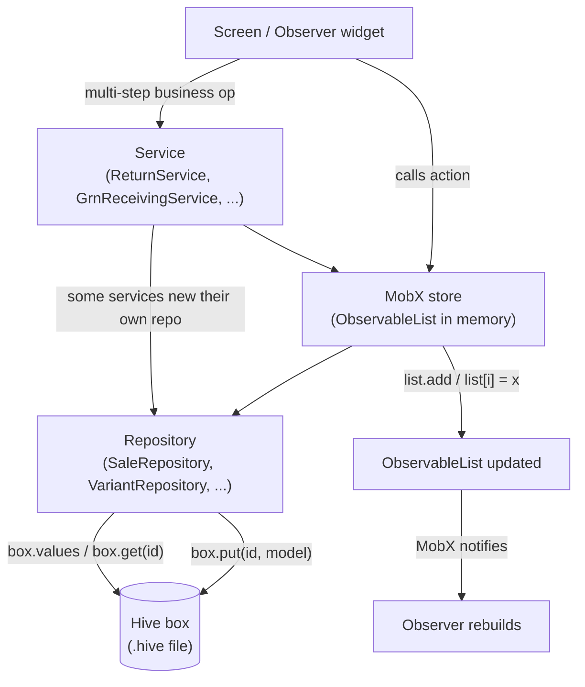
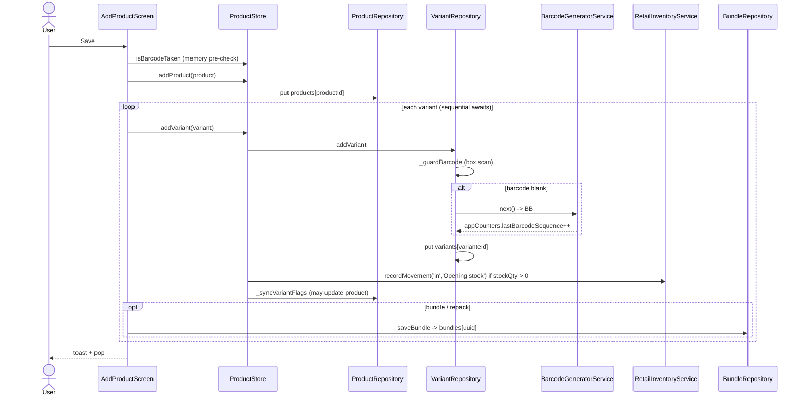
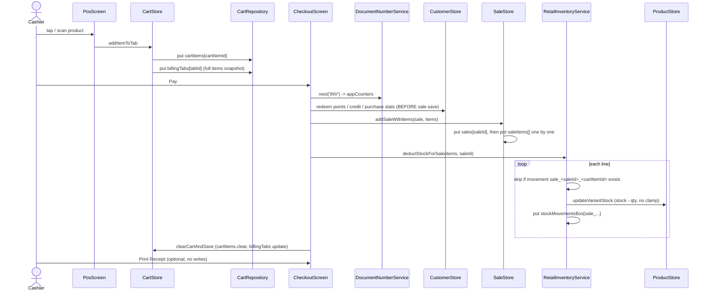
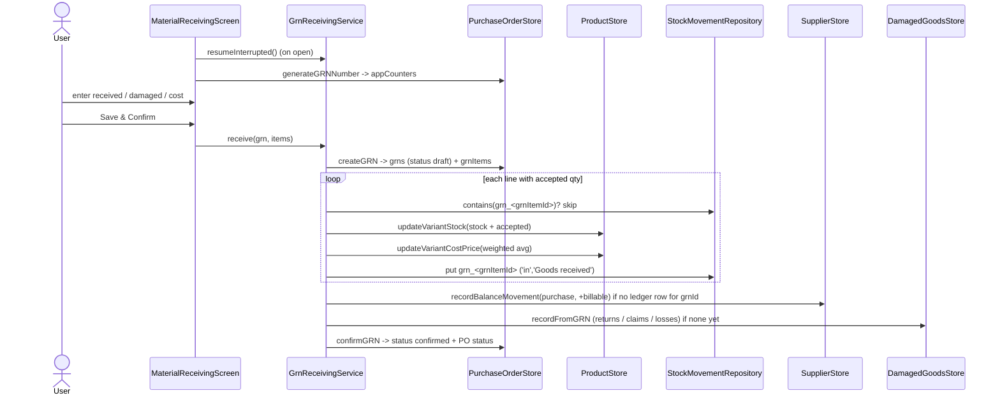
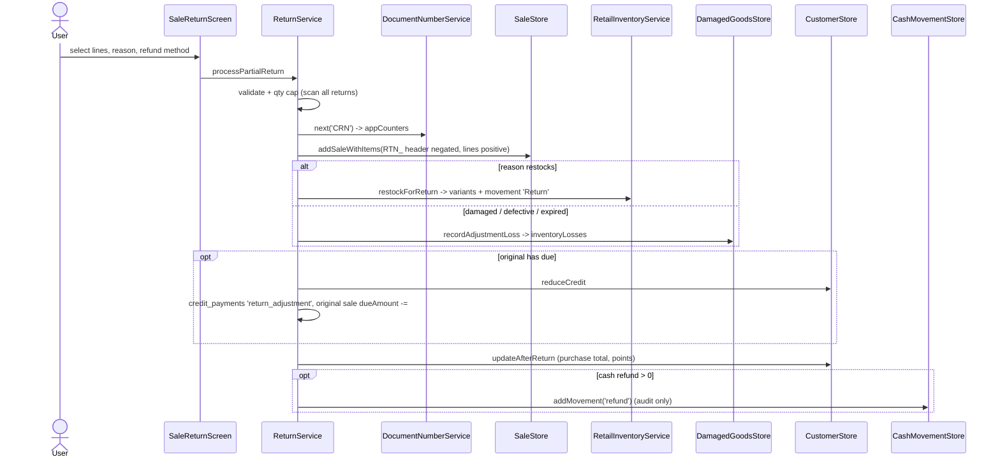
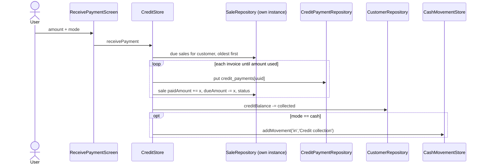
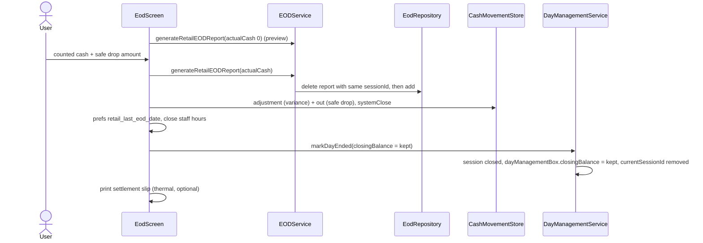
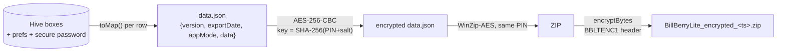

# 03 — Retail Database Flows

**App:** Bill Berry Lite (retail mode) · **Storage:** Hive · **State:** MobX
**Branch read:** `refactor/shared-code-consolidation` · **Date:** 2026-10-19 · **Method:** static code reading only (nothing was run)

This document follows each retail business operation from the screen down to the Hive box, and lists every record that gets created, changed or deleted.

## How to read this document

- All paths are relative to `lib/` unless they start with `docs/`.
- `file.dart:120` means line 120 of that file. A statement with a citation was checked in the code.
- **(inferred)** = a conclusion drawn from reading the code, not from running it.
- **(unverified)** = not checked.
- **Not implemented** = there is no code for it.
- The **Records** line in each step uses **CREATED**, **MODIFIED** and **DELETED**. The box name always comes first, for example `sales[saleId]`.
- Related docs: `01_*` (infrastructure) and `02_*` (models), in this folder. Older module docs in `docs/modules/` are partly out of date. The stale points are listed where they matter.

---

## Contents

0. [General data access path](#0-general-data-access-path)
A. [Product creation](#a-product-creation)
B. [Product retrieval and lookup](#b-product-retrieval-and-lookup)
C. [Retail billing and checkout](#c-retail-billing-and-checkout)
D. [Purchase orders and goods receipt](#d-purchase-orders-and-goods-receipt)
E. [Refunds, returns and exchanges](#e-refunds-returns-and-exchanges)
F. [Purchase returns, claims, loss, stock take, adjustment, kits](#f-purchase-returns-supplier-claims-inventory-loss-stock-take-stock-adjustment-kits)
G. [Customer credit payments](#g-customer-credit-payments)
H. [Expenses, cash movements, day sessions and EOD](#h-expenses-cash-movements-day-sessions-and-eod)
I. [Reports](#i-reports)
J. [Deletion flows](#j-deletion-flows)
K. [Backup and restore](#k-backup-and-restore-as-a-data-flow)
Z. [Unclear or risky data flows](#z-unclear-or-risky-data-flows)

---

## 0. General data access path

### 0.1 The layers

Most retail features use the same five layers:

| Layer | What it does | Example |
|---|---|---|
| Screen (`presentation/screens/retail/…`) | Reads observables inside an `Observer` widget and calls store actions | `checkout_screen.dart` |
| MobX store (`domain/store/retail/…`) | Holds `ObservableList`s in memory and runs actions | `ProductStore`, `CartStore`, `SaleStore` |
| Service (`domain/services/retail/…` or `common/…`) | Business rules that touch more than one store or box | `RetailInventoryService`, `ReturnService`, `GrnReceivingService` |
| Repository (`data/repositories/retail/…`) | Hive reads and writes, one box (or a pair of boxes) each | `SaleRepository`, `VariantRepository` |
| Hive box | The file on disk | `sales`, `variants`, `stockMovementsBox` |

**Exceptions to the layering** (direct box access, no store in between):
- The retail EOD reads `cashMovementsBox` directly with `Hive.box(...)` (`domain/services/restaurant/eod_service.dart:556-563`).
- `DayManagementService` is a static class that reads and writes `dayManagementBox`, `restaurantSessionsBox` and `cashMovementsBox` itself (`domain/services/restaurant/day_management_service.dart:16-92`).
- `DocumentNumberService` and the barcode, SKU and customer-id generators write `appCounters` directly.
- `StockMovementRepository` is not in DI. It is created with `new` inside `grn_receiving_service.dart:48`, `inventory_service.dart:29` and `stock_adjustment_service.dart:83`.
- `CreditStore` creates its own `SaleRepository` and writes sales behind `SaleStore`'s back (`domain/store/retail/credit_store.dart:97-99`).

### 0.2 How writes work

- **One `put` per record.** Every repository writes with `box.put(id, model)`, where `id` is the model's string id. That is an upsert: it inserts, or replaces the record with the same key.
- **No transactions.** Hive has no transaction that spans several boxes. Every multi-record operation (for example a sale header plus N lines plus N stock updates) is a chain of separate `await`ed `put` calls.
- **No batch atomicity.** No retail flow uses `putAll`. If the app dies halfway through a chain, the records written so far stay written and the rest are missing.
- **Whole-record writes.** An update reads a model, builds a `copyWith`, and `put`s the whole record back. Stock updates are read–modify–write with no lock (`VariantRepository.updateStock`, `data/repositories/retail/variant_repository.dart:235-241`).
- **Ids** are mostly `Uuid().v4()`. The exceptions that matter for flows are listed in the table below.

| Record | Id format | Where |
|---|---|---|
| Sale | UUID | `checkout_screen.dart:649` |
| Return document | `RTN_<uuid>` | `return_service.dart:309` |
| Cart line | `<variantId>_<millis>` | `cart_store.dart:477` |
| Held sale | `HOLD_<uuid>` | `hold_sale_service.dart:28` |
| Purchase order | `millisecondsSinceEpoch` string | `purchase_order_model_211.dart:84` |
| Stock movement (sale) | `sale_<saleId>_<cartItemId>` | `inventory_service.dart:46` |
| Stock movement (GRN) | `grn_<grnItemId>` | `grn_receiving_service.dart:163-180` |
| Stock movement (stock take) | `st_<takeItemId>` | `stock_take_store.dart:409-417` |

Display numbers (`INV-00001`, `CRN-00001`, `EXC-00001`, `PO-00001`, `GRN-00001`, `PR-…`, `CLM-…`, `LOSS-…`, `ST-…`) come from `DocumentNumberService.next(prefix)`. It writes the `appCounters` box under `<PREFIX>_lastFy` and `<PREFIX>_lastSeq`, and restarts the sequence each financial year (`domain/services/common/document_number_service.dart:68-123`). A number is reserved **before** the document is saved, so an abandoned form leaves a gap. Two documents never get the same number in the same year.

### 0.3 How memory caching works

- All retail stores are **lazy singletons** (`core/di/service_locator.dart:132-135`). A store is built the first time something asks for it, not at app start.
- A store loads its box **once** into an `ObservableList`. For example, the `ProductStore` constructor calls `loadProducts()` then `loadVariants()`, which copy `box.values.toList()` into memory (`domain/store/retail/product_store.dart:51-61, 76-83, 328-334`).
- After that, writes update both the box and the list (for example `products.add(...)`, or re-reading the saved record into the list with `_mirrorSaved`, `product_store.dart:475-478`).
- `@computed` values are derived from the lists and recomputed when the lists change, for example `variantsByProduct` (`product_store.dart:339-346`) and `CartStore.bill` (`cart_store.dart:140-147`).
- **Caveat:** some screens reload explicitly (`inventory_screen.dart:102-103`, `product_management_screen.dart:66`). Other writers bypass the store (CreditStore → sales, the backup restore), so a store's list can be stale until something reloads it (inferred).
- **Reports do not cache.** `ReportService` scans `sales` and `saleItems` on every load (see I).

### 0.4 Duplicate-prevention mechanisms that exist

| Mechanism | What it prevents | Where |
|---|---|---|
| Barcode guard in the repository | Two variants with the same barcode. It checks the **box**, not memory. | `VariantRepository._guardBarcode`, `variant_repository.dart:143-154` |
| Barcode pre-check in the UI | Same, before any write, using the in-memory list and other rows in the form | `add_product_screen.dart:759-768, 789-798`; `ProductStore.isBarcodeTaken` `product_store.dart:409-414` |
| Deterministic sale movement ids | Deducting stock twice when the in-screen checkout finish is retried | `inventory_service.dart:38-98` |
| Checkout `_isProcessing` + `_committedSale` | Double-tap creating two sales; re-saving a sale that is already committed | `checkout_screen.dart:633-642` |
| GRN draft + `resumeInterrupted()` + `grn_<id>` movement ids + ledger `docId` check | Re-applying a goods receipt after a crash | `grn_receiving_service.dart:30-44, 136-206` |
| GRN `_inFlight` set + `isGRNNumberUsed` | Double-tap on Receive | `grn_receiving_service.dart:60-67` |
| Stock take `st_<takeItemId>` movement id | Applying a counted variance twice | `stock_adjustment_service.dart:128-130` |
| `creditApplied` / `lossRecorded` flags | Crediting a purchase return or claim twice; writing off a rejected claim twice | `damaged_goods_store.dart:313-321, 472-482, 501-554` |
| Exchange `_inFlight` guard | Double commit of an exchange | `exchange_service.dart:209, 404-412` |
| Return qty cap (derived from all return documents) | Returning more units than were sold | `return_service.dart:84-100`; `return_math.dart:124-135` |
| EOD dedupe by `sessionId` | Two EOD reports for the same session | `eod_service.dart:402-417` |

### 0.5 What happens if the app closes mid-operation

| Flow | Crash-safe? | Summary (details in each section) |
|---|---|---|
| Product create | No | Product row first, then variants one by one. A crash can leave a product with some or no variants. |
| Checkout | Partly | Recoverable while the checkout screen is still alive. After a process kill there is **no** startup recovery. The cart is still in the tab, so the cashier can bill it again → duplicate sale (inferred). |
| Hold / restore | Yes (restore) | The hold is deleted last, so it can be restored again. |
| GRN receive | Mostly | Draft-first and resumable. Three small windows remain (see D). |
| Sale return / exchange | No | Random movement ids, no resume. A crash can leave a credit note with no restock, or a return with no exchange stamp. |
| Stock take commit | Mostly | Per-line idempotent through `st_` movement ids. One window remains (stock written, movement not). |
| Stock adjustment | No | Stock, then movement, then loss row. |
| Kit assembly | No | No resume. Components can be deducted with no kit credit. |
| Credit collection | No | One row per invoice plus sale updates plus customer update plus Cash-In, all separate. |
| EOD close | No | Report saved before the drawer rows and the session close. |
| Backup restore | No | Each box is `clear()`ed then refilled row by row. A throw mid-box leaves that box partly filled. |

### 0.6 Safeguards: implemented vs missing

| Implemented safeguards | Missing or unverified safeguards |
|---|---|
| Barcode uniqueness checked in the repository against the box | No cross-box transaction or rollback anywhere |
| Checkout re-entrancy guard and committed-sale resume (same screen instance) | No startup reconciliation for a sale saved without stock deduction |
| Sale stock deduction idempotent per line (`sale_…` ids) | Customer balance, points and visits are written **before** the sale is saved |
| GRN draft → resume → confirm last | Add Product: no save re-entrancy flag; `VariantWriteResult` ignored |
| Stock take idempotent per line (`st_…` ids) | Returns and exchanges have no resume and use random movement ids |
| `creditApplied` / `lossRecorded` exactly-once flags | Kit assembly has no resume |
| Supplier delete blockers (`deleteBlockers`) | Product, variant, tax, attribute value and staff deletes have no history guard |
| Bundle-component guard on product and variant delete | Pending-EOD gate runs only when the POS screen opens |
| Category delete re-parents products (never deletes them) | Cash movements are refused silently when EOD is strictly pending |
| Daily bill cap and stock shortfall check at checkout | No credit-limit check on partial payments |
| EOD report dedupe per session | No soft-delete/archive for products or variants |
| Encrypted backups (three layers) | Restore uses `add()` (int keys) for 10 retail boxes + 3 common boxes; sessions box not backed up; payment legs lost on restore |

---

## A. Product creation

**Entry:** `presentation/screens/retail/add_product_screen.dart`. The Save button (`:1314`) calls `_saveProduct()` for a new product or `_updateProduct()` for an edit.

### A1. Create (`_saveProduct`, `add_product_screen.dart:729-959`)

1. **Validate the form.** Manual variant rows that are fully blank are dropped (`_filledManualVariants`, `:680-695`). At least one variant is required (`:736`). Each manual row needs a selling price, and needs stock unless the product is a Bundle (`:746-758`). Generated rows need a selling price (`:774-783`).
   - Records: none.
2. **Barcode pre-check (UI only).** Each non-blank barcode is checked against `productStore.isBarcodeTaken` (in-memory `variants`, `product_store.dart:409-414`) and against the other rows of the same form (`seenBarcodes`, `:759-768, 789-798`).
   - Records: none.
3. **Below-cost confirm** dialog per row (`:801-824`). **Tax rate** resolved from `taxStore.taxes` by `_selectedTaxId` and cached on the model (`:830-837`). **Plan gate** `productStore.canAddProduct` (`:841-847`; `product_store.dart:98-101`).
   - Records: none.
4. **Build the product.** `productId = Uuid().v4()` (`:850`). `hasVariants`/`productType` are derived from the variant count (`:867-868`). `imageBytes` holds the raw bytes from `UniversalImagePicker.showPicker` (`:1110`). No resizing or compression was found in `presentation/widget/componets/common/universal_image_picker.dart`. `category` may be `''` if no category was chosen (`:862`).
   - UI: `add_product_screen.dart` · Store: `ProductStore.addProduct` (`product_store.dart:86-92`) · Repo: `ProductRepository.addProduct` (`data/repositories/retail/product_repository.dart:25-29`) · Box: `products`
   - Records: **CREATED** `products[productId]`. The store appends to `ObservableList products`.
5. **Variants, one at a time** (`:882-951`). Sequential `await`s, not batched.
   - Attribute-generated variants: `variant.copyWith(productId, taxRate, taxId, isDecimalQuantity, unit, expiryDate, stockQty: bundle ? 0 : null)` (`:884-894`). Their `varianteId` was created earlier by `VariantGeneratorService`.
   - Manual variants: `VarianteModel.create(varianteId: Uuid().v4(), sellingPrice, mrp, costPrice, stockQty, …, customAttributes)` (`:906-942`). Simple-product custom fields go into `customAttributes`.
   - Each goes through `ProductStore.addVariant` (`product_store.dart:490-514`):
     a. `VariantRepository.addVariant` (`variant_repository.dart:89-98`) runs `_guardBarcode` against the **box** (`:143-154`) and normalises the barcode (trim, `''` → null, `:52-55`). **If the barcode is blank it mints one**: `BarcodeGeneratorService.next` produces `BB` + 10 digits from `appCounters['lastBarcodeSequence']` and skips codes already taken (`domain/services/retail/barcode_generator_service.dart:47-69`). Then `put(varianteId)` (`:96`).
     b. On success, `_mirrorSaved` re-reads the record from the box into the in-memory `variants` list (`product_store.dart:475-478`), so the minted barcode is visible.
     c. **Opening stock movement:** if `stockQty > 0`, `RetailInventoryService.recordMovement(type 'in', reason 'Opening stock')` (`product_store.dart:502-510`; `inventory_service.dart:287-318`, never throws).
     d. `_syncVariantFlags` may rewrite the product's `hasVariants`/`productType` (`product_store.dart:462-471`).
   - Records: **MODIFIED** `appCounters.lastBarcodeSequence` (only when minting) · **CREATED** `variants[varianteId]` · **CREATED** `stockMovementsBox[uuid]` (only if stock > 0) · **MODIFIED** `products[productId]` (maybe).
6. **Bundle / kit components.** When `stockMode` is not standard and components were staged: `_persistBundleForNewVariant` (`add_product_screen.dart:965-985`) → `bundleRepository.saveBundle`.
   - Records: **CREATED** `bundles[uuid]` (one row per bundle variant).
7. **Attributes.** The variant stores its attribute value ids and descriptor labels. The main Add Product screen does **not** write `ProductAttributeModel` rows. The only writer of `product_attributes` is bulk import (`stores/import_product/bulk_import_store.dart:743` → `attribute_store.dart:452-482`).
   - Records: none from this screen.
8. Success toast and `Navigator.pop` (`:953-958`).

> **Memory note correction:** "opening stock writes NO movement" is stale. Opening stock now logs a movement (`product_store.dart:502-510`).

### A2. Edit (`_updateProduct`, `add_product_screen.dart:529-664`)

1. Plan gate `RetailEntKeys.catalogProductsEdit` (`:531-537`). Bundle/repack needs at least one variant (`:544-552`). Switching **into** Bundle is refused while any variant has stock ≠ 0 (`:560-574`).
   - Records: none.
2. `existing.copyWith(...)` (with explicit `clearX` flags) → `productStore.updateProduct` (`:585-604`; `product_store.dart:171-181`).
   - Records: **MODIFIED** `products[productId]`.
3. For each variant whose unit, decimal flag or expiry changed, or that is leaving Bundle mode: `productStore.updateVariant(copyWith(... stockQty: reset ? 0 : null))`. `updateVariant` compares against the box copy and logs a `Stock edited` movement if `stockQty` changed (`product_store.dart:516-542`).
   - Records: **MODIFIED** `variants[id]` · **CREATED** `stockMovementsBox[uuid]` (if stock changed).
4. Per variant, save or delete its bundle row (`:641-659`).
   - Records: **CREATED / MODIFIED / DELETED** `bundles[id]`.

Adding, editing and deleting single variants happens in `product_detail_screen.dart` (not traced line by line here).

### A3. Other creation paths that use `ProductStore.addVariant`

- **POS quick-create** when a scanned barcode is not found: `ex/posscreen.dart:3266-3296` → `productStore.createSimpleProduct` (`product_store.dart:115-169`). It checks the barcode **before** writing. Records: **CREATED** `products`, **CREATED** `variants` (costPrice null, stock 1 by default), **CREATED** opening movement, then the item is added to the cart.
- Bulk import (`stores/import_product/bulk_import_store.dart`), sample data, and Add Variant on Product Detail (not traced here).

### Crash/consistency notes (A)

- Not atomic: product row → N variant rows → N bundle rows. A crash in the loop leaves a product with only some of its variants (inferred).
- A variant whose `put` succeeded but whose opening movement failed has stock with no movement row (`recordMovement` never throws, so the error is swallowed).

### Risks found (A)

| ID | Risk | Evidence |
|---|---|---|
| A-R1 | `_saveProduct` ignores the `VariantWriteResult` returned by `addVariant`. If the repository refuses a variant (for example a barcode race with an import), the variant is lost silently and the toast still reports success. That can leave a product with zero variants. | `add_product_screen.dart:884, 910` |
| A-R2 | No `_isSaving` flag on Save. A double tap can create two products (inferred; the async dialogs make the window real). | grep for `_isSaving|_saving` in the file: none; `:1314` |
| A-R3 | Photos are stored as raw bytes in every `ProductModel`. `loadProducts` loads the whole box, photos included, into memory. No compression. | `product_store.dart:76-83`; `product_model_200.dart:71-75` |
| A-R4 | A product can be saved with an empty category id. | `add_product_screen.dart:862` |
| A-R5 | `ProductStore.isBarcodeTaken` compares untrimmed stored barcodes with a trimmed input; the repository trims both. The UI pre-check can disagree with the real guard. | `product_store.dart:409-414` vs `variant_repository.dart:52-55` |

---

## B. Product retrieval and lookup

### B1. Steps

1. **Hydration.** The `ProductStore` constructor runs `_init()` → `loadProducts()` → `loadVariants()`. Both copy the whole box into `ObservableList products` / `ObservableList variants` (`product_store.dart:51-61, 76-83, 328-334`). Because the store is a lazy singleton, this happens on first access. `ensureLoaded()` returns the in-flight future (`:71`); `report_service.dart:1116` and `retail_notification_sync_service.dart:75` wait on it.
   - Records: none (read only).
2. **Explicit reloads** happen in `inventory_screen.dart:102-103`, `product_management_screen.dart:66`, `product_detail_screen.dart:115`, bulk import and restore.
3. **Join product → variants.** `@computed variantsByProduct` builds `Map<productId, List<Variante>>` once per change (`product_store.dart:339-346`). `variantsFor(productId)` is the fast lookup used by tiles (`:349-350`). Stock helpers: `totalStockFor`, `stockStatusForVariant` (a variant's `minStock` wins over the global threshold, `:398-417`). Expiry helpers: `:427-445`.
4. **POS text search** (`ex/posscreen.dart:574-581`): `productStore.searchProducts(query)` filters in memory on product name, category display name and brand (`product_store.dart:309-324`). Results go into a `ValueNotifier<List<ProductModel>>` (`posscreen.dart:194`), not `setState`. Barcode and SKU are **not** matched by text search (inferred).
5. **Category browse.** `ValueNotifier<String?> _browseCategoryId` (`posscreen.dart:198`). Tiles use `productStore.variantsFor` and `RetailInventoryService.totalAvailableToSell`. For a bundle, available = the minimum over its components (`posscreen.dart:1523-1536, 1847-1854`; `inventory_service.dart:160-201`).
6. **Tap a product** (`posscreen.dart:655-695`): `productStore.getVariantsForProduct` (this is a **box scan**, not the in-memory map), filtered to `status == 'active'`. One variant → expiry confirm (`:602-623`) → quantity (`_resolveQuantity`; decimal variants open the weight sheet, `:633-653`) → `cartStore.addItemToTab`. More than one → `VariantPickerDialog`.
7. **Barcode scan.** Camera `onDetect` (`posscreen.dart:1279-1291`) or Enter in the search field (`:1421-1424`) → `_handleBarcodeScanned` (`:697-765`):
   - 2-second debounce for the same code (`:700-709`).
   - `productStore.findVariantByBarcode` → `VariantRepository.findByBarcode`: a linear **box** scan that trims both sides (`variant_repository.dart:200-207`).
   - Inactive variant → warning (`:713-720`).
   - Then `productStore.findByBarcode` → `ProductRepository.findByBarcode`: a **second** box scan that compares **without trimming** (`product_repository.dart:58-68`).
   - Not found → "product not found" dialog → quick-create (A3).

### Crash/consistency notes (B)

Read-only. No writes.

### Risks found (B)

| ID | Risk | Evidence |
|---|---|---|
| B-R1 | If a variant matched only after trimming (stored `" BB0000000042"` or a scanner adds whitespace), the product lookup returns null and the scan **does nothing**: no line added, no message. Fix idea: resolve the product with `getProductById(variant.productId)`. | `posscreen.dart:711-751`; `product_repository.dart:58-68` vs `variant_repository.dart:200-207` |
| B-R2 | Pressing Enter on a product **name** in the search field takes the barcode path and shows "product not found" (inferred UX issue). | `posscreen.dart:1421-1424` |
| B-R3 | Barcode lookup and tap-to-variants are box scans (O(n)) on every scan or tap, though memory already has the data. | `variant_repository.dart:200-207`; `posscreen.dart:655-695` |

---

## C. Retail billing and checkout

### C0. Gates before billing

| Gate | When it runs | Where |
|---|---|---|
| Plan `RetailEntKeys.billing` | POS screen init | `posscreen.dart:355-362` |
| **Pending EOD**: `isEodStrictlyPending() || hasPendingEOD()` → "Complete End of Day for the previous day first" | POS screen init only | `posscreen.dart:373-382, 414` |
| Day not started → `promptStartDay` | POS screen init | `posscreen.dart:387-399` |
| Daily bill cap (counts `getTodaySales()`, which **includes** return and exchange rows) | Checkout submit | `checkout_screen.dart:248-260`; `sale_repository.dart:71-78` |
| Stock shortfall (`checkoutShortfalls`: sums demand per variant, expands bundles, compares live stock; skips `allowOrderWhenOutOfStock`) | Checkout submit | `checkout_screen.dart:612-626`; `cart_store.dart:1007-1042` |

The checkout screen has no EOD or day check (no `DayManagement` reference in `checkout_screen.dart`). A POS left open past midnight or past the auto-close limit can keep billing into the old session (inferred).

### C overview diagram

### C step 1 — Select a product

See B6 and B7. Tap → variant list (box scan) → expiry confirm → quantity → `addItemToTab`. Scan → `_handleBarcodeScanned`.
- UI: `ex/posscreen.dart` · Store: `ProductStore` · Repo: `VariantRepository`, `ProductRepository` · Box: `variants`, `products` (read)
- Records: none.

### C step 2 — Add to cart

**The cart model (tab-snapshot rule).** `CartStore` holds `ObservableList<CartItemModel> items` (the active tab's lines) and `ObservableList<BillingTabModel> tabs` (`cart_store.dart:103-110`). Each `BillingTabModel` row in `billingTabs` embeds a **full copy** of its tab's lines (`items`, HiveField 2). On start the store restores the tabs from `billingTabs` (or creates "Tab 1") and loads the active tab's embedded lines (`:85-101, 210-233`).

The `cartItems` box is **written but never read back** by retail. `CartRepository.getAllCartItems` has no retail caller. The tab snapshot in `billingTabs` is the real source of truth; `cartItems` is a write-only mirror.

`CartStore.addItem` (`cart_store.dart:349-508`):
1. An unconfigured bundle is refused (`:367-369`).
2. `available = calculateAvailableToSell(product, variant) − heldInOtherTabs` (`:373-375`; `_heldInOtherTabs` `:987-996`). Out of stock is refused unless `product.sellsWhenOutOfStock` or `ignoreStock` (used when restoring a held sale) (`:386-399`).
3. Category name resolved (`:402-407`). GST rate: 0 if `!TaxFeature.enabled`, else override ?? variant.taxRate ?? product.gstRate ?? the default rate (`:414-416, 821-836`). HSN: variant first, then product (`:839-851`).
4. Tax mode is read via `_taxMode()` (`:420, 164-167`).
5. Same variant already in the cart → merge: qty += n, keep any overridden price, re-resolve a % line discount (`:422-461`). Otherwise a new line: `cartItemId = '${varianteId}_${millis}'`, `price = priceOverride ?? sellingPrice ?? mrp ?? 0` (`:464-465`).
6. `CartItemModel.create(...)` computes the line's total, taxable, GST, CGST and SGST.

- UI: `posscreen.dart` (calls the `*InTab` wrappers: `:674, 737, 781, 2201, 2225, 2262, 2399, 2517`) · Store: `CartStore.addItemToTab` → `addItem` · Repo: `CartRepository.saveCartItem` (`cart_repository.dart:28-30`), `saveTab` (`:50`) · Box: `cartItems`, `billingTabs`
- Records: **CREATED / MODIFIED** `cartItems[cartItemId]` · **MODIFIED** `billingTabs[tabId]` (full items copy, via `_saveCurrentTabItems`, `cart_store.dart:1305-1318`).

**Quick item** (`addQuickItem`, `:529-…`): new id every time, no stock check, no catalogue row. Stock deduction later skips it.

**Tab operations:** `createNewTab` (saves the current tab, **CREATED** `billingTabs`, `:1238-1261`), `switchTab` (saves the current tab, `:1265-1274`), `closeTab` (**DELETED** `billingTabs[id]`; the last tab is cleared instead, `:1278-1302`). Every tab change calls `resetBillingInputs()` (`:227-233`), which resets the discount and loyalty and **deselects the customer** (`:198-207`).

### C step 3 — Change quantity (including decimal)

- `incrementQuantity` / `decrementQuantity` step by `variant.quantityStep` (a fraction for loose goods, 1 for pieces) (`cart_store.dart:1044-1154`).
- `setQuantity` sets an absolute value. 0 removes the line. `kMaxCartLineQuantity` stops typos. It re-reads live stock with `variantRepository.getVariantById` and checks `_stockLimit` (`:884-970`).
- Decimal entry from the POS: weight sheet `showWeightItemDialog` (`posscreen.dart:640-651`) or typed quantity `_applyTypedQuantity` → `setQuantityInTab` (`:2218, 2262`).
- Every change rebuilds the line with `CartItemModel.create`, keeping the override and re-resolving a % discount.
- UI: `posscreen.dart` · Store: `CartStore` · Repo: `CartRepository` · Box: `cartItems`, `billingTabs`, `variants` (read)
- Records: **MODIFIED** `cartItems[cartItemId]` (or **DELETED** at qty 0) · **MODIFIED** `billingTabs[tabId]`.

### C step 4 — Taxes, discounts and price override

| Input | Writer | What is written | Where |
|---|---|---|---|
| Tax mode (inclusive/exclusive) | `CartStore.setTaxMode(bool)` — the **only** writer | SharedPreferences `gst_tax_inclusive` (via `gstService.setTaxInclusiveMode`) + observable `isTaxInclusive` | `cart_store.dart:175-182` |
| Order discount | `CartStore.setDiscount` (called by the checkout discount field listener) | In memory only (discount type/value) | `cart_store.dart:184-188`; `checkout_screen.dart:148, 155-159`; reason picked at `:88-111` |
| Line discount | `setLineDiscountInTab` → `setLineDiscount`. Refuses a discount ≥ line gross. Permission check is the caller's job (`LineDiscountService`). | Line type/value/amount/reason/note → `cartItems`, `billingTabs` | `cart_store.dart:747-818`; `posscreen.dart:2367-2399` |
| Price override | `overrideLinePriceInTab` → `overrideLinePrice`. Sets `price = newPrice`, `originalPrice = catalogue price`, reason/note. Reverting clears the audit. The variant master is **never** written. Gate `PriceOverrideService` in the caller. | → `cartItems`, `billingTabs` | `cart_store.dart:604-674`; `posscreen.dart:2491-2517` |
| Loyalty redemption | `setLoyaltyRedemption` | In memory | `cart_store.dart:190-193`; checkout snapshots `_pointsRedeemed` (`checkout_screen.dart:145`) |

**The bill engine.** `@computed bill = RetailBillingService.compute(items, isTaxInclusive, discountType, discountValue, loyaltyRedemption)` (`cart_store.dart:140-147`). It delegates to the shared `CartCalculationService.fromLines` with `discountOnItems: false` and no service or delivery charge (`domain/services/retail/retail_billing_service.dart:169-242`). Line discounts are taken first; the order discount is spread over what is left. On each output line, `discountAmount` = TOTAL (line discount + share of the bill discount) and `lineDiscountAmount` = only the line's own discount (`:21-31`). CGST/SGST come from `TaxSplit.halves`.

Changing the tax mode does **not** rebuild existing cart rows, so their stored per-row GST fields still reflect the old mode. The bill itself is recomputed from price, qty, line discount and rate only, so totals stay right (inferred).

- Records: **MODIFIED** `cartItems`, `billingTabs` (line discount, override); SharedPreferences `gst_tax_inclusive` (tax mode).

### C step 5 — Payment

**Paid, split or partial** (`_processCheckout`, `checkout_screen.dart:632-736`):
1. Re-entrancy: `_isProcessing` (`:633, 640-642`) and the `_committedSale` resume guard (`:634`). Buttons are disabled while processing (`:822`; `_canSubmitPayment` `:131-135`).
2. Gates: daily bill cap and stock shortfall (`:637-638`).
3. Payment legs come from `SplitPaymentWidget` (`PaymentEntry`, `presentation/widget/componets/common/split_payment_widget.dart:15`) and become `paymentList` maps (`:658`). A leg's `amount` is the money actually settled (change excluded), not the bill share (`split_payment_widget.dart:61-76`).
4. `SaleModel.createWithSplitPayment(...)` (`data/models/retail/hive_model/sale_model_203.dart:333-425`):
   - `paymentType = 'split'` if there is more than one leg, otherwise the single leg's method.
   - `paymentListJson = jsonEncode(legs)`. **Legs are stored inside the sale as JSON**, not in a box of their own. The `paymentEntries` box and `PaymentEntryModel` are never written.
   - `totalPaid` (tendered), `changeReturn`.
   - `paidAmount = clamp(amountCollected ?? grandTotal)`. Partial payment → `dueAmount = grandTotal − collected`, `status = 'partially_paid'`; otherwise `status = 'paid'`.
   - Snapshots: `isTaxInclusive`, `taxEnabled`, `storeGstNumber`, `lineDiscountTotal`, `roundOff`, `loyaltyPointsUsed`, `shiftId = RestaurantSession.currentShiftId`, `date = createdAt = now`.

**Pay Later / full credit** (`_processCreditSale`, `checkout_screen.dart:262-449`):
- Same guards, plus: a customer is required, and `customerStore.canMakeCreditPurchase(customerId, grandTotal)` checks `creditLimit` (≤ 0 means unlimited) (`:279-297`; `customer_store.dart:345-351`).
- `SaleModel.createCreditSale`: `paymentType 'credit'`, legs `[{credit, grandTotal}]`, `paidAmount 0`, `dueAmount = grandTotal`, `status 'due'` (`sale_model_203.dart:446-502`).
- No loyalty points are **earned** on a pure credit sale (there is no `updateAfterPurchase` call) (inferred from code).

**Customer updates happen BEFORE the sale is saved.**

| Path | Calls (in order) | Effect on `customers[customerId]` | Where |
|---|---|---|---|
| Paid / split | `redeemCustomerPoints`, then `updateAfterPurchase(grandTotal, LoyaltyPoints.earnedFor(grandTotal))` | −points (only if balance ≥ points); +purchase total; +earned points; +1 visit | `checkout_screen.dart:694-710`; `customer_store.dart:227-232, 264-267` |
| Partial | as above **plus** `updateAfterCreditSale(customerId, dueAmount)` | +credit balance (due); **+purchase (due) again**; **+1 visit again** | `checkout_screen.dart:701-709`; `customer_store.dart:337-342` |
| Pay Later | `updateAfterCreditSale(customerId, grandTotal)`, `redeemCustomerPoints` | +credit balance; +purchase; +1 visit; −points | `checkout_screen.dart:419-422` |

- Records: **MODIFIED** `customers[customerId]` (before the sale exists).

### C step 6 — Save the sale

1. `saleId = Uuid().v4()` (`checkout_screen.dart:649`; credit path `:384`).
2. **Invoice number:** `saleStore.nextInvoiceNumber()` → `DocumentNumberService.next('INV')` → `INV-00001` style, restarting each financial year; a display prefix can be overridden (`sale_store.dart:52-53`; `document_number_service.dart:68-123`). It is minted at submit, before the other writes, so a later failure leaves a gap. `invoiceNumber` is display only; the key is `saleId`.
3. `_buildSaleItems` (`checkout_screen.dart:501-551`): one `SaleItemModel.fromCalculated` per bill line, using the engine's figures (taxable, GST, total discount, capped line discount), override and line-discount audit fields, and the **unit cost frozen** from the live variant's `costPrice` (`:531`).
4. `saleStore.addSaleWithItems(sale, items)` (`sale_store.dart:87-94`): header first, then one `put` per line (`sale_repository.dart:29-31`; `sale_item_repository.dart:34-37`). Then `sales.insert(0, sale)` in memory, then `loadSalesStats()` (two full box scans, `sale_repository.dart:116-130`).
5. `_committedSale = sale` (`checkout_screen.dart:716`).

- UI: `checkout_screen.dart` · Store: `SaleStore` · Service: `DocumentNumberService` · Repo: `SaleRepository`, `SaleItemRepository` · Box: `appCounters`, `sales`, `saleItems`
- Records: **MODIFIED** `appCounters` (`INV_lastSeq`, `INV_lastFy`) · **CREATED** `sales[saleId]` · **CREATED** `saleItems[saleItemId]` × N.

### C step 7 — Inventory update

`_finishCommittedSale` (`checkout_screen.dart:557-592`) → `RetailInventoryService.deductStockForSale(cartStore.items, saleId)` (`domain/services/retail/inventory_service.dart:38-98`):

| Line type | What happens | Movement |
|---|---|---|
| Standard variant | `newStock = stockQty − qty`, **not clamped** (can go negative) → `productStore.updateVariantStock` → `VariantRepository.updateStock` (`variant_repository.dart:235-241`), memory upsert, `RetailNotificationSyncService.scheduleSync()` (`product_store.dart:557-566`) | `type 'out'`, reason `Sale`, id `sale_<saleId>_<cartItemId>`, `sessionId` from `DayManagementService.getCurrentSessionId()` |
| **Bundle** (`product.isBundle`) | Bundles are **virtual**: no own stock. Each component is reduced by `qty × component.quantity` (`:106-153`) | One `out` per component, id `<lineKey>_<componentVariantId>`, reason `Sale (bundle: …)` |
| **Kit / repack** (`stockMode 'repack'`) | **Physical**: sold from its own `stockQty` like a standard variant. Components were consumed earlier, at assembly (`:329+`) | `Sale` |
| Quick item / deleted product | Product or variant not found → skipped (`:71`) | none |

Before each line, if a movement with that id already exists, the line is skipped. That makes an in-screen retry safe.

- UI: `checkout_screen.dart` · Service: `RetailInventoryService` · Store: `ProductStore` · Repo: `VariantRepository`, `StockMovementRepository` · Box: `variants`, `stockMovementsBox`
- Records: **MODIFIED** `variants[variantId]` per line or component · **CREATED** `stockMovementsBox[sale_…]` per line or component.

Then:
- `cartStore.clearCartAndSave()` → `clearCart` (**DELETED** every row of `cartItems` via `box.clear()`, plus `resetBillingInputs`, which deselects the customer) and `_saveCurrentTabItems` (**MODIFIED** `billingTabs[tabId]` with empty items) (`cart_store.dart:1156-1163, 1475-1479`). `clearCartItems` wipes the **whole** `cartItems` box, including other tabs' lines. That is harmless only because `cartItems` is never read.
- Credit sale → `creditStore.loadData()` (`checkout_screen.dart:574`).
- No cash-drawer record is written at sale time. Expected cash is derived later from the sales (see H).

### C step 8 — Receipt and reports

- Success dialog → optional **Print Receipt** → `printService.showPrintOptionsDialog(sale, items, customer, store details, itemTotal/roundOff/isTaxInclusive from the STORED sale)` (`checkout_screen.dart:1798-1985`; `domain/services/retail/print_service.dart:697`). Printing is started by the user and writes nothing.
- `Navigator.pop(true)` back to the POS (`:591`).
- Reports read the stored `sales` and `saleItems` later; nothing is pre-aggregated (see I).
- Records: none.

### C9. Hold (park) and resume a sale

**Park** (`posscreen.dart:806-857` → `HoldSaleService.park`, `domain/services/retail/hold_sale_service.dart:22-78`):
1. Freezes `retailCartStore.bill` into a header (`subtotal` holds the payable **grand total**, despite its name) and one line per cart line (price, gstRate, taxable, GST, discount, override and line-discount audit).
2. `holdSaleStore.addHoldSale` (`hold_sale_store.dart:64-66`; `hold_sale_repository.dart:18-19, 52-55`).
3. `clearCartAndSave()`.
- Records: **CREATED** `holdSales['HOLD_<uuid>']` · **CREATED** `holdSaleItems[...]` × N · **DELETED** all `cartItems` · **MODIFIED** `billingTabs`.

**Restore** (`parked_sales_screen.dart:56` → `HoldSaleService.restore`, `:87-185`):
1. `clearCartAndSave()` (replaces whatever is in the active tab).
2. Replays each line with `addItemToTab(priceOverride, gstRateOverride, qty, override audit, line-discount type/value…, ignoreStock: true)`. Quick items use `addQuickItemToTab` + `setLineDiscountInTab`, with `qty.round()` (`:102`). Lines whose product was deleted are reported as skipped.
3. Sets the order discount as an AMOUNT equal to `holdSale.discountAmount` (`:175-181`).
4. Deletes the hold and its lines (`hold_sale_repository.dart:33-37, 70-74`).
- Records: **CREATED/MODIFIED** `cartItems`, `billingTabs` · **DELETED** `holdSales[id]`, `holdSaleItems[...]`.

**Delete a parked sale:** `parked_sales_screen.dart:85-98` → `holdSaleStore.deleteHoldSale` → **DELETED** both boxes.

### Crash/consistency notes (C)

Write order on the paid path:
`appCounters` → `customers` → `sales` → `saleItems` × N → per line {`variants`, `stockMovementsBox`} → `cartItems` clear → `billingTabs`.

| Crash point | Result |
|---|---|
| After the invoice number, before anything else | Gap in the INV series. Harmless. |
| After the customer writes, before `addSaleWithItems` | Customer balance, purchase total, visits and points changed with **no sale**. A retry mints a new invoice and applies them **again** (`checkout_screen.dart:694-714, 419-427`). |
| After the sale header, before all lines | Sale header with some lines missing (inferred). |
| After the sale is saved, before stock deduction — screen still alive | Safe: `_committedSale` + deterministic movement ids; `dispose()` also fires a background finish (`:161-178`). |
| Same, but the **process is killed** | No startup recovery exists (the only callers of `deductStockForSale` are `checkout_screen.dart:171, 559`). The tab snapshot still holds the cart (it is cleared only after deduction). On restart the cashier sees the same cart and can bill it again → **duplicate sale and duplicate customer updates**, while the first sale's stock was never deducted (inferred). |
| Between a line's variant write and its movement write | Stock reduced, no movement row. A re-run does not find the movement id and reduces the stock again (inferred). |
| Hold restore mid-way | The hold still exists (deleted last), the tab is partly filled. Safe to restore again (inferred). |

### Risks found (C)

| ID | Risk | Evidence |
|---|---|---|
| C-R1 | Customer writes happen before the sale save; failure or retry double-applies them. | `checkout_screen.dart:419-427, 694-714` |
| C-R2 | Process kill after sale save → no stock deduction, cart still present → re-billing creates a duplicate sale. | `checkout_screen.dart:161-178, 557-592` |
| C-R3 | Partial payment counts `totalPurchaseAmount` as `due + grandTotal` and adds 2 visits. | `checkout_screen.dart:701-709`; `customer_store.dart:227-232, 337-342` |
| C-R4 | Partial payment skips the credit-limit check (only Pay Later calls `canMakeCreditPurchase`). | `checkout_screen.dart:279-297` vs `:676-714` |
| C-R5 | **Restoring a held sale applies line discounts twice.** The parked `discountAmount` is the TOTAL discount (line + bill). Restore replays each line discount AND sets the order discount to that total. | `hold_sale_service.dart:36, 175-181`; `retail_billing_service.dart:69-70, 116-131` |
| C-R6 | Parking drops the attached customer. `HoldSaleModel` has `customerId`/`customerName`, but `park()` never sets them, and `clearCartAndSave` deselects the customer. Loyalty redemption is not parked either. | `hold_sale_service.dart:30-40`; `hold_sale_model_209.dart:12, 15` |
| C-R7 | Quick-item quantities are rounded on restore. | `hold_sale_service.dart:102` |
| C-R8 | Pending-EOD gate only at POS init; checkout itself is not gated. | `posscreen.dart:373-382, 414` |
| C-R9 | Daily bill cap counts return and exchange documents as bills. | `checkout_screen.dart:248-260` |
| C-R10 | Stock deduction never clamps; allowed-out-of-stock and concurrent sales go negative by design. | `inventory_service.dart:70-73` |
| C-R11 | `HoldSaleItemModel` id = `holdSaleId + variantId + ms`; two lines of the same variant in the same ms would collide. | `hold_sale_item_model_210.dart:149` |

---

## D. Purchase orders and goods receipt

Boxes: `purchaseOrders`, `purchaseOrderItems`, `grns`, `grnItems`, `variants`, `stockMovementsBox`, `supplierLedger`, `suppliers`, plus the damaged-goods boxes (see F).

### D1. Create a purchase order

1. `PurchaseOrderListScreen` FAB → `_navigateToAddPO()` (`purchase_order_list_screen.dart:94-105, 366`).
2. `AddPurchaseOrderScreen.initState` → `_reservePONumber` → `PurchaseOrderStore.generatePONumber` → `DocumentNumberService.next('PO')` (`add_purchase_order_screen.dart:46-59`). The counter is written **when the form opens**.
   - Records: **MODIFIED** `appCounters` (`PO_lastSeq`).
3. `_savePO` (`:124-185`): plan `RetailEntKeys.purchaseCreate`, supplier required, at least one line. Builds `PurchaseOrderModel.create(status: draft)` (`poId` = millisecond timestamp string, `purchase_order_model_211.dart:84`) and one `PurchaseOrderItemModel.create` per line (UUID).
4. `PurchaseOrderStore.addPurchaseOrder` (`purchase_order_store.dart:94-110`) recomputes `totalItems` and `estimatedTotal`, then writes the header, then the lines one by one.
   - UI: `add_purchase_order_screen.dart` · Store: `PurchaseOrderStore` · Repo: `PurchaseOrderRepository`, `PurchaseOrderItemRepository` · Box: `purchaseOrders`, `purchaseOrderItems`
   - Records: **CREATED** `purchaseOrders[poId]` · **CREATED** `purchaseOrderItems[poItemId]` × N.

### D2. Edit a purchase order (draft only)

- Entry: the detail sheet's Edit, shown only when `po.canEdit` (`purchase_order_detail_sheet.dart:869-879` → `_openEditor` `:339-352`).
- `_savePO` builds `copyWith(...)` and **new** item objects. Every line gets a new UUID.
- `updatePurchaseOrder` (`purchase_order_store.dart:112-141`): add the new lines first → delete the old ids not in the new set (that is all of them) → write the header last (bumps `updatedAt`).
- Records: **CREATED** new `purchaseOrderItems` · **DELETED** old `purchaseOrderItems` · **MODIFIED** `purchaseOrders[poId]`.

### D3. PO status changes

| From → To | Trigger | Code | Guard |
|---|---|---|---|
| (new) → draft | Save | `addPurchaseOrder` | plan + supplier + items |
| draft → sent | "Mark Sent" | `_markSent` `purchase_order_detail_sheet.dart:427-441` → `updatePOStatus` `purchase_order_store.dart:155-168` | UI only |
| draft → cancelled | "Cancel PO" | `_cancelPO` `purchase_order_list_screen.dart:840-863` → `cancelPurchaseOrder` `purchase_order_store.dart:236-243` | draft only; button needs `canAccess('purchase')` (`:682-683`) |
| sent/partial → partiallyCompleted / fullyCompleted | GRN confirm | `_updatePOStatusAfterGRN` `purchase_order_store.dart:462-500` | per line: received ≥ ordered − 1e-6, counted over **confirmed** GRNs; never reopens closed/cancelled |
| sent/partial → closed | "Close order" | `_closeOrder` `purchase_order_detail_sheet.dart:372-405` (runs `resumeInterrupted()` first, `:394`) → `closePurchaseOrder` `purchase_order_store.dart:254-260` | `canReceive`; terminal; nothing reversed |
| draft → deleted | "Delete PO" | `_deletePO` `purchase_order_list_screen.dart:865-894` → `canDeletePurchaseOrder` (draft AND no GRN, `purchase_order_store.dart:265-271`) → `deletePurchaseOrder` (`:143-153`) | header deleted first, then lines |

There is no way back to draft, and no sent → cancelled (a sent order must be closed).

Records: **MODIFIED** `purchaseOrders[poId]` (status); delete: **DELETED** `purchaseOrders[poId]`, `purchaseOrderItems` of that PO.

### D4. Goods receipt (GRN) against a PO

**There is no standalone GRN.** `GRNModel.poId` is required (`grn_model_213.dart:30-34`), and the only creator, `MaterialReceivingScreen`, needs a `PurchaseOrderModel` (`material_receiving_screen.dart:21-24`). Bundles cannot be picked on a PO, so they cannot be received.

**UI steps** (`presentation/screens/retail/material_receiving_screen.dart`):
1. Entry: "Receive Items" on the list card (`purchase_order_list_screen.dart:744-767`) or the detail sheet (`purchase_order_detail_sheet.dart:926-944`; needs `canAccess('purchase')`, `:669`), only when `po.canReceive`.
2. `_loadPOItems` (`:59-103`): first `GrnReceivingService.resumeInterrupted()` (`:62`), so an interrupted receipt is finished before "remaining" is calculated. Then the GRN number is reserved (`:66`). Per line: `remaining = orderedQty − received on confirmed GRNs` (`grn_item_repository.dart:104-116`); lines with nothing remaining are hidden; cost is pre-filled from `estimatedPrice ?? variant.costPrice ?? 0`.
   - Records: **MODIFIED** `appCounters` (`GRN_lastSeq`); plus anything a resume completes.
3. Per-line dialog: received, damaged, handling, price. Damaged > received is refused (`:289`); over-receipt asks to confirm (`:305`).
4. `_saveAndConfirmGRN` (`:500-841`): `_saving` guard, plan `purchaseReceive`, at least one received line, every damaged line needs a handling, cost > 0 on received lines (`:501-556`). Builds `GRNModel.create` (draft) with `totalAmount = totalBillableAmount` (`:610-628`) and one `GRNItemModel` per line with `receivedQty > 0`; `acceptedQty = received − damaged` (`:631-649`). A confirm dialog explains stock, billing, damaged docs and outstanding qty (`:652-812`).
5. `GrnReceivingService.receive(grn, items)` (`:819`).

**Service steps** (`domain/services/retail/grn_receiving_service.dart`, `receive` `:56-83`, `_complete` `:136-206`):

| Step | What | Records |
|---|---|---|
| 0 | `_inFlight` set (by GRN number) blocks a double tap; `isGRNNumberUsed` refuses a reused number (`:60-67`) | none |
| 1 | `purchaseOrderStore.createGRN` (`purchase_order_store.dart:296-317`): totals recomputed (`totalAmount = Σ billableAmount`), header put with status **draft**, then the lines | **CREATED** `grns[grnId]` (draft) · **CREATED** `grnItems[grnItemId]` × N |
| 2 | Per line (`:143-181`): `qty = acceptedQty`; skip if `qty ≤ 0` or movement `grn_<grnItemId>` exists; skip if the variant is missing (`:147-148`); `newCost = weightedAverageCost(onHand, currentCost, qty, item.costPrice)` (`:115-129`); **`updateVariantStock(stock + qty)`** (`:157-158`); `updateVariantCostPrice` if changed (`:159-161`); movement `in` / `Goods received`, `unitCost = item.costPrice`, note `GRN · PO` (`:163-180`) | **MODIFIED** `variants[id]` (stock, cost) · **CREATED** `stockMovementsBox[grn_<grnItemId>]` |
| 3 | If no `purchase` ledger row for this `grnId`: `supplierStore.recordBalanceMovement(amount: grn.totalAmount, type: purchase, docId: grnId, date: receivedDate)` (`:185-195`). This is the **full billable value** = Σ `receivedQty × costPrice`, **damaged units included** (`grn_item_model_214.dart:163-167`) | **CREATED** `supplierLedger[entryId]` · **MODIFIED** `suppliers[supplierId].currentBalance` |
| 4 | If no damaged documents exist for this GRN: `damagedGoodsStore.recordFromGRN` (`:198-201`; never throws). See F1 | **CREATED** `purchaseReturns`/`purchaseReturnItems`, `supplierClaims`/`supplierClaimItems`, `inventoryLosses` as needed |
| 5 | `purchaseOrderStore.confirmGRN(grnId)` (`purchase_order_store.dart:388-411`): only if still draft → status `confirmed` → `_updatePOStatusAfterGRN` | **MODIFIED** `grns[grnId]` · **MODIFIED** `purchaseOrders[poId]` (status) |

**Facts to remember:**
- Stock goes up only by the **accepted** units. Damaged units never enter stock.
- Cost is a moving weighted average against the on-hand quantity before the receipt.
- PO received quantities are **not stored** on the PO. They are derived from confirmed GRN lines (`getTotalReceivedQtyForPOItem`, `getPOItemReceipts`, `progressFor`, `purchase_order_store.dart:554-607`).
- The supplier balance changes **only** through `SupplierStore.recordBalanceMovement` (the only caller of `SupplierRepository.updateSupplierBalance`, `supplier_store.dart:204`). It writes the ledger row first, then the balance (`:163-205`).
- `GRNItemModel.orderedQty` is the **remaining** qty when receiving started, not the original PO qty (`material_receiving_screen.dart:79-90`).

**resumeInterrupted** runs when the PO list opens (`purchase_order_list_screen.dart:72-74`), when the receiving screen opens (`material_receiving_screen.dart:62`) and on Close order (`purchase_order_detail_sheet.dart:394`). It finds draft GRNs and runs `_complete` again. Steps 2–4 are idempotent, so already-done work is skipped.

### Crash/consistency notes (D)

| Crash point | State after the crash | Recovery |
|---|---|---|
| Inside `createGRN` (header written, lines loop not finished) | Draft GRN with some lines | Resume finishes it with the lines that exist. **Missing lines are never received**, and the GRN total still includes them (totals were computed before the line puts). |
| After a line's stock write, before its movement | Stock added, no `grn_` row | Resume redoes the line → **double stock**, cost re-averaged (acknowledged in `grn_receiving_service.dart:42-44`). |
| Inside `recordBalanceMovement`: ledger row saved, balance not updated | Ledger row exists, `currentBalance` too low | Resume skips (row exists) → **balance drifts** from the ledger sum permanently. Same window for credit notes, claim settlement and supplier payments. |
| In `recordFromGRN` after some documents were created | Some damaged docs exist | Resume skips step 4 completely (`hasDocumentsForGRN` is true, `damaged_goods_store.dart:158-161`) → **remaining damaged documents are never created**. |
| After GRN confirmed, before PO status update | PO status stale | Not resumed (the GRN is no longer draft). Corrected by the next receipt; a fully received PO may stay `sent` (it can still be closed). |
| Before step 2 | Draft GRN | Resumed fully. |
| PO create: header then lines | Header with no lines but `totalItems > 0` | None. |
| PO edit: new lines, delete old, header | Duplicate lines | None (never zero lines). |
| PO delete: header then lines | Orphan PO lines | None. |

### Risks found (D)

| ID | Risk | Evidence |
|---|---|---|
| D-R1 | Residual GRN crash windows (double stock, ledger/balance drift, missing damaged docs, stale PO status). | `grn_receiving_service.dart:30-44, 136-206` |
| D-R2 | Receiving against a **deleted** variant skips stock but the GRN still bills the full value → payable without stock. Product delete does not check open POs. | `grn_receiving_service.dart:147-148` |
| D-R3 | `poId` is a millisecond timestamp; two POs in the same ms would collide. | `purchase_order_model_211.dart:84` |
| D-R4 | Unused, unguarded store methods `updateGRN` (deletes all lines then re-adds), `deleteGRN`, `cancelGRN` would desync stock, cost, ledger and PO progress if ever wired up. | `purchase_order_store.dart:319-357, 426-434` |
| D-R5 | Pending / Partially Received PO reports filter on PO `createdAt`, default This Month → older open POs are hidden. | see I |
| D-R6 | Movement `timestamp` is the write time, not the GRN `receivedDate` (which can be up to 30 days back). | `stock_movement_model.dart` f1; `material_receiving_screen.dart:105-118` |

> **Doc drift:** `docs/modules/retail_inventory.md` §11.2 still says "createGRN → confirmGRN → stock" and "No stock movement for the receipt". Both are stale. "Missing: weighted-average cost, PO short-close" is also stale; both exist.

---

## E. Refunds, returns and exchanges

Extra boxes: `inventoryLosses`, `cashMovementsBox`, `credit_payments`.

A retail sale is **never voided or edited**. `SaleStatus` only has `paid`, `partially_paid` and `due` (`sale_model_203.dart:12-16`). A sale is reversed by a separate **return document**, which is itself a `SaleModel`.

**Sign convention:** a return header stores its money fields **negated** (`totalItems` stays positive). Its lines (`SaleItemModel`) stay **positive** (`return_service.dart:401-452`; `sale_item_model_204.dart:38-40`).

### E1. Plain return

1. **Entry and gating (UI).** Returned status is derived when the detail screen loads (`sale_detail_screen.dart:91-98`). Return is enabled only if `AppSettings.refundsEnabled` and inside the refund window (`:240-247, 369-371`). `SaleReturnScreen._processReturn` re-checks the plan key `billingReturns`, selection, reason (and note if required), refundsEnabled and window (`sale_return_screen.dart:163-218`). Refund method: cash, card or UPI (`:574-593`). **No role check and no pending-EOD or day check.**
   - Records: none.
2. **Validation, no writes** (`return_service.dart:253-302`): the original exists and is not itself a return; qty > 0; **qty cap** = sold − Σ qty of lines of every sale with `isReturn && originalSaleId == X` (full `sales` scan plus `saleItems` scan, `return_service.dart:84-100`; `return_math.dart:124-135`). The returned qty is never stored on the original; it is always derived.
3. **Proration** (pure maths, `return_math.dart:167-243`): `ratio = returnQty / soldQty`, applied to the line's stored discount (which already includes its bill-discount and loyalty share), taxable, GST, total and line discount. Header = Σ line nets × a reconciliation factor `sale.totalAmount / Σ line.total`, clamped to 0.9–1.1 (absorbs round-off).
4. **Numbering.** Hive key `RTN_<uuid>`. Customer-facing number `CRN-00001` from `DocumentNumberService.next('CRN')` (`sale_store.dart:58-59`; `return_service.dart:309-310`), taken before any other write.
   - Records: **MODIFIED** `appCounters` (`CRN_*`).
5. **Write 1 — return document.** `saleStore.addSaleWithItems` (`return_service.dart:316-327`). Header (`:401-452`): `isReturn: true`, `originalSaleId`, negated money fields, `paymentType = refundMethod`, `paidAmount = −total`, `dueAmount 0`, `status 'paid'`, **no `paymentListJson`**, copies `isTaxInclusive/taxEnabled/storeGstNumber`, `shiftId`, `returnReason`, `returnNote`. Lines: positive, via `SaleItemModel.fromCalculated`, cost copied from the original line (`:454-499`).
   - Records: **CREATED** `sales[RTN_…]` · **CREATED** `saleItems[…]` × N.
6. **Write 2 — restock or write-off** (`return_service.dart:333-363`). `SaleReturnReason.restocksFor(code)`: damaged, defective and expired do **not** restock (`sale_return_reason.dart:37-72`).
   - Resellable → `RetailInventoryService.restockForReturn` (`inventory_service.dart:208-240`): stock += qty, then a movement `in` / `Return` (random UUID). Bundle → components credited using the **current** recipe. Kit/repack → its own stock. Deleted variant → silently skipped.
     Records: **MODIFIED** `variants` · **CREATED** `stockMovementsBox[uuid]`.
   - Not resellable → `damagedGoodsStore.recordAdjustmentLoss(source: saleReturn, original cost)` (`return_service.dart:338-351`; `damaged_goods_store.dart:604-643`). No stock change and no movement. A failure is only logged.
     Records: **CREATED** `inventoryLosses[lossId]` (and **MODIFIED** `appCounters` `LOSS_*`).
7. **Write 3 — credit settlement**, only if `original.dueAmount > 0` and a customer is attached (`return_service.dart:515-561`): `appliedToDue = min(returnValue, due)`, `refunded = returnValue − appliedToDue`.
   - Records: **MODIFIED** `customers[id]` (`creditBalance −= appliedToDue`) · **CREATED** `credit_payments[uuid]` (`paymentMode 'return_adjustment'`, `saleId` = the original, `referenceId` = the RTN id) · **MODIFIED** `sales[original]` (`dueAmount −= applied`, status recalculated; `paidAmount` unchanged).
8. **Write 4 — customer stats** (`return_service.dart:373-379`): `customerStore.updateAfterReturn` → `totalPurchaseAmount −= returnValue`; `loyaltyPoints` and `totalPointEarned −= floor(returnValue / rupeesPerPoint)` (not clamped; redeemed points not given back; visits unchanged).
   - Records: **MODIFIED** `customers[id]`.
9. **Write 5 — cash audit**, for cash refunds > 0 only (`return_service.dart:566-584`): a `refund` movement (try/caught). `CashMovementStore.addMovement` refuses **silently** when EOD is strictly pending (`cash_movement_store.dart:91-96`). The drawer and EOD **ignore** `refund` rows; they derive the refund from the return sale instead (`util/retail/cash_drawer_ledger.dart:79-95, 104-107`).
   - Records: **CREATED** `cashMovementsBox[uuid]` (type `refund`).
10. **Original sale:** its status does not change to "returned" (no such status). "REFUNDED" / "PARTIALLY RETURNED" banners are derived (`sale_detail_screen.dart:639-678`; `sales_history_screen.dart:247`).
11. **Duplicate submit:** `_isProcessing` is set after the confirm dialog (`sale_return_screen.dart:243, 985`). The service has no in-flight guard of its own.

### E2. Exchange

1. **Gate:** `canExchange = RestaurantSession.canAccess('billingExchange')` (Admin and Manager) (`exchange_service.dart:211-220`; `sale_detail_screen.dart:234, 255, 309-318`) and plan `billingReturns` (`exchange_screen.dart:222`). It **ignores** `refundsEnabled` and the refund window. No EOD or day gate.
2. **Quote, no writes** (`exchange_service.dart:231-345`): one returned line and one replacement variant; the screen always uses `replacementQty = 1`. Return side via `RetailReturnMath.compute`; replacement via `RetailBillingService.compute` (no discount or loyalty). `difference = replacementValue − returnValue`; `exchangeCredit = min(returnValue, replacementValue)` (`:56-72`). The same payment method is used for both legs (`exchange_screen.dart:61, 246`).
3. **Commit** (`exchange_service.dart:395-500`), guarded by `_inFlight` per service instance (`:209, 404-412`):

| # | Step | Records |
|---|---|---|
| 1 | Re-quote | none |
| 2 | `groupId = DocumentNumberService.next('EXC')` → `EXC-00001`, restarts each FY, **no `isTaken` check** (`:429`) | **MODIFIED** `appCounters` (`EXC_*`) |
| 3 | Return leg = `ReturnService.processPartialReturn` (all of E1 writes 1–5; stock reason `Exchange`, note `groupId · returnSaleId`, `cashRefundOverride = refundedInMoney`) (`:437-449`) | as E1 |
| 4 | `_stamp` the return document: `exchangeGroupId`, `paymentListJson = [exchange_credit −credit, (method −diff if refunded)]`, `paymentType` = method or `exchange_credit` (`:510-534`) | **MODIFIED** `sales[RTN_…]` |
| 5 | Replacement leg: new sale with `invoiceNumber = nextInvoiceNumber()` (INV series), same `exchangeGroupId`, legs `[exchange_credit credit, (method diff if the customer pays)]`, `paymentType 'split'` or `'exchange_credit'`, status paid (`:459-478, 538-598`). Failure → result "incomplete", **no rollback** | **MODIFIED** `appCounters` (`INV_*`) · **CREATED** `sales[uuid]` · **CREATED** `saleItems` |
| 6 | `RetailInventoryService.deductStock` (`inventory_service.dart:247-279`): stock −= qty (bundle → components), not clamped | **MODIFIED** `variants` · **CREATED** `stockMovementsBox` (`out` / `Exchange`) |

4. The replacement does **not** add customer purchase stats or loyalty (the return leg did reverse them). `exchange_credit` legs are excluded from payment buckets and the drawer, so only the money difference reaches the reports (`exchange_service.dart:182-197`; `cash_drawer_ledger.dart:28-74, 86-91`).
5. `findIncomplete` (`exchange_service.dart:626-643`) detects a group that has a return but no replacement. It is shown only as a banner on Sale Detail (`sale_detail_screen.dart:100-107`); it is never repaired.

### Crash/consistency notes (E)

- Return header then lines, not atomic. A crash after the header leaves a negative header with no lines. It counts in revenue and the drawer, but `remainingByVariant` sees nothing returned, so **the same goods can be returned again**.
- No resume. Movement ids are random (unlike sales). Crash after write 1 → credit note exists, stock never restored. Crash after restock but before settlement → due untouched, while the drawer treats the full value as refunded.
- Exchange crash between the return leg and `_stamp` → a plain return without `exchangeGroupId`, which `findIncomplete` cannot see. A replacement write failure leaves a `−exchange_credit` leg with no store-credit mechanism behind it.

### Risks found (E)

| ID | Risk | Evidence |
|---|---|---|
| E-R1 | **Exchange on a sale with a due balance spends the return value twice.** `_settle` writes `appliedToDue` off the invoice and the customer balance, while the quote still credits the full value to the replacement or refund. Example: ₹1,000 credit sale swapped for a ₹1,000 item → debt cleared AND item handed over. | `exchange_service.dart:56-72, 109-113`; `return_service.dart:527-558`; confirm text `exchange_screen.dart:279-283` |
| E-R2 | Cash refund overstated for a cash return against an invoice with a due: no legs + `paymentType 'cash'` → drawer and EOD subtract the full `|totalAmount|`, though only `refunded` left the till. Default refund method is cash. | `cash_drawer_ledger.dart:93-94`; `eod_report_service.dart:35-40`; `sale_return_screen.dart:51` |
| E-R3 | Header-then-lines window allows a repeat return (above). | `return_service.dart:316-327` |
| E-R4 | No resume for returns or exchanges. | `inventory_service.dart:208-240` (random ids) |
| E-R5 | `EXC-00001` restarts every FY and is a **join key** (`salesInGroup`, `counterpartOf`, `findIncomplete`) → groups from different years collide. | `document_number_service.dart:125`; `exchange_service.dart:429` |
| E-R6 | Inconsistent gating: returns have no role check; exchange ignores refund settings and window; the window is enforced only in the UI; neither checks pending EOD; the cash audit row is dropped silently when EOD is pending. | `sale_return_screen.dart:163-218`; `exchange_service.dart:211-220`; `cash_movement_store.dart:91-96` |
| E-R7 | Loyalty reversal uses `earnedFor(returnValue)`, not the points actually earned; unclamped; redeemed points never restored. | `return_service.dart:373-379` |
| E-R8 | Bundle restock uses the current recipe, not the one sold. | `inventory_service.dart:230-238` |
| E-R9 | Each partial return is prorated independently → Σ partial refunds can differ from the invoice by paise. | `return_math.dart:167-243` |
| E-R10 | Confirm text says "Stock goes back in" even for write-off reasons. | `sale_return_screen.dart:227-230` |
| E-R11 | `remainingReturnable` is O(sales + saleItems × returns) and runs on load, every quote and commit. | `return_service.dart:84-100` |

> **Doc drift** in `docs/modules/retail_returns_exchange.md`: it says `EXC-YYYYMMDD-NNN` (real: `EXC-00001`), "sales and returns write no stock movement" (both do), "exchange admin-only" (Admin and Manager), and does not mention the `CRN` series.

---

## F. Purchase returns, supplier claims, inventory loss, stock take, stock adjustment, kits

All damaged-goods logic is in `domain/store/retail/damaged_goods_store.dart`. **That file never calls a stock writer** (verified). Purchase returns, claims and losses do **not** change stock.

### F1. Damaged documents created from a GRN (`recordFromGRN`, `:117-155`)

Called only from GRN step 4. Takes lines with `damagedQty > 0` and a handling:

| Handling | Writer | Records |
|---|---|---|
| `returnToSupplier` | `_createReturn` (`:163-200`): ONE pending return + one line per damaged line (`returnedQty = damagedQty`); header first | **MODIFIED** `appCounters` (`PR_*`) · **CREATED** `purchaseReturns[returnId]` · **CREATED** `purchaseReturnItems` × N |
| `keepForClaim` | `_createClaim` (`:202-238`): ONE pending claim + lines | **MODIFIED** `appCounters` (`CLM_*`) · **CREATED** `supplierClaims[claimId]` · **CREATED** `supplierClaimItems` × N |
| `writeOff` | `_createLosses` (`:241-272`): one loss per line, source `grn_damage`, reason "Damaged on receipt" | **MODIFIED** `appCounters` (`LOSS_*`) · **CREATED** `inventoryLosses` × N |

Exceptions are caught and stored in `errorMessage`; an empty result is returned (`:151-154`). No stock change, no ledger change.

### F2. Purchase return lifecycle

1. **Record a credit note** (`recordCreditNote`, `:286-340`, from `purchase_return_detail_screen.dart:146-150`): refuses a cancelled return and an amount < 0 or > total (`:296-309`). Saves the return as `creditReceived` with the CN fields and `creditApplied: true` (if the adjustment ≠ 0) **first**, **then** `recordBalanceMovement(returnCredit, −amount)` (`:325-336`).
   - Records: **MODIFIED** `purchaseReturns[id]` · **CREATED** `supplierLedger` · **MODIFIED** `suppliers.currentBalance`.
2. **Cancel** (`cancelPurchaseReturn`, `:353-403`, from `purchase_return_detail_screen.dart:193`): pending only. Status saved first, then one loss per line (source `return_cancelled`). No balance movement (the GRN payable stands). No stock.
   - Records: **MODIFIED** `purchaseReturns[id]` · **CREATED** `inventoryLosses` × N.
3. A partial credit note (amount < total) still closes the return as `creditReceived`; the uncredited remainder is never written off. A first note of 0 leaves `creditApplied` null, so a later note can still credit.
4. **Not implemented:** creating a manual or second purchase return from the UI (`returnedQtyForGRNItem` supports it in the repository, `purchase_return_repository.dart:51-62`).

### F3. Supplier claim lifecycle

1. `updateClaimStatus` (`:434-487`, from `supplier_claim_detail_screen.dart:144`). Allowed: pending → approved, pending/approved → rejected, approved → settled (`:444-450`). Saves the claim (with `creditApplied` when settling), then on settle only `recordBalanceMovement(claimCredit, −totalAmount)` (`:472-482`).
   - Records: **MODIFIED** `supplierClaims[id]`; on settle **CREATED** `supplierLedger`, **MODIFIED** `suppliers`.
2. `writeOffRejectedClaim` (`:501-554`, from `supplier_claim_detail_screen.dart:557`): rejected and not `lossRecorded` → losses first (source `claim_rejected`), then `lossRecorded = true`.
   - Records: **CREATED** `inventoryLosses` × N · **MODIFIED** `supplierClaims[id]`.

### F4. Inventory loss — who writes it

| Source | Writer | Stock touched? |
|---|---|---|
| `grn_damage` | `_createLosses` `:241` | No (never entered stock) |
| `return_cancelled` | `cancelPurchaseReturn` `:368-398` | No |
| `claim_rejected` | `writeOffRejectedClaim` `:510-542` | No |
| `stock_adjustment` | `recordAdjustmentLoss` `:603-643` ← `StockAdjustmentService.adjust` | The **adjustment service** already reduced the stock; the loss row itself does not |
| `sale_return` | `recordAdjustmentLoss` ← `return_service.dart:335-352` | No (unsellable units are simply not restocked) |

`InventoryLossModel` rows are never updated. `InventoryLossRepository.delete` exists for cleanup only (`inventory_loss_repository.dart:49`).

### F5. Stock take (`domain/store/retail/stock_take_store.dart`)

1. **Start** — `StockTakeListScreen` → `startTake(scopeNote)` (`stock_take_list_screen.dart:66` → `:176-204`): requires `StockAdjustmentService.canAdjust`; `ST-` number; draft take.
   - Records: **MODIFIED** `appCounters` (`ST_*`) · **CREATED** `stockTakes[takeId]`.
2. **Count** — `StockTakeScreen` → `countVariant(variant, countedQty)` (`stock_take_screen.dart:145` → `:212-275`): draft only, counted ≥ 0; an applied line cannot be recounted; one line per variant (`findLine`, `stock_take_repository.dart:72-77`). `systemQty` = a snapshot of current stock (taken again on recount), plus a cost snapshot. **Drafts write only the stock-take boxes**; stock is not touched.
   - Records: **CREATED / MODIFIED** `stockTakeItems[takeItemId]`.
3. **Remove line / cancel** — `removeLine` (`:278-302`) and `cancelTake` (`:307-331`): draft only, no applied lines. Cancel **hard-deletes** the take and its lines; the `cancelled` status is never written.
   - Records: **DELETED** `stockTakeItems`, `stockTakes`.
4. **Commit** — `commit(reason, note)` (`stock_take_screen.dart:201` → `:354-468`):
   - Pending lines = variance ≠ 0 and `appliedQty == null` (`:100-106`).
   - Per line: `target = variant.stockQty (in memory) + line.variance` (`:400`). The difference is applied as a **delta to the current stock**, so sales made between counting and committing are kept. `target < 0` → the line fails (`:401-407`).
   - `StockAdjustmentService.adjust(newStock: target, reason, note: "Stock take ST-… - note", movementId: 'st_<takeItemId>')` (`:409-417`) → see F6.
   - On success, `appliedQty = variance` is saved (`:424`).
   - After the loop: the take becomes `completed` only if every variance line was applied; otherwise it stays `draft` and can be committed again (`:431-446`).
   - Bundle variants fail ("A bundle holds no stock of its own", `stock_adjustment_service.dart:153-157`).
   - Records per line: **MODIFIED** `variants` · **CREATED** `stockMovementsBox[st_<takeItemId>]` · maybe **CREATED** `inventoryLosses` · **MODIFIED** `stockTakeItems`. Then **MODIFIED** `stockTakes[takeId]`.

### F6. Stock adjustment (`domain/services/retail/stock_adjustment_service.dart`)

Entry: Product detail → `StockAdjustmentDialog.show` (`product_detail_screen.dart:256` → `stock_adjustment_dialog.dart:124-143`), and the stock-take commit.

`adjust(variant, newStock, reason, note, expectedStock, movementId)` (`:111-239`):
1. Permission `canAdjust` = `RestaurantSession.canAccess('inventoryAdjust')` (`:96, 122-126`).
2. If `movementId` already exists → success with `alreadyApplied` (`:128-130`).
3. `newStock < 0` refused; live variant re-read; `expectedStock` mismatch → `stale`; product must exist and not be a bundle; no-change refused; `data_entry_error` needs a note (`:132-171`).
4. **Write 1:** `productStore.updateVariantStock(variantId, newStock)` — an absolute value (`:183`).
5. **Write 2:** movement `in` or `out`, qty = |delta|, reason = `reason.label`, id = `movementId` or a UUID (`:191-205`).
6. **Write 3:** if the reason is a loss reason (damaged, expired, theft, internal_use, sample) and stock went down → `damagedGoodsStore.recordAdjustmentLoss` (`:209-222`). A failed loss row still returns success, with a warning (`:231-234`).

- Records: **MODIFIED** `variants[id]` · **CREATED** `stockMovementsBox[id]` · maybe **CREATED** `inventoryLosses` (+ `appCounters` `LOSS_*`).

**All retail writers of `stockQty`:**

| Writer | File:line | Movement reason |
|---|---|---|
| GRN receive | `grn_receiving_service.dart:158` | `Goods received` (`grn_…` id) |
| Manual adjust / stock take | `stock_adjustment_service.dart:183` | reason label (`st_…` id for takes) |
| POS sale | `inventory_service.dart:77` | `Sale` (`sale_…` id) |
| Bundle component on sale | `inventory_service.dart:126` | `Sale (bundle: X)` |
| Sale return / exchange return leg | `inventory_service.dart:219` | `Return` / `Exchange` |
| Exchange replacement | `inventory_service.dart:258` | `Exchange` |
| Kit assemble | `inventory_service.dart:383, 426` | `Assembly (X)` / `Assembly batch` |
| Kit disassemble | `inventory_service.dart:498, 523` | `Disassembly batch` / `Disassembly (X)` |
| Opening stock (`addVariant`) | `product_store.dart:491-514` | `Opening stock` |
| Whole-record save (`updateVariant`) | `product_store.dart:516-542` | `Stock edited` |
| Backup restore | `unified_backup_service.dart` restore paths | none (by design) |

### F7. Kits, bundles and repack

- **Bundle** (`stockMode = 'bundle'`): virtual, no own stock. See C step 7. Adjusting a bundle is refused.
- **Repack / kit** (`stockMode = 'repack'`): physical, own stock, filled by assembly. `AssembleKitScreen._confirm` (`assemble_kit_screen.dart:120-162`) checks `canAdjust`, then:
  - **`assembleKit`** (`inventory_service.dart:329-461`): batchQty > 0; a bundle row with components is required; **all component stock is validated first** (`:342-360`). Then per component: stock −= qty × batch (`:383`) + an `out` movement (`:396-409`). Kit stock += batch (`:426`). Kit cost = weighted average via `GrnReceivingService.weightedAverageCost` (`:420-429`; null if any component has no cost). An `in` movement "Assembly batch" (`:431-446`). Finally a `RetailKitAssemblyModel` with all movement ids (`:448-458`).
    Records: **MODIFIED** `variants` (each component + kit) · **CREATED** `stockMovementsBox` (one per component + one for the kit) · **CREATED** `kitAssemblies[id]`.
  - **`disassembleKit`** (`:470-567`): kit stock ≥ batch; kit stock −= batch + `out`; each component += qty × batch + `in`; `RetailKitAssemblyModel(isReversal: true)`. It does **not** reverse the kit cost average and uses the **current** recipe.
    Records: same boxes, reversed.

### Crash/consistency notes (F)

- Damaged docs: header then lines per document.
- Credit note / claim settle: document saved with the flag first, then the ledger. Crash between → document marked as credited with no ledger row; the exactly-once flag then blocks a retry → the supplier is **under-credited**.
- `cancelPurchaseReturn`: status first, losses after → a cancelled return with no loss rows.
- `writeOffRejectedClaim`: losses first, flag after → a retry **duplicates** the losses.
- Stock adjustment: stock → movement → loss. Crash after stock, before movement → stock moved with no audit row. For a stock-take line the re-commit then applies the variance **again**, because idempotency is keyed on the movement row.
- Stock take: crash between `adjust` and the `appliedQty` save is safe (`st_` id makes `adjust` return `alreadyApplied`).
- Kit assembly: no recovery at all. A crash mid-loop leaves some components deducted with no kit credit and no assembly row. Validation-first is not atomicity.

### Risks found (F)

| ID | Risk | Evidence |
|---|---|---|
| F-R1 | Flag-before-ledger ordering can permanently under-credit a supplier after a crash. | `damaged_goods_store.dart:313-336, 472-482` |
| F-R2 | Rejected-claim write-off can duplicate losses after a crash. | `damaged_goods_store.dart:501-554` |
| F-R3 | Kit assembly has no idempotency or resume; the service has no permission check of its own (the screen checks). | `inventory_service.dart:329-461` |
| F-R4 | Stock-take target computed from the in-memory variant, then written as an absolute value without `expectedStock`. If memory lagged the box, the write overwrites the difference (memory is normally refreshed by `updateVariantStock`). | `stock_take_store.dart:388-417` |
| F-R5 | `updateStock` is a key-only lookup (no fallback) and an unlocked read–modify–write. | `variant_repository.dart:235-241` |
| F-R6 | Component quantity is `int`; kit movement unit is hard-coded `pcs`. | `bundle_component_model.dart`; `inventory_service.dart:406, 442` |
| F-R7 | Partial credit note remainder is never written off. | `damaged_goods_store.dart:286-340` |

---

## G. Customer credit payments

Model: `CreditPaymentModel` (`data/models/retail/hive_model/credit_payment_model_218.dart:10-60`), box `credit_payments`. One row per **invoice** touched: `saleId`, amount, `paymentMode`, `balanceBefore/After`, `isWriteOff`. `isCollection` = not a write-off and not a return adjustment (`:95-109`).

There are two sources of truth for what a customer owes: the stored `customer.creditBalance`, and Σ `sale.dueAmount` over their sales. They are never reconciled.

### G1. How credit is created

See C step 5. Pay Later → `updateAfterCreditSale(customerId, grandTotal)` before the sale save. Partial pay → `updateAfterCreditSale(due)` + `updateAfterPurchase(grandTotal)` before the save, with **no credit-limit check**.

### G2. Receive a payment

1. UI `receive_payment_screen.dart:69-103`: caps the amount at Σ `sale.dueAmount` (`:78-83`) → `creditStore.receivePayment` (`:88`) → reload customers.
2. Store `credit_store.dart:135-248`: refuses if `customer.creditBalance <= 0` (`:152`). Loads the customer's due sales oldest first (FIFO, `sale_repository.dart:160-165`). Per invoice: a payment row (`:178-190`) and a sale update through its **own** `SaleRepository`, not `saleStore` (`:193-203`). Then the customer balance (`:215-220`). If the mode is cash → a Cash-In movement `Credit collection` (`:231-238`). That is how collections reach the drawer and EOD expected cash. Card/UPI collections only appear in EOD info fields (`eod_service.dart:656-658`).
   - UI: `receive_payment_screen.dart` · Store: `CreditStore`, `CashMovementStore` · Repo: `CreditPaymentRepository`, `SaleRepository`, `CustomerRepository`, `CashMovementRepository` · Box: `credit_payments`, `sales`, `customers`, `cashMovementsBox`
   - Records: **CREATED** `credit_payments[uuid]` × invoices · **MODIFIED** `sales[saleId]` × invoices · **MODIFIED** `customers[id]` · **CREATED** `cashMovementsBox[uuid]` (cash only).

### G3. Write off a debt

`writeOffDebt` (`credit_store.dart:254-321`): a payment row with `isWriteOff`, mode `write_off`; sale `paidAmount += writeOff`, `dueAmount −=`; customer balance reduced. No cash movement.
- Records: **CREATED** `credit_payments` · **MODIFIED** `sales` · **MODIFIED** `customers`.

### G4. Return against a due invoice

See E1 write 3 (`return_adjustment` mode; only `dueAmount` changes, `paidAmount` does not).

### G5. Ledger and reports

- `customer_ledger_screen.dart:38` → `creditStore.getCustomerLedger` (`credit_store.dart:327-397`). Computed each time, never stored.
- Outstanding tab → `customerStore.getCustomersWithCredit` (uses the stored `creditBalance`).
- Collection buckets → `CreditPaymentRepository.bucketCollections` (`credit_payment_repository.dart:135-158`).
- **Not implemented:** deleting or reversing a credit payment. `deletePayment`/`clearAll` exist (`credit_payment_repository.dart:186-193`) but have no callers, so a mistaken collection cannot be undone in the app.

### Crash/consistency notes (G)

Per-invoice payment rows, sale updates, the customer update and the Cash-In are separate awaits (`credit_store.dart:190-238`). A crash mid-loop leaves some invoices paid while the customer balance is unchanged (inferred).

### Risks found (G)

| ID | Risk | Evidence |
|---|---|---|
| G-R1 | Not atomic (above). | `credit_store.dart:190-238` |
| G-R2 | Wrong `balanceBefore/After` on multi-invoice payments (`balanceBefore` not advanced in the loop). | `credit_store.dart:165, 176` |
| G-R3 | Cash-In for a collection is dropped **silently** when EOD is strictly pending (return value ignored); no session gate. | `credit_store.dart:232`; `cash_movement_store.dart:91-96` |
| G-R4 | `creditBalance` vs Σ `dueAmount`: screen validates one, store the other; EOD stores `customersWithDue` from one and `totalOutstanding` from the other. | `receive_payment_screen.dart:78-83`; `credit_store.dart:152`; `eod_service.dart:633-634` |
| G-R5 | Ledger running balance adds only `paymentType == 'credit'` sales but subtracts all payments → partial-pay invoices drive it negative. | `credit_store.dart:363-377` |
| G-R6 | A write-off raises `paidAmount`, so anything summing `paidAmount` treats forgiven debt as collected (inferred). A return offset does not raise it. | `credit_store.dart:293`; `return_service.dart:549-555` |
| G-R7 | Collection filters disagree: `getTodayCollectionByMode` / `getTotalCollectedFromCustomer` exclude write-offs but not return adjustments, while `bucketCollections` uses `isCollection`. | `credit_payment_repository.dart:96-114, 170-175` |
| G-R8 | Repayments edit historical sales in place, so past days' "Credit" bucket shifts for partly paid sales. | `credit_store.dart:193-203` |
| G-R9 | `CreditStore` writes sales behind `SaleStore`, so `saleStore.sales` is stale until reload (inferred). | `credit_store.dart:98` |

---

## H. Expenses, cash movements, day sessions and EOD

Boxes: `restaurantSessionsBox` and `dayManagementBox` (shared with restaurant), `cashMovementsBox` (shared), `eodBox` (retail only), `expenseBox` and `expenseCategory` (retail only). The shared repositories pick the box with `AppConfig.isRetail ? … : …` (`data/repositories/restaurant/eod_repository.dart:11-13`, `expense_repository.dart:11-13`).

### H1. Start day

1. Entry: the POS billing gate (`posscreen.dart:387-399`) or Settings → Start Day (`settings_screen.dart:266`) → `promptStartDay` (`presentation/widget/restaurant/opening_balance_dialog.dart:21`). Already-open session → nothing happens (`:35`).
2. The dialog pre-fills `DayManagementService.getLastClosingBalance()` = `dayManagementBox['closingBalance']`, which is **yesterday's kept cash** (after the safe drop) (`opening_balance_dialog.dart:91`; `day_management_service.dart:178-182`). (`EODService.getLastClosingBalance` returns the system-expected figure instead, but the Start Day dialog does not use it.)
3. If the entered amount differs from last closing (> 0): an `adjustment` movement, with `sessionId` null because the session does not exist yet (`opening_balance_dialog.dart:46-60`; `cash_movement_store.dart:133-157`).
   - Records: **CREATED** `cashMovementsBox[uuid]` (`adjustment`).
4. `setOpeningBalance` → `startSession` (`day_management_service.dart:189-191, 47-92`).
   - Records: **CREATED** `restaurantSessionsBox[sessionId]` (isClosed false, openingCash) · **MODIFIED** `dayManagementBox` keys `currentSessionId`, `openingBalance`, `dayStarted`, `lastDayDate`, `dayStartTimestamp` · prefs `last_eod_date` removed · **CREATED** `cashMovementsBox[uuid]` (`opening`, staff "System", `sessionId` null). Retail skips the restaurant bill-number reset (`:41-45`).

### H2. Cash In / Cash Out

`cash_drawer_screen.dart:289-497` (fixed reason lists `:294-305`; over-balance Cash Out asks to confirm `:462-476`) → `cashMovementStore.addMovement` (`cash_movement_store.dart:84-123`). If `isEodStrictlyPending()` it **refuses silently** (the screen just skips the reload, `:489`). Otherwise it writes the row with the current `sessionId` and staff name via `CashMovementRepository.saveMovement` (`cash_movement_repository.dart:17-19`).
- Records: **CREATED** `cashMovementsBox[uuid]` (`in` or `out`).
- Cash movements are never edited or deleted; corrections are new rows (`cash_movement_model.dart:158-159`).

### H3. Expenses

**Not implemented in retail.** Expense screens and routes are restaurant-only (`core/routes/restaurant_routes.dart:257-275`; the only creator is `presentation/screens/restaurant/Expense/addexpence.dart:116-128`). Retail only **reads** `expenseStore` (`cash_drawer_screen.dart:160-170`; `eod_service.dart:534-546`; `report_service.dart:1260-1273`). The retail `expenseBox` stays empty in practice, so the "Cash Expenses" term is effectively always 0 (inferred).

### H4. Expected cash in the live drawer

`cash_drawer_screen.dart:88-189, 279-285`:

`Expected = Opening + CashSales + CashIn − CashOut − CashExpenses − CashRefunds`

Window: session `startTime` → now (fallback: midnight today, `:98`).
- **Cash sales** = `CashDrawerLedger.cashComponentOf` (`util/retail/cash_drawer_ledger.dart:19-74`): split bills count only their cash leg; short-paid bills are trimmed to `paidAmount`, the rest is credit. Retail has no "finalized vs active" split: every saved sale counts, filtered by `createdAt`.
- **Refunds** = `cashRefundOf`: cash legs if present, else the full header when `paymentType == 'cash'`.
- **Movements:** only `in` and `out` (excludes `opening`, `adjustment`, `refund`) (`cash_drawer_ledger.dart:104-107`; `cash_movement_store.dart:38-47`).
- **Credit collections in cash** arrive as a `Credit collection` Cash-In movement (G2), not as a separate term.
- Records: none (computed).

### H5. EOD close (`presentation/screens/retail/eod_screen.dart`)

1. Requires an open session (`:79-88`). Trading date = `session.startTime` (`:94`).
2. Preview: `EODService.generateRetailEODReport(actualCash: 0)` (`:101`). Expected = `report.closingBalance` (`:158-161`). The "Cash In (net)" row is a residual (`:168-170`).
3. Safe-drop dialog **before any write**: `kept = counted − withdrawal`; withdrawal > counted is refused (`:198, 431-607`).
4. **Generate** (`domain/services/restaurant/eod_service.dart:436-666`, the only retail EOD engine):
   - `sessionId` stamped (`:456-457`); window = session start → now (`:459-466`).
   - Payment summaries = forward sales + exchange returns, via `RetailPaymentModeSummary.summarize` (skips `exchange_credit`) (`:496-501`).
   - `totalSales` = plain Σ of headers (returns are negative, so they net out) (`:511-512`). `totalRefunds` stored positive (`:526-528`).
   - Cash In/Out read **directly** from `Hive.box(cashMovementsBox)`, time window only, types `in`/`out` (`:556-563`).
   - Cash refunds via `EODReportService.cashRefundsIn` (non-exchange returns with `paymentType 'cash'`, full `abs(totalAmount)`, `eod_report_service.dart:35-40`).
   - **`closingBalance` = the SYSTEM-EXPECTED cash** = `RetailCashExpectation.expected(...)` (`util/retail/retail_cash_expectation.dart:21-34`), plus a tolerance status (`:593-599`). It is **not** the counted cash and **not** the kept cash.
   - Credit collections by mode are stored for information only (`:618-619, 656-658`). Profit via `ReportService.getProfitReport` (`:626`). Outstanding from both `creditBalance > 0` (count) and Σ `dueAmount` (`:633-634`).
5. **Save:** `EODService.saveEODReport` (`:402-417`) deletes any report with the same `sessionId` (legacy: same date), then adds the new one. This is a **stored aggregate snapshot**; list, detail, print and export read it as is.
   - Records: **DELETED** old `eodBox[reportId]` (same session, if any) · **CREATED** `eodBox[reportId]`.
6. `_recordDrawerMovements` (`eod_screen.dart:317-353`): an `adjustment` row for a non-zero variance and an `out` row "Safe drop - End of Day" for the withdrawal, both with `sessionId`; `systemClose: true` bypasses the pending guard; failures swallowed.
   - Records: **CREATED** `cashMovementsBox` × up to 2.
7. `_markDayCompleted` → prefs `retail_last_eod_date` (`:688-694`; read only by backup).
8. `_closeStaffHours` (`:646-686`): closes attendance and shifts. The clock-out time for a stale session comes from `calculateSessionLastActivity`, which scans only restaurant boxes + cash movements (`day_management_service.dart:314-349`), so retail sales are ignored (inferred).
   - Records: **MODIFIED** `shiftBox`, `restaurantAttendanceBox` rows.
9. **Carry forward:** `markDayEnded(closingBalance: kept)` → `endSession` (`day_management_service.dart:193-195, 109-125`).
   - Records: **MODIFIED** `restaurantSessionsBox[sessionId]` (endTime, `closingCash = kept`, isClosed) · **MODIFIED** `dayManagementBox` (`dayStarted false`, `closingBalance = kept`) · **DELETED** key `currentSessionId`.
10. Settlement slip printed on thermal only; non-fatal (`:360-387`).

**Meaning of the three "closing" numbers:**

| Field | Meaning |
|---|---|
| `EndOfDayReport.closingBalance` | System-expected cash |
| `CashReconciliation.actualCash` | Cash counted by the user |
| `EndOfDayReport.cashKept` (getter) = `actualCash − cashWithdrawn` | Cash left in the drawer; also written to `session.closingCash` and `dayManagementBox.closingBalance`, and offered as tomorrow's opening |

### H6. Multi-session

Reports are de-duplicated by `sessionId` (`eod_service.dart:410-415`). Report date = the session's opening day (`:477`). Movements carry `sessionId`, but every query filters by **time window** (`cash_movement_repository.dart:23-31`). Sales have no `sessionId` at all; they are linked to a session only by time.

### H7. Pending-EOD gate

`posscreen.dart:348-402` blocks billing when `isEodStrictlyPending()` (session older than `maxSessionDurationHours` with auto-close on, `day_management_service.dart:201-215`) OR `hasPendingEOD()` (the session started on an earlier calendar day, `:144-162`). It runs **only on POS init** (`:414`). Checkout, Receive Payment, Sale Return and Exchange are not gated. `cash_movement_store.dart:92` blocks manual movements on the duration rule only. `home_screen.dart:69` only freezes stale shifts.

### Crash/consistency notes (H)

- Start day: the `adjustment` and `opening` movements are written with no `sessionId`; a crash between the session row and the `dayManagementBox` keys leaves a session with no pointer to it (inferred).
- EOD close is not atomic: report saved → drawer rows → staff hours → `markDayEnded`. If `markDayEnded` throws and the user retries, the report is replaced, but the first attempt's safe-drop `out` row stays in the window → the expectation is lowered and the drop is duplicated (inferred).

### Risks found (H)

| ID | Risk | Evidence |
|---|---|---|
| H-R1 | Cash movements lost **silently** when EOD is strictly pending (manual Cash In/Out, cash collections, return audit rows) → false over/short with no error shown. | `cash_movement_store.dart:91-98`; `cash_drawer_screen.dart:489`; `credit_store.dart:232` |
| H-R2 | No day gate on collections and returns: done with no open session they fall outside every EOD window. | `posscreen.dart:414` (only gate) |
| H-R3 | Cash refunds overstated for returns against due invoices (= E-R2), in both drawer and EOD. | `cash_drawer_ledger.dart:93-94`; `eod_report_service.dart:35-40` |
| H-R4 | Two refund definitions (`cashRefundsIn` vs `cashRefundOf`) can drift; the comment at `eod_report_service.dart:22` claiming the drawer uses `cashRefundsIn` is wrong. | |
| H-R5 | EOD reads `cashMovementsBox` directly (bypasses repo/store); strict `isAfter/isBefore` drops a movement written exactly at session start. | `eod_service.dart:556-563` |
| H-R6 | EOD close not atomic (above). | `eod_screen.dart:219-353` |
| H-R7 | `opening` and opening-`adjustment` rows have null `sessionId`. | `day_management_service.dart:78-86`; `opening_balance_dialog.dart:46-60` |
| H-R8 | Stale-session freeze ignores retail sales. | `day_management_service.dart:314-349` |
| H-R9 | Retail expense creation is not implemented, but drawer and EOD formulas include an expense term. | `restaurant_routes.dart:257-275` |

> `docs/cash_drawer_flow_2026-07-07.md` describes the **restaurant** drawer (pastOrders, VOID/VOIDED). It does not apply to retail.

---

## I. Reports

Hub: `presentation/screens/retail/reports_screen.dart`, 28 tiles (Sales 9, Purchase 7, Inventory 2, Financial 5, Staff 3). Each is gated by `PlanGuard.allowedOr(entitlementKey)` (`:536-547`). Stock Alerts and Expiry Alerts can also be opened from `home_screen.dart:996/1031` and `inventory_hub_screen.dart:98/106`.

### I1. Shared engine — how the numbers are produced

- One `ReportService` instance per screen (not DI). Sales come from `saleStore.salesInStorageOrder()` = `_saleBox.values`; lines from `saleItemRepository.saleItemsInStorageOrder()` = `_saleItemBox.values` (`report_service.dart:221, 258`).
- **All sales, profit and GST figures are recomputed from `SaleModel` / `SaleItemModel` every time a report loads. Only End of Day History reads stored aggregates.**
- Window: start inclusive, end exclusive, on `createdAt`. A plan history cutoff (`ReportHistoryWindow.cutoff`) is applied in `_inWindow` (`report_service.dart:107-118, 195`). `_salesInWindow` is one pass over the whole sales box, splitting forward sales, returns and a sign map (`:204-245`). `SaleCreatedAtPrefilter` skips only the date parse, not the loop.
- **Returns netted:** headers are stored negative, so header reports net by a plain sum. Line reports multiply by `RetailSaleFilter.revenueSign` (−1 for return lines) (`util/retail/sale_revenue_filter.dart`).
- **GST kept out of profit:** `_netRevenueOf = item.total − (gstAmount ?? taxAmount)` (`report_service.dart:272`).
- **Cost:** `item.costPrice ?? liveCost[variantId]` (`:280-291`). The snapshot is written at checkout, copied on returns, and taken live for an exchange replacement. A null cost stays "unknown" (`unknownCostLines/Revenue`).
- **Caching:** none. No memoisation, no `@computed`, no isolate for aggregation; it runs on the UI isolate. Exports (`ReportExportService.showExportDialog`) build PDF/Excel in a `compute()` isolate; PDF is capped at 500 rows (`report_export_service.dart:264-266, 389`).
- `ReportPageScaffold`: default This Month; Today/Week/Month/Year/Custom; 50-row pages (`report_page_scaffold.dart:125, 144-178`).

### I2. Report table

| # | Report | Screen (`presentation/screens/retail/…`) | Service method (`report_service.dart`) | Data source boxes | Computed or stored | Default range / caching |
|---|---|---|---|---|---|---|
| 1 | Daily Sales | `reports/daily_sales_report_screen.dart:48-49` | `getDailySalesReport` :313 | `sales`, `saleItems` | Computed | One day; no cache |
| 2 | Monthly Sales | `reports/monthly_sales_report_screen.dart:46-50` | `getMonthlySalesReport` :335 | `sales`, `saleItems` | Computed | Month; no cache |
| 3 | Product-wise | `reports/product_wise_sales_report_screen.dart:30` | `getProductWiseSalesReport` :423 | `saleItems`, `sales` | Computed | Scaffold |
| 4 | Variant-wise | `reports/variant_wise_sales_report_screen.dart:30` | `getVariantWiseSalesReport` :482 | `saleItems`, `sales` | Computed | Scaffold |
| 5 | Category-wise | `reports/category_wise_sales_report_screen.dart:30` | `getCategoryWiseSalesReport` :535 | `saleItems`, `sales`, **live** `products` → category | Computed | Scaffold |
| 6 | Top Selling | `reports/top_selling_products_report_screen.dart:39` | `getTopSellingProductsReport` :1482 | `saleItems`, `sales` | Computed | Scaffold |
| 7 | Sales Refunds | `reports/sales_refund_report_screen.dart:64` | `getSalesRefundReport` :776 | return headers in `sales`, `credit_payments`, `customers`, `shiftBox` | Computed | Scaffold |
| 8 | Discounts Given | `reports/discount_report_screen.dart:118` | `getDiscountReport` :907 | `saleItems`, `sales` (loyalty) | Computed | Scaffold |
| 9 | Quick Items | `reports/quick_items_report_screen.dart:61` | `getQuickItemsReport` :633 | `saleItems` | Computed | Scaffold |
| 10 | Purchase Summary | `reports/purchase_summary_report_screen.dart:46` | `getPurchaseSummaryReport` :2150 | `purchaseOrders`, `grns`, `grnItems`, damaged-goods boxes | Computed | Scaffold |
| 11 | Supplier-wise Purchases | `reports/supplier_wise_purchase_report_screen.dart:86` | `getSupplierWisePurchaseReport` :1011 | confirmed `grns`, recoveries, `suppliers` | Computed | Scaffold |
| 12–14 | Pending / Partially Received / Completed POs | `reports/purchase_order_status_report_screen.dart:121` | `getPurchaseOrderStatusReport` :2240 | `purchaseOrders`, `grns`, `grnItems` | Computed | Scaffold on PO `createdAt` |
| 15 | GRN Report | `reports/grn_report_screen.dart:42` | `getGRNReport` :2291 | confirmed `grns`, `grnItems` | Computed | Scaffold |
| 16 | Damaged Items | `reports/damaged_items_report_screen.dart:52` | `getDamagedItemsReport` :2340 | `grnItems` × confirmed `grns` | Computed | Scaffold |
| 17 | Purchase Returns | `reports/purchase_return_report_screen.dart:52` | `getPurchaseReturnReport` :2399 | `damagedGoodsStore.purchaseReturns` | Computed | Scaffold |
| 18 | Low Stock Alert | `reports/low_stock_report_screen.dart:70` | `getLowStockReport` :1109 | live `variants` (`ensureLoaded`), `bundles` | Computed (current state) | None |
| 19 | Stock Adjustments | `reports/stock_adjustment_report_screen.dart:41` | `getStockAdjustmentReport` :2453 | `stockMovementsBox` | Computed | Scaffold |
| 20 | Profit (5 tabs) | `reports/profit_report_screen.dart:85-91` | `getProfitReports` :1516, `getBundleMarginReport` :1688 | `saleItems`, `sales`; bundle margin = live catalogue | Computed | **All time**; no export |
| 21 | GST / Tax (4 tabs) | `gst_report_screen.dart:94` | `getGstSummaryReport` :1339 | `saleItems`, `sales` | Computed | Rolling 30 days; no export |
| 22 | Credit Reports (3 tabs) | `credit_reports_screen.dart:250, 534, 823` | `getCreditSalesReport` :1299, `getCreditCollectionsReport` :1316, `bucketCollections`, `getCustomersWithCredit` | `sales`, `credit_payments`, `customers` | Computed; Outstanding uses **stored** `creditBalance` | Range (not Outstanding) |
| 23 | Cash Drawer History | `reports/cash_drawer_history_report_screen.dart:50` | `getCashDrawerReport` :1204 | `sales` (via `CashDrawerLedger`), `cashMovementsBox`, `expenseBox` | Computed | Scaffold |
| 24 | End of Day History | `eod_reports_list_screen.dart:63-90` → `eod_report_detail_screen.dart` | `EODService.getAllEODReports()` (`eod_service.dart:419`), `mode == 'retail'` | `eodBox` | **Stored aggregate** (frozen at close) | Optional period on `r.date`; reprint and export |
| 25–27 | Attendance / Shift / Staff Performance | `screens/common/attendance/attendance_report_screen.dart:230`, `common/shift/shift_report_screen.dart:51`, `common/shift/staff_performance_screen.dart:99-104` | attendance and shift stores, `shiftRepository.getAllTxns()` | `restaurantAttendanceBox`, `shiftBox`, `sales` | Computed from shift txns | Own pickers |
| — | Stock Alerts | `stock_alerts_screen.dart:31-32` | `stockAlertStore.refresh()` → `getLowStockReport` | `variants` | Computed (live) | None |
| — | Expiry Alerts | `expiry_alerts_screen.dart:46-52` | `ExpiryAlertService.getExpirySummary()` inside `Observer` | `variants` | Computed on every rebuild | None |

> **Memory note correction:** "8 reports via PurchaseReportPage" is stale. `PurchaseReportPage` no longer exists; purchase tiles use `ReportPageScaffold` + `ReportService`.

### I3. Notes

- Daily/Monthly: bare keys = forward sales only; `net*` = Σ of all headers. Taxable is a residual `revenue − tax − roundOff` (`sales_totals.dart:70`). Header totals include round-off; line reports do not (`report_service.dart:72-81`).
- Product/Variant/Top: labels come from sale-line snapshots; quick items are folded into `QUICK-ITEMS` (`:412-420`).
- Profit: ex-GST lines; returns signed, with cost reversed through the copied snapshot. EOD's stored `grossProfit` comes from the same engine at close (`eod_service.dart:626`).
- GST: signed taxable and GST; CGST/SGST via `TaxSplit.halves`; "By Category" is actually by rate band; no HSN summary.
- EOD History: frozen at close. Later edits or restores never change it.

### Risks found (I)

| ID | Risk | Evidence |
|---|---|---|
| I-R1 | Full scans of `sales` and `saleItems` (no `saleId` index) on every load, on the UI isolate, no cache → slows down linearly with history. | `report_service.dart:204-258, 303, 1343, 1529` |
| I-R2 | Profit opens on ALL TIME; Profit/GST pickers allow 2020 but the service clamps silently. | `profit_report_screen.dart:85-91` |
| I-R3 | Purchase reports are O(POs × GRNs); supplier lookup per GRN. | `report_service.dart:1020, 2132-2144` |
| I-R4 | Category-wise uses the CURRENT product → category map (history rewritten by re-categorise or delete) and does not call `ensureLoaded()` → a cold open may show everything as "Uncategorized" (inferred). | `report_service.dart:535` |
| I-R5 | Null cost snapshots fall back to live cost; bundle lines snapshot the bundle variant's own cost, not Σ components (inferred). | `report_service.dart:280-291` |
| I-R6 | Pending/Partial PO reports default to This Month on PO `createdAt` → older open POs hidden. | `purchase_order_status_report_screen.dart:121` |
| I-R7 | Exchanges inflate gross KPIs (revenue, sale count, refunds) though the nets are right. | `exchange_service.dart:459-478` |
| I-R8 | No stale-result guard in `ReportPageScaffold._load`, Daily/Monthly stepping or GST (only Profit has `_loadToken`); GST swallows exceptions. | `report_page_scaffold.dart:168-178`; `gst_report_screen.dart:120` |
| I-R9 | Credit definitions diverge (Sales tab = `paymentType 'credit'` only; Outstanding = `creditBalance`; EOD = Σ `dueAmount`). | `credit_reports_screen.dart`; `eod_service.dart:633-634` |
| I-R10 | EOD History ignores `ReportHistoryWindow` and can disagree with live Daily for the same day after backdated or restored data. | `eod_reports_list_screen.dart:63-90` |
| I-R11 | Expiry Alerts rescans the whole catalogue on every Observer rebuild. | `expiry_alerts_screen.dart:46-52` |

---

## J. Deletion flows

**Guard** = a check that refuses the delete. **Cascade** = other records deleted with it. **Dangle** = other records keep a reference to the deleted id.

| Entity | Entry point | Store → Repo → Box | Guard | Hard / soft | Cascade | Dangling references |
|---|---|---|---|---|---|---|
| Product | `inventory_screen.dart:225-281` (also `product_management_screen.dart:166`); import rollback `bulk_import_store.dart:488` | `ProductStore.deleteProduct` `product_store.dart:263-276` → `ProductRepository.deleteProduct` `product_repository.dart:38-50` → `products`, `variants` | Plan `catalogProductsDelete`; refused if one of its variants is a component of another bundle (`bundlesUsing`, `:229-238`). **No** stock, sales, open-PO, hold or cart check | Hard | Its variants; its own bundle rows and `product_attributes` (`_dropOwnedRecords`, best effort, errors swallowed, `:246-260`); the photo (inline bytes) | `saleItems` (keep name/barcode/GST snapshots, so receipts still work); PO/GRN/return/claim/loss/stock-take/kit lines (name copies); movements; `holdSaleItems`; cart lines; barcode freed for reuse; Category report moves history to "Uncategorized" |
| Variant | `product_detail_screen.dart:887` → `_deleteVariant` `:263-307`; import rollback `bulk_import_store.dart:556` | `ProductStore.deleteVariant` `product_store.dart:544-554` → `VariantRepository.deleteVariant` `variant_repository.dart:163-165` → `variants` | Plan `catalogVariantsDelete`; last variant refused (**UI only**, `:273`); bundle-component refused (`:280`) | Hard | Its own bundle row; `_syncVariantFlags` | Same as product, per variant |
| Customer | **Not implemented in retail UI** (retail "Remove" only detaches the customer from the bill) | `CustomerStore.deleteCustomer` `common/customer_store.dart:191` → `customer_repository.dart:60` → `customers` | None (no credit-balance or history check) | Hard | None | Would orphan `sale.customerId` and credit payments |
| Category | `category_management_screen.dart:357-360, 451-480`; product form sheet `add_product_screen.dart:2505-2509` | `CategoryStore.deleteCategory` `common/category_store.dart:204` → `common/category_repository.dart:72-99` → `categories` | Plan `ModeKeys.categoriesDelete` (`:210`); confirm shows the product count | Hard | Products are **re-parented** to `category: ''` (`:85-96`), never deleted | Category report moves history to "Uncategorized" |
| Supplier | `supplier_list_screen.dart:597-600` → `_deleteSupplier` `:263-301` | `SupplierStore.deleteSupplier` `supplier_store.dart:95` → `supplier_repository.dart:33` + `SupplierLedgerRepository.deleteBySupplier` `:42` → `suppliers`, `supplierLedger` | Plan `suppliersDelete` + **`deleteBlockers`** (`supplier_store.dart:283-307`): any PO, GRN, purchase return, claim, non-opening ledger row, or balance > 0.009 blocks | Hard | Ledger (only the opening row can exist by then) | None |
| Attribute | `attributes_screen.dart:98, 183-207` | `AttributeStore.deleteAttribute` `attribute_store.dart:261` → `attribute_repository.dart:161-170` → `attributes`, `attribute_values`, `product_attributes` | Refused if `isAttributeInUse` (`:349`), which checks only `product_attributes` rows (written only by bulk import). Checked **after** the confirm dialog | Hard (`deactivateAttribute` exists, unused) | Its values + `product_attributes` | Variants keep `attributeValueIds` pointing at deleted rows (labels survive through `customAttributes`) |
| Attribute value | `attributes_screen.dart:532, 364-386` | `AttributeStore.deleteValue` `:421` → repo `deleteValue` `:241` → `attribute_values` | **None** | Hard | None | `ProductAttributeModel.selectedValueIds`, `VarianteModel.attributeValueIds` |
| Tax | `tax_settings_screen.dart:414, 447-461` | `TaxStore.deleteTax` `common/tax_store.dart:97` → `common/tax_repository.dart:35` → `taxes` | Confirm only; no in-use check, no plan gate | Hard | None | `product.taxId` / `variant.taxId` (selling still works through the cached rate). **`findTaxIdByHsnCode` can auto-fill the deleted taxId into a new product** (`product_store.dart:296-305`; `add_product_screen.dart:487-489`) → saved with `gstRate null`, sells at the default rate |
| Sale | **Not implemented in UI** (corrections go through return/exchange) | `SaleStore.deleteSale` `sale_store.dart:119-128` → `sale_repository.dart:93-95` → `sales` (dead code) | None | Hard | **Header only** — `saleItems` not deleted (`deleteItemsBySaleId` never called); no stock, credit or drawer reversal | Everything, if it were ever wired up |
| Held sale | `parked_sales_screen.dart:85-104, 575-578`; implicit on restore (`hold_sale_service.dart:183`) | `HoldSaleStore.deleteHoldSale` `hold_sale_store.dart:93` → `hold_sale_repository.dart:33-37` → `holdSales`, `holdSaleItems` | Confirm only | Hard | Its lines | None (holds reserve no stock, inferred) |
| Payment method | `payment_methods_screen.dart:369-386, 577-580`; `payment_setup_screen.dart:133-146, 299-306` | `PaymentMethodStore.deletePaymentMethod` `stores/payment_method_store.dart:101` → `payment_method_repository.dart:125-131` → `paymentMethodsBox` | Built-ins protected, but by **different rules** in the two screens (by value vs `sortOrder > 6`) | Hard | None | Past sales keep the value string (bucket key) |
| Staff | `common/staff/manage_staff_screen.dart:373-375, 1126-1143, 240` | `StaffStore.deleteStaff` `common/staff_store.dart:147` → `staff_repository.dart:40` → `staffBox` | Confirm only — can delete self, the last Manager, or staff with an open shift; toast shows before the await finishes | Hard (soft Disable also exists) | None | Attendance, shifts, sale attribution (inferred) |
| Purchase order | `purchase_order_list_screen.dart:692-696, 865-894` | `PurchaseOrderStore.deletePurchaseOrder` `purchase_order_store.dart:144` → `purchaseOrders`, `purchaseOrderItems` | `canDeletePurchaseOrder`: draft only, no GRN (`:265-271`) | Hard | PO lines (deleted after the header) | Number gap (inferred) |
| GRN | **Not implemented in UI** (`deleteGRN` `:348`, `updateGRN` `:320` have no callers) | → `grn_repository.dart:36` + `deleteItemsByGRNId` `:51` → `grns`, `grnItems` | None | Hard (dead) | Lines | Stock, weighted cost, movements, supplier ledger and PO progress would all desync |
| Credit payment | **Not implemented in UI** | `CreditPaymentRepository.deletePayment` `credit_payment_repository.dart:186` (no callers) | — | Hard (dead) | — | — |
| Stock take (draft) | `cancelTake` | `stock_take_store.dart:307-331` → `stockTakes`, `stockTakeItems` | Draft with no applied line | Hard | Its lines | None |

### Risks found (J)

| ID | Risk | Evidence |
|---|---|---|
| J-R1 | Product/variant delete has no history, stock or open-document guard; downstream code silently skips missing ids (sale deduction, return restock, draft PO edit, GRN receive). A soft "archived" flag would remove the whole class of issues. | `inventory_service.dart:71, 217`; `add_purchase_order_screen.dart:80-81`; `grn_receiving_service.dart:147-148` |
| J-R2 | Category report rewrites history (sale lines have no category snapshot). | `report_service.dart:535` |
| J-R3 | A deleted tax can be re-applied through HSN auto-fill. | `product_store.dart:296-305` |
| J-R4 | Staff hard delete is unguarded. | `manage_staff_screen.dart:1126-1143` |
| J-R5 | Payment-method built-in detection differs between two screens. | `payment_methods_screen.dart:54-63` vs `payment_setup_screen.dart:298` |
| J-R6 | Attribute-value delete is unguarded; the attribute guard runs after the confirm and only sees bulk-import rows. | `attribute_store.dart:261-278, 421-442` |
| J-R7 | Dead but dangerous methods: `SaleStore.deleteSale` (header only), `deleteGRN/updateGRN`, `CustomerStore.deleteCustomer` (no credit guard), `CreditPaymentRepository.deletePayment`. | see table |
| J-R8 | Barcodes are freed for reuse after a variant delete; historical lines keep the old string. | `variant_repository.dart:163-165` |
| J-R9 | `_dropOwnedRecords` is best effort → an orphan `product_attributes` row can later block deleting its attribute. | `product_store.dart:246-260` |

---

## K. Backup and restore as a data flow

Primary file: `domain/services/common/unified_backup_service.dart`. Retail UI: `presentation/screens/retail/backup_screen.dart` (create `:287-312`, restore `:597-640`).

### K1. Export

1. Gate: `PlanEnforce.allows(EntKeys.dataBackup)` (`:219, 298, 324`). A 6-digit backup password is mandatory (`:1625-1629`).
2. Each box is read and converted row by row with the model's `toMap()` into one `data` map (export lines `:1057-1472`).
3. Three encryption layers (`_createZipBackup`, `:1609-1722`): AES-256-CBC on `data.json` → password ZIP → whole-file `encryptBytes` with a `BBLTENC1` header. A safety check aborts if `data.json` is readable without the password (`:1681-1684`).
4. Written to Downloads, a custom folder, or a share cache (`:203-211, 328-331`).
- Records: none changed in Hive.

**Product photos** travel inline in `data.json` as a `List<int>` inside each product (`product_model_200.dart:213`). The `includeImages` switch does not affect retail.

### K2. What is exported and how it is restored

| Box | Export key | Restore write mode |
|---|---|---|
| `products`, `variants`, `sales`, `saleItems`, `customers`, `suppliers`, `purchaseReturns`/`Items`, `supplierClaims`/`Items`, `inventoryLosses`, `stockMovementsBox`, `stockTakes`/`Items`, `purchaseOrders`/`Items`, `grns`, `grnItems`, `bundles`, `kitAssemblies`, `categories`, `attributes`, `attribute_values`, `staffBox`, `shiftBox`, `restaurantAttendanceBox`, `taxes` | same names (`stockMovements` for the movement box) | `clear()` + `put(id)` per row |
| `supplierLedger`, `cashMovementsBox` | `supplierLedger`, `cashMovements` | `clear()` + `put(id)`; **cleared even if the key is missing** |
| `appCounters`, `dayManagementBox`, `appConfigBox`, `app_state`, `storebox` | one map each | `clear()` + put each key |
| `cartItems`, `billingTabs`, `holdSales`, `holdSaleItems`, `eodBox`, `expenseCategory`, `expenseBox`, `credit_payments`, `product_attributes`, `paymentEntries` (dead) | various | `clear()` + **`add()`** → auto-increment **int keys** |
| `businessDetailsBox`, `businessTypeBox`, `taxBox` | `businessDetails`, `businessTypes`, `taxDetails` | `clear()` + **`add()`** |
| `paymentMethodsBox` | `paymentMethods` | `clear()` + `add()` (matches the repository, which uses `add`/index) |
| SharedPreferences (minus a denylist) | `localPrefs` | set per type |
| Secure-storage backup password | `secureCreds` | `setPassword` |

**Excluded from the retail backup:**

| Box / file | Consequence |
|---|---|
| `restaurantSessionsBox` | `dayManagementBox.currentSessionId` is restored but its session row is not → `getCurrentSession()` returns null and no session is open (inferred). Session history is lost. |
| `restaurantPrintersBox` | Printer pairings not restored (device-bound; arguably intended). |
| `restaurantNotificationsBox` | Notification history not restored. |
| `retail_categories` (legacy strings) | Overwritten at export by the `categories` key collision (`:1224-1230` vs `:1345`). Dead box, low impact. |
| Printer logo file `<AppDocs>/logos/*` | Not zipped; the path in prefs dangles. |

### K3. Restore steps

1. Pick the file (`importData` `:343`, `importFromBytes` `:378`, `importFromFilePath` `:437`). Plain `.json` and unencrypted ZIPs are rejected (`:387-390, 408-411, 452-454`).
2. Decrypt the three layers; read `appMode` (fallback: retail if `products` and `suppliers` exist, `:1839-1857`).
3. `_ensureBoxesOpened(mode)` (`:645-704`).
4. `_restoreRetailData` first (`:1902`) → per box: `clear()` then per-row `put`/`add` (`restoreBoxTyped` `:2564-2581`, `restoreBoxTypedWithId` `:2586-2606`). **No `putAll`, no transaction.** Most calls are wrapped in try/catch that logs and continues. A missing key leaves the device's rows in place (except `supplierLedger` and `cashMovements`).
5. Common boxes (`:1910-2028`), including `appConfigBox.businessMode` (`:1913-1918`), then local settings (`:2040`).
6. `productStore.loadProducts()` / `loadVariants()` (`:3010-3015`, errors swallowed). **Other stores are not reloaded** and keep stale lists until they reload themselves (inferred). DI is not re-registered on the backup-screen path.
- Records: **DELETED** every row of every restored box, then **CREATED** the backup's rows.

### Crash/consistency notes (K)

- A throw in the middle of a box leaves that box partly written; other boxes may already be replaced. There is no rollback (inferred).
- Backup restore writes stock directly, with no stock movement (by design) and without the barcode guard (`restoreBoxTypedWithId` bypasses `VariantRepository`; a duplicate-barcode scan only logs, `:2630-2650`).

### Risks found (K)

| ID | Risk | Evidence |
|---|---|---|
| K-R1 | **Payment legs lost on restore.** `SaleModel.toMap` writes `'paymentList'`, but `fromMap` reads `'paymentListJson'`. After a restore every sale's `paymentListJson` is null: split sales collapse to one leg, short-paid cash legs inflate to the full total, exchange returns lose their stamped legs. Affects drawer, EOD buckets and reprints. | `sale_model_203.dart:668` vs `:724`; `unified_backup_service.dart:1097, 2694-2696` |
| K-R2 | Int-key restore (`add()`) for 10 retail boxes: after restore, deletes are no-ops and updates create duplicates (held sales, tabs, EOD, credit payments, expenses, product attributes). | `unified_backup_service.dart:2668-2672, 2829-2863, 2922-2945, 2983-2987` |
| K-R3 | Common boxes `BusinessDetails`/`BusinessType`/`TaxDetails` restored with `add()` while their repositories read fixed string keys → `BusinessDetailsRepository.get()` returns null (logo, tax flags, store type). | `unified_backup_service.dart:1967, 1990, 2006` vs `business_details_repository.dart:8, 14, 19` |
| K-R4 | Sessions box excluded → dangling `currentSessionId`. | §K2 |
| K-R5 | Stores other than products/variants are not reloaded after a restore on the backup screen. | `backup_screen.dart:597-640` |
| K-R6 | Retail never starts the auto-backup scheduler (`AutoBackupService.initialize()` is restaurant-only). | `main.dart:162, 196` |
| K-R7 | Restoring a retail backup on a restaurant install switches `businessMode` with a stale DI graph until restart (inferred). | `unified_backup_service.dart:1913-1918` |
| K-R8 | KDF is a single SHA-256 of a 6-digit PIN + salt → offline brute force of about 10^6 guesses (inferred). The PIN is also kept in plaintext in secure storage and inside the backup payload. | `backup_encryption_service.dart:45-49, 195-199`; `unified_backup_service.dart:1587-1590` |
| K-R9 | `CartItemModel.toMap` omits `tabIndex` (vestigial, low impact). | `cart_model_202.dart:264, 317` |

---

## Z. Unclear or risky data flows

Severity: **H** = can corrupt money, stock or customer balances; **M** = wrong figures or lost audit data; **L** = cosmetic, performance or latent.

| ID | Flow | Risk | Severity | Evidence |
|---|---|---|---|---|
| Z-01 | Checkout | Customer credit/points/purchase/visits written **before** the sale is saved; a failure or retry double-applies them. | H | `checkout_screen.dart:419-427, 694-714` |
| Z-02 | Checkout | Process kill after the sale save but before stock deduction: no startup recovery; the cart is still in the tab, so re-billing creates a duplicate sale. | H | `checkout_screen.dart:161-178, 557-592` |
| Z-03 | Checkout | Partial payment double counts `totalPurchaseAmount` and visits; skips the credit-limit check. | M | `checkout_screen.dart:701-709` |
| Z-04 | Hold / restore | Restoring a parked sale applies line discounts twice. | H | `hold_sale_service.dart:36, 175-181`; `retail_billing_service.dart:116-131` |
| Z-05 | Hold | Parking drops the attached customer and loyalty redemption. | M | `hold_sale_service.dart:30-40` |
| Z-06 | Exchange | Exchange against a due invoice spends the return value twice. | H | `exchange_service.dart:56-72, 109-113`; `return_service.dart:527-558` |
| Z-07 | Return / drawer / EOD | Cash refund overstated for cash returns against due invoices. | M | `cash_drawer_ledger.dart:93-94`; `eod_report_service.dart:35-40` |
| Z-08 | Return | Header-then-lines window allows the same goods to be returned twice; no resume; random movement ids. | M | `return_service.dart:316-363` |
| Z-09 | Exchange | `EXC-00001` restarts every FY and is used as a join key → cross-year collisions. | M | `exchange_service.dart:429` |
| Z-10 | Gating | Pending-EOD gate only at POS open; checkout, returns, exchange, collections not gated. | M | `posscreen.dart:373-382, 414` |
| Z-11 | Cash movements | Refused **silently** when EOD is strictly pending (manual In/Out, cash collections, refund audit). | M | `cash_movement_store.dart:91-98`; `credit_store.dart:232` |
| Z-12 | POS scan | Scan silently does nothing when the variant matched only after trimming. | M | `posscreen.dart:711-751`; `product_repository.dart:58-68` |
| Z-13 | Product create | `VariantWriteResult` ignored; no save re-entrancy flag → lost variants or duplicate products. | M | `add_product_screen.dart:884, 910, 1314` |
| Z-14 | GRN | Residual crash windows: double stock, ledger vs balance drift, missing damaged docs, stale PO status. | M | `grn_receiving_service.dart:30-44, 136-206` |
| Z-15 | GRN | Receiving a deleted variant bills the supplier with no stock added. | M | `grn_receiving_service.dart:147-148` |
| Z-16 | Damaged goods | Flag-before-ledger can under-credit a supplier; rejected-claim write-off can duplicate losses after a crash. | M | `damaged_goods_store.dart:313-336, 472-554` |
| Z-17 | Kit assembly | No resume; a crash deducts components without crediting the kit. | M | `inventory_service.dart:329-461` |
| Z-18 | Stock adjustment / take | Crash after the stock write but before the movement → re-commit applies the variance twice. | M | `stock_adjustment_service.dart:183-205` |
| Z-19 | Credit | `creditBalance` vs Σ `dueAmount`: two unreconciled sources of "outstanding". | M | `credit_store.dart:152`; `receive_payment_screen.dart:78-83`; `eod_service.dart:633-634` |
| Z-20 | Credit | Multi-invoice payment rows record wrong `balanceBefore/After`; ledger running balance can go negative. | L | `credit_store.dart:165, 176, 363-377` |
| Z-21 | Credit | A mistaken collection cannot be reversed (no delete/void UI). | M | `credit_payment_repository.dart:186-193` |
| Z-22 | EOD | Close not atomic; a retry after `markDayEnded` fails duplicates the safe drop. | M | `eod_screen.dart:219-353` |
| Z-23 | EOD | Retail expenses are not implemented, but formulas include an expense term (always 0 in practice). | L | `restaurant_routes.dart:257-275` |
| Z-24 | Backup | `SaleModel.toMap/fromMap` key mismatch drops payment legs on restore. | H | `sale_model_203.dart:668, 724` |
| Z-25 | Backup | `add()` int keys for 10 retail + 3 common boxes break later updates and deletes; BusinessDetails reads null after restore. | H | `unified_backup_service.dart:1967-2006, 2668-2987` |
| Z-26 | Backup | Sessions box not backed up → dangling `currentSessionId`. | M | `unified_backup_service.dart:2990-3000` |
| Z-27 | Deletes | Product/variant/tax/attribute-value/staff deletes have no history guard; a deleted tax can return via HSN auto-fill. | M | §J |
| Z-28 | Reports | Full box scans on every load, no cache, UI isolate; Profit defaults to all time. | L | `report_service.dart:204-258` |
| Z-29 | Reports | Category-wise uses the current category map → history rewritten. | L | `report_service.dart:535` |
| Z-30 | Cart | `cartItems` box is write-only (never read) and wiped wholesale at each checkout; the tab snapshot is the real cart. Not a bug today, but a trap for anyone who reads `cartItems`. | L | `cart_store.dart:85-101, 1156-1163`; `cart_repository.dart:38` |
| Z-31 | Payments model | `PaymentEntryModel` / `paymentEntries` box is opened and backed up but never written. | L | `hive_init.dart:516`; `unified_backup_service.dart:1354` |
| Z-32 | Credit sale | No loyalty points are earned on a pure Pay Later sale (inferred; unclear if intended). | L | `checkout_screen.dart:419-427` |
| Z-33 | Opening stock | Opening movement failures are swallowed (`recordMovement` never throws) → stock without an audit row. | L | `inventory_service.dart:287-318` |

### Stale notes found while tracing

| Source | Stale claim | Reality |
|---|---|---|
| Project memory (`retail_inventory`) | GRN / returns / opening stock write NO movement | All three write movements (`grn_receiving_service.dart:163-180`; `inventory_service.dart:208-240`; `product_store.dart:502-510`) |
| Project memory (`purchase_reports`) | 8 reports via `PurchaseReportPage` | Class gone; `ReportPageScaffold` + `ReportService` |
| `docs/modules/retail_returns_exchange.md` | `EXC-YYYYMMDD-NNN`; no movements; admin-only exchange | `EXC-00001`; movements written; Admin + Manager |
| `docs/modules/retail_inventory.md` §11.2 | createGRN → confirm → stock; no movement | draft → stock → ledger → damaged → confirm; movement written |
| `docs/cash_drawer_flow_2026-07-07.md` | (restaurant drawer) | Not valid for retail |
| Code comments `exchange_service.dart:175`, `eod_report_service.dart:22` | EXC date format; drawer uses `cashRefundsIn` | `EXC-00001`; drawer uses `cashRefundOf` |
