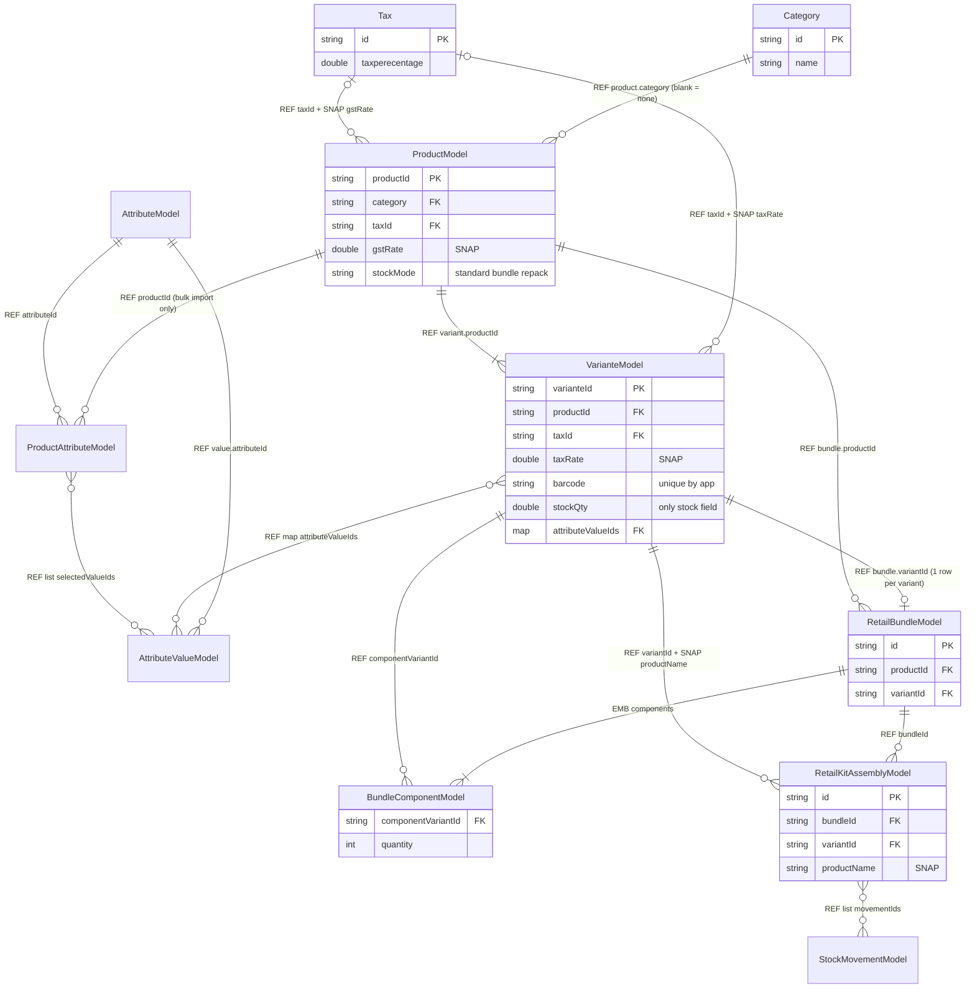
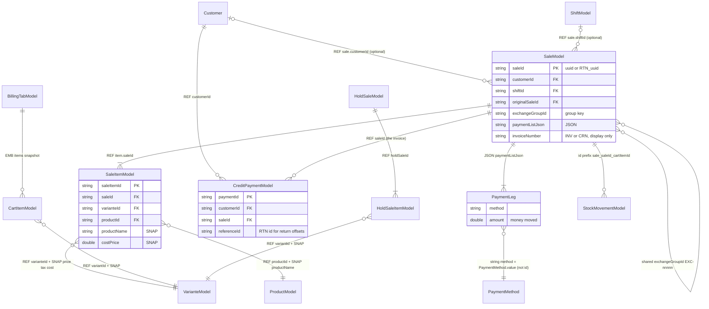
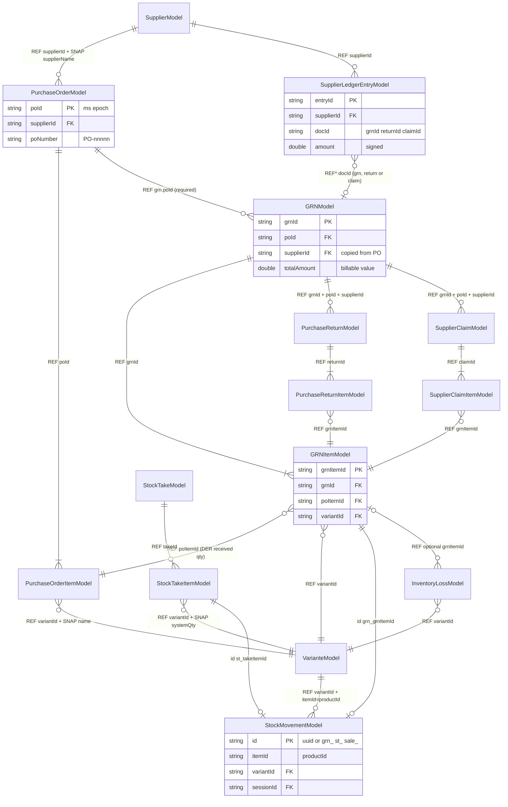
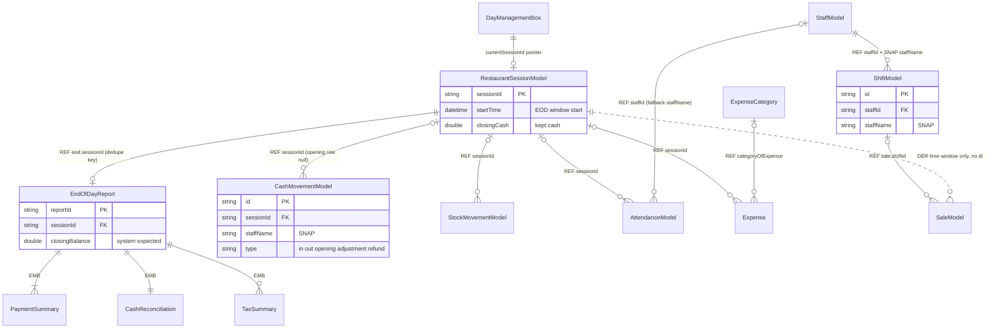

# 04 — Retail Database Relationships

> **Scope:** the RETAIL vertical of Bill Berry Lite (`D:\flutter\UniPOSs`), branch `refactor/shared-code-consolidation`. Verified by static reading of the source on 2026-10-19. Nothing was executed.
> **Audience:** a junior Flutter developer who needs to know how retail records point at each other, and what happens to those pointers when something is edited or deleted.
> **Companion docs:** model field lists live in the model docs of this series. This file covers only the **links between** models.

**Evidence markers used throughout**

| Marker | Meaning |
|---|---|
| `file.dart:123` | Confirmed by reading that line of the source. |
| **(inferred)** | A conclusion drawn from the code that was not proven end to end. |
| **(unverified)** | Not checked in this pass. Treat it as a lead, not a fact. |

---

## 1. Read this first: Hive has no relationships

Hive is a **key-value store**. Every box is a map of `key → object`. That has some consequences that are easy to forget:

- There are **no foreign keys**. A `String productId` field on a sale line is only a string. Hive does not know it refers to the `products` box.
- There are **no cascades**. Deleting a product does not touch anything else unless Dart code does it explicitly.
- There are **no joins**. "All lines of sale X" means scanning the whole `saleItems` box and filtering by `saleId` (`sale_item_repository.dart:58`, a full scan).
- There are **no transactions across boxes**. A multi-box write is a sequence of awaited `put`s, and a crash can stop it halfway.
- The **only** thing Hive enforces is that a key is unique **within one box**, and that the stored bytes match a registered type adapter.

Every "relationship" in this document is therefore a **convention that application code follows**. The diagrams in §2 are **conceptual**. They show what the code intends, not anything the database checks.

### 1.1 The five link kinds

| Kind | Code | What it looks like | Example | Survives deletion of the target? |
|---|---|---|---|---|
| **ID reference** | `REF` | A `String` field that holds another box's key | `SaleItemModel.varianteId → variants[varianteId]` | The string stays and **dangles** |
| **Embedded object** | `EMB` | A child object stored *inside* the parent record, with no box of its own | `RetailBundleModel.components: List<BundleComponentModel>`; the 5 summary types inside `EndOfDayReport`; `BillingTabModel.items: List<CartItemModel>` | It lives and dies with the parent |
| **Snapshot / denormalised copy** | `SNAP` | A copy of a value (name, price, tax rate, cost) taken at write time | `SaleItemModel.productName`, `.price`, `.gstRate`, `.costPrice`; `GRNModel.supplierName`; `RetailKitAssemblyModel.productName` | Yes. That is the whole point: history stays readable |
| **JSON in a field** | `JSON` | A JSON string holding a nested structure | `SaleModel.paymentListJson` (payment legs) | Lives with the parent. It is opaque to Hive and any query |
| **Derived** | `DER` | Not stored at all. It is computed on demand from other records | PO received qty = Σ confirmed GRN lines; product stock = Σ variant `stockQty`; returned qty = Σ return lines | Recomputed, so it is always "current", including after edits you might not want reflected |

**Polymorphic reference (`REF*`)** is a special case of `REF`: the same field points at different boxes depending on another field. Examples are `SupplierLedgerEntryModel.docId` (a GRN, return or claim) and the deterministic `StockMovementModel.id` prefixes.

### 1.2 Shared physical boxes

Retail and restaurant **share** some boxes. Retail code reads and writes the same file that restaurant uses (`hive_box_names.dart`, verified per row in notes 01 §3.3):

| Data | Box string | Shared? |
|---|---|---|
| Customers | `customers` | Yes |
| Categories | `categories` | Yes |
| Staff | `staffBox` | Yes |
| Taxes | `taxes` | Yes |
| Shifts | `shiftBox` | Yes |
| Attendance | `restaurantAttendanceBox` | Yes |
| Notifications | `restaurantNotificationsBox` | Yes |
| Payment methods | `paymentMethodsBox` | Yes |
| Sessions (the "day") | `restaurantSessionsBox` | Yes |
| Day pointer | `dayManagementBox` (untyped) | Yes |
| Cash movements | `cashMovementsBox` | Yes |
| Stock movements | `stockMovementsBox` | Yes |
| Counters | `appCounters` (untyped) | Yes |
| EOD reports | `eodBox` (retail) vs `restaurant_eodBox` | **No**, one per mode |
| Expense categories | `expenseCategory` vs `restaurant_expenseCategory` | **No** |
| Expenses | `expenseBox` vs `restaurant_expenseBox` | **No** |

A device runs one mode at a time (`appConfigBox['businessMode']`), so in practice a shared box holds only one mode's rows. A model named `restaurant…` (for example `StockMovementModel`, typeId 126) is **still used by retail**.

### 1.3 Where the cited files live

| Short name pattern | Folder |
|---|---|
| `*_model_2xx.dart`, `*_model_17x.dart`, `bundle_*.dart`, `kit_assembly_model.dart` | `lib/data/models/retail/hive_model/` |
| `categorymodel_300.dart`, `taxmodel_314.dart`, `customer_model_125.dart`, `staffModel_310.dart`, `shift_model.dart`, `attendance_model.dart` | `lib/data/models/common/` |
| `eodmodel_317.dart`, `expensel_316.dart`, `expensemodel_315.dart`, `cash_movement_model.dart`, `stock_movement_model.dart`, `session_model.dart` | `lib/data/models/restaurant/db/` |
| `payment_method.dart` | `lib/models/` |
| retail repositories (`product_repository.dart`, `variant_repository.dart`, `sale_repository.dart`, …) | `lib/data/repositories/retail/` |
| `category_repository.dart`, `customer_repository.dart`, `tax_repository.dart`, `shift_repository.dart` | `lib/data/repositories/common/` |
| `stock_movement_repository.dart`, `cash_movement_repository.dart`, `eod_repository.dart`, `expense_repository.dart` | `lib/data/repositories/restaurant/` |
| `product_store.dart`, `sale_store.dart`, `cart_store.dart`, `credit_store.dart`, `supplier_store.dart`, `purchase_order_store.dart`, `damaged_goods_store.dart`, `stock_take_store.dart`, `attribute_store.dart` | `lib/domain/store/retail/` |
| `category_store.dart`, `customer_store.dart`, `tax_store.dart`, `shift_store.dart`, `attendance_store.dart` | `lib/domain/store/common/` |
| `inventory_service.dart`, `grn_receiving_service.dart`, `return_service.dart`, `exchange_service.dart`, `hold_sale_service.dart`, `stock_adjustment_service.dart`, `barcode_generator_service.dart`, `sku_generator_service.dart`, `customer_id_generator_service.dart` | `lib/domain/services/retail/` |
| `document_number_service.dart`, `unified_backup_service.dart` | `lib/domain/services/common/` |
| `day_management_service.dart`, `eod_service.dart` | `lib/domain/services/restaurant/` |
| screens (`checkout_screen.dart`, `add_product_screen.dart`, …) | `lib/presentation/screens/retail/` |

---

## 2. Conceptual relationship diagrams

> **CONCEPTUAL ONLY.** These are Mermaid `erDiagram`s for orientation. The lines show **intended** links that application code maintains by convention. Hive enforces none of them. "PK" marks the field used as the Hive key. "FK" marks a string that *should* match another box's key. Relationship labels give the link kind from §1.1.

### 2.1 Catalog

### 2.2 Sales

### 2.3 Purchasing and inventory

### 2.4 Day, cash and staff

The dotted line `Session ..o{ Sale` is deliberate: **a sale has no `sessionId` field.** Sales belong to a day only because their `createdAt` falls inside the session's time window (`eod_service.dart:459-482`).

---

## 3. Relationship inventory

Column guide:
- **Kind**: see §1.1.
- **On delete of target**: what happens to *this* record when the record it points at is deleted.
- **On change of target**: what happens when the target is renamed, repriced or re-taxed.
- **Enforced by**: `DB: never` always applies, so this column names the **app code** that keeps the link valid, or `Nobody`.

### 3.1 Catalog

| # | From (model.field) | To (model.key) | Kind | Card. | On delete of target | On change of target | Enforced by | Evidence |
|---|---|---|---|---|---|---|---|---|
| C1 | `ProductModel.category` | `Category.id` | REF | N:1 (0..1; `''` = none) | **Re-parented** to `''` by the repo; the product is never deleted | Rename is free (only the id is stored). Category reports use the **live** name, so history moves with it | App: `category_repository.dart:72-99`, mirrored in `category_store.dart:234-241` | `product_model_200.dart` f3; `category_store.dart:80-95` (`displayNameFor` maps unknown → "Uncategorized") |
| C2 | `VarianteModel.productId` | `ProductModel.productId` | REF | N:1 (every product has ≥1 variant) | **Cascade hard delete** of all variants, direct on the box | n/a (no name copy on the variant) | App: `product_repository.dart:38-50` (bypasses `VariantRepository`) | `variante_model_201.dart` f1 |
| C3 | `ProductModel.taxId` (+`gstRate`) | `Tax.id` | REF + SNAP | N:1 (optional) | `taxId` **dangles**; billing keeps using the cached `gstRate` | A rate edit does **not** re-cache. Products keep the old rate until "Apply to products" is re-run | Nobody (delete); App on explicit apply: `product_store.dart:189-222` | `tax_settings_screen.dart:447-461`; `cart_store.dart:820-834` |
| C4 | `VarianteModel.taxId` (+`taxRate`) | `Tax.id` | REF + SNAP | N:1 (optional) | Same as C3 | Same as C3. Variant rate wins over the product rate | Same as C3 | `gst_service.dart:20-31` |
| C5 | `VarianteModel.attributeValueIds` (`{attributeId: valueId}`) | `AttributeModel.attributeId`, `AttributeValueModel.valueId` | REF (map) | N:M (one value per attribute) | **Dangles**. `attributesOf` silently skips missing ids; labels survive in `customAttributes` (SNAP) | Value rename shows live; `customAttributes` keeps the old text | Nobody. The attribute guard ignores this map; value delete has no guard | `attribute_store.dart:646-671`, `:421-442` |
| C6 | `VarianteModel.customAttributes` | — | SNAP | — | Unaffected | Not updated | — | `variante_model_201.dart` f14 |
| C7 | `AttributeValueModel.attributeId` | `AttributeModel.attributeId` | REF | N:1 | **Cascade** delete of values | n/a | App: `attribute_repository.dart:161-170` | `attribute_value_model_220.dart` f1 |
| C8 | `ProductAttributeModel.productId` | `ProductModel.productId` | REF | N:1 | **Cascade** (best effort, errors swallowed) | n/a | App: `product_store.dart:246-260` (`_dropOwnedRecords`) | `product_attribute_model_221.dart` f1 |
| C9 | `ProductAttributeModel.attributeId` | `AttributeModel.attributeId` | REF | N:1 | Delete is **blocked** while any row exists; otherwise cascade | n/a | App: `attribute_store.dart:261-278` → `isAttributeInUse` (`attribute_repository.dart:339-352`) | Only bulk import writes these rows (`bulk_import_store.dart:743`) |
| C10 | `ProductAttributeModel.selectedValueIds` | `AttributeValueModel.valueId` | REF (list) | N:M | **Dangles** | n/a | Nobody | `attribute_store.dart:421-442` |
| C11 | `RetailBundleModel.variantId` | `VarianteModel.varianteId` | REF | 1:1 (by convention) | **Cascade** (own bundle row dropped) | n/a | App: `_dropOwnedRecords`; uniqueness only by reusing the row id (`add_product_screen.dart:346-349`) | `bundle_model.dart` f2; `bundle_repository.dart:17-23` |
| C12 | `RetailBundleModel.productId` | `ProductModel.productId` | REF | N:1 | Cascade via its variants | n/a | App (as C11) | `bundle_model.dart` f1 |
| C13 | `RetailBundleModel.components` | `BundleComponentModel` | EMB | 1:N | Dies with the bundle row | — | — | `bundle_model.dart` f3 |
| C14 | `BundleComponentModel.componentVariantId` | `VarianteModel.varianteId` | REF | N:1 | Delete of the component variant/product is **refused** by the UI | Component cost changes flow live into bundle cost estimates | App (UI): `inventory_screen.dart:245-258`, `product_detail_screen.dart:280-291` via `bundlesUsing` (`product_store.dart:229-238`) | `bundle_component_model.dart` f0 |
| C15 | `RetailKitAssemblyModel.bundleId` | `RetailBundleModel.id` | REF | N:1 | **Dangles** (log is append-only, no delete) | Disassembly uses the **current** recipe, not the one at assembly | Nobody | `kit_assembly_model.dart` f1; `inventory_service.dart:470-567` |
| C16 | `RetailKitAssemblyModel.variantId` (+`productName`) | `VarianteModel.varianteId` | REF + SNAP | N:1 | Dangles; name snapshot keeps history readable | Name snapshot not updated | Nobody | `kit_assembly_model.dart` f2-f3 |
| C17 | `RetailKitAssemblyModel.movementIds` | `StockMovementModel.id` | REF (list) | 1:N | Movements are never deleted | — | App writes the list last (`inventory_service.dart:448-458`) | `kit_assembly_model.dart` f7 |
| C18 | Product total stock | Σ `VarianteModel.stockQty` | DER | — | — | Always current | App: `ProductStore.totalStockFor` (`product_store.dart:354-355`) | `product_model_200.dart` has no stock field |
| C19 | Bundle sellable qty | min over components of `stock ~/ qty` | DER | — | — | Current recipe and stock | App: `inventory_service.dart:160-184` | — |

### 3.2 Sales

| # | From (model.field) | To (model.key) | Kind | Card. | On delete of target | On change of target | Enforced by | Evidence |
|---|---|---|---|---|---|---|---|---|
| S1 | `SaleItemModel.saleId` | `SaleModel.saleId` | REF | N:1 (sale has ≥1 line) | Sales are never deleted in the app. Dead `deleteSale` would orphan lines (header only) | Lines are never edited | App: written together by `SaleStore.addSaleWithItems` (`sale_store.dart:88`), header first then lines, not atomic | `sale_item_model_204.dart` f1; `sale_store.dart:119-128` |
| S2 | `SaleItemModel.varianteId` | `VarianteModel.varianteId` | REF + SNAP | N:1 | **Dangles**; receipts still render from snapshots | Price, tax, cost, name, barcode, HSN, attributes are **frozen** on the line | Nobody (delete); snapshot written at checkout (`checkout_screen.dart:501-551`) | `sale_item_model_204.dart` f2, f4-f29 |
| S3 | `SaleItemModel.productId` | `ProductModel.productId` | REF | N:1 | Dangles | Category is **not** snapshotted, so category reports use the live map | Nobody | `report_service.dart` category-wise (notes 05 §G4.4) |
| S4 | `SaleModel.customerId` | `Customer.customerId` | REF | N:1 (optional; required for credit) | Retail has **no** customer delete UI. Restaurant's `deleteCustomer` has no guard **(inferred risk)** | No name snapshot on the sale: reprints show the **current** customer **(inferred)** | Nobody | `sale_model_203.dart` f1; notes 05 §H |
| S5 | `SaleModel.paymentListJson` | payment legs | JSON | 1:N | — | Legs are rewritten only by exchange stamping | App: `split_payment_widget.dart:69-91`; `exchange_service.dart:525-530` | `sale_model_203.dart` f18, getter `:428-443` |
| S6 | leg `method` / `SaleModel.paymentType` | `PaymentMethod.value` | **string value, not id** | N:1 (soft) | Past sales keep the string; reports bucket by it | Built-in methods keep `value` on edit (`payment_methods_screen.dart:255-262`). Custom-method value on rename **(unverified)** | Nobody | `payment_method.dart` f2 |
| S7 | `SaleModel.shiftId` | `ShiftModel.id` | REF | N:1 (optional) | Shifts are not deleted in normal flows | — | Nobody. Attribution fallback by time window (`shift_repository.dart:152+`) | `sale_model_203.dart` f33 |
| S8 | `SaleModel.originalSaleId` (return doc) | `SaleModel.saleId` | REF (self) | N:1 (many partial returns per sale) | n/a (no sale delete) | Returned qty is **derived** (S10), never stored on the original | App: `ReturnService` validates the original exists and is not a return (`return_service.dart:253-302`) | `return_service.dart:428` |
| S9 | `SaleModel.exchangeGroupId` | other `SaleModel` rows with the same value | group key (shared string) | N:N (normally 2 docs) | — | — | App: `exchange_service.dart:429, 525-530`. **Not unique across FYs** (`EXC-00001` resets) | `exchange_service.dart:626-643` |
| S10 | Remaining returnable qty | Σ lines of returns with `originalSaleId == X` | DER | — | — | — | App: `RetailReturnMath.remainingByVariant` (`return_math.dart:124-135`) | `return_service.dart:84-100` |
| S11 | Return line `SaleItemModel.saleId` | the **RTN** doc, not the original | REF | N:1 | — | — | App | `sale_item_model_204.dart` f1 note |
| S12 | `CreditPaymentModel.customerId` | `Customer.customerId` | REF | N:1 | Dangles if a customer were deleted | — | Nobody | `credit_payment_model_218.dart` f1 |
| S13 | `CreditPaymentModel.saleId` | `SaleModel.saleId` (the **invoice**) | REF | N:1 | — | The sale's `paidAmount`/`dueAmount` are mutated in place | App: `credit_store.dart:167-209, 254-325`; `return_service.dart:516-547` | `credit_payment_model_218.dart` f2 |
| S14 | `CreditPaymentModel.referenceId` (mode `return_adjustment`) | `SaleModel.saleId` of the **RTN** doc | REF (overloaded) | N:1 | — | — | App: `return_service.dart:543` | Field is a UPI/card ref for other modes |
| S15 | Customer outstanding | `Customer.creditBalance` **and** Σ `SaleModel.dueAmount` | stored + DER | — | — | Two sources, never reconciled | Nobody | `credit_store.dart:152`; `receive_payment_screen.dart:78-83`; `eod_service.dart:633-634` |
| S16 | `BillingTabModel.items` | `CartItemModel` | EMB | 1:N | Dies with the tab | — | App: `_saveCurrentTabItems` (`cart_store.dart:1293-1318`) | `billing_tab_model_173.dart` f2 |
| S17 | `cartItems` box | `CartItemModel` (mirror) | write-only mirror | — | Whole box cleared on checkout | — | — | Never read back by retail (notes 05 §C1) |
| S18 | `CartItemModel.variantId` / `productId` | Variant / Product | REF + SNAP | N:1 | Dangles in an open tab **(inferred)** | Price is captured at add time; GST mode at add time | Nobody | `cart_model_202.dart` f1-f3 |
| S19 | `BillingTabModel.customerName/Phone` | — | SNAP (display only) | — | — | — | — | No `customerId` on the tab |
| S20 | `HoldSaleItemModel.holdSaleId` | `HoldSaleModel.holdSaleId` | REF | N:1 | **Cascade** on hold delete | — | App: `hold_sale_repository.dart:33-37, 70-74` | `hold_sale_item_model_210.dart` f1 |
| S21 | `HoldSaleItemModel.variantId` / `productId` | Variant / Product | REF + SNAP | N:1 | Restore **skips** deleted products and reports them | Price, GST, discount replayed from the snapshot | App: `hold_sale_service.dart:87-185` | `hold_sale_item_model_210.dart` f2-f4 |
| S22 | `HoldSaleModel.customerId` / `customerName` | Customer | REF + SNAP | N:1 | — | — | **Never populated** by `park()` | `hold_sale_service.dart:30-40` |
| S23 | `StockMovementModel.id = sale_<saleId>_<cartItemId>[_<componentVariantId>]` | sale + cart line | REF* (encoded in key) | 1:1 per line | — | — | App: idempotency check (`inventory_service.dart:43-46, 64, 83-85`) | Only sale deductions use it; return/exchange movements use random UUIDs |

### 3.3 Purchasing and inventory

| # | From (model.field) | To (model.key) | Kind | Card. | On delete of target | On change of target | Enforced by | Evidence |
|---|---|---|---|---|---|---|---|---|
| P1 | `PurchaseOrderModel.supplierId` (+`supplierName`) | `SupplierModel.supplierId` | REF + SNAP | N:1 | Supplier delete is **blocked** while any PO exists | Name snapshot not refreshed | App: `deleteBlockers` (`supplier_store.dart:283-307`) | `purchase_order_model_211.dart` f2-f3 |
| P2 | `PurchaseOrderItemModel.poId` | `PurchaseOrderModel.poId` | REF | N:1 | **Cascade** on PO delete (header first, then items; crash → orphan items) | Edit replaces **all** lines with new UUIDs | App: `purchase_order_store.dart:112-153` | `purchase_order_item_model_212.dart` f1 |
| P3 | `PurchaseOrderItemModel.variantId` / `productId` (+`productName`, `variantInfo`) | Variant / Product | REF + SNAP | N:1 | Dangles; draft PO edit silently skips missing variants | Snapshot kept | Nobody | `add_purchase_order_screen.dart:80-81` |
| P4 | `GRNModel.poId` (+`poNumber`) | `PurchaseOrderModel.poId` | REF + SNAP | N:1 (required; no standalone GRN) | PO delete is **blocked** once a GRN exists | — | App: `canDeletePurchaseOrder` (`purchase_order_store.dart:265-271`) | `grn_model_213.dart` f2-f3 |
| P5 | `GRNModel.supplierId` (+`supplierName`) | `SupplierModel.supplierId` | REF (copied from PO) + SNAP | N:1 | Supplier delete blocked | — | App: `deleteBlockers` | `grn_model_213.dart` f4-f5 |
| P6 | `GRNItemModel.grnId` | `GRNModel.grnId` | REF | N:1 | No GRN delete UI (dead `deleteGRN` would cascade and desync stock, ledger, PO progress) | — | App (dead path): `purchase_order_store.dart:347-357` | `grn_item_model_214.dart` f1 |
| P7 | `GRNItemModel.poItemId` | `PurchaseOrderItemModel.poItemId` | REF | N:1 | — | — | App | `grn_item_model_214.dart` f2 |
| P8 | PO line received qty / PO status | Σ `receivedQty` of GRN lines of **confirmed** GRNs | DER (+ stored status) | — | — | Status recomputed only at GRN confirm | App: `purchase_order_store.dart:462-500, 554-607`; `grn_item_repository.dart:104-116` | `purchase_order_item_model_212.dart:9-10` (no receiving fields) |
| P9 | `GRNItemModel.variantId` | `VarianteModel.varianteId` | REF + SNAP | N:1 | Receiving **skips** a missing variant but the GRN still bills full value | Cost is weighted-averaged into the variant | App: `grn_receiving_service.dart:143-181` | `:147-148` |
| P10 | `StockMovementModel.id = grn_<grnItemId>` | `GRNItemModel.grnItemId` | REF* (key) | 1:1 | — | — | App: idempotency (`grn_receiving_service.dart:145`) | `:163-180` |
| P11 | `PurchaseReturnModel.grnId/poId/supplierId` (+numbers, name) | GRN / PO / Supplier | REF + SNAP | N:1 (auto: 1 per GRN; model allows many) | Supplier delete blocked | — | App: `deleteBlockers` | `purchase_return_model_174.dart` f2-f7 |
| P12 | `PurchaseReturnItemModel.returnId` | `PurchaseReturnModel.returnId` | REF | N:1 | — (no delete) | — | App (header then items, not atomic) | `damaged_goods_store.dart:163-200` |
| P13 | `PurchaseReturnItemModel.grnItemId` / `variantId` | GRN line / Variant | REF + SNAP | N:1 | Dangles if variant deleted | Snapshot | Nobody | `purchase_return_item_model_175.dart` |
| P14 | `SupplierClaimModel.grnId/poId/supplierId` | GRN / PO / Supplier | REF + SNAP | N:1 | Supplier delete blocked | — | App: `deleteBlockers` | `supplier_claim_model_176.dart` f2-f7 |
| P15 | `SupplierClaimItemModel.claimId` / `grnItemId` / `variantId` | Claim / GRN line / Variant | REF + SNAP | N:1 | Dangles if variant deleted | Snapshot | Nobody | `supplier_claim_item_model_177.dart` |
| P16 | `InventoryLossModel.grnId/grnItemId/poId/supplierId` | GRN / GRN line / PO / Supplier | REF (all optional) + SNAP | N:1 | Not part of the supplier delete guard (only reachable via docs that already block) | — | Nobody | `inventory_loss_model_178.dart` f3-f8 |
| P17 | `InventoryLossModel.variantId` / `productId` | Variant / Product | REF + SNAP | N:1 | Dangles | Snapshot | Nobody | f9-f12 |
| P18 | `SupplierLedgerEntryModel.supplierId` | `SupplierModel.supplierId` | REF | N:1 | **Cascade**: supplier delete wipes its ledger (only the opening row can exist by then) | — | App: `supplier_store.dart:94-105`; `supplier_ledger_repository.dart:42-48` | `supplier_ledger_entry_model_179.dart` f1 |
| P19 | `SupplierLedgerEntryModel.docId` (+`docNumber`) | `grnId` / `returnId` / `claimId` | REF* (polymorphic) + SNAP | N:1 | — | — | App: idempotency `hasEntryForDoc` | f7-f8 |
| P20 | `SupplierModel.currentBalance` vs Σ ledger `amount` | — | stored + DER | — | — | Can drift if a crash lands between ledger row and balance write | App: `recordBalanceMovement` only (`supplier_store.dart:166-206`) | notes 04 §H |
| P21 | `StockTakeItemModel.takeId` | `StockTakeModel.takeId` | REF | N:1 | **Cascade** on cancel (hard delete of take + items, draft only) | — | App: `stock_take_repository.dart:61-68` | `stock_take_store.dart:307-331` |
| P22 | `StockTakeItemModel.variantId` (+`systemQty`, `costPrice`) | Variant | REF + SNAP | N:1 | Dangles | `systemQty` re-snapshotted on recount | App | `stock_take_item_model_181.dart` |
| P23 | `StockMovementModel.id = st_<takeItemId>` | `StockTakeItemModel.takeItemId` | REF* (key) | 1:1 | — | — | App: `stock_take_store.dart:409-417` | — |
| P24 | `StockMovementModel.variantId` / `itemId` (= productId) | Variant / Product | REF + SNAP (`itemName`) | N:1 | Dangles; `itemName` keeps it readable | Snapshot | Nobody | `stock_movement_model.dart` f2-f4 |
| P25 | `StockMovementModel.sessionId` | `RestaurantSessionModel.sessionId` | REF | N:1 (optional) | Sessions are never deleted | — | Nobody | f12 |
| P26 | Source doc of a return / adjustment / kit movement | sale return, adjustment, kit | **text only** (`reason`, `note`) | — | — | — | Nobody | e.g. note `EXC-… · saleId`; kit movements are linked the other way (C17) |

### 3.4 Day, cash, staff, tax configuration

| # | From (model.field) | To (model.key) | Kind | Card. | On delete of target | On change of target | Enforced by | Evidence |
|---|---|---|---|---|---|---|---|---|
| D1 | `dayManagementBox['currentSessionId']` | `RestaurantSessionModel.sessionId` | REF (pointer) | 1:0..1 | Pointer deleted at close (`day_management_service.dart:123`) | — | App: `startSession`/`endSession` (`:47-125`) | After a retail restore the session row is **missing** (sessions not backed up) |
| D2 | `EndOfDayReport.sessionId` | `RestaurantSessionModel.sessionId` | REF | 1:1 (dedupe) | — | Saving again for the same session **deletes and replaces** the report | App: `eod_service.dart:402-417` | `eodmodel_317.dart` f20 |
| D3 | EOD ↔ sales, cash movements, expenses | rows inside session `startTime → now` | DER (time window), then frozen | — | — | Stored aggregates never change afterwards | App: `eod_service.dart:459-482, 556-563` | No id list on the report |
| D4 | `EndOfDayReport.paymentSummaries/cashReconciliation/taxSummaries/...` | embedded types 118-121, 124 | EMB | 1:N / 1:1 | Die with the report | — | — | `eodmodel_317.dart` |
| D5 | `CashMovementModel.sessionId` | Session | REF | N:1 (**null** for the `opening` row and pre-session adjustment) | — | Queries filter by **time**, not by sessionId | Nobody | `day_management_service.dart:78-86`; `cash_movement_repository.dart:23-31` |
| D6 | `CashMovementModel` (credit collection / refund) | Credit payment / return sale | **text only** (`reason`, `note`) | — | — | — | Nobody | `credit_store.dart:225-232`; `return_service.dart:566-584` |
| D7 | `Expense.categoryOfExpense` | `ExpenseCategory.id` | REF | N:1 (optional) | **(unverified)** | — | **(unverified)** | `expense_repository.dart:42`. Retail has no expense writer, so the box stays empty in practice |
| D8 | `Expense.sessionId` | Session | REF | N:1 (optional) | — | — | Nobody | `expensel_316.dart` f6 |
| D9 | `ShiftModel.staffId` (+`staffName`) | `StaffModel.id` | REF + SNAP | N:1 | Staff hard delete is **unguarded**; shift keeps the name snapshot | Name snapshot not updated | Nobody | `shift_model.dart` f1-f2; `manage_staff_screen.dart:240-241` |
| D10 | `AttendanceModel.staffId` (fallback `staffName`) | `StaffModel.id` | REF + SNAP | N:1 | As D9 | Old rows match by name (`attendance_store.dart:45-50`) | Nobody | `attendance_model.dart` f1, f10 |
| D11 | `AttendanceModel.sessionId` | Session | REF | N:1 | — | — | Nobody | f7 |
| D12 | `CashMovementModel.staffName`, `StockMovementModel.staffName` | Staff | SNAP only | — | — | — | — | No staff id on either |
| D13 | `AppNotificationModel.subjectId` (`subjectType 'variant'`) | `VarianteModel.varianteId` | REF* | N:1 | Resolved by the reconciling sync **(inferred)** | — | App: `retail_notification_sync_service.dart` | notes 03 §17 |
| D14 | `TaxDetails.defaultRate` (singleton `taxBox['taxDetails']`) | used when variant and product rate are ≤ 0 | config fallback | — | — | Changing it reprices every product whose cached rate is 0 or null | App: `cart_store.dart:821-836` | A deliberate 0 % tax falls through to this default |
| D15 | `SaleModel.storeGstNumber`, `taxEnabled`, `isTaxInclusive`; `SaleItemModel.gstRate/hsnCode` | Business details, tax mode, Tax | SNAP | — | — | Frozen at sale time | App: checkout | `sale_model_203.dart` f30, f37, f38 |
| D16 | `ProductModel.hsnCode` → auto-suggested `taxId` | `Tax.id` via `findTaxIdByHsnCode` | lookup | — | Can auto-fill a **deleted** taxId into a new product | — | Nobody | `product_store.dart:296-306`; `add_product_screen.dart:487-489` |

### 3.5 Expected relationships that do NOT exist

New developers often assume these links exist. They don't:

| Missing link | What exists instead | Evidence |
|---|---|---|
| `SaleModel.sessionId` | Time window on `createdAt` | `eod_service.dart:459-482`; field list `sale_model_203.dart` |
| `SaleModel.staffId` / cashier id | Only `shiftId` → `ShiftModel.staffId` | notes 03 §1 "Snapshot fields vs live references" |
| `ShiftModel.sessionId` | None. Shift and session are independent | `shift_model.dart` (fields 0-7, no sessionId) |
| `RestaurantSessionModel.staffId` / opened-by | None | `session_model.dart` (fields 0-5) |
| `SaleItemModel` category id or name | None. Category reports join to the **live** product | notes 05 §G4.4 |
| Payment rows in their own box | Legs are JSON inside the sale. `PaymentEntryModel` / `paymentEntries` is a dead box that is never written | `payment_entry_model_216.dart`; `hive_init.dart:516` |
| Sale ↔ PaymentMethod id | The sale stores the method `value` string | `payment_method.dart` f2 |
| Expense ↔ Sale | None | — |
| CashMovement ↔ CreditPayment / Sale | Free text in `reason` / `note` only | `credit_store.dart:225-232` |
| `StockMovementModel` source-document field | Encoded in the id prefix (`sale_`, `grn_`, `st_`) or in `note` text | `stock_movement_model.dart` |
| PO item received qty | Derived from confirmed GRN lines | `purchase_order_item_model_212.dart:9-10` |
| Original sale "returned qty" / "returned" status | Derived from return docs; `SaleStatus` has no returned value | `sale_model_203.dart:12-16` |
| Product stock | Σ variant `stockQty` | `product_store.dart:354-355` |
| Product / Variant → Supplier (preferred supplier) | None | field lists in notes 02 |
| Category parent / sub-category entity | `ProductModel.subCategory` is a free string with no runtime reader | `product_model_200.dart` f4 |
| `BillingTabModel.customerId` | Name and phone snapshots only | `billing_tab_model_173.dart` f5-f6 |
| Customer → list of sales | Query `sales` by `customerId` (full scan) | `sale_repository.dart:108` |
| EOD → list of sale ids | Aggregates only | `eodmodel_317.dart` |
| Retail void / cancel of a sale | A return document reverses it | `sale_model_203.dart:12-16` |
| Unit or Brand entity | `VarianteModel.unit` string + `kItemUnits`; `ProductModel.brandName` free text | `item_units.dart:5` |

---

## 4. How IDs connect records

### 4.1 ID schemes

| Record | Id field | Hive key | Format / generator | Evidence |
|---|---|---|---|---|
| Product | `productId` | same | UUID v4. Dead sample data uses `p<i>` | `add_product_screen.dart:850`; `product_store.dart:129-130` |
| Variant | `varianteId` | same | UUID v4. The generator reuses an existing id on regenerate. Sample `p<i>_v<j>` | `variant_generator_service.dart:114` |
| Attribute / value / product-attribute | `attributeId` / `valueId` / `id` | same (product-attribute: **auto-int after restore**) | UUID v4 | `attribute_store.dart:198-206, 297, 452-482` |
| Bundle / kit assembly | `id` | same | UUID v4 | `inventory_service.dart:449,554` |
| Category (shared) | `id` | same | **Mixed**: retail Add uses `millisecondsSinceEpoch`; first-run seeds use UUID v4 | `category_management_screen.dart:395-399`; `category_repository.dart:164-184` |
| Tax (shared) | `id` | same | UUID v4 | `tax_settings_screen.dart:539-541` |
| Customer (shared) | `customerId` | same | Retail `CUST-000042` from `appCounters['lastCustomerSequence']`, skipping taken ids. Restaurant uses UUID | `customer_id_generator_service.dart:20-45` |
| Staff (shared) | `id` | same | UUID v4 | `manage_staff_screen.dart:166-177` |
| Payment method (shared) | `id` (UUID) | **auto-int** (`box.add`) | Sales reference `value`, not `id` | `payment_method_repository.dart:74-76,110-143` |
| Sale | `saleId` | same | UUID v4 | `checkout_screen.dart:384, 649` |
| Return (credit note) | `saleId` | same | `RTN_<uuid>` | `return_service.dart:309` |
| Sale display number | `invoiceNumber` | not a key | `INV-00001` / `CRN-00001`, reset every financial year | `sale_store.dart:52-58` |
| Exchange group | `exchangeGroupId` | not a key | `EXC-00001`, FY reset, **no `isTaken` check** | `exchange_service.dart:429` |
| Sale line | `saleItemId` | same | UUID v4 | `sale_item_model_204.dart:270,337` |
| Cart line | `cartItemId` | same | `<variantId>_<millis>` | `cart_store.dart:477,563` |
| Billing tab | `id` | same (auto-int after restore) | UUID v4 | `cart_store.dart:212,1246` |
| Held sale | `holdSaleId` | same (auto-int after restore) | `HOLD_<uuid>` | `hold_sale_service.dart:28` |
| Held line | `holdSaleItemId` | same (auto-int after restore) | `<holdSaleId>_<variantId>_<millis>` (collision possible in one ms) | `hold_sale_item_model_210.dart:149` |
| Credit payment | `paymentId` | same (auto-int after restore) | UUID v4 | `credit_store.dart:175,277` |
| Purchase order | `poId` | same | **`millisecondsSinceEpoch` string** (not UUID). Display `PO-00001` | `purchase_order_model_211.dart:84` |
| PO line | `poItemId` | same | UUID v4, **new on every edit** | `purchase_order_item_model_212.dart:68` |
| GRN / GRN line | `grnId` / `grnItemId` | same | UUID v4. Display `GRN-00001` | `grn_model_213.dart:104`; `grn_item_model_214.dart:122` |
| Purchase return / claim / loss / stock take | `returnId` / `claimId` / `lossId` / `takeId` | same | UUID v4. Display `PR-` / `CLM-` / `LOSS-` / `ST-00001` | notes 04 §1.1 |
| Supplier / ledger entry | `supplierId` / `entryId` | same | UUID v4 | `supplier_model_205.dart:50-71` |
| Stock movement | `id` | same | UUID v4, **or deterministic**: `sale_<saleId>_<cartItemId>[_<componentVariantId>]`, `grn_<grnItemId>`, `st_<takeItemId>` | `inventory_service.dart:46`; `grn_receiving_service.dart:163`; `stock_take_store.dart:409-417` |
| Session / EOD / cash movement / shift / attendance / notification | `sessionId` / `reportId` / `id` | same (EOD: auto-int after restore) | UUID v4 | notes 03 §9-17 |
| Expense / expense category | `id` | same (auto-int after restore) | **(unverified)** format | `expense_repository.dart:18` |

### 4.2 Codes that act like identifiers but are not keys

| Code | Format | Counter (`appCounters` key) | Unique? | Evidence |
|---|---|---|---|---|
| Barcode | `BB` + 10 zero-padded digits, auto-minted when blank on **add** only | `lastBarcodeSequence` | **Yes, enforced by the app** in `VariantRepository` (box scan, trimmed). Freed for reuse when a variant is deleted | `barcode_generator_service.dart:27-74`; `variant_repository.dart:52-160` |
| SKU format 1 | first 3 alnum chars of the category name (or `GEN`), then `-` and 6 digits, e.g. `APP-000042` | `lastSkuSequence` | **No** guard anywhere | `sku_generator_service.dart:12-31` |
| SKU format 2 | first 4 chars of a **draft** productId + value slugs | none | No | `variant_generator_service.dart:168-175` |
| Document numbers | `<PREFIX>-00001`, reset each FY | `<PREFIX>_lastFy`, `<PREFIX>_lastSeq`, optional `<PREFIX>_prefix` | Unique within a box via `isTaken`, **except** `EXC` | `document_number_service.dart:38-126` |

Prefixes in use: `INV`, `CRN`, `EXC`, `PO`, `GRN`, `PR`, `CLM`, `LOSS`, `ST`. The counter keys are mode-agnostic, so retail and restaurant share a sequence for the same prefix (`document_number_service.dart:9-11`).

**Rule for juniors:** join on the **id** fields, never on a display number. `INV-00001` exists once per financial year; `saleId` exists once forever.

### 4.3 "Key ≠ id" after a backup restore

Most boxes are restored with `put(id, row)`, so key = id. These boxes are restored with `box.add(row)`, which assigns **auto-increment int keys** (`unified_backup_service.dart:2564-2581`):

`cartItems`, `billingTabs`, `holdSales`, `holdSaleItems`, `eodBox`, `expenseCategory`, `expenseBox`, `credit_payments`, `product_attributes`, `paymentEntries` (dead), plus the common singletons `businessDetailsBox`, `businessTypeBox`, `taxBox`.

After a restore the repositories still call `box.get(id)`, `box.put(id, …)` and `box.delete(id)` with the string id. **(inferred)** Consequences:
- A delete by id is a silent no-op (for example `removeAllAttributesFromProduct`, so an attribute stays "in use" forever).
- An update by id writes a **second** row instead of replacing the first.
- A lookup by id returns null (for example `BusinessDetailsRepository.get()`).

`PaymentMethod` is the exception that works: its repository is position-based (`putAt`/`deleteAt`) by design.

---

## 5. Deletion and consistency behaviour

| Entity | Delete path | Guard | Behaviour | What dangles | What keeps history readable |
|---|---|---|---|---|---|
| Product | `inventory_screen.dart:235-281` → `product_store.dart:262-276` | Plan key; refused if any variant is a component of another bundle | **Hard delete + cascade**: variants, own bundle rows, `product_attributes` (best effort) | Sale/PO/GRN/return/claim/loss/stock-take/kit/movement/held lines; `notification.subjectId` | Name, price, tax, cost snapshots on every document line |
| Variant | `product_detail_screen.dart:263-307` → `product_store.dart:544-554` | Plan key; last-variant refusal (UI only); bundle-component refusal | **Hard delete**; own bundle row dropped | As product, per variant. **Barcode freed for reuse** | Snapshots; old lines keep the old barcode string |
| Variant (soft) | Active toggle `product_detail_screen.dart:1361,1534` | — | **Soft hide** `status = 'inactive'`; POS refuses it | Nothing | Everything |
| Category | `category_management_screen.dart:451-470` → `category_repository.dart:72-99` | Plan key; confirm shows product count | **Re-parents** products to `''` (and bumps their `updateAt`) | Nothing | **Nothing**: category reports re-bucket history to "Uncategorized" |
| Tax | `tax_settings_screen.dart:447-461` | Confirm only | **Hard delete** | `product.taxId`, `variant.taxId` | Cached `gstRate`/`taxRate` keep billing; sale lines snapshot the rate |
| Attribute | `attributes_screen.dart:183-207` → `attribute_repository.dart:161-170` | `isAttributeInUse` (ProductAttribute rows only), checked **after** the confirm | **Cascade**: values + product-attribute rows. Soft `deactivateAttribute` exists but has no UI caller | `variant.attributeValueIds` | `variant.customAttributes`; sale line `attributes` |
| Attribute value | `attribute_store.dart:421-442` | **None** | Hard delete | `variant.attributeValueIds`, `ProductAttributeModel.selectedValueIds` | As above |
| Bundle row | via variant/product delete or leaving bundle mode | — | Hard delete | `kitAssembly.bundleId` | Kit log `productName` |
| Supplier | `supplier_list_screen.dart:263-303` → `supplier_store.dart:94-105` | **`deleteBlockers`**: any PO, GRN, purchase return, claim, non-opening ledger row, or balance > 0.009 | Hard delete + its ledger | Nothing (guard prevents it) | Supplier name snapshots on documents |
| Purchase order | `purchase_order_list_screen.dart:865-894` | Draft only and no GRN | Hard delete, header then items | Orphan items on crash | Number gap only |
| GRN | **No UI** (dead `deleteGRN`) | None | Would cascade items only | Stock, cost, movements, ledger, PO progress | — |
| Stock take | `cancelTake` (`stock_take_store.dart:307-331`) | Draft only, no applied line | Hard delete of take + items | Nothing applied, so nothing | — |
| Sale | **No UI** (dead `deleteSale`) | None | Would delete header only | Lines, stock, credit, drawer | — |
| Held sale | `parked_sales_screen.dart:85-104`; on restore | Confirm | Hard delete + its items | Nothing | Not kept: no history of parked bills |
| Billing tab | `closeTab` (`cart_store.dart:1275`) | Last tab is cleared, not deleted | Hard delete | — | — |
| Customer | **No retail UI** (restaurant only) | None (no credit check) | Hard delete | `sale.customerId`, `creditPayment.customerId` | Nothing on the sale (no name snapshot) **(inferred)** |
| Staff | `manage_staff_screen.dart:240-241, 1140` | Confirm only. Can delete self, last Manager, staff with open shift. Soft **Disable** (`isActive`) exists | Hard delete | `shift.staffId`, `attendance.staffId` | `staffName` snapshots on shifts, attendance, cash and stock movements |
| Payment method | `payment_methods_screen.dart:370-386`; `payment_setup_screen.dart:298` | Built-ins protected, by **different rules** on the two screens | Hard delete | Nothing (sales hold the value string) | The value string on sales |
| Credit payment, cash movement, stock movement, kit assembly, inventory loss, EOD | — | — | **Append-only** in practice. EOD is replaced only for the same `sessionId` | — | — |

---

## 6. Database-enforced vs application-enforced

### 6.1 What Hive enforces (the complete list)

1. **Key uniqueness within one box.** `put(k, v)` with an existing key overwrites; it never errors.
2. **Type adapters.** A box opened as `Box<SaleModel>` reads and writes only what the registered adapter for typeId 153 understands. An unknown typeId on disk throws on open.
3. **Hive `defaultValue`** on a field, used when an old record lacks it (for example `VarianteModel.isDecimalQuantity = false`).

Nothing else. No referential integrity, uniqueness of non-key fields, required references, or cascades.

### 6.2 What application code enforces

| Rule | Where |
|---|---|
| Barcode is unique (trimmed; blank → minted on add) | `VariantRepository._guardBarcode` / `addVariant` / `updateVariant` (`variant_repository.dart:52-160`). UI pre-checks in `ProductStore.isBarcodeTaken` (in-memory, `product_store.dart:409-414`) |
| Supplier cannot be deleted while referenced | `SupplierStore.deleteBlockers` (`supplier_store.dart:283-307`) |
| Variant/product used as a bundle component cannot be deleted | `ProductStore.bundlesUsing` (`product_store.dart:229-238`), called from the UI |
| Product cascade to variants, bundle rows, product-attribute rows | `product_repository.dart:38-50`; `product_store.dart:246-260` |
| Category delete re-parents products | `category_repository.dart:72-99` |
| Attribute delete blocked while assigned (weak: ProductAttribute rows only) | `attribute_store.dart:261-278` |
| Attribute name / value unique (case-insensitive) | `attribute_store.dart:181-258, 283-418` |
| Category name unique on **add only** | `category_store.dart:150-159` |
| Customer phone unique (UI pre-check only) | `customer_list_screen.dart:226-234` |
| Staff PIN unique (UI) | `manage_staff_screen.dart:183-202` |
| PO deletable only as draft with no GRN | `purchase_order_store.dart:265-271` |
| GRN requires a PO | `grn_model_213.dart:30-34`; only creator `material_receiving_screen.dart` |
| GRN line stocked exactly once | movement id `grn_<grnItemId>` (`grn_receiving_service.dart:145`) |
| Sale line deducted exactly once | movement id `sale_<saleId>_<cartItemId>` (`inventory_service.dart:43-46`) |
| Stock-take line applied exactly once | movement id `st_<takeItemId>` + `appliedQty` |
| Supplier balance moves only with a ledger row | `SupplierStore.recordBalanceMovement` (`supplier_store.dart:166-206`) |
| Credit-note / claim credit applied once | `creditApplied` / `lossRecorded` flags (`damaged_goods_store.dart`) |
| Return qty ≤ remaining | `RetailReturnMath.remainingByVariant` (`return_service.dart:84-100`) |
| One EOD per session | `EODService.saveEODReport` (`eod_service.dart:402-417`) |
| Document numbers unique within a box | `DocumentNumberService.isTaken` (except `EXC`) |
| Customer id unique | `CustomerIdGeneratorService` skips taken ids |

### 6.3 What nobody enforces

- `SaleItemModel`, PO/GRN/return/claim/loss/stock-take/held lines → variant or product existence.
- `ProductModel.taxId`, `VarianteModel.taxId` → tax existence; cached rate ↔ current tax rate.
- `VarianteModel.attributeValueIds` and `ProductAttributeModel.selectedValueIds` → value existence.
- `SaleModel.customerId`, `CreditPaymentModel.customerId` → customer existence (only matters if a delete is ever wired).
- `ShiftModel.staffId`, `AttendanceModel.staffId` → staff existence.
- `SaleModel.shiftId`, `*.sessionId` → shift/session existence.
- `exchangeGroupId` uniqueness across financial years.
- SKU uniqueness.
- One bundle row per variant (convention only).
- `Customer.creditBalance` = Σ `SaleModel.dueAmount`.
- `SupplierModel.currentBalance` = Σ ledger amounts after a crash.
- Kit assembly atomicity (no resume).
- Any cross-box atomicity (Hive has none).
- Restore-time barcode uniqueness (restore writes the box directly, `unified_backup_service.dart:2617-2650`, log only).

---

## 7. Consistency risks (relationship level)

| # | Risk | Links affected | Evidence | Severity |
|---|---|---|---|---|
| K1 | Product/variant hard delete has no history guard. Every document line keeps a dangling id; sale deduction, return restock and PO edit silently `continue` | S2, S3, P3, P9, P13-P17, P22, P24 | `product_store.dart:262-276`; `inventory_service.dart:71, 217`; `add_purchase_order_screen.dart:80-81` | High |
| K2 | GRN against a deleted variant bills the supplier full value but adds no stock | P9, P19 | `grn_receiving_service.dart:147-148, 185-195` | High |
| K3 | After restore, 10 retail boxes have int keys: id-based delete/update silently fails or duplicates | §4.3 | `unified_backup_service.dart:2564-2581` | High |
| K4 | `SaleModel.toMap` writes `paymentList` but `fromMap` reads `paymentListJson`: payment legs are lost on backup restore | S5, S6 | `sale_model_203.dart:668` vs `:724`; `unified_backup_service.dart:1097, 2694-2696` | High |
| K5 | Sessions are not in the retail backup, so `currentSessionId` points at nothing after restore; every `sessionId` dangles | D1, D2, D5, P25 | notes 01 F3, §7.3 | Medium |
| K6 | Two sources of customer outstanding (`creditBalance` vs Σ `dueAmount`), never reconciled | S15 | `credit_store.dart:152`; `eod_service.dart:633-634` | Medium |
| K7 | Category reports use the live product→category map; delete/re-categorise rewrites history | C1, S3 | `category_repository.dart:85-96`; notes 05 §G4.4 | Medium |
| K8 | Tax edit does not re-cache rates; tax delete leaves `taxId` dangling; HSN auto-fill can re-attach a deleted taxId | C3, C4, D16 | `tax_settings_screen.dart:447-461`; `product_store.dart:296-306` | Medium |
| K9 | Attribute value delete unguarded; attribute guard ignores `attributeValueIds` | C5, C10 | `attribute_store.dart:421-442`; `attribute_repository.dart:339-352` | Low |
| K10 | `EXC-00001` resets every FY and is used as a join key → cross-year exchange groups collide | S9 | `exchange_service.dart:429, 626-643` | Medium |
| K11 | Sale header written before lines, not atomic: a crash leaves a header with no lines (a return header like that still counts in revenue, and `remainingByVariant` sees nothing returned) | S1, S10 | `sale_store.dart:88`; notes 05 D-R3 | Medium |
| K12 | Supplier ledger row written before the balance; a crash makes `currentBalance` drift from Σ ledger, and resume skips it | P20 | `supplier_store.dart:163-205`; notes 04 §H | Medium |
| K13 | PO delete: header first then items → orphan PO items on crash. PO create: header first → header with no items | P2 | `purchase_order_store.dart:94-153` | Low |
| K14 | Kit assembly has no resume: components deducted, kit not credited, no assembly row if the app crashes mid-loop | C15-C17 | `inventory_service.dart:329-461` | Medium |
| K15 | Disassembly and bundle return restock use the **current** recipe, not the one in force at assembly/sale | C13-C15 | `inventory_service.dart:230-238, 470-567` | Low |
| K16 | Hold sale never stores the customer, so parking drops the link | S22 | `hold_sale_service.dart:30-40` | Low |
| K17 | Held-line id `holdSaleId_variantId_ms` can collide; PO id `ms epoch` can collide | §4.1 | `hold_sale_item_model_210.dart:149`; `purchase_order_model_211.dart:84` | Low |
| K18 | `CreditPaymentModel.balanceBefore/After` wrong for rows 2+ of a multi-invoice payment | S12, S13 | `credit_store.dart:165, 176` | Low |
| K19 | `paidAmount` meaning diverges: write-off raises it, return offset does not | S13 | `credit_store.dart:293`; `return_service.dart:549-555` | Low |
| K20 | Barcode freed on variant delete can be re-used; old sale lines then share a barcode string with a different product | C2, S2 | notes 05 §H1.9 | Low |
| K21 | Restore bypasses barcode uniqueness (log only) | §6.3 | `unified_backup_service.dart:2617-2650` | Low |
| K22 | Staff hard delete is unguarded; shifts and attendance keep only the name | D9, D10 | `manage_staff_screen.dart:240-241` | Low |
| K23 | Cash movements for credit collections and refunds link to their source only by text | D6 | `credit_store.dart:225-232`; `return_service.dart:566-584` | Low |
| K24 | `ProductAttributeModel` rows are written only by bulk import, so the attribute "in use" guard is effectively off for UI-created products | C9 | `bulk_import_store.dart:743` | Low |

---

## 8. Quick answers

- **"Which box do I scan to find X's children?"** The child box, filtering on the FK field. There is no index (`getItemsBySaleId` is a full scan).
- **"Can I rename a product safely?"** Yes. Documents keep their name snapshots; only live screens show the new name.
- **"Can I delete a product safely?"** Technically yes, but history then holds dangling ids. Prefer setting variants `status: 'inactive'`.
- **"Where is the money for a sale split by method?"** In `SaleModel.paymentListJson`, not in `paymentEntries`.
- **"Which sales belong to today's EOD?"** Those whose `createdAt` falls in the session window. There is no sale→session id.
- **"How do I know how much of a PO was received?"** Sum `receivedQty` over GRN lines of confirmed GRNs for each `poItemId`. It is not stored.
